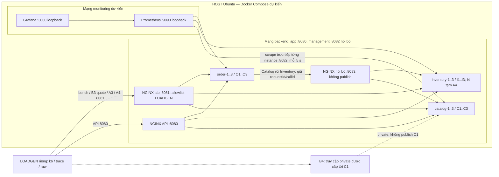

> **Vận hành v2 — chưa chạy D01:** ADMIN chọn D1–D14; năm worker thực hiện ngày được chọn, không tự chuyển ngày. Mọi task ban đầu chưa thực hiện. Code/test chạy trong workspace riêng trên Ubuntu HOST/LOADGEN; server tự Git/PR/merge theo CI và review AI, không chờ duyệt PR thông thường. Không áp ngưỡng CPU/RAM/disk để chặn bắt đầu; lỗi OOM/hết disk hoặc test thất bại vẫn phải báo thật. Các mục Windows/WSL, quyền duyệt và ngưỡng mở lab của mô hình cũ bên dưới được thay bởi hồ sơ này và AGENTS.md; số liệu, raw, RQ/API/protocol không được giả hoặc đổi để làm đẹp kết quả.

# KẾ HOẠCH END-TO-END NT533 — 2 TUẦN / 14 NGÀY

## Nghiên cứu và đánh giá các kỹ thuật cân bằng tải trong kiến trúc Microservices

**Đơn vị:** Trường Đại học Công nghệ Thông tin, ĐHQG-HCM (UIT).  
**Bản cập nhật:** 10/11/2026 — giữ kế hoạch **14 ngày liên tiếp, kể cả cuối tuần**; chốt đặc tả NT533-v1 tại mục 0A.  
**Tài liệu:** [Lý thuyết](02_CO_SO_LY_THUYET.md) · Bảng phân công Excel: `03_NT533_PCCV.xlsx` (tài liệu nội bộ, không nằm trong repo public).

> Ngày D1 là ngày nhóm bắt đầu thực tế. Excel tạm đặt D1 = **05/11/2026**, D14 = **18/11/2026**, không phải deadline do giảng viên xác nhận. Đổi ô `HUONG_DAN!B3` để đổi toàn bộ ngày trong workbook. Lịch D1–D14 trong Markdown không lệ thuộc ngày bắt đầu. Đây là kế hoạch, không phải xác nhận nhóm đã lập trình hoặc có kết quả benchmark.

## 0. Quyết định đã chốt cho thời hạn 2 tuần

1. Xây **3 Spring Boot service độc lập, mỗi service 3 replica**, Docker Compose, NGINX; so sánh RR, LC và IP Hash như đề tài ban đầu.
2. Bổ sung kỹ thuật nâng cao **Consistent Hash theo client-ID (CH-ID)**, dùng NGINX sẵn có, không tự viết scheduler. Đánh giá hai vấn đề: nhiều người dùng chung IP/NAT và mức đổi backend khi membership 3→4→3. Dùng Generic Hash cùng client-ID (GH-ID) làm đối chứng riêng cho phép đo remapping.
3. Bổ sung slow-backend và stop/start có timeline; thu tail latency, lỗi, phân bố tải và thời gian phục hồi. Không chỉ dựa vào số request trung bình.
4. Chốt **96 run hiệu năng chính**, **8 run xác nhận bổ sung** và **60 lượt quét mapping**; khoảng 10,7 giờ benchmark hiệu năng trước dự phòng. Chi tiết ở mục 6. Khối lượng này thay toàn bộ ma trận cũ.
5. **Không triển khai AWS, Kubernetes, HPA, UI, database ghi, auth đầy đủ hoặc thuật toán adaptive tự viết** trong 14 ngày. Giữ chúng ở hướng phát triển. Advanced nằm ở kỹ thuật hashing và phương pháp kiểm chứng, không ở số công cụ cài thêm.
6. D7 đóng tính năng; D8 khóa protocol; D12 đóng dữ liệu và báo cáo nháp; D13 tổng duyệt; D14 nộp và xử lý dự phòng. Không để “ngày cuối mới viết báo cáo”.

**Điều kiện khả thi:** mỗi người cần khoảng 35–40 giờ tập trung trong 14 ngày, đã có nền tảng Java/Git/Docker căn bản, ngoài thời gian máy chạy không cần trực liên tục. Nếu nguồn lực thực tế thấp hơn, giảm phạm vi theo mục 11 ngay D2, không âm thầm bỏ test hoặc dựng số liệu.

## 0A. Hồ sơ quyết định NT533-v1 — chốt ngày 10/11/2026

Phần này có cùng nội dung trong cả hai tài liệu và là đặc tả để triển khai. Các task “chốt/thiết kế/duyệt” trong PCCV được thực hiện bằng cách áp dụng, kiểm tra và lưu evidence cho các quyết định dưới đây, không mở lại việc lựa chọn từ đầu. **Đã chốt thiết kế không có nghĩa đã viết code, chạy thử, được giảng viên duyệt hoặc hoàn thành task trong Excel.** Nếu phần diễn giải cũ khác đặc tả này, sửa phần diễn giải theo đặc tả trước khi triển khai; không tự chọn một trong hai.

### Q01. RQ, giả thuyết và scope đã chốt

| RQ | Câu hỏi đã chốt | Phép đo/đối chứng |
|---|---|---|
| RQ1 | RR/LC/IPH khác nhau thế nào với backend đồng nhất và thời gian xử lý biến thiên? | B1 CPU-fixed, B2 Mixed-delay, cùng M/H; success RPS, p95/p99, lỗi, count và CPU |
| RQ2 | Một backend chậm hoặc dừng ảnh hưởng chất lượng và phục hồi thế nào? | A1/A2 so B2/M khỏe, cùng trace/block; timeline stop/start/ready |
| RQ3 | CH-ID có giảm tập trung do NAT và giữ affinity theo ID không, kể cả hot-client? | A3 uniform/hot-ID; RR/LC/IPH/CH-ID cùng một IP và trace |
| RQ4 | Bật consistent có giảm remapping khi membership 3→4→3 không? | A4 GH-ID so CH-ID cùng key, membership, endpoint identity |
| RQ5 | 1→3 replica và gọi xuyên dịch vụ thay đổi kết quả ở cùng tải thế nào? | B0 so B1; B3 quote; B4 chỉ diagnostic đường đi |

H1: RR đủ tốt với request đồng nhất. H2: LC có thể giảm tail khi connection bận phản ánh công việc tồn đọng. H3: ID tách client cùng NAT nhưng không chia được một hot key. H4: CH-ID có thể giảm remapping so GH-ID. Đây là giả thuyết cần kiểm chứng; không buộc dữ liệu phải ủng hộ.

**Trong scope:** Catalog, Inventory, Order; mỗi service ba replica; RR/LC/IPH core; CH-ID ở Inventory cho A3, GH-ID/CH-ID cho A4; A1 slow và A2 stop/start. **Ngoài scope:** AWS, Kubernetes/HPA, UI, database ghi, đặt hàng/thanh toán thật, auth production, cache/session store thật, retry ablation, circuit breaker và scheduler adaptive. Không thêm spike/soak vào ma trận chính.

**Ma trận cố định:** B0=6, B1=18, B2=18, B3=9, B4=3, A1=9, A2=9, A3=24 → **96 run chính + 8 xác nhận = 104 run hiệu năng**; A4 = 2 biến thể × 5 bộ khóa × 3 membership × 2 sweep = **60 sweep / 60.000 request**. Giữ nguyên 70 task, owner, effort và ngày trong Excel; không tự đánh dấu hoàn thành. Hai contrast xác nhận: LC–RR tại B2/H; CH-ID–IPH tại A3/uniform, thêm block 4–5 cho đúng hai phía để đạt n=5.

### Q02. API v1 và fixture đã chốt

HTTP/1.1, JSON UTF-8; không thêm `/v1` vào URL hiện có. Request quote bắt buộc `Content-Type: application/json`; kiểu khác → 415 `UNSUPPORTED_MEDIA_TYPE`. Mọi response nghiệp vụ/lab do ứng dụng tạo có `requestId` và `instanceId` ở top-level, kèm `X-Request-ID` và `X-Instance-ID` trùng body; không bọc thêm `data`. Health/Actuator giữ schema của nền tảng. Response nghiệp vụ không chứa timestamp để dễ so sánh fixture. Route không có → 404 `ROUTE_NOT_FOUND`; method không hỗ trợ → 405 `METHOD_NOT_ALLOWED` và header `Allow`.

| Endpoint | Input | Body 200 ngoài requestId/instanceId |
|---|---|---|
| `GET /api/catalog/products` | Không query, không phân trang | `{"products":[{"id":"P001","name":"Ban phim","price":100000,"currency":"VND"},{"id":"P002","name":"Chuot","price":250000,"currency":"VND"},{"id":"P003","name":"Cap USB","price":50000,"currency":"VND"}]}`; thứ tự ID tăng dần |
| `GET /api/catalog/products/{id}` | ID đúng regex `^P[0-9]{3}$` | `{"id":"P001","name":"Ban phim","price":100000,"currency":"VND"}` với ID P001 |
| `GET /api/inventory/{productId}` | Cùng quy tắc ID | `{"productId":"P001","availableStock":100}` với ID P001 |
| `POST /api/orders/quote` | Chính xác `{"productId":"P001","quantity":2}` | `{"productId":"P001","quantity":2,"unitPrice":100000,"totalPrice":200000,"currency":"VND","availableStock":100}` |

Fixture duy nhất: P001/100000 VND/tồn 100; P002/250000 VND/tồn 3; P003/50000 VND/tồn 0. Catalog giữ tên/giá, Inventory giữ tồn; commit fixture cùng source, mọi replica cùng checksum. Giá và tổng dùng số nguyên 64-bit theo đồng, không float; `totalPrice = unitPrice × quantity`. Không giảm tồn, không sinh orderId, không ghi đơn. Quote kiểm tra input → Catalog → Inventory tuần tự; dừng ngay khi một bước lỗi, không gọi tiếp và không retry ở bất kỳ tầng nào.

`quantity` là JSON integer 1–10, không nhận chuỗi, boolean hoặc 2.5; thiếu/null, trường thừa, query không được khai báo, JSON lỗi → 400 `INVALID_INPUT`. ID sai format → 400; ID đúng format nhưng không có fixture (P999) → 404 `PRODUCT_NOT_FOUND`. Tồn < quantity → 409 `INSUFFICIENT_STOCK`, kể cả P003. Catalog 404 được Order trả 404; Inventory 404 khi Catalog có sản phẩm là lỗi không nhất quán fixture → 502 `DOWNSTREAM_BAD_RESPONSE`.

Lỗi ứng dụng có đúng dạng `{"error":{"code":"INVALID_INPUT","message":"Invalid request"},"requestId":"<id>","instanceId":"O1"}`; instance thực tế tùy service. Message ngắn, không lộ stack trace/host. Connection refused hoặc downstream 5xx → 503 `DOWNSTREAM_UNAVAILABLE`; hết deadline → 504 `DOWNSTREAM_TIMEOUT`; body/schema sai hoặc status khác dự kiến → 502 `DOWNSTREAM_BAD_RESPONSE`; lỗi nội bộ chưa xử lý → 500 `INTERNAL_ERROR`. Nếu timeout tại NGINX trước khi app trả lời, giữ status/body proxy, đánh lỗi transport/proxy trong analyzer; không ép body đó thành JSON đúng nghiệp vụ.

RequestId public: NGINX tạo `$request_id`, ghi đè header ngoài. Ingress lab chỉ nhận `X-Request-ID` dạng 32 hex thường từ load generator đã cho phép, thiếu/sai → 400; chuyển nguyên ID này xuống app. B3 gọi `/api/orders/quote` trên listener lab 8081 (proxy giữ nguyên URI tới Order), vì vậy requestId trong trace được giữ; public listener vẫn tạo ID mới. Order dùng cùng requestId cho cả hai call; mỗi call thêm `X-Call-ID` bằng requestId + `-catalog` hoặc `-inventory`. NGINX nội bộ giữ requestId và callId từ Order, không tạo lại. Không dùng requestId làm Prometheus label. X-Instance-ID trả về quote là O1/O2/O3, không ghi đè bằng instance downstream.

Test contract bắt buộc: list đủ ba sản phẩm; P001×2 → 200/200000; P002×3 → 200/750000; P002×4 và P003×1 → 409; P999 → 404; ID sai/quantity 0,11,2.5,"2",null/trường thừa → 400; sai content-type → 415; giả lập từng lỗi downstream → đúng 502/503/504. Kiểm tra cả body, metadata và số lần gọi, không chỉ status.

### Q02-DMN. Thiết kế Catalog và fixture — D01-DMN

Phần này cụ thể hóa Q02, không đổi API v1. Đầu ra D01 là schema, fixture và ca nghiệm thu trong tài liệu; chưa có service hay response HTTP thực tế. Catalog sở hữu tên/giá; Inventory sở hữu tồn kho. P003 vẫn xuất hiện trong list và detail Catalog dù tồn bằng 0; chỉ quote kiểm tra đủ tồn theo Q02.

#### Schema Product

Product có đúng bốn trường bắt buộc dưới đây, không null, không trường thừa. `id` là khóa duy nhất, phân biệt hoa/thường, không trim hay tự đổi chữ hoa. `name` giữ nguyên tên fixture. `price` là số nguyên 64-bit không âm theo đồng (Java `long`), `currency` chỉ nhận `VND`. Khi nạp fixture phải từ chối chuỗi, boolean và token số thập phân/khoa học cho giá; JSON Schema `integer` tự nó chỉ kiểm tra giá trị nguyên về mặt toán học.

Schema này áp dụng cho Product trong fixture/list, chưa chứa metadata request. Response detail thêm `requestId`, `instanceId` cùng cấp với bốn trường Product; list thêm hai trường này cùng cấp với `products`, không thêm vào từng Product. Không thêm `availableStock`, `orderId` hoặc timestamp vào Product.

<!-- D01-DMN:product-schema -->
```json
{
  "$schema": "https://json-schema.org/draft/2020-12/schema",
  "title": "NT533-v1 Catalog Product",
  "type": "object",
  "required": [
    "id",
    "name",
    "price",
    "currency"
  ],
  "additionalProperties": false,
  "properties": {
    "id": {
      "type": "string",
      "pattern": "^P[0-9]{3}$"
    },
    "name": {
      "type": "string",
      "minLength": 1
    },
    "price": {
      "type": "integer",
      "minimum": 0,
      "maximum": 9223372036854775807
    },
    "currency": {
      "type": "string",
      "const": "VND"
    }
  }
}
```

#### Fixture Catalog duy nhất

Khối JSON sau là fixture thiết kế để đưa vào resource của Catalog khi triển khai service theo Q08. Chỉ có ba ID, không trùng, thứ tự tăng dần; list giữ thứ tự này, detail lấy cùng dữ liệu theo ID. Không tạo giá ngẫu nhiên, cache giá khác ở Order hoặc đưa tồn kho vào fixture Catalog.

<!-- D01-DMN:fixture -->
```json
{
  "products": [
    {"id": "P001", "name": "Ban phim", "price": 100000, "currency": "VND"},
    {"id": "P002", "name": "Chuot", "price": 250000, "currency": "VND"},
    {"id": "P003", "name": "Cap USB", "price": 50000, "currency": "VND"}
  ]
}
```

Đối chiếu Inventory theo Q02: P001/tồn 100, P002/tồn 3, P003/tồn 0. Quote tham chiếu cùng ID và giá: P001×2 = 200000 VND; P002×3 = 750000 VND; P002×4 và P003×1 trả 409. Giá lớn nhất của fixture nhân quantity tối đa 10 vẫn trong miền `long`. Những phép tính này là expected value, chưa phải kết quả gọi Order.

Fixture được đọc một lần khi khởi động, giữ bất biến; kiểm tra kiểu/miền, ID duy nhất, đủ đúng ba bản ghi và giá/tên/currency khớp Q02. Fixture sai làm readiness fail theo Q08, không bỏ qua bản ghi lỗi hay trả danh sách rỗng. Khi có source, commit fixture cùng source và đối chiếu SHA-256 byte file giữa C1–C3; khác checksum phải chặn chạy đo. SHA-256 khối JSON trong kiểm tra D01 dưới đây chỉ nhận diện fixture tài liệu (UTF-8/LF, có LF cuối), chưa chứng minh các replica đã dùng cùng file.

#### Ba ca nghiệm thu Catalog

Điều kiện chung cho kiểm thử HTTP sau này: fixture hợp lệ đã nạp, instance minh họa C1, requestId minh họa được ingress truyền xuống là `0123456789abcdef0123456789abcdef`; không query. Instance và requestId thực tế lấy từ môi trường/request đang kiểm, luôn đối chiếu body với header. Message 404 bên dưới là ví dụ thông báo ngắn; mã lỗi và cấu trúc theo Q02 là bắt buộc.

| Case | Ý nghĩa | Kỳ vọng |
|---|---|---|
| CAT-01 | ID P001 hợp lệ và có fixture | 200, đúng tên/giá/currency, không bọc `data` |
| CAT-02 | ID p001 sai định dạng (chữ thường) | 400 `INVALID_INPUT`, không tự sửa thành P001 |
| CAT-03 | ID P999 đúng định dạng nhưng không có fixture | 404 `PRODUCT_NOT_FOUND`, không nhầm với sai định dạng |

<!-- D01-DMN:cases -->
```json
[
  {
    "caseId": "CAT-01", "method": "GET", "path": "/api/catalog/products/P001",
    "expectedStatus": 200,
    "expectedBody": {"id":"P001","name":"Ban phim","price":100000,"currency":"VND","requestId":"0123456789abcdef0123456789abcdef","instanceId":"C1"},
    "expectedHeaders": {"X-Request-ID":"0123456789abcdef0123456789abcdef","X-Instance-ID":"C1"}
  },
  {
    "caseId": "CAT-02", "method": "GET", "path": "/api/catalog/products/p001",
    "expectedStatus": 400,
    "expectedBody": {"error":{"code":"INVALID_INPUT","message":"Invalid request"},"requestId":"0123456789abcdef0123456789abcdef","instanceId":"C1"},
    "expectedHeaders": {"X-Request-ID":"0123456789abcdef0123456789abcdef","X-Instance-ID":"C1"}
  },
  {
    "caseId": "CAT-03", "method": "GET", "path": "/api/catalog/products/P999",
    "expectedStatus": 404,
    "expectedBody": {"error":{"code":"PRODUCT_NOT_FOUND","message":"Product not found"},"requestId":"0123456789abcdef0123456789abcdef","instanceId":"C1"},
    "expectedHeaders": {"X-Request-ID":"0123456789abcdef0123456789abcdef","X-Instance-ID":"C1"}
  }
]
```

Khi triển khai còn phải kiểm tra list trả đủ ba Product/thứ tự, detail từng ID khớp list (kể cả P003), query thừa → 400, route lạ → 404, method sai → 405/`Allow`, header/body metadata, cùng fixture trên mọi replica theo Q02/Q10. Ba ca trên là bộ mô tả nghiệm thu D01, không thay toàn bộ contract test.

#### Kiểm tra thiết kế có thể chạy lại trên Ubuntu

Lệnh sau đọc và chạy khối Python `D01-DMN-CHECK` ngay trong tài liệu, chỉ đọc hai MD; không cần dependency ngoài Python 3 stdlib. Kiểm tra đồng bộ hai bản thiết kế, schema, fixture so với bảng API Q02, giá/tổng, ba ca kỳ vọng và 11 Product lỗi. Đây là kiểm tra dữ liệu thiết kế, không phải trình xác thực JSON Schema tổng quát hay kiểm thử HTTP.

```bash
python3 -c 'from pathlib import Path; t=Path("01_KE_HOACH_DO_AN.md").read_text(encoding="utf-8"); exec("# D01-DMN-CHECK" + t.split("```python\n# D01-DMN-CHECK",1)[1].split("```",1)[0])'
```

<!-- D01-DMN:check -->
```python
# D01-DMN-CHECK: kiểm tra thiết kế tài liệu, không gọi HTTP
import copy
import hashlib
import json
import re
from pathlib import Path

paths = ("01_KE_HOACH_DO_AN.md", "02_CO_SO_LY_THUYET.md")
docs = [Path(p).read_text(encoding="utf-8") for p in paths]
def section(text):
    return re.split(r"^### Q03\.", text.split("### Q02-DMN. ", 1)[1], maxsplit=1, flags=re.M)[0]
assert section(docs[0]) == section(docs[1]), "D01-DMN sections differ"
def block(text, label):
    pattern = r"<!-- D01-DMN:" + re.escape(label) + r" -->\n\x60{3}json\n(.*?)\n\x60{3}"
    match = re.search(pattern, text, re.S)
    assert match, label
    return match.group(1)
schema = json.loads(block(docs[0], "product-schema"))
fixture_text = block(docs[0], "fixture")
fixture = json.loads(fixture_text)
cases = json.loads(block(docs[0], "cases"))
fields = {"id", "name", "price", "currency"}
assert schema["$schema"] == "https://json-schema.org/draft/2020-12/schema"
assert schema["type"] == "object" and schema["additionalProperties"] is False
assert set(schema["required"]) == set(schema["properties"]) == fields
assert schema["properties"] == {
    "id": {"type": "string", "pattern": "^P[0-9]{3}$"},
    "name": {"type": "string", "minLength": 1},
    "price": {"type": "integer", "minimum": 0, "maximum": 9223372036854775807},
    "currency": {"type": "string", "const": "VND"},
}
# Bộ kiểm tra stdlib chỉ cho Product này, không phải engine JSON Schema tổng quát.
def product_ok(p):
    return (type(p) is dict and set(p) == fields
        and type(p["id"]) is str and re.fullmatch(r"P[0-9]{3}", p["id"]) is not None
        and type(p["name"]) is str and len(p["name"]) >= 1
        and type(p["price"]) is int and 0 <= p["price"] <= 9223372036854775807
        and p["currency"] == "VND")
expected = [
    {"id": "P001", "name": "Ban phim", "price": 100000, "currency": "VND"},
    {"id": "P002", "name": "Chuot", "price": 250000, "currency": "VND"},
    {"id": "P003", "name": "Cap USB", "price": 50000, "currency": "VND"},
]
assert set(fixture) == {"products"} and fixture["products"] == expected
assert all(product_ok(p) for p in fixture["products"])
ids = [p["id"] for p in fixture["products"]]
assert ids == sorted(set(ids)) and len(ids) == 3
for doc in docs:
    q02 = doc.split("### Q02.", 1)[1].split("### Q02-DMN.", 1)[0]
    row = next(line for line in q02.splitlines() if "| `GET /api/catalog/products` |" in line)
    assert json.loads(re.search(r"`(\{\"products\":.*?\})`", row).group(1)) == fixture
products = {p["id"]: p for p in fixture["products"]}
assert products["P001"]["price"] * 2 == 200000
assert products["P002"]["price"] * 3 == 750000
assert all(p["price"] * 10 <= 9223372036854775807 for p in products.values())
assert [c["caseId"] for c in cases] == ["CAT-01", "CAT-02", "CAT-03"]
assert [c["path"].rsplit("/", 1)[1] for c in cases] == ["P001", "p001", "P999"]
for c in cases:
    assert c["method"] == "GET" and c["path"].startswith("/api/catalog/products/")
    pid = c["path"].rsplit("/", 1)[1]
    status = 400 if re.fullmatch(r"P[0-9]{3}", pid) is None else (200 if pid in products else 404)
    assert c["expectedStatus"] == status
    body = c["expectedBody"]
    assert re.fullmatch(r"[0-9a-f]{32}", body["requestId"])
    assert body["instanceId"] == "C1"
    assert c["expectedHeaders"] == {"X-Request-ID": body["requestId"], "X-Instance-ID": body["instanceId"]}
    payload = {k: v for k, v in body.items() if k not in ("requestId", "instanceId")}
    if status == 200:
        assert payload == products[pid] and product_ok(payload)
    else:
        assert set(payload) == {"error"} and set(payload["error"]) == {"code", "message"}
        assert payload["error"]["code"] == {400: "INVALID_INPUT", 404: "PRODUCT_NOT_FOUND"}[status]
        assert type(payload["error"]["message"]) is str and payload["error"]["message"]
bad = []
for key, value in [("id", "p001"), ("id", "P001\n"), ("price", True),
                   ("price", "100000"), ("price", 100000.0), ("price", -1),
                   ("price", 9223372036854775808), ("name", ""), ("currency", "USD")]:
    item = copy.deepcopy(expected[0])
    item[key] = value
    bad.append(item)
bad.append({**expected[0], "availableStock": 100})
bad.append({k: v for k, v in expected[0].items() if k != "price"})
assert all(not product_ok(p) for p in bad)
print("OK: 2 documents; Product schema; 3 fixed products; Q02 parity; 3 Catalog cases; 11 invalid products rejected; quote arithmetic")
print("fixture-sha256 (UTF-8/LF + final LF): " + hashlib.sha256((fixture_text + "\n").encode("utf-8")).hexdigest())
```

#### Tiến độ D01-DMN và ghi chú cho cả ba MD

Đã hoàn thành sản phẩm thiết kế Catalog/fixture và ba ca mô tả nghiệm thu của D01-DMN trong workspace Ubuntu của task. Không có service để kiểm thử HTTP; không có benchmark, build Java hay triển khai ứng dụng trong phần việc này. Mã kiểm tra dùng Python 3.12.3 stdlib trên Linux qua vm_exec; không cài thêm công cụ.

Lần kiểm tra được ghi tự động từ kết quả lệnh chạy thật lúc 2026-11-17T07:45:34Z. Lệnh D01-DMN-CHECK được công bố ngay trên; stdout/stderr và exit code dưới đây là kiểm tra thiết kế, không phải response HTTP.

stdout:
~~~text
OK: 2 documents; Product schema; 3 fixed products; Q02 parity; 3 Catalog cases; 11 invalid products rejected; quote arithmetic
fixture-sha256 (UTF-8/LF + final LF): bd76926a87fd55258a567c248146ff215632ae323bd276fcc7a76eae227d850e
~~~

stderr:
~~~text
~~~

Exit code D01-DMN-CHECK: 0. Lệnh bổ sung: `git diff --check`; exit code: 0, stdout/stderr rỗng. Phần bổ sung dùng LF; nội dung gốc và khối tiến độ hệ thống được giữ nguyên.

Ghi chú để bộ điều phối cập nhật bằng chứng vào **cả ba MD** trước commit: `01_KE_HOACH_DO_AN.md` giữ schema/fixture/case và kết quả kiểm tra; `02_CO_SO_LY_THUYET.md` giữ bản thiết kế đồng bộ, giải thích fixture bất biến và ranh giới Catalog/Inventory; `AGENTS.md` ghi D01-DMN đã kiểm tra thiết kế đạt, chưa có bằng chứng HTTP/runtime/deploy. Worker chỉ sửa hai MD trong phạm vi task, không sửa thân AGENTS.md hay khối JSON hệ thống; bộ điều phối xác minh và hợp nhất phần tiến độ có cấu trúc. Đã trao đổi với TDN/TTN/HXN/DHN; TTN xác nhận tồn 100/3/0, TDN xử lý câu tóm tắt 400/404 trong task riêng.

Bàn giao tiếp theo trong pipeline của task hiện tại: bộ điều phối kiểm tra, cập nhật bằng chứng ba MD, commit/PR/review đúng HEAD/CI/merge tuần tự. Chưa có xác nhận các bước này hoàn tất. Không chuyển sang task/ngày mới.

#### Q02-TTN. Hợp đồng Inventory dùng cho triển khai D01-TTN

Phần này cụ thể hóa Q02, không thêm API ghi. Inventory chỉ sở hữu `productId` và `availableStock`; không gọi Catalog/Order, không reservation hoặc trừ tồn. `availableStock` là JSON integer không âm, đơn vị **sản phẩm**; không dùng chuỗi, float, phần trăm hoặc giá tiền. Fixture đọc một lần, bất biến và giống nhau trên mọi replica; fixture thiếu/sai kiểu/trùng ID làm readiness fail theo Q08.

| Request GET | HTTP / phần body nghiệp vụ ngoài metadata |
|---|---|
| `/api/inventory/P001` | 200 / `{"productId":"P001","availableStock":100}` |
| `/api/inventory/P002` | 200 / `{"productId":"P002","availableStock":3}` |
| `/api/inventory/P003` | 200 / `{"productId":"P003","availableStock":0}` |
| `/api/inventory/P999` | 404 / `PRODUCT_NOT_FOUND` |
| `/api/inventory/p001`, `/api/inventory/P01` | 400 / `INVALID_INPUT` |
| `/api/inventory/P001?quantity=1` | 400 / `INVALID_INPUT` (API không nhận query) |

GET tồn 0 vẫn là 200; **409 `INSUFFICIENT_STOCK` thuộc Order quote**, không thuộc GET Inventory. Thiếu segment `/api/inventory` là route không tồn tại: 404 `ROUTE_NOT_FOUND`. Method không hỗ trợ trả 405 `METHOD_NOT_ALLOWED` kèm `Allow` theo Q02; không tạo POST/PUT/DELETE cập nhật tồn. Metadata/error envelope, requestId public/lab và header giữ nguyên Q02.

Ví dụ đầy đủ (ID minh họa, không phải response đã chạy):

```json
{"productId":"P001","availableStock":100,"requestId":"0123456789abcdef0123456789abcdef","instanceId":"I1"}
```

Ví dụ có `X-Request-ID: 0123456789abcdef0123456789abcdef`, `X-Instance-ID: I1`; khi gọi replica khác, chỉ instanceId/header tương ứng thay đổi. D04-TTN phải kiểm cả schema/kiểu, ba fixture, lỗi 400/404/405, header khớp body và đọc lặp không đổi tồn. Lab Inventory giữ nguyên Q04: `mixed-delay` 20/200 ms, A1 I3 thêm 300 ms; `mapping` không delay; lab tắt thì route không tồn tại. Không đưa delay vào API tồn kho.

### Q03. Stack, topology, tài nguyên và config đã chốt

Chọn Spring MVC đồng bộ, Java 21, Maven Wrapper 3.9.9, Spring Boot 3.5.7; dùng BOM của Boot, không tự trộn phiên bản Spring. Image lab chọn NGINX OSS 1.28.3, k6 1.0.0, Prometheus 3.2.1, Grafana 11.6.0; analyzer Python 3.12 với stdlib, chart dùng matplotlib 3.10.1. Đây là baseline tái lập trong mạng cô lập, **không phải tuyên bố các bản này mới nhất/an toàn để đưa production**. Trước lần build phải rà advisory, nếu cần nâng patch thì cập nhật cả hai tài liệu và chạy smoke trước pilot; không đổi giữa các run chính thức. Java patch, OS/Docker/Compose thực tế và image digest chỉ được ghi từ lệnh trên HOST, không tự điền giá trị giả. `versions.lock` và manifest giữ version + digest; không dùng `latest`.

Nguồn phiên bản: [Boot 3.5.7](https://spring.io/blog/2025/10/23/spring-boot-3-5-7-available-now/), [Maven 3.9.9](https://maven.apache.org/docs/3.9.9/release-notes.html), [NGINX 1.28](https://nginx.org/en/CHANGES-1.28), [k6 1.0.0](https://github.com/grafana/k6/releases/tag/v1.0.0), [Prometheus 3.2.1](https://github.com/prometheus/prometheus/releases/tag/v3.2.1), [Grafana 11.6.0](https://github.com/grafana/grafana/releases/tag/v11.6.0), [matplotlib 3.10.1](https://pypi.org/project/matplotlib/3.10.1/). Phiên bản là lựa chọn thiết kế; chưa build/test tương thích trong lần sửa tài liệu này.

Topology cố định cho chiến dịch: một HOST chạy Docker Compose và một LOADGEN riêng cùng LAN; nếu không có máy riêng thì dùng LOADGEN chung host như phương án dự phòng đã chọn, ghi `topology=single-host` và giám sát client; không trộn hai topology trong một chiến dịch. HOST/LOADGEN là vai trò, Nhật điền địa chỉ từ kiểm kê, không giả định máy hiện tại đủ tài nguyên. Điều kiện mở lab v2: năm Codex ready, SSH xác thực thành công và công cụ cần thiết dùng được; không chặn theo CPU/RAM/disk. Giữ cấu hình replica/protocol; ghi lỗi thực thi thật nếu không chạy được.

Tên container `catalog-1..3`, `inventory-1..3`, `order-1..3`; instance `C1..3`, `I1..3`, `O1..3`; A4 thêm `inventory-4`/I4. Port app 8080, management 8082 chỉ nội bộ. Compose có mạng backend/monitoring; chỉ NGINX publish API 8080 và lab 8081 trên địa chỉ LAN được firewall giới hạn LOADGEN. Grafana 3000/Prometheus 9090 chỉ bind loopback; Actuator và backend không publish. B4 chạy qua quyền truy cập private tới C1, không mở C1 ra Internet. Order gọi listener NGINX nội bộ 8083; B3 không truyền IP giả xuống downstream.

Mỗi JVM: 0,5 CPU, 512 MiB, `-Xms256m -Xmx256m`, G1, 32 platform worker threads, accept-count 100, virtual threads off. NGINX: 1 CPU/256 MiB, 2 worker, worker_connections 4096; mọi upstream zone 64k, equal weight=1, keepalive 32, `max_fails=1 fail_timeout=5s`. Monitoring tổng 1 CPU/1 GiB; I4 cùng quota JVM. Đo không swap/OOM, không CPU contention bất thường; nếu footprint không đạt thì dừng preflight và sửa đồng đều trước pilot, không đổi quota riêng một thuật toán.

HTTP/1.1, cache off, `proxy_buffering off`, `proxy_next_upstream off`, connect 200 ms, send/read 3 s, client k6 timeout 5 s, keepalive bật đồng đều. Order: mỗi downstream connect ≤200 ms nằm trong call deadline tổng 1 s; toàn quote deadline 2,5 s, không chỉ dựa vào socket read timeout. Healthcheck readiness 5 s/lần, timeout 2 s, start-period 60 s, 3 retries; runner yêu cầu 3 lần ready liên tiếp trước warm-up, abort sau 120 s. Probe Compose không phải health-check chủ động của NGINX OSS; NGINX vẫn dùng passive failure handling.

#### D01-DHN — Bảng tài nguyên và sơ đồ mạng (17/11/2026)

**Trạng thái:** bảng quota và topology dưới đây là thiết kế theo Q03/Q04, chưa phải triển khai hay kiểm kê phần cứng đã đạt. Task chỉ sửa thân hai Markdown; giữ nguyên AGENTS.md, nội dung các thành viên và JSON tiến độ hệ thống. Không áp ngưỡng CPU/RAM/disk cũ để chặn bắt đầu v2.

**Máy được broker phân:** `get_lab` của task D01-DHN trả role `host`, workspace `/workspace`, HOST `10.70.197.121`, LOADGEN riêng `10.70.197.172`, `toolsReady.host/loadgen=true`. Đây là metadata phân máy, chưa chứng minh SSH/LAN, OS, cấu hình máy, Docker daemon hay năng lực phát tải. HXN đã xác nhận vai trò LOADGEN trong workspace riêng, chưa có receipt host-inspect thực.

| Hạng mục kiểm kê | HOST | LOADGEN | Bằng chứng / phần còn thiếu |
|---|---|---|---|
| Vai trò | Docker Compose, NGINX, backend, monitoring | k6, trace và thu raw ở máy riêng | Broker phân vai trò; topology dự kiến `two-host` |
| Địa chỉ broker cấp | `10.70.197.121` | `10.70.197.172` | Không biến thành cấu hình firewall/Real-IP trước khi xác minh peer thực |
| Ubuntu/OS/kernel/kiến trúc | Chưa kiểm kê host thực | Chưa kiểm kê host thực | Cần adapter read-only trên từng Ubuntu |
| CPU logic/quota, RAM tổng/available, swap | Chưa đo | Chưa đo | Không lấy CPU/RAM của container làm số đo host |
| Disk tổng/trống và filesystem vùng NT533 | Chưa đo | Chưa đo | Không dùng số đo từ đợt cũ |
| Docker Engine/server và Compose | Chưa xác minh | Chưa xác minh công cụ cần dùng | `toolsReady=true` không thay `docker version/info` và `docker compose version` |
| Java patch, image ID/digest, config hash | Chưa build/thu | k6 host chưa xác minh | Không tự điền digest hoặc gọi bản thiết kế là bản đã chạy |
| LAN route/source peer và cổng thực | Chưa xác minh | Chưa xác minh | Chưa xác nhận trust /32 hoặc rule firewall đã áp dụng |
| Năng lực phát tải | Chưa chạy backend | Chưa pilot CPU/RAM/VU/dropped | Chưa xác nhận N/R_ref/VU, G0/G2/G3 |

**Budget quota dự kiến (MiB, heap nằm trong RAM quota):**

| Thành phần | JVM | CPU | RAM MiB | Heap tối đa MiB |
|---|---:|---:|---:|---:|
| Catalog C1–C3 | 3 | 1,5 | 1.536 | 768 |
| Inventory I1–I3 | 3 | 1,5 | 1.536 | 768 |
| Order O1–O3 | 3 | 1,5 | 1.536 | 768 |
| Backend thường | 9 | 4,5 | 4.608 | 2.304 |
| NGINX | 0 | 1 | 256 | — |
| Prometheus + Grafana (budget chung) | 0 | 1 | 1.024 | — |
| Tổng HOST thường | 9 | 6,5 | 5.888 | 2.304 |
| I4 tạm, chỉ A4/profile `mapping` | 1 | 0,5 | 512 | 256 |
| Tổng HOST khi A4 có I4 | 10 | 7 | 6.400 | 2.560 |

Mỗi JVM giữ `-Xms256m -Xmx256m`, G1, 32 platform worker threads, accept-count 100, virtual threads off. Giới hạn 512 MiB phải chứa heap, metaspace, thread stack và native memory; không cộng heap lần nữa. Tổng quota chưa dự trù OS, page cache, Docker/overhead ngoài container, lưu raw và chi phí phát tải. Monitoring 1 CPU/1 GiB là budget chung; chưa có số đo footprint. Pilot phải quan sát OOM/swap/throttling/client contention thật; không giảm quota/replica riêng một thuật toán để làm test đạt. I4 chỉ vào membership A4 3→4→3, không thêm vào chín JVM thường.

**Sơ đồ mạng dự kiến, chưa phải bằng chứng network/container đã tạo:**



| Cổng / ranh giới | Quy tắc thiết kế cần kiểm chứng khi triển khai |
|---|---|
| HOST LAN 8080 / API | Chỉ NGINX publish; tạo requestId mới, ghi đè header ngoài; không route `/internal/bench` |
| HOST LAN 8081 / lab | Firewall giới hạn LOADGEN; Real-IP chỉ tin peer thực /32 sau kiểm kê, không tin 0.0.0.0/0; log cả peer/effective IP |
| Backend 8080, management 8082 | Không publish app/Actuator; scrape trực tiếp từng instance, không qua load balancer |
| NGINX 8083 | Chỉ Order gọi nội bộ; giữ requestId/callId; B3 không giả IP downstream |
| HOST 127.0.0.1:9090 / :3000 | Prometheus/Grafana chỉ bind loopback; không mở ra Internet |
| B4 → C1 | Chỉ đường private được cấp trong vùng NT533; không mở thêm cổng public hoặc đổi mạng/SSH |
| Header lab / ID | ID đúng regex không phải authentication; ngoài allowlist, thiếu/sai ID/requestId phải có negative smoke |

**Probe thực tế trong container task:** `python3 -c` kiểm PATH/socket và gọi `k6 version` trả exit 0, stderr rỗng; Python 3.12.3, cwd `/workspace`, không có `/var/run/docker.sock`. `docker version` và `docker compose version` không khởi chạy vì không tìm thấy executable (exit của tiến trình Docker không có, không phải daemon đã trả lỗi). `k6 version` trả `k6 v1.0.0 (commit/41b4984b75-dirty, go1.24.2, linux/amd64)`, exit 0, stderr rỗng. Đây chỉ là quan sát container, không xác nhận bản cài HOST/LOADGEN; không cài thêm hoặc tìm đường vượt sandbox.

**Đối chiếu sửa tiếp:** đầu phiên này `vm_read`, `git status --porcelain` và `git diff --stat` xác nhận checkout sạch ở base `c73d70eac79395d2bbf83821acbe31d592150381`, chưa có mục DHN của lượt trước. Khôi phục đúng mục D01-DHN trong hai MD, không reset/ours/theirs. `get_task` hiện trả 46 receipt cũ đến 08:00:26.250 UTC, gồm audit/CI/whitespace exit 0; nhận định cũ “chỉ đến 07:49 UTC” đã lỗi thời. Chưa thấy receipt mới của phiên sửa tiếp, nên không coi output mới trong phiên là bằng chứng broker đã lưu. Lượt trước từng lỗi mã hóa một dòng gốc (audit/CI exit 1), sau khôi phục riêng dòng từ HEAD đã đạt exit 0; lần này ghi chèn theo byte UTF-8/CRLF để bảo toàn phần gốc.

**Yêu cầu adapter và bàn giao cả ba MD:** máy chủ cần cung cấp job kiểm kê read-only trên HOST và LOADGEN thực, gồm OS/CPU/RAM/swap/disk, Docker client/server/Compose, Java/k6 và route/source peer; lưu argv/stdout/stderr/exit/job ID theo task. Nếu thiếu công cụ host, chuẩn bị qua adapter được quản lý, không sudo host từ container. Điều phối phải đối chiếu/lưu receipt mới, hợp nhất tiến độ D01-DHN vào AGENTS.md và hai MD trước commit, bảo toàn bằng chứng mọi worker. AGENTS.md nằm ngoài scope sửa thân của DHN; không tự ghi JSON hệ thống. Chưa chạy Compose/NGINX/chín JVM/I4/pilot, chưa xác nhận G0/G2/G3; chưa commit/push/PR/CI GitHub/merge/deploy. Chờ điều phối xác nhận pipeline, không chuyển task/ngày.

### Q04. Workload, trace và seed đã chốt

| Profile/endpoint lab | Hành vi chính xác | Input/output cần kiểm |
|---|---|---|
| `cpu-fixed`: `/bench/catalog` → Catalog `/internal/bench` | SHA-256 lặp N lần, digest vòng trước làm input vòng sau, input đầu UTF-8 `NT533-v1`; tính lại mỗi request, không cache/sleep | Query `profile=cpu-fixed`; body `profile,iterations,checksum,requestId,instanceId`; checksum khớp N |
| `mixed-delay`: `/bench/inventory` → Inventory `/internal/bench` | Query `delayClass=fast` ngủ 20 ms, `slow` ngủ 200 ms; trace chọn 80/20 | Query `profile=mixed-delay&delayClass=fast` hoặc `slow`; body `profile,delayClass,appliedDelayMs,requestId,instanceId` |
| `mapping`: cùng route Inventory | Không delay/CPU loop, không gọi downstream | Query `profile=mapping`; body `profile,requestId,instanceId` |
| `quote`: `/api/orders/quote` | P001, quantity=2; không thêm synthetic delay vào API nghiệp vụ | 200, totalPrice=200000, stock=100; profile quote ở trace, không phải query API |

Không nhận số delay/vòng lặp do client tự truyền. Profile ngoài allowlist hoặc query sai → 400; `/internal/bench` không được route qua API public, Spring profile lab tắt thì route không tồn tại. N áp dụng chung mọi Catalog, xác định bằng pilot theo Q05; Mixed-delay 20/200 ms là giá trị đã chọn, không chỉnh để tạo chiến thắng LC. A1: I3 thêm **300 ms** vào mọi request lab trước thời gian fast/slow, nên appliedDelayMs=320/500; I1/I2 giữ 20/200. B2/A2/A3 không có extra delay. Cleanup trả I3 về 0 ms extra.

Trace CSV UTF-8/LF: `request_index,request_id,client_id,effective_ip,profile,delay_class,product_id,quantity`. Index liên tục từ 0, dùng `scenario.iterationInTest`, không lấy VU ID; requestId = 32 hex đầu SHA-256 của `trace_id:request_index`. Seed block 1–5: **53301,53302,53303,53304,53305**; seed schedule=53300, bootstrap=53399, A4 keyset=**53401..53405**. Luồng độc lập: dùng Python `random.Random(seed)` cho client, `random.Random(seed+100000)` cho delay; schedule dùng seed riêng. Xuất toàn bộ trace trước khi chạy, đóng checksum; block lặp cùng trace trên mọi thuật toán.

A3 và B1/B2/A1/A2 dùng cùng bộ 1.000 client-ID/block: ID thứ j (0..999) là `c-` + 16 hex đầu SHA-256 của `seed:client:j`; trùng ID → abort generator. Uniform chọn `randrange(1000)`; hot-ID chọn ID 0 với xác suất 0,8, còn lại chọn đều 1..999, báo tỷ lệ thực tế từ trace. Delay chọn fast nếu RNG delay <0,8, không gắn fast/slow vào hot-ID. A4 dùng cùng cách sinh với seed 53401..53405, sắp ID tăng dần rồi sweep; keysets phải khác nhau.

IP giả lập cho client j: `10.(64 + j//256).(j%256).10`, tạo 1.000 prefix /24 khác nhau; A3 tất cả dùng `10.250.0.10`. NGINX lab dùng `real_ip_header X-Lab-Source-IP`, `real_ip_recursive off`, `set_real_ip_from` đúng peer LOADGEN thực tế /32 sau kiểm kê; firewall chặn nguồn khác, log cả `$realip_remote_addr` và `$remote_addr`. Không tin toàn mạng 0.0.0.0/0, không expose ingress này. A3/A4 bắt buộc ID regex `^c-[0-9a-f]{16}$` ở tất cả biến thể. B3 dùng IP thực từng hop; IPH downstream hash IP Order, không giả định hash IP người dùng. Trust Real-IP phải kiểm tra theo [module NGINX](https://nginx.org/en/docs/http/ngx_http_realip_module.html).

A4 rate **10 request/s**, concurrency tối đa 1, timeout 5 s; nếu không giữ được rate do lỗi/chậm thì snapshot invalid. Mỗi membership có 2 sweep đủ 1.000 ID, mapping giống nhau 100%; lỗi/schema sai/thiếu key → invalid và chạy lại cả snapshot với ID mới. Sau reload: backend ready, worker generation cũ thoát (tối đa 30 s), đóng connection client cũ/mở mới, smoke xác minh generation mới trước sweep; không đạt → abort. Traffic-weighted remap dùng weight từ trace hot-ID cùng seed keyset; lưu riêng weight CSV/checksum; không suy weight từ response thành công. So cả 3→4, 4→3 và 3 đầu→3 cuối; không ép tỷ lệ đổi bằng 25%.

### Q05. Pilot, SLO, lịch run và ngưỡng quyết định đã chốt

Các giá trị **được đo**, không phải quyết định tùy ý: N CPU, R_ref cho CPU/Mixed/Quote, số VU cần cấp, version/digest và host facts. Không điền số giả. Chốt quy tắc sau để người triển khai không phải tự chọn lại:

1. N CPU: bắt đầu 1.000 vòng, gấp đôi đến tối đa 1.024.000; warm-up 120 s và đo 100 request tuần tự trực tiếp C1, chọn N đầu tiên có median xử lý app ≥20 ms và ≤100 ms. Không tìm được → dừng hiệu chuẩn, ghi log, không đo chính thức. N giống nhau giữa replica/thuật toán.
2. RR/3 replica, từng profile riêng: rate 10,20,40,... tối đa 2.560 request/s; mỗi bước warm-up 120 s/đo 60 s, cooldown tối thiểu 60 s. `R_ref` là bước đầu vi phạm ít nhất một SLO trong 2 lượt cùng rate có client hợp lệ; bước trước phải đạt SLO. Nếu ngay 10 đã trượt, thêm bước 1,2,5; không có bước đạt, hoặc đến 2.560 chưa trượt → dừng pilot, ghi không tìm được điểm tham chiếu trong miền đã chốt, không tự tăng trần.
3. H=R_ref; M=max(1,floor(0,6×R_ref)). B0/B4 dùng rate CPU của B1; A1/A2/A3 dùng M Mixed của B2; B3 dùng M Quote riêng. Không chọn rate riêng theo thuật toán. Cấp trước `ceil(rate×5×1,2)` VU, maxVUs bằng preAllocatedVUs; smoke/pilot phải chứng minh LOADGEN đủ RAM/CPU. Không đủ → đổi máy phát tải trước chiến dịch, không hạ offered load chỉ cho một thuật toán.
4. **SLO cố định:** direct p95 wall-clock thành công <500 ms, quote <1.000 ms, error <1%. Validity: actual sent ≥99% target, dropped=0, đủ raw/trace/config/membership và cùng input, HTTP 200 không sai fixture/schema. Overload/timeouts/HTTP lỗi do backend là kết quả performance, không invalid; sai body 200 do bug implementation là lỗi contract phải sửa và chạy lại toàn bộ cell bị ảnh hưởng, giữ raw cũ. Không hạ SLO theo pilot.
5. Run thường warm-up 120 s, đo 180 s, drain tối đa 5 s, cooldown ≥60 s. A2 đo 300 s; stop I3 tại t=90 s bằng stop timeout 0, start cùng container t=150 s; log thời điểm lệnh/exit và ready thực, không reload config trong run. Nếu warm-up chưa ổn (hai cửa sổ 30 s cuối có success RPS lệch >5% hoặc p95 lệch >10%), tăng warm-up đồng đều lên 300 s và chạy lại pilot; vẫn không ổn → dừng G3. Cập nhật ngân sách nếu tăng, không cắt đoạn dữ liệu bằng mắt.
6. Giữ pairing theo block: B2/M → A1 → A2 cùng algorithm/seed, reset giữa run; các thuật toán trong block đảo thứ tự bằng seed schedule. Các case khác đảo thứ tự thuật toán trong từng cell/block; ghi toàn bộ `schedule.csv` trước khi xem kết quả. D9 chạy B0–B4 (54); D10 A1/A3 và 8 xác nhận (41); D11 A2 (9) và A4 (60 sweep); không chạy chồng host. Máy dự trù 18–20 giờ, 642 phút hiệu năng chưa cộng drain; riêng mapping 60.000/10=100 phút chưa tính setup. Nếu phải tăng warm-up, công bố ngân sách mới trước chạy.
7. Khác biệt thực tiễn: ≥10% giảm p95 hoặc tăng success RPS, **error candidate không lớn hơn baseline**, không đánh đổi đạt SLO thành trượt SLO. n=3: từng run, median/min–max, chỉ kết luận thăm dò. n=5: paired bootstrap 10.000 resample nguyên block, seed 53399, thống kê mean chênh lệch cặp và CI 95% percentile; CI chứa 0 → chưa đủ bằng chứng chiều cải thiện. Không dùng p-value/kiểm định hàng loạt và không gọi “tương đương” vì CI rộng.
8. Recovery A2: mức trước fault = success RPS trong [30,90) s; xét cửa sổ 10 s không chồng, neo tại t=90 s. Đầu của 3 cửa sổ liên tiếp có error <1%, p95 <500 ms, success RPS ≥95% mức trước fault là mốc phục hồi; mỗi cửa sổ ≥100 successful samples, không đủ → N/A. Báo khoảng từ stop thực và ready thực; nếu mốc phục hồi trước ready, ghi đã phục hồi khi I3 còn down và khoảng từ ready là N/A. Không đạt trước t=300 → chưa phục hồi trong thời gian quan sát.

### Q06. Metric, dữ liệu và kiểm thử đã chốt

Latency chính = wall-clock từ ngay trước `http.get/post` đến khi nhận xong hoặc timeout, đơn vị ms; giữ riêng k6 http_req_duration để diagnostic. p50/p95/p99 analyzer dùng nearest-rank `sorted[ceil(p×n)-1]`, n=0 → N/A. Báo latency successful riêng all-completed; timeout là lỗi, không âm thầm bỏ mẫu. p99 với <1.000 successful samples gắn cờ ít mẫu; không dùng để xếp hạng. Success=HTTP/body đúng contract. Throughput theo completion-window; latency/error theo request bắt đầu trong measurement-window và kết thúc đến drain; lưu rõ hai population, pending cuối drain làm run invalid do thiếu dữ liệu.

Scrape trực tiếp từng instance **5 s**, retention **15 ngày**. Custom counter `nt533_requests_total{service,instance,route,status,profile}`, timer `nt533_request_duration_seconds` (count/sum/buckets), timer downstream `nt533_downstream_duration_seconds{service,instance,target,status}`; bucket giây `[0.005,0.01,0.02,0.05,0.1,0.2,0.5,1,2,5]`. Route là template (`/api/inventory/{productId}`), không ID thật. Không gắn requestId/clientId/runId vào metric; phase/algorithm/run được ghép theo manifest và timestamp, không tạo series mới mỗi request. JSONL log: `timestamp_utc,request_id,call_id,service,instance_id,route,profile,status,duration_ms`; NGINX thêm `peer_ip,effective_ip,upstream_addr,upstream_status,request_time_s,upstream_response_time_s,config_generation`. Request không thuộc downstream dùng call_id=null. Health/scrape không tính vào count nghiệp vụ.

Mỗi `results/<run_id>/` có `manifest.json,trace.csv,k6-raw.json,requests.jsonl,nginx.jsonl,app.jsonl,metrics/,events.jsonl,stdout.txt,stderr.txt,exit-code.txt,summary.json,SHA256SUMS`. Run ID: `<scenario>-<condition>-<algorithm>-b<block>-<UTC>-a<attempt>`. Rerun ID mới, manifest `supersedes` trỏ bản lỗi; không ghi đè. Manifest có schema_version=1, scenario/algorithm/condition/repeat/block_id, các seed/trace_sha256, commit/image_digests/config_sha256, host_spec/limits/topology, N/delay, target/actual rate/VU, ip_mode/key_mode, window/retry/fault, status và invalid_reason. Mapping CSV giữ schema `seed,variant,membership,sweep,client_id,instance_id,status,config_hash`; summary chứa sent/completed/success/errors/dropped/RPS/percentiles/per_instance_counts/CV/Jain/validity và sample counts. Chưa có dữ liệu → null/N/A, không thay bằng 0 thành công.

Count vector luôn chứa đủ instance membership kể cả 0; all-zero CV/Jain=N/A. Analyzer phải assert `[100,100,100]` → Jain=1, `[300,0,0]` → Jain=1/3, missing-map invalid, remap 1/4=25%, weighted 80/100=80%; test timeout/error dedup, start/completion boundary, ID/profile validation, percentile n=0/1 và retry-list parser. CI: build/unit từng service; quote contract/integration; `docker compose config`, `nginx -t` cho 5 biến thể; analyzer asserts; không chạy 104 benchmark trong CI. Mọi lệnh có stdout/stderr/exit code, không chỉ ảnh dashboard.

#### Q06-TTN. Từ điển nhãn, đơn vị và ranh giới đo D01-TTN

Schema dưới đây áp dụng cho **custom metric** Q06 ở cả ba service. Tên/giá trị nhãn phân biệt hoa thường; không lấy nhãn trực tiếp từ path, query hoặc header chưa kiểm tra. Đây là đặc tả triển khai, chưa phải bằng chứng endpoint Prometheus đã hoạt động.

| Nhãn | Giá trị/quy tắc thống nhất |
|---|---|
| `service` | `catalog`, `inventory`, `order` (tên logic, chữ thường) |
| `instance` | Catalog `C1,C2,C3`; Inventory `I1,I2,I3`, chỉ A4 thêm `I4`; Order `O1,O2,O3`. Khớp `INSTANCE_ID`, body `instanceId`, header `X-Instance-ID` và log `instance_id`; không dùng container ID/IP/port làm định danh này |
| `route` | Catalog: `/api/catalog/products`, `/api/catalog/products/{id}`; Inventory: `/api/inventory/{productId}`; Order: `/api/orders/quote`; lab ở app: `/internal/bench`. Không match route → `unknown`; lỗi 405 dùng template nếu xác định được |
| `status` của request app | Chuỗi HTTP thực tế ba chữ số, ví dụ `200`, `400`, `404`, `409`, `500`; không gom thành `2xx`, không dùng mã nghiệp vụ. Nếu xử lý bị hủy và không có response HTTP xác định: `aborted`, không giả `200`/`499`; log status=null |
| `profile` | Lab hợp lệ: `cpu-fixed`, `mixed-delay`, `mapping`; route quote: `quote`; API nghiệp vụ khác: `none`; lab thiếu/sai profile: `unknown`. Không đưa `delayClass` hoặc chuỗi profile lạ thành series mới |
| `target` của downstream | Chỉ `catalog` hoặc `inventory`, emitter là `service=order`, `instance=O1/O2/O3`; không dùng URL/instance đích |
| `status` của downstream | HTTP ba chữ số nếu đã nhận response; trước khi nhận HTTP, deadline hết → `timeout`, lỗi kết nối/I/O → `io_error`. HTTP 200 sai body vẫn có nhãn `200`; Order trả 502 và log cho biết lỗi contract, không đổi status downstream thành 502 |

`nt533_requests_total` là Counter tăng một lần cho mỗi request nghiệp vụ/lab kết thúc ở app, kể cả lỗi; không đếm health/Actuator/scrape. `nt533_request_duration_seconds` là Timer có **cùng năm nhãn** `service,instance,route,status,profile`; mỗi request được count có đúng một timer observation. Đo bằng monotonic clock từ lúc vào application filter đến khi xử lý response hoàn tất/lỗi/hủy; gồm xử lý, delay và downstream ở Order, không gồm hàng chờ trước filter hoặc toàn bộ mạng tới client. Tránh double-count giữa filter, controller và exception handler.

`nt533_downstream_duration_seconds{service,instance,target,status}` đo từng call thực sự được Order phát: bắt đầu trước gửi HTTP, kết thúc khi đọc/kiểm body xong hoặc lỗi/deadline và cancel; không ghi observation cho call chưa phát do bước trước lỗi. Quote thành công tạo 1 request Order + 1 Catalog + 1 Inventory và 2 downstream observations; không cộng chúng thành 3 client request. Quote lỗi input có 0 downstream; Catalog lỗi thì không gọi Inventory. Không retry theo Q02.

Prometheus exposition của mỗi Timer gồm `_seconds_count` (số observation), `_seconds_sum` (tổng giây), `_seconds_bucket{le="..."}` (count tích lũy). Bucket hữu hạn giữ đúng Q06: `[0.005,0.01,0.02,0.05,0.1,0.2,0.5,1,2,5]` giây; thêm bucket `+Inf` bằng count, không cộng các bucket tích lũy để tính số request. Không thêm counter trùng timer-count để cộng lần nữa; `nt533_requests_total` và timer-count dùng đối soát. Histogram phục vụ diagnostic; p95/p99 chính vẫn từ raw client theo Q06.

Scrape trực tiếp từng app trên management 8082 nội bộ, mỗi 5 s, retention 15 ngày; không scrape qua NGINX. App xuất common tags `service/instance`; scrape app dùng `honor_labels: true` để giữ `instance=I1` thay vì nhãn mặc định `host:port`. Khi triển khai phải kiểm series sau ingestion không bị đổi thành `exported_instance` và mỗi series thuộc đúng replica; `job` là nhãn scrape, `le` là nhãn histogram, không thay nhãn nghiệp vụ. Chỉ dùng exporter nội bộ tin cậy theo Q03.

| Đại lượng | Đơn vị lưu / diễn giải |
|---|---|
| Counter, timer-count, bucket | Request/call/observation (số đếm không âm); counter reset khi restart, dùng delta có xử lý reset, không coi mất scrape là count 0 |
| App/downstream Timer, NGINX `request_time_s,upstream_response_time_s` | Giây; upstream thiếu thời gian là null, không thay bằng 0 |
| Client wall latency, app log `duration_ms`, `appliedDelayMs` | Mili giây; đổi s→ms nhân 1000 đúng một lần, không lấy app timer làm latency client |
| Throughput | Request thành công/giây theo completion-window Q06; `rate(counter)` chỉ là tốc độ phía app, chưa kiểm body hoặc client timeout |
| CPU / RAM / GC | CPU cumulative = core-second, tốc độ = core (hiển thị 100% = 1 core, ghi quota riêng); RAM/heap = byte (MiB = byte/1048576); GC pause = giây, GC count = lần |
| `timestamp_utc` / tỷ lệ | Timestamp UTC ISO-8601 có `Z`; elapsed dùng monotonic. Error/CV/Jain/affinity/remap lưu ratio không đơn vị, nhân 100 khi trình bày % |

Không thêm requestId/clientId/productId/runId/algorithm/phase vào labels; đối chiếu log/trace/manifest theo Q06. Phân biệt **HTTP status** với kết quả contract: 200 sai body hoặc client timeout sau khi app trả 200 vẫn là client error. Dashboard histogram/counter không thay raw và không chứng minh run hợp lệ.

**Checklist triển khai D04/D06 (chưa chạy ở D01):** scrape cả C/I/O và I4 chỉ A4; gọi hai productId vẫn cùng route template; lỗi profile lạ không tạo nhãn mới; health/scrape không tăng custom counter; delta counter = timer-count (kể cả lỗi/hủy), bucket đơn điệu và +Inf=count; quote fan-out đúng số call; kiểm reset/mất scrape và đổi đơn vị. Đây là điểm giao Inventory/Order, scrape của DHN và analyzer của HXN.

### Q07. Ownership, nghiệm thu và thay đổi sau chốt

| Nhóm quyết định / task PCCV liên quan | Owner / reviewer | Đầu ra đã xác định |
|---|---|---|
| Q01–Q02: D01-TDN, D02-TDN, D03-TDN, D04-TDN | Trương Danh Nhân / Đào Mạnh Nhân | API v1 ở đây; code/contract tests phải bám đặc tả, không còn API v0/nháp để lựa chọn |
| Fixture/CPU: D01-DMN, D04-DMN, D05-DMN, D08-DMN | Đào Mạnh Nhân / Trần Thanh Nguyên | Fixture và thuật toán CPU theo Q02/Q04; N được đo theo Q05 |
| Inventory/metric: D01-TTN, D04-TTN, D06-TTN, D08-TTN | Trần Thanh Nguyên / Đào Hồng Nhật | Delay/metric theo Q04/Q06; readiness và tài nguyên phải có evidence |
| Host/config/fault: D01-DHN, D05-DHN, D06-DHN, D08-DHN | Đào Hồng Nhật / Trương Danh Nhân | Topology/quota/trust theo Q03/Q04, ghi HOST/digest thực; A1=+300 ms, A2=90/150 s |
| Matrix/trace/runner: D01-HXN, D04-HXN, D05-HXN, D06-HXN, D08-HXN | Huỳnh Xuân Nin / Trần Thanh Nguyên | Matrix/seed/schema/schedule theo Q01/Q04–Q06; pilot chỉ điền giá trị đo |
| D07-TDN/D08-TDN, D11-HXN/D12-HXN, D14-TDN | Owner theo PCCV / reviewer theo PCCV | G2 kiểm tra tính năng, G3 kiểm tra protocol đã chốt; G4 khóa raw, G5 báo cáo, G7 bàn giao |

Họp **21:00–21:15 Asia/Ho_Chi_Minh** mỗi ngày, deadline task **22:00** ngày D tương ứng. D1–D14 vẫn là ngày tương đối; lịch 05–18/11/2026 trong workbook chỉ là mốc kế hoạch hiện có, không xác nhận ngày bắt đầu thật hoặc hạn nộp chính thức. Không tự dời lịch vì ngày sửa tài liệu. G0 cần chứng cứ host và phản hồi giảng viên nếu môn học yêu cầu; tài liệu này không thay chữ ký của người khác.

G0: scope/RQ/API đã có trong hồ sơ này, còn xác minh nguồn lực. G1: quote và lỗi đúng contract. G2: 9 replica + 5 biến thể/smoke/test đạt. G3: áp dụng SLO/seed/matrix đã chọn, thêm N/R_ref/VU và lock hashes từ pilot hợp lệ. G4: 104 run hợp lệ và 60 sweep, hoặc bảng thiếu/lý do công khai. G5: báo cáo bảy chương và H1–H6 có raw/run ID. G6: fresh-clone do người khác làm. G7: source tag `nt533-v1`, report PDF, slide PDF/PPTX, video MP4, raw archive/checksum, runbook và PCCV có evidence. Không đánh dấu code/benchmark hoàn tất chỉ vì đã viết đặc tả.

Nếu trễ, thứ tự cắt đã chọn: bỏ B0 trước (96→90 chính, 98 tổng hiệu năng); nếu vẫn không đủ, A4 giảm 5→3 bộ seed đầu (60→36 sweep, 36.000 request). Không cắt B3 xuống nữa vì chỉ còn một mức M. Không cắt thuật toán core, lặp/cell, validation hay raw. Chỉ kích hoạt trước run đầu của chiến dịch, nhóm trưởng ghi lý do và reviewer xác nhận; cập nhật đồng thời hai Markdown và workbook, tổng/claim tương ứng. **Bản hiện tại chưa kích hoạt cắt: vẫn 96+8 và 60 sweep.** Nếu đã chạy thì giữ nguyên dữ liệu, công bố thiếu thay vì đổi protocol hậu nghiệm.

Quyết định v1 không thay đổi bằng trao đổi miệng: PR nêu quyết định cũ/mới/lý do/case bị ảnh hưởng, owner và reviewer theo bảng; cập nhật cả hai Markdown. Đổi scope/matrix/effort/lịch phải cập nhật workbook trước khi chạy tiếp; đổi code/config/profile/SLO làm mất so sánh thì tạo protocol_version mới và chạy lại các cell bị ảnh hưởng, không gộp dữ liệu khác version. Raw lưu bất biến, backup sang thiết bị/thư mục lưu trữ thứ hai kèm SHA-256 trước khi cleanup; không commit secret, không xóa archive chưa bàn giao.

**Còn phải thực hiện, không phải còn phải tự lựa chọn:** kiểm kê HOST/LOADGEN, rà advisory/build/smoke, đo N/R_ref/VU, thu digest/hash thực, thực nghiệm, phản hồi giảng viên, bàn giao. Mỗi giá trị cần đo đã có owner, quy tắc và cổng chặn ở trên. Không có số liệu hiệu năng thật trong lần chốt tài liệu này.

### Q08. Từ số 0: môi trường, repository và quy ước source

**Môi trường v2:** HOST và LOADGEN là hai VM Ubuntu 24.04 riêng. Docker Engine/Compose chạy trên Ubuntu, không dùng Docker Desktop/WSL trên Windows cho thực thi đồ án. ADMIN nhập IP/user/password trên web và xác minh fingerprint. Windows giữ vai trò điều phối/Git/Codex client, không tự cài hoặc đổi cấu hình hệ điều hành Windows. Mỗi task có workspace Ubuntu riêng; bootstrap kiểm kê và dùng lại dependency phù hợp trước khi cài phần thiếu.

**Môi trường v2:** HOST và LOADGEN là hai VM Ubuntu 24.04 riêng. Docker Engine/Compose chạy trên Ubuntu, không dùng Docker Desktop/WSL trên Windows cho thực thi đồ án. ADMIN nhập IP/user/password trên web và xác minh fingerprint. Windows giữ vai trò điều phối/Git/Codex client, không tự cài hoặc đổi cấu hình hệ điều hành Windows. Mỗi task có workspace Ubuntu riêng; bootstrap kiểm kê và dùng lại dependency phù hợp trước khi cài phần thiếu.

**Môi trường v2:** HOST và LOADGEN là hai VM Ubuntu 24.04 riêng. Docker Engine/Compose chạy trên Ubuntu, không dùng Docker Desktop/WSL trên Windows cho thực thi đồ án. ADMIN nhập IP/user/password trên web và xác minh fingerprint. Windows giữ vai trò điều phối/Git/Codex client, không tự cài hoặc đổi cấu hình hệ điều hành Windows. Mỗi task có workspace Ubuntu riêng; bootstrap kiểm kê và dùng lại dependency phù hợp trước khi cài phần thiếu.

```text
NT533-DoAn/
  README.md                          # lệnh theo Q09, yêu cầu máy, giới hạn thực nghiệm
  .gitignore                         # .env, .venv, target/, raw results, runtime, release, key
  .gitattributes                     # source/config/scripts UTF-8 LF, *.sh text eol=lf
  .env.example                       # chỉ tên biến và giá trị lab không nhạy cảm
  versions.lock                      # version/image ID/digest thật sau build
  services/catalog/                  # pom.xml, mvnw, .mvn/, Dockerfile, src/main, src/test
  services/inventory/                # cùng cấu trúc, build/image riêng
  services/order/                    # cùng cấu trúc, build/image riêng
  infra/compose/compose.yaml          # project name nt533, services/limits/health/networks
  infra/nginx/nginx.conf              # cấu hình khung; include runtime/http.conf trong http
  infra/nginx/templates/              # common + rr/lc/iph/ch-id/gh-id, không copy trôi default
  infra/runtime/                      # file sinh ra, không commit; mount directory read-only
  observability/prometheus.yml
  observability/grafana/              # provision datasource + dashboard JSON đã export
  load-tests/main.js                  # k6, đọc trace theo iterationInTest, validate body
  load-tests/trace.py                 # sinh trace CSV/checksum theo Q04, stdlib
  experiments/matrix.csv              # toàn bộ cell/count/condition Q01, không tính tay lại
  experiments/run.py                  # runner CLI stdlib, gọi docker/ssh/scp/k6 bằng argv
  experiments/protocol.json           # version, giá trị pilot, seed, thời gian, SLO, topology
  experiments/schedule.csv            # thứ tự cố định, block, run ID/trace trước chạy
  analysis/analyze.py                 # audit → summary → tables/charts, không sửa raw
  analysis/tests/                     # unittest + tiny raw/mapping fixtures
  analysis/requirements.txt           # matplotlib==3.10.1, khóa dependency resolve trong lock
  docs/                              # bản chụp hai Markdown, API, kiến trúc, runbook, report
  results/                           # raw/manifest bất biến, không commit raw lớn
  release/                           # bộ nộp sinh ở Q15, không commit bản nén
  .github/workflows/ci.yml
```

Mỗi service dùng package `vn.edu.uit.nt533.<catalog|inventory|order>`; Maven groupId `vn.edu.uit.nt533`, artifactId `catalog-service`, `inventory-service`, `order-service`, version `1.0.0`. Dependencies chỉ Spring Boot web/validation/actuator, Micrometer Prometheus, Boot test (JUnit/Mockito từ BOM); không JPA/H2/Lombok/Spring Cloud/OpenFeign. DTO dùng Java record; fixture JSON đọc một lần lúc khởi động, bất biến, lỗi fixture làm readiness fail. Catalog/Inventory: Application, Controller, FixtureStore, BenchController; Order thêm QuoteService và DownstreamClient; mỗi service có local exception handler và request metadata filter, không tạo framework chung.

Order dùng một Java HttpClient dùng lại, HTTP/1.1/connect 200 ms; gửi từng call bằng sendAsync + BodyHandlers.ofString, chờ Future tối đa min(1 s, ngân sách quote còn lại), timeout thì cancel future và trả mã Q02. Quote vẫn là xử lý tuần tự đồng bộ ở MVC, không thêm fan-out song song. Jackson reject unknown fields, float→integer coercion và string/boolean→quantity; kiểm tra JSON type trước binding nếu cấu hình mapper chưa đủ, test các case Q02. Lab chỉ nhận profile/extra delay trong allowlist; không nhận arbitrary URL/file/command từ request.

`.env` local chỉ chứa `HOST_IP,LOADGEN_IP,LOADGEN_USER,REMOTE_ADDR,BACKUP_DIR`; `REMOTE_ADDR` là Git remote thật. Chọn địa chỉ sau kiểm kê, không hard-code account/IP của người khác. `.env.example` dùng slot `HOST`, `LOADGEN`, `USER`, `BACKUP`; runner từ chối slot chưa thay. Các biến workload/rate/SLO/seed không nằm trong `.env`, lấy từ protocol đã khóa để tránh sửa ngoài kiểm soát. Image local gắn `<service>:<git-short-sha>`; ghi cả `.Id` và RepoDigest nếu có, vì image build local có thể chưa có RepoDigest. Maven Wrapper/dependency lock và digest là evidence build, không bịa chúng trong tài liệu.

### Q09. Chuỗi dựng và vận hành end-to-end đã chốt

**Các lệnh dưới đây là giao diện triển khai đã chốt, không phải lệnh đã được chạy trong lần sửa Markdown.** `experiments/run.py`, `analysis/analyze.py` và source chưa tồn tại trong workspace hiện tại; owner phải tạo chúng theo hợp đồng bên dưới trước khi dùng. Không báo build/smoke/benchmark thành công chỉ vì có các dòng lệnh này.

**Môi trường v2:** HOST và LOADGEN là hai VM Ubuntu 24.04 riêng. Docker Engine/Compose chạy trên Ubuntu, không dùng Docker Desktop/WSL trên Windows cho thực thi đồ án. ADMIN nhập IP/user/password trên web và xác minh fingerprint. Windows giữ vai trò điều phối/Git/Codex client, không tự cài hoặc đổi cấu hình hệ điều hành Windows. Mỗi task có workspace Ubuntu riêng; bootstrap kiểm kê và dùng lại dependency phù hợp trước khi cài phần thiếu.

**Môi trường v2:** HOST và LOADGEN là hai VM Ubuntu 24.04 riêng. Docker Engine/Compose chạy trên Ubuntu, không dùng Docker Desktop/WSL trên Windows cho thực thi đồ án. ADMIN nhập IP/user/password trên web và xác minh fingerprint. Windows giữ vai trò điều phối/Git/Codex client, không tự cài hoặc đổi cấu hình hệ điều hành Windows. Mỗi task có workspace Ubuntu riêng; bootstrap kiểm kê và dùng lại dependency phù hợp trước khi cài phần thiếu.

`run.py` có đúng các subcommand nêu trên: config, smoke, pilot, plan, preflight, run, rerun, backup, reproduce, close; không thêm GUI/daemon. Exit 0=thao tác kỹ thuật hoàn tất và raw/audit hợp lệ, **không có nghĩa SLO đạt**; exit 2=preflight/input/schema/đủ tải không hợp lệ; exit 3=process/SSH/Docker/thu thập lỗi; Ctrl-C giữ raw và chạy finally. Giữ nguyên exit code child trong manifest (kể cả k6 threshold fail) và phân biệt performance fail với runner failure. Mọi subcommand ghi command/UTC/stdout/stderr/exit/evidence path; đường dẫn RUN_ID không được chứa `..` hoặc separator.

### Q10. Bộ test, CI và điều kiện dừng đã chốt

| Lớp kiểm tra | Case bắt buộc | Owner / bằng chứng đạt |
|---|---|---|
| Catalog | fixture đúng ba ID/giá/thứ tự; unknown/invalid ID; query/method lỗi; checksum CPU cùng N | Mạnh Nhân / JUnit XML và command log |
| Inventory | tồn 100/3/0; 20/200 và extra 300; mapping không sleep; reject profile lạ | Nguyên / JUnit và timer test có tolerance, không assert sleep đúng tuyệt đối từng ms |
| Order | toàn bộ case Q02; số call chính xác; Catalog fail không gọi Inventory; timeout cancel; ID/Call-ID xuyên hop; không retry | Nhân trưởng / JUnit + local fake HTTP server, không thêm mocking proxy dependency |
| Proxy/replica | nginx -t cả 5 variant; đúng route/body; C/I/O đúng service; đủ 9 instance; LC có concurrency | Nhật / smoke JSONL + config hash + inventory container/IP |
| Trust boundary | ngoài allowlist bị chặn; thiếu/sai lab ID/requestId; giả header public bị ghi đè; Actuator/8083 không truy cập từ LOADGEN | Nhật + Nin / negative smoke; không coi regex ID là authentication |
| Trace/runner | checksum tái sinh, client/delay độc lập, không dùng VU ID; allowlist/rate cap; Ctrl-C/child fail vẫn reset; resume không trùng run | Nin / unittest với fake child process, dry-run và một run ngắn thật |
| Analyzer | các expected values Q06; malformed/missing JSON/CSV, duplicate ID/key, zero samples, p95 nearest-rank, orphan downstream | Nin, Mạnh Nhân review / unittest + audit report |
| Recovery/mapping | I3 stop/start đúng container; ready timeline; I4 add/remove; không đổi I1–I3 endpoint; same-snapshot stability | Nhật + Nguyên / events/CSV và cleanup readiness |
| Reproduction/release | reviewer clone sạch, verify/build, một case ngắn, chart từ raw giữ nguyên; giải nén archive và verify checksum | Nhân trưởng, Mạnh Nhân review / fresh-clone log + release audit |

Workflow một file: PR/main → Java 21 → `mvnw verify` ba service → Python unit → Compose config → image build → `nginx -t` năm config → smoke core/private boundary với 1 replica/service → upload JUnit/audit/log và cleanup luôn chạy. Full 9-replica/all-variant/fault smoke chạy trên HOST G2 và trước chiến dịch vì tài nguyên CI có thể không đủ; không tuyên bố CI đã kiểm chín replica nếu chỉ chạy ba. Actions/dependency versions pin commit/digest khi dựng workflow, ghi trong versions.lock; không dùng action `@main`. Tham khảo [Maven CI chính thức](https://docs.github.com/en/actions/tutorials/build-and-test-code/java-with-maven).

Không merge khi compile/test/schema fail. Không qua G2 khi route/contract/reset fail. Không qua G3 khi IP/ID/trace/client/protocol sai. Không loại run chỉ vì lỗi/latency cao do quá tải. Hết thời gian nhưng evidence thiếu thì công bố thiếu và thu hẹp kết luận, không đổi `status=valid` bằng tay. Negative test được gắn suite riêng, không gộp 400/404 cố ý vào error benchmark.

### Q11. Triển khai proxy, reset, fault và an toàn dữ liệu đã chốt

`compose.yaml` dùng project name `nt533`, tên service/container tường minh Q03. NGINX chờ backend healthy ở lần khởi tạo bằng `depends_on: condition: service_healthy`; app readiness chỉ phản ánh instance tự sẵn sàng, không fail đồng loạt vì dependency tạm down. Order không restart tự động khi Inventory chết trong A2. Container restart policy `unless-stopped`, không watchdog riêng làm I3 tự quay lại giữa fault. [Quy tắc startup Compose](https://docs.docker.com/compose/how-tos/startup-order/).

Renderer tạo `infra/runtime/nginx/http.conf` từ common + đúng một variant, ghi file tạm rồi rename trong **directory** được bind mount read-only; không bind riêng inode file sinh. Validate config trước apply, lưu bản cũ; validate/reload fail → khôi phục file/config trước đó, giữ stderr và không chạy tiếp. Mỗi variant public/lab/internal route cùng upstream service; core đổi directive cả Catalog/Inventory/Order, CH-ID/GH-ID chỉ Inventory lab. Thay membership chỉ trong A4; mọi server weight=1, tên/port/thứ tự ổn định. Retry/cache/buffering/worker/connection/quota lấy common Q03, không rải default ở năm file.

A1 extra delay chọn bằng property `lab.extra-delay-ms` (allowlist 0 hoặc 300) trong directory config riêng từng Inventory, mount read-only và đọc lúc startup. Runner ghi property cho I3 rồi restart **cùng container** trước warm-up; không thêm admin/fault HTTP endpoint, không nhận delay tùy ý từ client. Trước mọi run hiệu năng: reset extra=0 rồi restart cùng chín app container theo cùng chính sách; A1 đặt extra=300 cho I3 ngay trong reset đó; chờ ready rồi warm-up. `INSTANCE_ID` không đổi. Không recreate trong A2; nếu phải recreate nơi khác và IP đổi, reload/xác minh membership trước run, không đổi giữa cửa sổ đo.

I4 khai báo sẵn dưới Compose profile `mapping`, cùng image/fixture/quota I1–I3; ngoài A4 không chạy. A4: start I4/ready → config membership=4/reload/drain → snapshot → config membership=3/reload/drain → stop I4, I1–I3 không recreate. A2: `docker compose -f infra/compose/compose.yaml stop -t 0 inventory-3` tại t=90, `start inventory-3` tại t=150; không sửa upstream config. Log Docker container ID và địa chỉ thực ở mọi transition, không chỉ tên I3.

Finally/reset luôn đưa extra=0, I3 running/ready, membership=3, I4 stopped, NGINX về RR, đóng client đang phát tải; lưu exit code cleanup riêng. Cleanup fail → dừng batch, đánh tình trạng môi trường lỗi và Nhật xử lý; không chạy tiếp trên stack còn fault. `docker compose down` chỉ dùng sau close; không `down -v`, không prune Docker toàn máy. Mọi đường dẫn backup/cleanup phải resolve nằm trong repo hoặc BACKUP_DIR đã chỉ định; không xóa theo input tự do.

Disk preflight: ngoài mức tối thiểu Q03, ước lượng raw bytes/s từ pilot × thời gian còn lại × **1,5**; không đủ thì dừng và bổ sung ổ lưu, không bỏ request log. Mỗi run sau audit tạo SHA256SUMS và copy nguyên run sang BACKUP_DIR trên thiết bị/thư mục lưu trữ thứ hai; kiểm tra checksum tại đích. Giữ cả archive invalid và log fault; logs chỉ ID giả lập, không dữ liệu cá nhân/token/key; bản release quét secret trước public. Giờ hệ thống đồng bộ, lưu UTC và monotonic offset; nếu lệch clock giữa máy >100 ms thì sửa trước run, không căn timeline bằng mắt sau đo.

### Q12. Pipeline dữ liệu → bảng/hình → trả lời RQ đã chốt

Một nguồn số liệu duy nhất: raw + manifest bất biến → `analysis/analyze.py audit` → `summary.json` từng run → `docs/generated/run_table.csv` → bảng aggregate và chart. Không nhập tay số benchmark vào Excel/Word/slide. Mọi table row/chart caption có protocol_version, scenario/condition/rate/algorithm/block/run IDs, n và đơn vị; dữ liệu khác protocol/topology không gộp chung. Gộp successful/HTTP/network/business errors theo Q06, không bỏ instance zero-count; reject duplicate result hoặc thiếu cohort.

| File trong docs/generated | Nội dung đã chốt | Kết luận được phép |
|---|---|---|
| `T01-environment.csv` | host/VM/LOADGEN/quota/version/image ID/config/fixture hashes | Mô tả môi trường thật, không phải thông số thiết kế giả làm đo |
| `T02-run-ledger.csv` | toàn bộ valid/invalid/rerun/missing, n thực mỗi cell | Độ đầy đủ, lý do loại; không giấu run xấu |
| `T03-performance.csv` | từng run + median/min–max success RPS/error/p50/p95/p99/count/CPU | RQ1/RQ5 theo M/H, không suy capacity_3/capacity_1 nếu chưa tìm capacity riêng |
| `T04-confirmation.csv` | 5 cặp/block của hai contrast, mean paired difference/CI/effect % | Chiều khác biệt và giới hạn small-n, không chọn contrast mới |
| `T05-affinity-remap.csv` | eligible keys/coverage, affinity, remap thường/có trọng số, stability từng seed | RQ3/RQ4; lỗi không thành remap, key thiếu làm snapshot invalid |
| `T06-recovery.csv` | stop/start/ready, cửa sổ/điều kiện/mốc recovery hoặc N/A | RQ2, tách slow/down/membership |
| `H1-architecture.svg` | sơ đồ public/lab/private/monitoring, C/I/O và fan-out | Sơ đồ thiết kế, không phải ảnh chụp bằng chứng đã deploy |
| `H2-performance-*.png` | success RPS, actual rate, error; mean/p95 ở panel riêng B1/B2 | Không lấy latency lỗi nhanh để xếp hạng |
| `H3-distribution-*.png` | count share đủ 3 instance, CV/Jain và CPU | Count fairness khác CPU fairness |
| `H4-fault-*.png` | A1 so healthy, A2 time series + stop/start/ready | Recovery theo Q05, không suy HA nhiều host |
| `H5-nat-*.png` | uniform/hot-ID, IPH/CH-ID và RR/LC controls, affinity/coverage | Đổi IP→ID và giới hạn hot-key |
| `H6-remap-*.png` | GH-ID/CH-ID, 3→4,4→3,3 đầu→3 cuối, 5 seed + stability | Tác động consistent cùng key, không ép 25% |

Chart PNG 1600×900 hoặc lớn hơn khi cần đọc nhãn, giữ cùng màu RR/LC/IPH/CH-ID/GH-ID giữa hình; không dual-axis che đơn vị, không vẽ missing thành 0. H1 giữ SVG để in rõ. Matplotlib dùng trực tiếp, không thêm notebook/dashboard phân tích. `build` thất bại nếu thiếu file/column/schema; trường hợp dataset chưa đủ thì xuất bảng missing và chỉ sinh hình từ phần hợp lệ, không xuất chart rỗng như kết quả.

Nhân trưởng viết kết luận theo mẫu cố định cho **từng RQ1–RQ5**: điều kiện → run/table/figure → số đo + n/độ bất định → giả thuyết ủng hộ/không ủng hộ/chưa đủ evidence → giới hạn. Nếu CI chứa 0, nói chưa đủ bằng chứng chiều khác biệt; nếu SLO trượt, nêu trượt; nếu không đo được cell thì đánh chưa trả lời được RQ tương ứng. Không chọn sẵn thuật toán thắng và không coi số minh họa trong lý thuyết là dữ liệu.

### Q13. Báo cáo cuối cùng đã chốt nội dung và hình thức

Bản chính viết tiếng Việt, tên đề tài **“Nghiên cứu và đánh giá các kỹ thuật cân bằng tải trong kiến trúc Microservices”**, output `NT533_BaoCao.docx` và `NT533_BaoCao.pdf`. Mục tiêu **30 trang nội dung**, chưa tính bìa/mục lục/tài liệu tham khảo/phụ lục; không kéo dài bằng log/code nguyên trang. Mặc định A4, Times New Roman 13, giãn dòng 1,3, lề trái 3 cm/phải 2 cm/trên dưới 2 cm, heading đánh số, hình/bảng có caption và nguồn, tài liệu tham khảo IEEE số thứ tự. Đây là quy cách nhóm chọn khi chưa có mẫu môn học; yêu cầu chính thức của giảng viên nếu được cung cấp ưu tiên hơn và phải cập nhật cả hai Markdown, không tự tuyên bố đã đúng template UIT.

| Chương / số trang mục tiêu | Nội dung phải viết, không để “sẽ chốt” | Chủ trì |
|---|---|---|
| 1. Giới thiệu — 2 | vấn đề, 5 RQ, H1–H4, scope/out-of-scope, đóng góp và giới hạn 14 ngày | Nhân trưởng |
| 2. Cơ sở lý thuyết/liên quan — 4 | service/replica/state, RR/LC/IPH, consistent key/ring, queue, metric, nghiên cứu liên quan có nguồn | Mạnh Nhân tổng hợp |
| 3. Thiết kế/triển khai — 6 | API/fixture Q02, source Q08, H1, network/trust, version/quota thật, timeout/retry, observability, A1/A2/A4 | Nhân trưởng + Nhật + Nguyên |
| 4. Phương pháp — 6 | biến độc lập/phụ thuộc/kiểm soát, 96+8/60, seed/trace/rate/pilot/SLO, windows/cohort, validity/stats, threats | Nin + Nguyên |
| 5. Kết quả/thảo luận — 8 | H2–H6/T01–T06, từng RQ1–RQ5, contrast/CI, hot-key, failure/recovery, giải thích và giới hạn | Nin xuất số; Mạnh Nhân đối soát; Nhật viết advanced |
| 6. Tái lập/đánh giá hạn chế — 3 | fresh-clone evidence, runbook/backup, missing/invalid, host/client bottleneck, không suy rộng production | Nhật + Nguyên |
| 7. Kết luận — 1 | trả lời gọn đủ 5 RQ bằng evidence, không thắng tuyệt đối; hướng phát triển ngoài scope | Nhân trưởng |

Phụ lục: OpenAPI/contract v1 xuất từ Q02; matrix/schedule/protocol; config/nginx -t; trace/manifest mẫu; test/fault/reproduction logs; link archive/checksum; PCCV và đóng góp có evidence. Trích tài liệu gốc cạnh nhận định rồi gom bibliography; ghi ngày truy cập, phiên bản thực; không bịa bài báo hoặc phát biểu kết quả. Word, PDF và slide lấy cùng thư mục docs/generated. D12 có đủ bảy chương với trạng thái dữ liệu thật; chưa có kết quả thì ghi thiếu, không điền số trông hợp lý.

Review cuối: Mạnh Nhân đối từng số/caption với run_table; Nguyên đối đơn vị/cohort/metrics; Nhật đối config/topology/fault; Nin kiểm chart/CI/reproducibility; Nhân trưởng kiểm RQ/scope/citation/bố cục và xuất PDF. Mở PDF sau xuất, kiểm trang trống/cắt hình/font/caption/link; sửa lỗi hiển thị rồi xuất lại. Đây là nghiệm thu bắt buộc, không chỉ kiểm file tồn tại.

### Q14. Slide, demo, video và bảo vệ đã chốt

Đầu ra `NT533_Slide.pptx` + PDF, **15 slide / 13 phút**, chữ chính ≥24 pt, không dán dashboard/log nhỏ. Thứ tự: (1) tên/nhóm; (2) vấn đề/RQ; (3) H1/scope; (4) API/fixture; (5) service/replica/test; (6) RR/LC/IPH; (7) protocol/matrix/SLO; (8) B1/B2 H2; (9) count/CPU H3; (10) A1/A2 H4; (11) NAT/hot-ID H5; (12) GH-ID/CH-ID H6; (13) paired CI/validity/giới hạn; (14) trả lời đủ 5 RQ; (15) tái lập/bàn giao/hướng sau này. Mỗi hình giữ caption/n/đơn vị/run IDs đọc được; không thêm số chưa có trong báo cáo.

Phân thời gian cố định: Nhân trưởng 2 phút (1–3), Mạnh Nhân 2 phút (4–5), Nhật 3 phút (6–7 và minh họa routing), Nguyên 2 phút (9–10), Nin 3 phút (8,11–14), Nhân trưởng 1 phút chốt (15); chuyển lời theo thứ tự slide, một người có thể trình bày hai đoạn. Q&A ngoài 13 phút. Mọi người chuẩn bị câu trả lời mục 13 của tài liệu lý thuyết và biết đường dẫn raw phần mình, không chỉ thuộc slide.

Demo dùng **lab và fixture đã chọn**, không dùng dịch vụ ngoài: (a) curl quote P001×2 và một lỗi P002×4; (b) xem X-Instance-ID/RR và metric trực tiếp; (c) minh họa NAT/IPH→CH-ID bằng trace demo seed 53501 ở 5 request/s, 20 s/biến thể; (d) trình bày timeline fault và 3→4→3 từ raw/video đã đo để không chờ full benchmark trên sân khấu. Trace demo riêng, không gộp vào 104 run; chỉ dùng ID giả lập. Không đổi matrix hoặc ngưỡng để “demo đẹp”. Live fail/quá 10 s không sẵn sàng → chuyển ngay video/ảnh offline, nói rõ đây là bản quay trước.

D12 Nhật quay `NT533_Demo.mp4`, 1080p/30 fps/H.264, **5 phút**: 30 s kiến trúc; 45 s API/test; 60 s RR/LC/IPH; 60 s NAT/CH-ID; 60 s fault/mapping; 45 s raw/checksum/tái lập. Che key/account/IP quản trị nếu xuất hiện; không chỉnh sửa log/số đo. Nguyên kiểm phát offline video/PDF/dashboard export; D13 tổng duyệt đủ 5 người, ghi thời lượng/lỗi/người sửa; D14 không thêm màn demo mới.

### Q15. Gói nộp, bàn giao và định nghĩa “xong đồ án” đã chốt

```text
release/nt533-v1/
  README_NopBai.md                   # mục lục/link, cách giải nén/verify/build/run, thiếu gì
  NT533_BaoCao.docx
  NT533_BaoCao.pdf
  NT533_Slide.pptx
  NT533_Slide.pdf
  NT533_Demo.mp4
  source/                           # snapshot source tại tag nt533-v1, không .env/key/raw
  docs/                             # hai Markdown + API/runbook/protocol/matrix/version lock
  data/                             # raw archive(s), summaries, charts, run ledger cả invalid
  03_NT533_PCCV.xlsx                 # trạng thái/evidence thật do owner cập nhật lúc bàn giao
  SHA256SUMS
  RELEASE_CHECK.json                 # file tồn tại/hash/link/secret/reproduce/người review
```

Nhân trưởng tạo tag `nt533-v1` **sau** khi G6 đạt; release metadata ghi commit/tag/image IDs/protocol version và timestamp. `analysis/analyze.py release` chỉ đọc source/raw đã khóa, sinh manifest và SHA256SUMS cho mọi file trong gói trừ SHA256SUMS/RELEASE_CHECK (hai file tự mô tả không hash vòng); quét secret và fail nếu thiếu file bắt buộc. Data archive chia part tối đa 1 GiB khi cần; raw đầy đủ nằm trong data hoặc link archive thứ hai do nhóm kiểm quyền tải thật, không để link giả/placeholder. Nếu phải nộp link vì cổng giới hạn dung lượng, README ghi từng part/hash/size và reviewer thử tải bằng tài khoản có quyền trước nộp.

Mạnh Nhân giải nén bản nộp vào thư mục sạch, kiểm checksum, mở PDF/PPTX/video/XLSX, chạy build/test và reproduction; lưu command/stdout/stderr/exit cùng RELEASE_CHECK. Nguyên đối metrics/fixtures, Nhật đối backup/đóng lab, Nin đối đủ/thiếu dataset và chart; Nhân trưởng xác nhận chỉ sau các reviewer. Không coi file ZIP giải nén được là tái lập thành công. Báo cáo/source/data phải cùng version; sửa code sau tag thì tag/release mới, không âm thầm thay nội dung cũ dưới cùng checksum.

Nhân trưởng nộp trên kênh chính thức do giảng viên cung cấp (slot `SUBMISSION_CHANNEL`), ghi biên nhận/URL/time trong `docs/evidence/submission.md`; người khác kiểm mở được. Không tự bịa deadline, quyền truy cập, URL LMS hoặc trạng thái “đã nộp”. Giữ hai bản sao đã verify ít nhất đến khi nhận điểm/phản hồi cuối; sau backup mới `run.py close`, dừng đúng stack nt533 và đóng rule/ingress lab đã mở. Bàn giao ownership source/config/analyzer/evidence theo PCCV; đóng góp thực tế dùng commit/PR/run/review, không tự chia đều phần trăm.

**Definition of Done end-to-end:** (1) đủ ba service/9 replica và test contract; (2) RR/LC/IPH, CH-ID/GH-ID và safety/reset có evidence; (3) protocol/pilot/version/seed/trace khóa thật; (4) run ledger đầy đủ/thiếu công khai, raw/summary/chart/checksum tái tạo được; (5) trả lời từng RQ đúng dữ liệu, không suy diễn; (6) báo cáo/slide/video mở đúng; (7) fresh-clone do reviewer; (8) PCCV/evidence trung thực; (9) gói nộp và biên nhận xác nhận; (10) backup kiểm được và đóng lab an toàn. Thiếu một mục thì chưa gọi hoàn tất, ghi đúng mục còn thiếu.

**Chuỗi quyết định cuối cùng:** chuẩn bị máy/repo → code ba service → contract/test → Compose/NGINX → metric/trace → advanced/fault/reset → smoke G2 → pilot/preflight G3 → 104 run + 60 sweep → audit/backup → bảng/hình/RQ → báo cáo/slide/video → fresh-clone → release/nộp/biên nhận → đóng lab/bàn giao. Q01–Q15 chốt toàn bộ lựa chọn triển khai và đầu ra từ số 0; dữ kiện cần đo hoặc xác nhận bên ngoài vẫn phải thu evidence thật, không thể thay bằng một tuyên bố trong Markdown.

<!-- END NT533-v1 DECISIONS -->

## 0B. Đề cương D01 sẵn gửi giảng viên — RQ, phạm vi và API v0

**Tên đề tài:** Nghiên cứu và đánh giá các kỹ thuật cân bằng tải trong kiến trúc Microservices. **Thời lượng:** 14 ngày liên tiếp (D1–D14), kể cả cuối tuần; ngày bắt đầu và hạn nộp chính thức cần giảng viên xác nhận. Mục tiêu là xây testbed tái lập để so sánh Round Robin (RR), Least Connections (LC), IP Hash (IPH), và khảo sát Consistent Hash theo client-ID (CH-ID). Đề cương tóm tắt Q01–Q07; hợp đồng triển khai chi tiết ở Q02.

| RQ | Câu hỏi và bằng chứng dự kiến |
|---|---|
| RQ1 | RR/LC/IPH khác nhau thế nào với backend đồng nhất và thời gian xử lý biến thiên? B1/B2, success throughput, p95/p99, lỗi, count và CPU. |
| RQ2 | Backend chậm hoặc dừng ảnh hưởng chất lượng và phục hồi ra sao? A1/A2 so B2 khỏe; ghi timeline stop/start/ready. |
| RQ3 | CH-ID có tách client cùng NAT mà giữ affinity không, kể cả hot-client? A3 cùng IP/trace, đối chiếu RR/LC/IPH/CH-ID. |
| RQ4 | Bật consistent có giảm remapping khi membership Inventory 3→4→3 không? A4 so GH-ID/CH-ID cùng keyset và backend identity. |
| RQ5 | Từ một lên ba replica và lời gọi xuyên dịch vụ đổi kết quả thế nào? B0/B1/B3; B4 chỉ chẩn đoán đường đi. |

**Phạm vi:** ba service độc lập Catalog, Inventory, Order; mỗi service ba replica trên Docker Compose với NGINX. Catalog cung cấp danh mục/giá, Inventory cung cấp tồn kho, Order gọi Catalog rồi Inventory tuần tự để lập báo giá chỉ đọc. So sánh RR/LC/IPH, thêm CH-ID cho A3 và GH-ID/CH-ID cho A4, có slow backend và stop/start. Kế hoạch Q01/Q05 gồm 96 run chính, 8 run xác nhận và 60 sweep mapping. Ngoài scope: AWS, Kubernetes/HPA, UI, database ghi, đặt hàng/thanh toán thật, auth production, cache/session store thật, retry ablation, circuit breaker và scheduler adaptive. D7 đóng tính năng, D8 khóa protocol, D12 đóng dữ liệu/báo cáo nháp, D13 tổng duyệt, D14 nộp/dự phòng.

**API v0 cho đề cương** là bản tóm tắt API v1 ở Q02, không tạo hợp đồng khác:

| Service | Endpoint | Kết quả chính |
|---|---|---|
| Catalog | GET /api/catalog/products | Danh sách P001/P002/P003 theo ID tăng dần, giá VND dạng số nguyên. |
| Catalog | GET /api/catalog/products/{id} | Một sản phẩm theo ID đúng regex ^P[0-9]{3}$. |
| Inventory | GET /api/inventory/{productId} | Tồn kho, gồm P003 có availableStock=0. |
| Order | POST /api/orders/quote | JSON productId và quantity nguyên 1–10; trả unitPrice, totalPrice, availableStock, currency. |

Fixture: P001 giá 100000/tồn 100; P002 giá 250000/tồn 3; P003 giá 50000/tồn 0. P001×2 → 200/200000; P002×3 → 200/750000; P002×4 và P003×1 → 409 INSUFFICIENT_STOCK. ID sai định dạng → 400 INVALID_INPUT; ID đúng định dạng nhưng vắng fixture (P999) → 404 PRODUCT_NOT_FOUND. Quote dùng HTTP/1.1, JSON UTF-8, requestId/instanceId và header tương ứng; không ghi đơn, không trừ tồn, không retry. Lỗi downstream, deadline, schema và contract test theo Q02.

**Gửi giảng viên:** ADMIN xác nhận trong phiên làm việc ngày 17/11/2026 rằng đề cương đã được gửi giảng viên. Chưa đính kèm kênh, thời điểm gửi hoặc biên nhận; bổ sung khi ADMIN cung cấp. Xác nhận này không có nghĩa giảng viên đã duyệt phạm vi hoặc phần nâng cao.

## 1. Mục tiêu và câu hỏi nghiên cứu

| Mã | Câu hỏi | Bằng chứng cần có |
|---|---|---|
| RQ1 | RR/LC/IPH khác nhau thế nào khi backend đồng nhất và thời gian xử lý biến thiên? | B1–B2: success throughput, mean/p95/p99, lỗi, tài nguyên và tải từng instance |
| RQ2 | Backend chậm hoặc chết ảnh hưởng đến chất lượng phục vụ ra sao? | A1–A2: đối chứng khỏe, timeline lỗi/phục hồi, số attempt |
| RQ3 | CH-ID có giảm tập trung tải do NAT mà vẫn giữ affinity theo định danh không? | A3: cùng request trace/IP, cùng 1.000 client-ID; case uniform và hot-client |
| RQ4 | `consistent` có giảm remapping so với GH-ID cùng khóa khi thêm/bớt backend không? | A4: bảng key→instance ở 3→4→3, tỷ lệ đổi backend, độ ổn định trong từng membership |
| RQ5 | Thêm replica và gọi xuyên dịch vụ thay đổi kết quả như thế nào? | B0 so B1 cùng tải; B3 luồng quote; không suy ra năng lực cực đại nếu chưa đo |

**Giả thuyết, không phải kết luận:** H1 RR có thể đủ tốt với request đồng nhất; H2 LC có thể hữu ích khi connection bận phản ánh workload tồn đọng; H3 client-ID tránh gộp nhiều người dùng thành một khóa IP nhưng vẫn có hot-key; H4 consistent hashing giảm xáo trộn mapping hơn GH-ID cùng khóa. Bằng chứng không ủng hộ giả thuyết vẫn là kết quả hợp lệ.

**Đóng góp dự kiến:** một testbed tái lập, một phép mở rộng hashing có đối chứng, một bộ dữ liệu/biểu đồ giải thích điều kiện phù hợp của từng phương án. Không tuyên bố sáng tạo ra consistent hashing hay chứng minh một thuật toán luôn tốt nhất. Mô tả advanced đã chọn ở Q01; nhóm trưởng gửi giảng viên để xác nhận mức phù hợp, không coi việc chốt tài liệu là đã được giảng viên duyệt.

## 2. Phạm vi chức năng và kiến trúc tối thiểu

### 2.1. Ba dịch vụ: mô phỏng lập báo giá đơn hàng

| Service | API chính | Dữ liệu và giới hạn | Chủ trì |
|---|---|---|---|
| Catalog | `GET /api/catalog/products`, `GET /api/catalog/products/{id}` | Fixture chỉ đọc; sản phẩm, giá nguyên theo đồng; không quản trị sản phẩm | Đào Mạnh Nhân |
| Inventory | `GET /api/inventory/{productId}` | Fixture tồn kho chỉ đọc; không trừ tồn, không reservation | Trần Thanh Nguyên |
| Order | `POST /api/orders/quote` | Gọi Catalog rồi Inventory tuần tự, trả báo giá; không lưu đơn/thanh toán | Trương Danh Nhân |

Hợp đồng quote v1 đầy đủ ở Q02; tóm tắt: body `{productId, quantity}`, quantity nguyên trong 1–10; ID sai định dạng → 400, ID hợp lệ nhưng không tồn tại → 404, input sai → 400, downstream không sẵn sàng/timeout → lỗi có mã và requestId rõ ràng. Kiểm tra schema, giá và tồn kho trong test; không coi mọi HTTP 200 là kết quả đúng. Không thêm DB chỉ để “trông giống microservice”; phạm vi dữ liệu này không cho phép kết luận về ACID, CAP hoặc độ bền giao dịch.

Mỗi service có artifact/image, cấu hình, health và test riêng. Replica dùng cùng image và fixture, chỉ khác `INSTANCE_ID`. Header `X-Instance-ID` dùng kiểm chứng routing, không dùng làm nhãn có cardinality tăng vô hạn. RequestId dùng log và được truyền qua Order xuống downstream; mỗi call có span/call ID riêng để tránh nhầm client request với request nội bộ.

```text
k6 + trace(clientId, effectiveIp, profile, requestId)
                       |
           NGINX public API / private bench ingress
             |                 |                |
        Catalog C1–C3    Inventory I1–I3    Order O1–O3
             ^                 ^                |
             +---- qua NGINX nội bộ, route rõ ---+

Prometheus --> scrape trực tiếp từng replica --> Grafana
k6 raw + NGINX/app log + container/JVM metrics --> analyzer --> hình/bảng
A4 chỉ thêm I4 tạm thời cho Inventory: tổng 10 backend trong phép đo mapping.
```

**Routing benchmark:** ingress lab `/bench/catalog` proxy tới Catalog `/internal/bench`; `/bench/inventory` proxy tới Inventory `/internal/bench`. Không đưa route lab lên Internet. API public dùng `/api/...`. Mẫu config minh họa nằm trong file lý thuyết; phải chạy `nginx -t` và smoke-test route thật trước benchmark.

**Đường đo:** direct upstream qua NGINX để cô lập thuật toán; luồng quote để quan sát tác động xuyên dịch vụ. B3 dùng RR/LC/IPH trên cả ba upstream, với IP nội bộ mà NGINX thực sự nhìn thấy. Không giả định IP của client tự truyền qua lời gọi Order; ghi rõ downstream IPH có thể hash địa chỉ của Order. CH-ID/A4 đo trên Inventory, không mở rộng thêm fan-out client-ID trong 2 tuần.

### 2.2. Stack và môi trường

**Môi trường v2:** HOST và LOADGEN là hai VM Ubuntu 24.04 riêng. Docker Engine/Compose chạy trên Ubuntu, không dùng Docker Desktop/WSL trên Windows cho thực thi đồ án. ADMIN nhập IP/user/password trên web và xác minh fingerprint. Windows giữ vai trò điều phối/Git/Codex client, không tự cài hoặc đổi cấu hình hệ điều hành Windows. Mỗi task có workspace Ubuntu riêng; bootstrap kiểm kê và dùng lại dependency phù hợp trước khi cài phần thiếu.

## 3. Phân công, khối lượng và quy tắc phối hợp

| MSSV — Họ tên | Ownership chính | Review/bàn giao |
|---|---|---|
| **24521245 — Trương Danh Nhân — Nhóm trưởng** | Scope/API, Order, CI/integration, milestone, báo cáo tổng hợp, release | Mạnh Nhân review Order; Nin review lập luận kết quả |
| **24521227 — Đào Mạnh Nhân** | Catalog, CPU workload, fixture, test nghiệp vụ, đối chứng 1 replica | Nguyên review API/workload; hỗ trợ Nin kiểm tra parser và biểu đồ |
| **24521213 — Trần Thanh Nguyên** | Inventory, delay/mixed profile, metrics/dashboard, đối soát số đo | Nhật review instrumentation; cùng Nin xác minh dữ liệu |
| **24521247 — Đào Hồng Nhật** | Docker/network, NGINX RR/LC/IPH/CH-ID/GH-ID, IP topology, fault/membership | Nhân trưởng review config; cùng Nin review trace/IP/mapping |
| **24521285 — Huỳnh Xuân Nin** | k6, trace, runner/manifest, parser/test, ma trận và thống kê | Nguyên review metrics; Mạnh Nhân kiểm tra analyzer và khả năng tái lập |

**Nhịp làm việc:** họp 21:00–21:15, deadline 22:00 (Asia/Ho_Chi_Minh) theo Q07, PR nhỏ có reviewer, ghép hệ thống từ D3. Giờ dự kiến trong workbook đã bao gồm review ngắn và cập nhật tài liệu, không tính lại 5 lần giờ máy chạy. Chỉ một người là owner mỗi task; “Cả nhóm” là điểm tích hợp, không phải lý do mọi người cùng chịu trách nhiệm mơ hồ. Review của nhóm trưởng không thay thế kiểm chứng kỹ thuật.

| Thành viên | Tuần 1 | Tuần 2 | Tổng effort |
|---|---:|---:|---:|
| Trương Danh Nhân | 19 giờ | 16 giờ | 35 giờ |
| Đào Mạnh Nhân | 18 giờ | 16.5 giờ | 34.5 giờ |
| Trần Thanh Nguyên | 18.5 giờ | 18 giờ | 36.5 giờ |
| Đào Hồng Nhật | 20 giờ | 18 giờ | 38 giờ |
| Huỳnh Xuân Nin | 20 giờ | 19 giờ | 39 giờ |

Nhật và Nin có rủi ro tải công việc cao nhất. Mạnh Nhân hỗ trợ analyzer/fixture; Nguyên hỗ trợ manifest và đối soát; nhóm trưởng lo đóng gói/release, không giao tất cả phần “cuối cùng” cho Nin. Nếu chậm một ngày, người review nhận việc đã có runbook thay vì tạo nhánh triển khai khác.

## 4. Lịch 14 ngày: làm gì, giao gì, dừng ở đâu

### 4.1. Kế hoạch từng thành viên mỗi ngày

Mỗi ô có mã task trùng `CHI_TIET` và `PCCV` trong Excel. Điều kiện nghiệm thu, sản phẩm và giờ dự kiến nằm trong sheet `CHI_TIET`; trạng thái ban đầu **Chưa bắt đầu**, không kế thừa các dấu hoàn thành của file Cineplex.

| Ngày | Nhân trưởng | Mạnh Nhân | Nguyên | Nhật | Nin | Nghiệm thu chung |
|---|---|---|---|---|---|---|
| **D1** | **D01-TDN**: Áp dụng RQ/scope/API v1 (Q01–Q02) | **D01-DMN**: Áp dụng Catalog/fixture đã chốt (Q02) | **D01-TTN**: Áp dụng Inventory/metric (Q02/Q06) | **D01-DHN**: Kiểm kê host, Docker và topology | **D01-HXN**: Áp dụng matrix/trace (Q01/Q04) | G0: đối chiếu đặc tả v1 và xác minh nguồn lực |
| **D2** | **D02-TDN**: Dựng Order, Maven và CI | **D02-DMN**: Dựng Catalog và unit test | **D02-TTN**: Dựng Inventory và health | **D02-DHN**: Compose và Dockerfile 3 service | **D02-HXN**: k6 smoke và kiểm tra body | Build/test cả 3 ứng dụng theo API v1 |
| **D3** | **D03-TDN**: Quote gọi Catalog rồi Inventory | **D03-DMN**: Hoàn thiện Catalog contract | **D03-TTN**: Actuator và scrape từng instance | **D03-DHN**: Nâng 9 replica và RR routing | **D03-HXN**: Parser raw/log bản đầu | G1: quote xuyên dịch vụ chạy được |
| **D4** | **D04-TDN**: Timeout/downstream error và CI | **D04-DMN**: CPU-fixed benchmark profile | **D04-TTN**: Mixed-delay profile và dashboard | **D04-DHN**: Thêm LC/IPH và common config | **D04-HXN**: Trace theo index và seed | Có workload xác định và 3 thuật toán |
| **D5** | **D05-TDN**: Review trust boundary và kiến trúc | **D05-DMN**: Test fixture, workload và profile | **D05-TTN**: Dashboard và đối soát bộ đếm | **D05-DHN**: CH-ID/GH-ID và validate header | **D05-HXN**: Runner preflight và manifest | CH-ID/GH-ID cùng ID, trust boundary rõ |
| **D6** | **D06-TDN**: Viết kiến trúc và review fault | **D06-DMN**: Test analyzer biên và remap | **D06-TTN**: Metric theo cửa sổ và fault events | **D06-DHN**: Real-IP, stop/start và I4 | **D06-HXN**: A3 trace và A4 snapshot runner | Preflight NAT/prefix và phục hồi an toàn |
| **D7** | **D07-TDN**: Tích hợp và feature freeze | **D07-DMN**: Regression Catalog và baseline | **D07-TTN**: Audit metric/log end-to-end | **D07-DHN**: Smoke 5 biến thể và cleanup | **D07-HXN**: Dry-run toàn pipeline | G2: cả stack và advanced qua smoke |
| **D8** | **D08-TDN**: Duyệt protocol và khóa phiên bản | **D08-DMN**: Hiệu chuẩn CPU và sample size | **D08-TTN**: Hiệu chuẩn delay, JVM và client | **D08-DHN**: Audit IP, key, quota, connection | **D08-HXN**: Sinh schedule từ matrix/seed đã chốt (Q05) | G3: ghi rate đo được, kiểm tra SLO/seed/order đã chốt |
| **D9** | **D09-TDN**: Viết phương pháp và giám sát B3 | **D09-DMN**: Theo dõi B0/B1/B4 | **D09-TTN**: Theo dõi B2 và tài nguyên | **D09-DHN**: Vận hành chuyển config/reset | **D09-HXN**: Chạy core và audit dữ liệu | B0/B1/B2/B3/B4; log và manifest đủ |
| **D10** | **D10-TDN**: Review cách kết luận advanced | **D10-DMN**: Đối soát chart sơ bộ và fixture | **D10-TTN**: Quan sát A1 slow và A3 skew | **D10-DHN**: Vận hành A1/A3 và key checks | **D10-HXN**: Chạy A1/A3 và 8 run xác nhận | A1/A3 + contrasts xác nhận |
| **D11** | **D11-TDN**: Fresh-clone kiểm tra độc lập | **D11-DMN**: Kiểm tra mapping analyzer | **D11-TTN**: Đối soát A2 và recovery | **D11-DHN**: Chạy stop/start và 3→4→3 | **D11-HXN**: Chạy A2/A4, khóa dữ liệu | G4: dữ liệu đầy đủ, buffer sáng D12 |
| **D12** | **D12-TDN**: Ghép báo cáo và kết luận | **D12-DMN**: Viết lý thuyết/workload và audit | **D12-TTN**: Viết observability và resilience | **D12-DHN**: Runbook, advanced và video | **D12-HXN**: Chốt chart và thống kê | G5: báo cáo nháp đủ chương, video dự phòng |
| **D13** | **D13-TDN**: Slide và điều phối tổng duyệt | **D13-DMN**: Regression/fresh-clone smoke | **D13-TTN**: Kiểm tra metric và media offline | **D13-DHN**: Thử demo lỗi và phục hồi | **D13-HXN**: Audit số liệu và archive | G6: kiểm chứng link, evidence và trình bày |
| **D14** | **D14-TDN**: Nộp bài, tag và xác nhận | **D14-DMN**: Sửa lỗi chặn nộp, bàn giao Catalog | **D14-TTN**: Bàn giao Inventory/metrics và backup | **D14-DHN**: Backup và đóng lab an toàn | **D14-HXN**: Khóa dataset/analyzer và evidence | G7: bàn giao, backup, không thêm tính năng |

### 4.2. Milestone và đường găng

| Mốc | Deadline tương đối | Điều kiện qua cổng | Nếu chưa đạt |
|---|---|---|---|
| G0 — Scope/API | Cuối D1 | Đặc tả Q01–Q07 sẵn có; có evidence máy/tài nguyên và trao đổi giảng viên; API v1 không còn nháp | Nhóm trưởng áp Q01/Q07, xác minh nguồn lực, không thêm tính năng |
| G1 — Vertical slice | Cuối D3 | Quote gọi được 2 dịch vụ, build/image riêng, instance ID và health | D4 ưu tiên tích hợp, không làm giao diện |
| G2 — Feature freeze | Cuối D7 | 9 replica, 3 thuật toán; CH-ID/GH-ID lab; log/metrics; smoke và test lỗi đạt | D8 chỉ sửa lỗi chặn đo; đánh giá mức giảm scope trước pilot |
| G3 — Protocol freeze | Cuối D8 | IP/ID đúng; áp dụng SLO/workload/seed v1, ghi rate theo Q05; runner đủ tải, manifest/parser đạt | Không chạy run chính thức nếu đầu vào hoặc log chưa đáng tin |
| G4 — Data freeze | Cuối D11, buffer D12 sáng | 96+8 run hợp lệ hoặc thiếu có ghi rõ; mapping đủ; raw/manifest/hash lưu | Ưu tiên case thiếu, không thêm scenario mới |
| G5 — Release candidate | Cuối D12 | Hình/bảng từ script, báo cáo đủ chương, raw link, bản demo dự phòng | D13 sửa báo cáo/demo thay vì thêm cloud |
| G6 — Tổng duyệt | Cuối D13 | Fresh-clone smoke, đối chiếu chart/raw, mọi người trình bày được | D14 chỉ lỗi chặn nộp |
| G7 — Nộp | D14 | Source/tag, report, slide, video, dữ liệu, runbook và phân công cập nhật | Sao lưu trước dọn môi trường |

**Đường găng:** contract → 3 service → route/replica → metric/trace → pilot → dữ liệu → kết luận → nộp. Các chương lý thuyết/kiến trúc viết từ D2–D6 song song với code. D7 chốt tính năng là ranh giới bắt buộc để bảo vệ thời gian đo và viết.

## 5. Advanced được chọn và tiêu chí nghiệm thu

### 5.1. A3 — Consistent Hash theo client-ID, không phụ thuộc IP để phân biệt client

**Lý do chọn:** cùng NAT có thể khiến IPH gộp nhiều client thành một khóa; client-ID cho phép thử một khóa ổn định khác. NGINX có sẵn `hash <key> consistent`; không cần thư viện scheduler hoặc NGINX Plus cho directive này. Tham chiếu [NGINX hash](https://nginx.org/en/docs/http/ngx_http_upstream_module.html#hash).

**Thiết kế:** trong lab, `X-Lab-Client-ID` là ID giả lập từ trace, format `c-` + 16 ký tự hex thường. Reject ID thiếu/sai ở ingress lab cho mọi biến thể A3. Cùng client giữ cùng ID qua các request; không sinh ID mới mỗi request. Dùng `hash $http_x_lab_client_id consistent;` trong upstream CH-ID. Đây là khóa routing, không phải danh tính đã xác thực; production phải có trusted gateway xác thực/ghi đè, không tin header công khai.

**So sánh cùng dữ liệu:** RR, LC, IPH, CH-ID nhận cùng trace và cùng effective IP cố định. Case 1: 1.000 client-ID tần suất gần bằng nhau. Case 2: một ID chiếm 80% request, 999 ID chia 20%. Case 2 cố ý kiểm tra giới hạn hot-key: CH-ID không tự chia tải một client nóng. Không diễn giải lợi ích đổi khóa là lợi ích thuần túy của consistent ring.

**Đầu ra:** bar chart per-instance, mean/p95/lỗi, CV/Jain, affinity theo ID; manifest khóa/IP; bảng so sánh uniform và hot-ID. Chấp nhận cả kết quả CH-ID không cải thiện. Nghiệm thu triển khai bằng cùng một ID quay lại cùng backend trong membership ổn định, input lỗi bị từ chối và mapping có raw evidence.

### 5.2. A4 — Churn/membership 3→4→3 và ablation cùng khóa

- Chỉ so **GH-ID** (`hash ...;`) với **CH-ID** (`hash ... consistent;`) để cô lập tác động `consistent`. IPH và CH-ID dùng khóa khác nên không đủ làm đối chứng cho ring.
- Tạo trước **5 bộ khóa độc lập**, mỗi bộ 1.000 ID hợp lệ, bằng 5 seed đã khóa; không chỉ đảo thứ tự cùng một tập khóa rồi gọi là lần lặp độc lập.
- Với từng bộ khóa/biến thể: snapshot 3 backend → thêm I4 → snapshot 4 backend → bỏ đúng I4 → snapshot lại 3 backend. Giữ tên, port, thứ tự và trọng số I1–I3 ổn định. Chờ readiness và thế hệ worker cũ thoát, mở client mới sau reload; xác minh config/membership trước snapshot.
- Mỗi snapshot quét toàn bộ khóa **hai lần** ở rate thấp cố định để kiểm tra repeatability, không đo throughput cực đại. Tổng: 2 biến thể × 5 bộ × 3 membership × 2 lượt = **60 lượt quét, 60.000 request**.
- Lưu key→instance và tách kết quả 3→4, 4→3, 3 ban đầu→3 sau rollback. Report unweighted remapping và traffic-weighted remapping; hash không bảo đảm tỷ lệ chính xác 25% trên mẫu hữu hạn.
- Request lỗi không bị tính thành “đổi backend”. Snapshot phải đủ 1.000 khóa có response đúng; thiếu snapshot thì đánh dấu invalid/rerun cả snapshot, không chỉ chọn key trả về thành công.

**Nghiệm thu:** 2 lượt cùng snapshot có cùng mapping; 3→4→3 có ledger membership; bảng remapping từ CSV; khôi phục config 3 replica và test lại. Không gọi A4 là chứng minh autoscaling, HA hay session durability.

### 5.3. A1–A2 — Backend chậm và lỗi từng phần

A1 thêm delay cố định cho đúng I3 trước khi run, không đổi CPU quota; giữ request trace như B2. A2 dừng I3 trong run, sau đó start lại cùng container. Dùng log, health và timeline để giải thích kết quả, không chỉ chụp dashboard. So với B2 ở cùng tải, cấu hình và seed. Fault chỉ chạy trên stack lab có allowlist container; script phải có `finally`/trap phục hồi khi k6/runner lỗi.

**Không làm trong 2 tuần:** retry ablation, adaptive weight controller, service mesh và HPA. Retry giữ off trong ma trận này để không cộng thêm biến; lý thuyết vẫn giải thích retry để bảo vệ.

## 6. Protocol thực nghiệm khả thi trong 14 ngày

### 6.1. Workload, input và nguồn IP

| Profile | Mục đích | Thiết kế và giới hạn |
|---|---|---|
| CPU-fixed | B0/B1: tải tính toán đồng nhất | SHA-256 lặp N đã định nghĩa ở Q04, N xác định theo Q05, checksum được kiểm tra; không dùng sleep thay CPU |
| Mixed-delay | B2/A1/A2/A3: thời gian xử lý biến thiên | 80% nhanh, 20% chậm từ trace; đã chọn 20/200 ms theo Q04, không đổi riêng từng thuật toán; mô phỏng I/O chờ, không gọi là benchmark DB thật |
| Quote | B3: nghiệp vụ xuyên dịch vụ | SKU/quantity cố định, Catalog→Inventory tuần tự, cùng fan-out và timeout; validate tổng tiền và tồn kho |
| Mapping | A4: affinity/remapping | Endpoint nhẹ, output instance ID; rate thấp để không trộn quá tải vào mapping |

Trace đầu vào theo Q04/7.1A: `request_index, request_id, client_id, effective_ip, profile, delay_class, product_id, quantity`. Chọn profile và client bằng hai luồng seed độc lập để không vô tình gắn hot-client với slow-request. Lưu checksum file. Mọi thuật toán trong một block dùng cùng trace; tên ID không phụ thuộc VU vì VU có thể được cấp phát khác nhau.

**IP cho B1/B2/A1/A2:** ingress test riêng, chỉ tin IP header từ đúng load generator; 1.000 địa chỉ lab từ các `/24` khác nhau, không chỉ đổi octet cuối. Log peer gốc và effective IP để chứng minh. Đây là mô phỏng khóa IP, không giả nhận là nhiều mạng vật lý. Nếu có topology source-IP thật không SNAT thì dùng và ghi rõ. Với A3 effective IP giống nhau, chỉ client-ID thay đổi.

NGINX IPH dùng ba octet IPv4 đầu hoặc toàn IPv6; VU không đồng nghĩa IP. Header tự gửi không có tác dụng nếu chưa cấu hình real-IP phù hợp. [NGINX IPH](https://nginx.org/en/docs/http/ngx_http_upstream_module.html#ip_hash), [real-IP trust](https://nginx.org/en/docs/http/ngx_http_realip_module.html). B3 ghi riêng IP ở từng hop, không trộn với mô phỏng IP của direct test.

### 6.2. Pilot và ngưỡng đăng ký trước

1. D8 thực hiện đúng các bước pilot Q05 để đo N và `R_ref` RR/3 replica cho từng profile. Đã chốt thuật toán chọn rate, không tự điền R_ref khi chưa có raw; đây không phải năng lực lý thuyết.
2. Chọn mức **M = 0,6 × R_ref**, **H = 1,0 × R_ref**, lấy floor, tối thiểu 1 request/s theo Q05, áp cùng rate cho mọi thuật toán trong scenario. Nếu H chưa vượt ngưỡng nào thì mô tả là near-reference, không tự gọi stress cực đại.
3. SLO đã chốt: direct p95 wall-clock thành công <500 ms, quote <1.000 ms, error <1%; actual sent ≥99% target, dropped=0. Không hiệu chỉnh SLO theo kết quả pilot; quy tắc validity và ngưỡng dừng ở Q05.
4. Phân biệt **validity** và **performance**: lỗi do backend overload là kết quả; thiếu tải do client/thiếu dữ liệu/sai seed là run invalid. Không loại run vì thuật toán thua hoặc SLO không đạt.
5. Đăng ký trước hai contrast xác nhận: LC–RR tại B2/H và CH-ID–IPH tại A3/uniform. Mỗi cell chạy thêm 2 lượt để có n=5; không chọn contrast chỉ sau khi thấy chênh lệch đẹp.

### 6.3. Ma trận khóa phạm vi

| ID | Kịch bản / workload | Thuật toán | Điều kiện tải | Lặp/cell | Run |
|---|---|---|---|---:|---:|
| B0 | 1 replica Catalog qua RR; CPU-fixed M/H | RR | 2 | 3 | 6 |
| B1 | 3 replica Catalog khỏe; CPU-fixed M/H | RR/LC/IPH | 2 | 3 | 18 |
| B2 | 3 replica Inventory khỏe; Mixed-delay M/H | RR/LC/IPH | 2 | 3 | 18 |
| B3 | Quote xuyên dịch vụ; Quote M | RR/LC/IPH | 1 | 3 | 9 |
| B4 | Direct C1 không qua NGINX; CPU-fixed M | Direct | 1 | 3 | 3 |
| A1 | Một Inventory chậm; Mixed-delay M | RR/LC/IPH | 1 | 3 | 9 |
| A2 | Stop/start I3; Mixed-delay M | RR/LC/IPH | 1 | 3 | 9 |
| A3 | NAT uniform/hot-ID; Mixed-delay M | RR/LC/IPH/CH-ID | 2 | 3 | 24 |

**Tổng chính:** 96 run hiệu năng, mỗi cell 3 lần lặp. **Bổ sung xác nhận:** 8 run (2 contrast × 2 thuật toán × 2 lượt) → **104 run hiệu năng**. A4 là 60 lượt mapping riêng, không gộp vào 104 run và không so latency A4 với B1–A3. Smoke/pilot/rerun lỗi có nhãn riêng.

**Ngân sách máy:** run thường = 2 phút warm-up + 3 phút đo + tối thiểu 1 phút cooldown = 6 phút. A2 có 5 phút đo nên mỗi run 8 phút. 96 run = 594 phút (9,9 giờ); 8 run xác nhận = 48 phút; tổng 642 phút (10,7 giờ). Dành thêm tối đa 2 giờ cho mapping/setup và khoảng 5–6 giờ cho rerun/pilot/drain. Đặt lịch máy **18–20 giờ**, phân bố D8–D11; không chạy nhiều thuật toán cùng lúc trên cùng server để tiết kiệm giờ giả tạo.

Mỗi workload có `R_ref` riêng. B0 dùng M/H của B1, không rate riêng theo công suất 1 replica. A1/A2/A3 dùng M của B2. B2/M khỏe là đối chứng A1/A2; A3 chạy các control RR/LC ngay trong điều kiện NAT để tránh so chéo nguồn IP.

### 6.3A. Matrix v0 — sản phẩm thiết kế D01-HXN

Matrix v0 diễn giải ma trận NT533-v1 ở 6.3 thành các cell có thể kiểm tra, chưa phải ledger đã chạy. `cell_id=(scenario,condition,algorithm)`; block là lần lặp ghép cặp, không phải một request. Core gồm B0–B4 (B4 là diagnostic); advanced gồm A1–A4. Các control RR/LC/IPH trong advanced vẫn thuộc scenario advanced, không cộng lại vào core.

| Nhóm | Scenario | Condition | Algorithms | Blocks chính | Số run chính | RQ |
|---|---|---|---|---|---:|---|
| core | B0 | M,H | RR | 1,2,3 | 6 | RQ5 |
| core | B1 | M,H | RR,LC,IPH | 1,2,3 | 18 | RQ1,RQ5 |
| core | B2 | M,H | RR,LC,IPH | 1,2,3 | 18 | RQ1 |
| core | B3 | M | RR,LC,IPH | 1,2,3 | 9 | RQ5 |
| core-diagnostic | B4 | M | Direct | 1,2,3 | 3 | RQ5 |
| advanced | A1 | M | RR,LC,IPH | 1,2,3 | 9 | RQ2 |
| advanced | A2 | M | RR,LC,IPH | 1,2,3 | 9 | RQ2 |
| advanced | A3 | uniform,hot-ID | RR,LC,IPH,CH-ID | 1,2,3 | 24 | RQ3 |

Tổng core **54**, advanced hiệu năng **42**, tổng chính **96**. Hai contrast xác nhận thêm block **4,5**: B2/H chỉ RR và LC (**4** run core); A3/uniform chỉ IPH và CH-ID (**4** run advanced). Không thêm block 4–5 cho thuật toán/condition khác: tổng **104**, gồm core **58** và advanced hiệu năng **46**. Mỗi phía của từng contrast có đúng 5 block.

A4 là **advanced-mapping**, không có cell M/H hay percentile hiệu năng: `variant∈{GH-ID,CH-ID}`, `keyset_seed∈{53401,53402,53403,53404,53405}`, `membership∈{3-before,4,3-after}`, `sweep∈{1,2}`. Hai nhãn membership ba backend phải tách biệt dù cùng tập I1–I3. Tích Descartes = **60 sweep**, mỗi sweep đúng **1.000** key → **60.000** request; hai sweep cùng snapshot là kiểm tra stability, không tăng n độc lập từ 5 thành 10.

Input từng cell lấy đúng 6.1/Q04: B0/B1 CPU, B2/A1/A2/A3 Mixed-delay, B3 quote, B4 CPU trực tiếp C1; A4 mapping. B0/B1/B4 dùng rate CPU đã pilot; B2 dùng rate Mixed; A1/A2/A3 dùng M Mixed; B3 dùng M Quote. A3 condition là phân bố ID, cả hai condition đều ở M. Các rate, N và VU chưa đo để `null`, không phát tải từ Matrix v0 trước G3. A1 extra=300 ms chỉ I3; A2 membership cấu hình vẫn là I1–I3 khi stop/start; chỉ A4 thêm/bỏ I4.

B2/M → A1 → A2 giữ cặp algorithm/block/trace và reset theo Q05/Q11; phần đo 180 s là prefix của lịch 300 s A2. Schedule khóa trước kết quả, seed 53300; các nhóm algorithm được đảo thứ tự nhưng không phá chuỗi đối chứng này. Pilot, smoke, demo, attempt lỗi và rerun có nhãn/ID riêng, không tính thêm n chính hay thay raw cũ.

### 6.4. Một run từ đầu đến cuối

1. **Preflight:** đúng commit/image/config hash; membership; seed/trace; máy phát tải; log disk; backend ready; profile/fault reset; kiểm tra input hợp lệ.
2. **Reset/warm-up:** cùng chính sách restart/warm-up giữa biến thể. Áp dụng kiểm tra ổn định và nhánh warm-up 300 s ở Q05; tăng đồng đều, cập nhật ngân sách, không cắt đoạn tùy ý.
3. **Phát tải:** `constant-arrival-rate`, một iteration một HTTP request đối với direct test/quote entry. Provision VU theo pilot, log dropped iterations và CPU client. Không thêm `sleep` cuối iteration để “điều chỉnh tải” trong executor này. [k6 arrival-rate](https://grafana.com/docs/k6/latest/using-k6/scenarios/executors/constant-arrival-rate/).
4. **Cửa sổ steady-state:** 180 giây, ghi UTC và timestamp tương đối; các response của warm-up gắn phase riêng. Request timeout mặc định lab chốt 5 giây; downstream phải có ngân sách nhỏ hơn entry request.
5. **Fault A2:** đo 300 giây; stop I3 tại t=90 s, start tại t=150 s; log command start/exit và ready thực tế. Không cố đo chính xác failover chỉ từ thời điểm dự định gọi lệnh.
6. **Drain:** chờ request outstanding tối đa timeout đã chốt; lưu riêng completions sau cửa sổ. Throughput chính đếm response hoàn tất trong cửa sổ/T; latency cohort dùng request khởi phát trong cửa sổ và kết thúc đến drain, công bố rõ ranh giới này. Đối soát counters dùng đúng cohort, không ép chúng bằng nhau khi boundary khác nhau.
7. **Export:** raw k6, NGINX/app log, metric, fault events, stdout/stderr/exit code, config và manifest; hash/backup; cooldown.
8. **Audit:** valid/invalid và lý do; run lỗi không bị xóa; rerun có ID mới dẫn chiếu bản cũ. Random hóa thứ tự thuật toán trong block, lưu cả order để tái lập.

### 6.5. Metric, quyết định và giới hạn thống kê

- Successful throughput; total sent/completed; mean/p50/p95/p99; timeout/network/business error; latency thành công và mọi response báo riêng. `http_req_duration` không gồm DNS/thiết lập kết nối ban đầu; nếu gọi end-to-end client latency thì phải đo thêm wall-clock phù hợp. [k6 metrics](https://grafana.com/docs/k6/latest/using-k6/metrics/reference/).
- Per-instance count theo service/phase, CPU/RAM/GC và attempts; loại health/scrape. Đếm instance có zero traffic; không bỏ nó khỏi Jain/CV. Counter request đều chưa chắc CPU đều.
- A3: affinity theo client-ID. A4: remap ratio, traffic-weighted remap và mapping stability; công thức và zero-denominator ở file lý thuyết.
- A2: recovery theo Q05: 3 cửa sổ 10 s liên tiếp, ≥100 successful samples/cửa sổ, error <1%, p95 <500 ms, success RPS ≥95% mức [30,90) s; thiếu mẫu → N/A, không đạt → chưa phục hồi trong thời gian quan sát. Tách mốc stop và ready.
- Với n=3: trình bày từng run, median và min–max; kết luận thăm dò, không trình bày CI hẹp giả tạo từ hàng triệu request tương quan. Hai contrast n=5 có paired bootstrap theo block (10.000 resample, seed cố định), report CI 95% và hạn chế small-n; không suy “không có khác biệt” chỉ vì CI rộng.
- Mốc khác biệt thực tiễn đã chốt ≥10% p95 hoặc success throughput, error candidate không lớn hơn baseline; quy tắc CI ở Q05. Khi chỉ một bên đạt SLO, ưu tiên nêu sự khác biệt chất lượng đó, không xếp hạng bằng latency của lỗi nhanh.
- Chỉ kết luận theo workload/mức tải/topology. A3 đổi khóa từ IP sang ID, A4 mới cô lập riêng `consistent`; không trộn hai cơ chế thành một lời giải thích.

## 7. API, observability và tự động hóa phải bàn giao

### 7.1. Data contract v1 (chi tiết Q06)

- Manifest: `run_id, scenario, algorithm, repeat, block_id, seed, trace_sha256, commit, image_digests, nginx_config_sha256, host_spec, limits, target_rate, ip_mode, key_mode, measurement_window, retry_policy, fault_events, status, invalid_reason`.
- Summary mỗi run: `sent, completed, success, errors, dropped, successful_rps, mean_ms, p95_ms, p99_ms, per_instance_counts, cv, jain, run_validity`.
- Mapping CSV: `seed, variant, membership, sweep, client_id, instance_id, status, config_hash`; không đưa client-ID vào Prometheus label.
- Log: requestId, service, instanceId, phase, algorithm, effective IP/peer, upstream endpoint, status và thời gian. Tất cả thời gian có đơn vị, timestamp UTC; secret/header nhạy cảm không log.

### 7.1A. Schema trace v0 — input, seed và validity D01-HXN

Đây là thiết kế cho CSV đầu vào của Q04; `manifest.schema_version=1` vẫn giữ nguyên Q06. Trace là lịch chọn input đã sinh trước chạy; timestamp, status, latency, instance quan sát thuộc raw/log. Không suy backend hoặc thời điểm hoàn tất từ trace.

**Định dạng cố định:** UTF-8 không BOM, xuống dòng LF, có header đúng thứ tự dưới đây; mỗi dòng đúng 8 cột, không cột dư/thiếu. Ô không áp dụng là chuỗi rỗng, không dùng `null`, `N/A` hoặc 0 để thế ô trống. CSV dùng quy tắc quote của thư viện `csv`, các giá trị hiện tại không cần quote.

| Cột | Kiểu CSV và ràng buộc | Ý nghĩa/điều kiện |
|---|---|---|
| request_index | Số nguyên thập phân không âm, dạng `0` hoặc `[1-9][0-9]*`, bắt đầu 0, tăng đúng 1, không trùng | Vị trí duy nhất trong file; chọn bằng index toàn cục từ `scenario.iterationInTest`, không VU |
| request_id | Regex `^[0-9a-f]{32}$`, duy nhất trong trace | 32 hex đầu SHA-256 UTF-8 của `trace_id:request_index`; echo/join ở listener lab |
| client_id | Regex `^c-[0-9a-f]{16}$`, thuộc pool đã khóa | Client tổng hợp ổn định, có thể lặp nhiều dòng; không phải request ID hay người dùng đã xác thực |
| effective_ip | IPv4 canonical hoặc rỗng theo mode bên dưới | IP dự kiến tại ingress; phải đối chiếu log, không coi giá trị CSV là bằng chứng Real-IP |
| profile | Enum `cpu-fixed,mixed-delay,quote,mapping` | Chọn hành vi/route đã chốt; không phải tên algorithm |
| delay_class | Enum `fast,slow` khi mixed-delay; rỗng ở profile khác | Delay cơ sở 20/200 ms; extra I3 ở manifest/config, không sửa ô thành 320/500 |
| product_id | Chính xác `P001` khi quote; rỗng ở profile khác | Trace benchmark không trộn case nghiệp vụ lỗi có chủ ý |
| quantity | Chính xác chuỗi CSV `2` khi quote; rỗng ở profile khác | Runner chuyển thành JSON integer 2, không gửi chuỗi hoặc query |

`trace_id` là định danh input ổn định, ghi trong manifest; không chứa algorithm, UTC hay attempt. Cùng input so sánh và rerun dùng lại trace_id/bytes/checksum. Một request_id có thể xuất hiện ở nhiều run ghép cặp, nên khóa join liên-run là `(run_id,request_id)`; downstream thêm `call_id`. Không khử trùng dữ liệu giữa các run theo request_id đơn lẻ.

Pool client j=0..999 lấy công thức Q04; collision → abort. B1/B2/A1/A2 dùng uniform và IP `10.(64+j//256).(j%256).10`; B0 dùng input CPU cùng họ B1 cho so sánh 1→3 replica. A3 dùng pool cùng block, effective_ip luôn `10.250.0.10`, cả uniform và hot-ID. B3/B4 giữ ID tổng hợp để nối trace nhưng không dùng ID để chọn backend; `effective_ip` để rỗng, `ip_mode` ghi nguồn thực và log lưu IP thật từng hop (B4 không có NGINX ingress). A4 cũng để effective_ip rỗng, giữ nguồn thực giống nhau giữa hai variant, ghi IP quan sát/mode trong manifest; key routing chỉ là client_id.

Ánh xạ runner: cpu-fixed → GET lab `/bench/catalog?profile=cpu-fixed`; mixed-delay → GET lab `/bench/inventory?profile=mixed-delay&delayClass=<fast|slow>`; mapping → GET lab `/bench/inventory?profile=mapping`; quote → POST lab `/api/orders/quote`, JSON `{"productId":"P001","quantity":2}`. B4 gọi C1 private `/internal/bench?profile=cpu-fixed` theo đường được cấp, không mở port mới. Request ID đi vào `X-Request-ID`; ID/IP lab chỉ đặt theo mode đã khóa và trust boundary Q04. Không thêm query `profile` vào quote, delay/vòng lặp tùy ý vào request, hay header giả nguồn vào B3/B4.

**Seed và metadata để tái sinh:**

| Mục | Giá trị/nguồn đã khóa | Cách dùng |
|---|---|---|
| block_id → client_seed | 1→53301, 2→53302, 3→53303, 4→53304, 5→53305 | `random.Random(seed)`; mỗi trace tạo RNG mới |
| delay_seed | client_seed + 100000 | RNG riêng; mỗi dòng mixed-delay dùng `random()<0.8` → fast, còn lại slow |
| uniform | RNG client `randrange(1000)` mỗi dòng | Tần suất kỳ vọng đều; không ép mỗi ID đúng cùng count |
| hot-ID | RNG client `random()<0.8` chọn j=0; nếu không `randrange(1,1000)` | 80% là xác suất, báo tỷ lệ thực tế, không loại trace vì không đúng 80% tuyệt đối |
| schedule_seed | 53300 | Chỉ thứ tự chạy, không tiêu thụ RNG client/delay |
| bootstrap_seed | 53399 | Chỉ phân tích paired bootstrap 10.000 lần, không sinh workload |
| A4 keyset_seed | 53401..53405 | Pool cùng công thức client; sort ID tăng dần, 2 sweep cùng keyset, keysets phải khác nhau |

Để tái lập, manifest/protocol khóa thêm `trace_id,trace_schema,trace_rows,client_seed,delay_seed,client_mode,ip_mode,generator_version,python_version,phase_offsets,trace_sha256` bên cạnh trường Q06; A4 có keyset/weight CSV và hash riêng. Bytes file hoàn chỉnh được hash SHA-256 sau xuất; không hash riêng các cột rồi gọi là checksum file. Không đổi generator/Python giữa chiến dịch. Seed không thay thế checksum.

Warm-up và đo dùng các dải index không giao nhau trong cùng file. Nếu runner dùng nhiều k6 scenario làm `iterationInTest` bắt đầu lại từ 0, cộng `phase_offsets[phase]` đã khóa; không dùng lại row/ID giữa phase. File phải có tối thiểu `rate × (warmup + measurement)` dòng (rate nguyên, thời gian giây), cùng warm-up 120 s hoặc 300 s theo Q05. Họ B2/M–A1–A2 sinh đủ lịch dài nhất 300 s đo và dùng cùng offset/prefix cho phần ngắn hơn. Drain không phát request mới. Hết trace hoặc index vượt biên → abort/invalid, không modulo hoặc tự sinh thêm.

**Ví dụ input tổng hợp để kiểm schema, không phải raw benchmark:** trace_id=`v0-example-b1`, block=1, client_mode=uniform, ip_mode=simulated-prefix; ba dòng đầu Mixed-delay, không đại diện một run đủ tải.

```csv
request_index,request_id,client_id,effective_ip,profile,delay_class,product_id,quantity
0,4da53a737721909216a8e581cd5f1a0b,c-35804344e33e8c67,10.65.206.10,mixed-delay,fast,,
1,bd21d2459ad1bfce31da695f6c23ad4b,c-1edfb1dd7110af72,10.64.19.10,mixed-delay,fast,,
2,f8a716c3c1bb6d97146eef33a6b2b8ff,c-28892eb830cd18a0,10.66.80.10,mixed-delay,fast,,
```

**Validity được audit tách khỏi SLO:**

| Lớp | Hợp lệ khi | Khi không đạt |
|---|---|---|
| Input/preflight | Đúng schema/profile/seed/hash/offset, cùng trace trong cặp, target và phiên bản khóa; membership, ready, IP trust có evidence | Dừng trước phát tải; nếu đã chạy, invalid với lý do, giữ raw |
| Client/cohort | Trong measurement-window, actual sent ≥99% target (=rate×T), dropped=0, đủ raw/log/manifest, mọi request kết thúc/timeout được theo dõi đến drain | invalid khi hụt tải/thiếu dữ liệu/pending cuối drain; không biến missing thành 0 |
| Contract | HTTP 200 khớp body/header/fixture/profile/instance thuộc membership | 200 sai body do bug: lỗi contract, sửa và chạy lại toàn bộ cell bị ảnh hưởng, giữ bản cũ |
| A2/A4 control | A2 có lệnh/exit/stop/start/ready thực; A4 có endpoint identity, config hash/generation, drain ≤30 s, hai sweep đủ 1.000 key và mapping trùng 100% | Không khẳng định fault/remap khi thiếu evidence; snapshot A4 invalid thì rerun cả snapshot với snapshot/run ID mới, giữ nguyên client-ID/keyset cũ |
| Performance | Lỗi/timeout/5xx do backend được giữ trong tổng error, latency/RPS và SLO theo Q05/Q06 | Run có thể valid nhưng SLO fail; không loại thuật toán vì kết quả xấu |

Các reason khi audit phải chỉ tới file/row/event thiếu hoặc sai, không dùng một cờ pass chung cho validity và performance. `status/invalid_reason/supersedes` giữ trong manifest; SLO verdict riêng trong summary. Không có mẫu → null/N/A; thiếu mẫu p99/recovery ghi cờ theo Q05/Q06, không tự suy run invalid chỉ vì ít mẫu thành công do overload. Mapping lỗi/schema sai không được tính như remap và không bỏ key lỗi khỏi mẫu số. Nếu sửa code/config/profile/SLO ảnh hưởng so sánh, áp dụng Q07: protocol_version mới và chạy lại các cell bị ảnh hưởng; không gộp khác version.

### 7.2. Repository đã chọn

```text
services/{catalog,inventory,order}/    # source, tests, Maven Wrapper, Dockerfile
infra/{compose,nginx}/                # common config + RR/LC/IPH/CH-ID/GH-ID
observability/                       # scrape, dashboard export
load-tests/                          # k6, traces, schema
experiments/                         # matrix, manifest, runner, fault/mapping scripts
analysis/                            # parser + tests + chart generation
results/<run_id>/                    # immutable raw + manifest + summary
docs/                               # API, runbook, report, slide notes
.github/workflows/                   # build/test/config/parser checks
```

Cấu trúc chi tiết, package/dependency và chuỗi lệnh đã chốt tại Q08–Q11; đây là cấu trúc sẽ triển khai, không phải source đã có. Dùng một runner đơn giản có preflight, đổi config, warm-up, đo, thu dữ liệu, cleanup và exit code; không làm dashboard quản trị benchmark riêng. Dùng script sinh chart thay chỉnh số tay trong Excel. Raw lớn có archive kèm checksum/link, không đẩy vô hạn vào Git.

### 7.3. Checklist test và bằng chứng

| Nhóm | Test tối thiểu | Bằng chứng |
|---|---|---|
| API | 200 đúng body, 400 input, 404 ID, lỗi downstream, timeout | Unit/contract/integration report |
| Routing | Mỗi upstream đúng service, 3 replica nhận được traffic, ID response đúng | Smoke log; LC phải thử có concurrency |
| CH-ID | Thiếu/sai ID → 400; cùng ID ổn định; mapping nhiều ID; hot-key không bị che | Test + CSV; không claim chống giả mạo |
| Infrastructure | `nginx -t`, Compose validation, health, limits, private ingress, reset | Command/exit code; config checksum |
| Analyzer | `[100,100,100]`, `[300,0,0]`, all-zero, missing instance, lỗi/timeout, boundary, retry-list, missing map | Assert/unit test có expected value |
| Fault | Stop/start đúng I3, logger ghi thời gian, cleanup khi runner thất bại | Fault events + readiness sau cleanup |
| Tái lập | Người khác fresh-clone, chạy một case và sinh chart từ raw | Run ID và checklist đối chiếu |

Mỗi PR có code/config, test và phần tài liệu liên quan. “Đã chạy trên máy tôi” không đủ nếu không có command và đầu ra. Không cần benchmark dài trong CI, nhưng CI phải phát hiện build/test/config/parser lỗi.

## 8. Báo cáo, hình/bảng và demo

### 8.1. Bố cục báo cáo và người viết

1. **Giới thiệu/phạm vi/RQ:** Nhân trưởng, viết D1–D2; nêu rõ mục tiêu so sánh và giới hạn 2 tuần.
2. **Cơ sở lý thuyết/nghiên cứu liên quan:** cả nhóm theo ownership; Mạnh Nhân tổng hợp D2–D6. Trích nguồn gốc, không chỉ sao chép tài liệu này.
3. **Kiến trúc/triển khai:** Nhân trưởng + Nhật; Nguyên viết observability. Có sơ đồ request/fan-out và bảng phiên bản.
4. **Phương pháp thực nghiệm:** Nin + Nguyên; khóa D8, có matrix, variables, validity, seeds và SLO.
5. **Kết quả/thảo luận:** Nin dựng chart theo Q12, Mạnh Nhân đối soát; trả lời đủ 5 RQ, gồm CH-ID/A4/fault; mỗi hình có scenario, n, đơn vị, lỗi và run IDs.
6. **Tái lập/đánh giá hạn chế:** Nhật + Nguyên; fresh-clone, backup, validity và giới hạn môi trường. Advanced nằm trong chương 3–5 theo Q13, không thêm một bố cục báo cáo khác.
7. **Kết luận/giới hạn/hướng phát triển:** Nhân trưởng; cả nhóm phản biện. Phụ lục source, config, data/manifest/checksum và phân công.

### 8.2. Hình/bảng bắt buộc

- H1: kiến trúc 3 service/9 replica, ranh giới public/lab/monitoring.
- H2: success throughput + actual rate + lỗi của B1/B2; p95/mean theo M/H ở hình riêng để trục rõ ràng.
- H3: stacked per-instance share + CV/Jain, kèm CPU; không dùng stacked count làm bằng chứng latency.
- H4: A1 khỏe/chậm và A2 time series với stop/start/ready.
- H5: A3 NAT uniform/hot-ID, IPH so CH-ID và controls RR/LC; affinity bên cạnh độ đều.
- H6: A4 GH-ID/CH-ID remapping theo 3→4 và 4→3, từng bộ khóa; thêm stability check.
- Bảng cuối: khuyến nghị theo điều kiện, metric, độ bất định và giới hạn áp dụng.

### 8.3. Demo đã chốt 13 phút / 15 slide (Q14)

| Thời lượng | Người trình bày | Nội dung |
|---|---|---|
| 2 phút | Nhân trưởng | Vấn đề, RQ, kiến trúc và phạm vi |
| 2 phút | Mạnh Nhân | API nghiệp vụ, độc lập service/replica, fixture và test |
| 3 phút | Nhật | RR/LC/IPH; cùng NAT và chuyển CH-ID, giải thích key |
| 2 phút | Nguyên | Dashboard, slow/fault ngắn, quan sát readiness/latency |
| 3 phút | Nin | Dữ liệu chính thức, mapping 3→4→3, kết luận có điều kiện |
| 1 phút | Nhân trưởng | Giới hạn, hướng phát triển và bàn giao; Q&A ngoài 13 phút |

Live demo chỉ là minh họa, không thay raw benchmark đã chạy. D12 quay video dự phòng và giữ ảnh/hình offline. Nếu demo trực tiếp lỗi, trình bày video và evidence đã kiểm chứng, không sửa số liệu để khớp màn hình.

## 9. Dùng bảng Excel PCCV

- `DSTV`: đủ 5 MSSV/họ tên; vai trò; đóng góp thực tế để trống đến khi có bằng chứng, không tự chia 20% và coi là kết quả.
- `PCCV`: giữ form mẫu — Giai đoạn, Tasks, **5 cặp Chi tiết task/Check**, Cả nhóm/Check, Tuần/Deadline. Mở rộng từ 3 lên 5 người; không mang dữ liệu Cineplex sang đề tài này.
- `CHI_TIET`: **70 task, mỗi người một task/ngày**; owner, reviewer, phụ thuộc, ngày bắt đầu/hạn, effort, đầu ra, nghiệm thu, trạng thái và evidence. Năm nhóm task không đồng nghĩa 70 chức năng mới; nhiều task là review/test/viết/chạy đo.
- `GANTT`: 14 cột ngày, mã task, owner và effort; màu theo tuần, phục vụ theo dõi dependency.
- `MA_TRAN`: số run và công thức tổng; phân biệt 96 chính, 8 xác nhận, mapping riêng.
- `HUONG_DAN`: D1 chỉnh được, quy ước status/evidence, ngày đề xuất và mốc G0–G7. Các ô Check ở PCCV được suy từ status task; không cần sửa hai nơi. Hoàn thành chỉ chọn khi có evidence và reviewer.

Tất cả task hiện là kế hoạch. File có công thức ngày/tổng/Check, filter, freeze pane, validation trạng thái và thiết lập in; đây là công cụ quản lý, không phải chứng nhận tiến độ. Bản Markdown và workbook phải được cập nhật cùng nhau nếu nhóm đổi scope, không để hai lịch khác nhau.

## 10. Rủi ro và điều kiện dừng

| Rủi ro | Cách phát hiện | Người xử lý / hành động |
|---|---|---|
| Không đủ thời gian 3 giờ/người/ngày | Task dồn, G1 trễ | Nhân trưởng xác minh nguồn lực D2; áp thứ tự cắt đã chọn tại Q07 |
| Máy không chịu nổi 9 JVM | Swap/OOM/throttle, client hụt tải | Nhật + Nguyên kiểm tra D2; đổi host hoặc tối ưu footprint trước dữ liệu |
| IPH case phân tán vẫn một khóa | Log effective prefix giống nhau | Nhật + Nin sửa topology/real-IP trust; không tiếp tục run sai |
| Client-ID thay mỗi request/empty | Affinity thất bại, regex reject | Nin sửa trace; Nhật validate ingress; không đổi khóa để tô đẹp phân bố |
| Snapshot A4 lẫn worker cũ | Mapping không ổn định sau reload | Nhật drain, xác minh worker/config, mở client mới, rerun snapshot |
| k6/parser là nguồn sai số | Dropped iterations, count mismatch | Nin + Nguyên audit cohort/boundary/client CPU, giữ run invalid |
| JVM/host drift | Kết quả lệch theo thời gian chạy | Randomize theo block, giữ config và warm-up; log tài nguyên nền |
| Bias n nhỏ/chọn kết quả đẹp | Chỉ report run tốt hoặc hàng triệu request làm n | Công bố từng run, validity và paired contrasts đã định trước |
| Thiếu báo cáo/bằng chứng | Code xong nhưng chưa có raw/chart | Viết từ D2, freeze dữ liệu D11, biểu đồ bắt buộc D12 |
| Benchmark ảnh hưởng hệ thống khác | URL/stack ngoài allowlist | Nhật + Nin chặn target, rate/time cap, chỉ test môi trường nhóm có quyền |
| Mất dữ liệu/secret lộ | Raw một máy, token trong Git/log | Backup + checksum; private endpoint, secret ngoài Git |

Không tự hạ ngưỡng SLO sau khi thấy kết quả. Không loại lỗi do thuật toán khỏi mẫu. Không trình bày thêm cloud/K8s như thể đã triển khai. Các chỉ số không đạt vẫn báo cáo trung thực.

## 11. Giảm phạm vi khi trễ, không giảm độ tin cậy

1. Không có cloud/K8s/UI ngay từ đầu; không dùng chúng làm đường thoát hoặc điểm cộng thay dữ liệu.
2. Nếu G1 trễ: giữ 3 API nghiệp vụ tối thiểu, bỏ endpoint phụ/trang quản trị; chia hỗ trợ vào Order/Compose.
3. Nếu D7 còn lỗi: sửa routing/metrics/trace trước; không thêm tính năng. CH-ID là thay đổi cấu hình nhỏ, giữ nó và A3 làm advanced chính; Phương án giảm đã định nghĩa tại Q07: chỉ kích hoạt trước chiến dịch và đồng bộ cả hai Markdown/workbook, không coi là mặc định.
4. Nếu thiếu giờ máy: bỏ B0 trước (còn 90+8 run), sau đó giảm A4 còn 3 bộ theo Q07; B3 giữ M vì đã chỉ có một mức; không bỏ một trong 3 thuật toán core, không giảm mọi case xuống một lần chạy. Matrix mặc định vẫn là 96+8; mọi thay đổi phải có lý do và tổng mới.
5. Nếu dữ liệu lỗi: thu hẹp số câu hỏi kết luận, giữ raw lỗi/rerun. Tuyệt đối không tạo dữ liệu giả, không gọi slide minh họa là kết quả thực nghiệm.
6. Từ D12 trở đi, chỉ sửa lỗi chặn tái lập/báo cáo; tính năng mới vào hướng phát triển.

## 12. Checklist hoàn thành và bàn giao

- [ ] Giảng viên/nhóm đã thống nhất core + CH-ID/A4 và thời hạn 14 ngày.
- [ ] 3 ứng dụng deploy độc lập, 9 replica khỏe; routes, input validation và timeout có test.
- [ ] RR/LC/IPH hoạt động; CH-ID và GH-ID có config riêng, trust boundary và test khóa.
- [ ] Raw, manifest, seed, trace/config hash, metrics/log, validity và rerun lineage đầy đủ.
- [ ] Ma trận đã chạy đủ hoặc thiếu được công bố rõ; 2 contrast xác nhận không chọn hậu nghiệm.
- [ ] A4 có mapping trước/sau và stability; A2 có cleanup và chứng cứ phục hồi hoặc chưa phục hồi.
- [ ] Chart tái tạo bằng script; mỗi nhận định có run ID; không trộn percentile hoặc request cohort sai.
- [ ] Fresh-clone smoke do người khác thực hiện; hướng dẫn build/run/test/reset và prerequisites có thật.
- [ ] Báo cáo, slide, video demo, source tag, archive dữ liệu, checksum và PCCV có link truy cập được.
- [ ] Cả 5 thành viên bảo vệ được phần mình và phân biệt service/replica/request/connection/key.
- [ ] Backup trước dọn stack; khóa endpoint lab; không xóa volume/archive dữ liệu chưa bàn giao.

**Việc làm ngay:** triển khai theo Q01–Q07; nhóm trưởng xác nhận ngày bắt đầu thật nếu khác lịch Excel, gửi mô tả advanced và tạo issue từ PCCV; Nhật kiểm kê HOST/LOADGEN. Không họp để chọn lại RQ/API/scope đã ghi. D8 đo các giá trị còn phụ thuộc phần cứng bằng quy tắc Q05, không bịa số để đóng task.

<!-- D01-HXN_DESIGN_CHECK_BEGIN -->
### Bằng chứng D01-HXN — kiểm tra thiết kế trên Ubuntu

Task `6ec53ea01d438a5a374b42c99112e65cd5c4b3ef64ff0c51`, đợt `cb39b2e0e86262365cd1378893add46f33bd413287cd1a68`. HXN bổ sung Matrix v0 (6.3A), schema trace (7.1A) và phương pháp (12.2A); không đổi RQ/API/PCCV/protocol. Đây là sản phẩm thiết kế D01, không xác nhận benchmark hay task ngày sau đã hoàn thành.

Môi trường kiểm tra: container Ubuntu riêng của task trên vai trò LOADGEN, Python 3.12.3, cwd `/workspace`. Broker get_lab báo HOST/LOADGEN và toolsReady=true, chưa chứng minh tài nguyên/daemon hay năng lực phát tải của host. Container có git/k6 trong PATH, không có rg/docker; dùng Python stdlib cho kiểm tra tài liệu, không cài thêm công cụ. Đã trao đổi TDN/DMN/TTN/DHN; TTN đối chiếu đặc tả/giao diện tóm tắt, chưa đọc patch hoặc chạy lại kiểm tra HXN, không coi là xác minh độc lập.

Lệnh đã chạy qua vm_exec: `python3 -c <harness stdlib D01-HXN>` (đọc hai Markdown thực, mở rộng matrix, tái sinh/validate CSV và thử input sai) và `git -c core.whitespace=cr-at-eol diff --check`, cwd `.`. Toàn bộ đối số Python, stdout/stderr/exit nằm trong log công cụ của task. Git dùng cr-at-eol vì tài liệu gốc CRLF; vẫn kiểm tra khoảng trắng cuối dòng.

Python stdout của lần kiểm tra đạt:

```text
OK scope; Q01-Q15 and system progress blocks unchanged; AGENTS unchanged
OK matrix: core=54 advanced=42 main=96 confirmation=8 total=104; paired n=5
OK A4: 60 sweeps / 60000 requests; 5 distinct collision-free sorted keysets
OK schema: 8 ordered columns; exact documented CSV regenerated; four profiles accepted
OK schema: 16 invalid-input mutations rejected
OK seeds: 5 blocks reproducible; delay stream independent of uniform/hot-ID client selection; 1000 prefixes
OK offsets: 120s warm-up disjoint; shared 180s prefix of 300s schedule; drain creates no rows
OK validity/protocol references; documentation design check only, no service benchmark
```

Python exit=0, stderr rỗng. Git diff-check exit=0, stdout/stderr rỗng. Lỗi trung gian đã sửa trước khi đạt: chèn chuỗi làm lặp nội dung (đã kiểm bảo toàn lại tài liệu); harness lấy sai offset header bảng (đã sửa parser). Một lệnh wrapper dài bị adapter từ chối `Invalid command argv`, không chạy; đã dùng lại harness trực tiếp thành công. Các kiểm tra trên dùng dữ liệu tổng hợp, không có số đo hiệu năng.

Kiểm tra thêm khối `Documents, links and secret boundaries` trích nguyên từ `.github/workflows/nt533-ci.yml` bằng `python3 -c` qua vm_exec: exit=0, stderr rỗng; stdout: `Document, relative-link and public-repository boundary checks passed`. Đây là chạy khối kiểm tra tài liệu tại Ubuntu, không tuyên bố GitHub CI/pipeline đã chạy.

Bàn giao ghi chú cho **cả AGENTS.md, 01_KE_HOACH_DO_AN.md và 02_CO_SO_LY_THUYET.md**: bộ điều phối xác minh rồi cập nhật tiến độ có cấu trúc trước commit, bảo toàn worker khác. HXN chỉ sửa thân hai tệp trong phạm vi, không sửa AGENTS.md/JSON hệ thống. Giữ trạng thái Matrix/schema là thiết kế; test tài liệu đã chạy; chưa có N/R_ref/VU/digest/pilot/raw benchmark. Chưa kiểm dịch vụ, Real-IP, fault/mapping thật, CI/merge/deploy; inventory host/năng lực phát tải còn cần adapter/owner thu bằng chứng. Chờ bộ điều phối xác nhận pipeline, không tự commit/push hoặc chuyển ngày.

<!-- D01-HXN_DESIGN_CHECK_END -->
#### D01-TTN. Bằng chứng kiểm tra và ghi chú bàn giao

- Task `b9513e18f4738431f4ff86b37a604f2fa1aa6f59a276cef9`, đợt `cb39b2e0e86262365cd1378893add46f33bd413287cd1a68`: bổ sung Q02-TTN/Q06-TTN đồng nhất trong hai Markdown; chỉ thiết kế Inventory/metric, giữ nguyên API v1, fixture, bucket và protocol gốc.
- Môi trường kiểm tra thật qua `vm_exec` tại workspace Ubuntu được cấp: Linux 6.8.0-149-generic, Python 3.12.3; workspace ban đầu sạch, chỉ có tài liệu và CI, chưa có source service. `rg` chưa cài; dùng Python đọc/đối chiếu, đã báo DHN, không cần cài thêm cho D01.
- Lệnh `python3 -c <khối kiểm tra Documents, links and secret boundaries trích từ .github/workflows/nt533-ci.yml>`: stdout `Document, relative-link and public-repository boundary checks passed`, stderr rỗng, exit 0.
- Lệnh `python3 -c <InventoryMetricSpec: unittest 7 ca trong biên nhận vm_exec>`: kiểm hai bản giống nhau, parse fixture/example JSON và metadata, lỗi API, nhãn hữu hạn, bucket/đơn vị/fan-out, bảo toàn toàn bộ nội dung gốc và AGENTS/khối hệ thống, diff chỉ hai tệp được giao. stdout rỗng; stderr kết thúc `Ran 7 tests ... OK`; exit 0. Đây là kiểm tra **đặc tả**, không phải test ứng dụng.
- `git diff --check` ban đầu exit 2 do CRLF bị nhận là trailing whitespace (6/7 ca đạt). Giữ nguyên CRLF của tài liệu; kiểm lại bằng `git -c core.whitespace=trailing-space,space-before-tab,cr-at-eol diff --check`: stdout/stderr rỗng, exit 0; bộ 7 ca chạy lại đạt. Không đổi Git config hoặc nội dung gốc để che lỗi.
- Trao đổi cùng đợt: DMN xác nhận Catalog không sở hữu stock; TDN phụ trách sửa tóm tắt ID sai format 400/ID không có 404 trong phần của TDN; HXN giữ trace/raw và đơn vị; DHN giữ scrape trực tiếp management 8082 nội bộ, instance hữu hạn, I4 chỉ A4. Nội dung workspace người khác chưa được đọc hoặc sửa.
- Ghi chú cần bộ điều phối cập nhật vào **cả AGENTS.md, 01_KE_HOACH_DO_AN.md và 02_CO_SO_LY_THUYET.md**: D01-TTN đã soạn/kiểm đặc tả, bằng chứng stdout/stderr/exit trong biên nhận `vm_exec`; giữ các kết quả lỗi ban đầu và kết quả kiểm lại. AGENTS.md ngoài phạm vi sửa thân của TTN; khối tiến độ JSON ở cả ba tệp do bộ điều phối hợp nhất sau xác minh, trước commit.
- Chưa chạy API/JUnit, Prometheus ingestion, Docker/NGINX, benchmark hoặc deploy vì chưa có source/config triển khai trong task thiết kế này. Checklist D04/D06 ở Q06-TTN là nghiệm thu tương lai. Không tự commit/push/PR/merge; chờ bộ điều phối xác nhận pipeline, không chuyển ngày.


<!-- D01-HXN_MAIN_REPAIR_BEGIN -->
### D01-HXN — bằng chứng sửa xung đột và bàn giao cùng task

Lượt tiếp tục task `6ec53ea01d438a5a374b42c99112e65cd5c4b3ef64ff0c51`, đợt `cb39b2e0e86262365cd1378893add46f33bd413287cd1a68`: đã đọc ba MD bằng vm_read. Workspace LOADGEN hiện tại vẫn có một conflict thân/tệp tại hai đoạn bằng chứng; HXN nối đủ cả hai bên, giữ nguyên byte Q02-TTN/Q06-TTN và bằng chứng HXN/TTN (kể cả lỗi ban đầu). Khôi phục riêng từ lỗi mã hóa trong câu Routing benchmark của 01 theo HEAD, không reset hoặc chọn ours/theirs. Matrix v0/schema trace không đổi.

Môi trường thực chạy qua vm_exec: cwd `/workspace`, Linux 6.8.0-149-generic, Python 3.12.3, có git/k6; thiếu rg/docker trong container. Dùng Python stdlib, không cài công cụ hoặc truy cập host/workspace khác. toolsReady là metadata của broker, không phải inventory tài nguyên hay chứng cứ daemon host. Đã trao đổi lại TTN/DHN; kết quả workspace của họ chỉ là dữ liệu phối hợp, không nhận làm test HXN.

Kết quả thực sau sửa thân:

| Lệnh qua vm_exec | Kết quả |
|---|---|
| `python3 -c <harness repair>` | exit 0, stderr rỗng; core 54 + advanced 42 + 8 xác nhận = 104 run thiết kế; A4 60 sweep/60.000 request; CSV tái sinh đúng, bốn profile, năm seed, phase offsets; từ chối 16 input sai |
| `python3 -c <documents trích nguyên từ .github/workflows/nt533-ci.yml>` | exit 0, stderr rỗng; stdout `Document, relative-link and public-repository boundary checks passed` |
| `git -c core.whitespace=trailing-space,space-before-tab,cr-at-eol diff --check` | exit 2, stderr rỗng; stdout chỉ báo leftover conflict marker trong JSON hệ thống của 01/02 |
| `python3 -c <audit marker ba MD>` | exit 1; stdout body_markers=0 cho cả ba MD, system_markers=0 ở AGENTS và 12 ở mỗi 01/02; stderr `BLOCKED: coordinator-owned NT533_PROGRESS JSON unresolved` |
| `python3 -c <audit bảo toàn từng phần>` | exit 0, stderr rỗng; byte AGENTS.md, JSON hệ thống, Q02/Q06-TTN và bằng chứng HXN/TTN giữ nguyên so với đầu lượt; không còn ký tự thay thế U+FFFD |

Một lệnh audit truyền thêm đối số dữ liệu bị adapter trả `Invalid command argv`, không thực thi; đã tách sang từng lệnh `python3 -c` và kiểm tra đạt, không bỏ qua kiểm tra. stdout/stderr/exit của các lệnh thực có trong phản hồi vm_exec. **Chưa xác minh broker lưu receipt mới:** get_task sau test vẫn trả 50 receipt cũ, mới nhất `2026-11-17T07:55:42.055Z`, không có lượt test vừa chạy; bộ điều phối cần thu nhận/xác minh trước commit, không dùng receipt cũ thay bằng chứng mới.

Ghi chú cần cập nhật vào **cả AGENTS.md, 01_KE_HOACH_DO_AN.md và 02_CO_SO_LY_THUYET.md**: bộ điều phối hợp nhất JSON bảo toàn receipt HXN/TTN, ghi kết quả đạt và điểm chặn nêu trên sau xác minh, rồi chạy lại audit/test/CI/review đúng HEAD. HXN không sửa AGENTS.md hoặc JSON hệ thống theo phạm vi task. Không thể báo hết conflict hay pipeline đạt khi JSON còn marker/receipt mới chưa xác minh.

Đây là kiểm tra thiết kế với dữ liệu tổng hợp, chưa benchmark dịch vụ, đo N/R_ref/VU, kiểm host, Real-IP/fault/mapping thật. Chưa commit/push/PR/merge/deploy; chờ bộ điều phối xử lý phần bị chặn và xác nhận pipeline, không chuyển task/ngày.
<!-- D01-HXN_MAIN_REPAIR_END -->

<!-- D01-DMN:conflict-recheck-begin -->
#### D01-DMN. Kiểm tra lại sau ghép xung đột thân tài liệu

Thời điểm chạy thật (UTC): 2026-11-17T08:01:36.290257+00:00. Task f75a1c3602e24369f1609e52ff61e0637a3806aa89a601af, đợt cb39b2e0e86262365cd1378893add46f33bd413287cd1a68. Linux 6.8.0-149-generic, Python 3.12.3, workspace Ubuntu /workspace qua vm_exec.

Đã xử lý bốn xung đột thân (hai trong mỗi MD): chỉ bỏ tổng cộng 12 dòng marker, giữ toàn bộ hai phía Catalog/Inventory và bằng chứng TTN, Q06-TTN. Kiểm SHA-256 xác nhận thân ngoài ghi chú này khớp từng byte với bản trước sửa sau khi chỉ loại 12 dòng marker. ID/giá/tồn và ba ca không đổi. AGENTS.md và byte của hai khối JSON hệ thống giữ nguyên; không chọn ours/theirs, không sửa Git config.

Kiểm kê đầu lượt: rg chưa cài; lệnh Python gọi rg --files dừng với FileNotFoundError, exit 1. Dùng pathlib/Python stdlib thay thế, không cài công cụ hay đổi môi trường host. Workspace được cấp lại còn marker thân mặc dù báo cáo trước mô tả thân đã sạch; lần sửa này dựa trên byte thực tế đang có.

Lần ghi bằng chứng đầu lượt bị dừng tại assertion (exit 1): marker trong chuỗi argv được hiểu nhầm là ranh giới hệ thống sau khi đã thêm ghi chú vào MD đầu tiên. Đã gỡ riêng ghi chú chưa hoàn chỉnh và xác minh SHA-256 thân/khối hệ thống khớp baseline; lần ghi lại mã hóa ký tự < trong argv để tránh nhập nhằng. Không sửa dữ liệu Catalog/TTN hay JSON hệ thống.

Kết quả dưới đây thuộc lần chạy này; kết quả cũ phía trên là lịch sử. TTN phản hồi đã đọc đặc tả trong workspace riêng và xác nhận ranh giới nghiệp vụ; TTN chưa đọc bản ghép hoặc chạy lại kiểm tra này, nên không coi là chứng thực độc lập byte/test của DMN. TDN chỉ đọc workspace riêng với JSON tiến độ [] và không xác minh được kết quả DMN; không xem phản hồi TDN là bằng chứng test.

- CI documents: `python3 -c <CI documents>`; exit 0.

argv thực thi (JSON biểu diễn tham số, không phải khối tiến độ hệ thống):
~~~text
["python3", "-c", "from pathlib import Path\nimport textwrap\nworkflow=Path(\".github/workflows/nt533-ci.yml\").read_text(encoding=\"utf-8\")\ncode=workflow.split(\"python3 - \u003c\u003c'PY'\\n\",1)[1].split(\"\\n          PY\",1)[0]\nexec(textwrap.dedent(code))"]
~~~

stdout:
~~~text
Document, relative-link and public-repository boundary checks passed
~~~

stderr:
~~~text
~~~

- D01-DMN-CHECK: `python3 -c <D01-DMN-CHECK>`; exit 0.

argv thực thi (JSON biểu diễn tham số, không phải khối tiến độ hệ thống):
~~~text
["python3", "-c", "from pathlib import Path\nt=Path(\"01_KE_HOACH_DO_AN.md\").read_text(encoding=\"utf-8\")\nexec(\"# D01-DMN-CHECK\"+t.split(\"```python\\n# D01-DMN-CHECK\",1)[1].split(\"```\",1)[0])"]
~~~

stdout:
~~~text
OK: 2 documents; Product schema; 3 fixed products; Q02 parity; 3 Catalog cases; 11 invalid products rejected; quote arithmetic
fixture-sha256 (UTF-8/LF + final LF): bd76926a87fd55258a567c248146ff215632ae323bd276fcc7a76eae227d850e
~~~

stderr:
~~~text
~~~

- Markers/system JSON: `python3 -c <Markers/system JSON>`; exit 1.

argv thực thi (JSON biểu diễn tham số, không phải khối tiến độ hệ thống):
~~~text
["python3", "-c", "from pathlib import Path\nimport json,re,sys\nfailures=0\nfor name in (\"AGENTS.md\",\"01_KE_HOACH_DO_AN.md\",\"02_CO_SO_LY_THUYET.md\"):\n text=Path(name).read_text(encoding=\"utf-8\")\n body,system=text.split(\"\u003c!-- NT533_PROGRESS_BEGIN v1 -->\",1)\n hits=list(re.finditer(r\"(?m)^(?:\u003c\u003c\u003c\u003c\u003c\u003c\u003c[^\\n]*|=======|>>>>>>>[^\\n]*)$\",text))\n body_hits=list(re.finditer(r\"(?m)^(?:\u003c\u003c\u003c\u003c\u003c\u003c\u003c|=======|>>>>>>>)\",body))\n print(name+\": body markers=\"+str(len(body_hits))+\"; total markers=\"+str(len(hits)))\n if hits: failures+=1\n try:\n  payload=re.search(r\"`{3}json\\n(.*?)\\n`{3}\",system,re.S).group(1)\n  records=json.loads(payload)\n  assert isinstance(records,list)\n  print(name+\": system JSON valid; records=\"+str(len(records)))\n except (ValueError,AttributeError,AssertionError) as error:\n  print(name+\": system JSON INVALID: \"+str(error)); failures+=1\nsys.exit(1 if failures else 0)"]
~~~

stdout:
~~~text
AGENTS.md: body markers=0; total markers=0
AGENTS.md: system JSON valid; records=2
01_KE_HOACH_DO_AN.md: body markers=0; total markers=15
01_KE_HOACH_DO_AN.md: system JSON INVALID: Expecting property name enclosed in double quotes: line 3 column 1 (char 6)
02_CO_SO_LY_THUYET.md: body markers=0; total markers=15
02_CO_SO_LY_THUYET.md: system JSON INVALID: Expecting property name enclosed in double quotes: line 3 column 1 (char 6)
~~~

stderr:
~~~text
~~~

- Preservation: `python3 -c <Preservation>`; exit 0.

argv thực thi (JSON biểu diễn tham số, không phải khối tiến độ hệ thống):
~~~text
["python3", "-c", "from pathlib import Path\nimport hashlib,re\nmarker=b'\u003c!-- NT533_PROGRESS_BEGIN v1 -->'\nexpected={\"01_KE_HOACH_DO_AN.md\":\"EC40B757B2C6D8831A4DD99E8C7B5068260045F2C9AF40EB73FB5615F99E9165\",\"02_CO_SO_LY_THUYET.md\":\"DD13CBA04B6EBAA17217998D2348DBC7349B202D91150F1FEF5DFB3ECD74262B\"}\nassert hashlib.sha256(Path(\"AGENTS.md\").read_bytes()).hexdigest().upper()==\"E97D4AF03D78DD17EFBC1A2C6E679B1E451450323CB6CB73B6A5148F081876B8\"\nfor name,digest in expected.items():\n raw=Path(name).read_bytes(); body,system=raw.split(marker,1)\n assert hashlib.sha256(system).hexdigest().upper()==\"16032CAB9BF1BF47D665EDA81FE3856429D6579724948F9E9D869F289E61944E\"\n body=re.sub(rb'\u003c!-- D01-DMN:conflict-recheck-begin -->\\n.*?\u003c!-- D01-DMN:conflict-recheck-end -->\\n',b'',body,flags=re.S)\n assert hashlib.sha256(body).hexdigest().upper()==digest,name\n assert not re.search(rb'(?m)^(?:\u003c\u003c\u003c\u003c\u003c\u003c\u003c|=======|>>>>>>>)',body),name\n for heading in (b\"#### Q02-TTN.\",b\"#### Q06-TTN.\",b\"#### D01-TTN.\"):\n  assert body.count(heading)==1,(name,heading)\n print(name+\": retained body matches byte baseline after deleting only 6 marker lines\")\nprint(\"OK: Catalog/Inventory/metrics/TTN evidence bytes retained; AGENTS.md and both system blocks unchanged\")"]
~~~

stdout:
~~~text
01_KE_HOACH_DO_AN.md: retained body matches byte baseline after deleting only 6 marker lines
02_CO_SO_LY_THUYET.md: retained body matches byte baseline after deleting only 6 marker lines
OK: Catalog/Inventory/metrics/TTN evidence bytes retained; AGENTS.md and both system blocks unchanged
~~~

stderr:
~~~text
~~~

- Whitespace/conflict: `git -c core.whitespace=trailing-space,space-before-tab,cr-at-eol diff --check`; exit 2.

argv thực thi (JSON biểu diễn tham số, không phải khối tiến độ hệ thống):
~~~text
["git", "-c", "core.whitespace=trailing-space,space-before-tab,cr-at-eol", "diff", "--check"]
~~~

stdout:
~~~text
01_KE_HOACH_DO_AN.md:935: leftover conflict marker
01_KE_HOACH_DO_AN.md:942: leftover conflict marker
01_KE_HOACH_DO_AN.md:949: leftover conflict marker
01_KE_HOACH_DO_AN.md:954: leftover conflict marker
01_KE_HOACH_DO_AN.md:959: leftover conflict marker
01_KE_HOACH_DO_AN.md:960: leftover conflict marker
01_KE_HOACH_DO_AN.md:977: leftover conflict marker
01_KE_HOACH_DO_AN.md:999: leftover conflict marker
01_KE_HOACH_DO_AN.md:1005: leftover conflict marker
01_KE_HOACH_DO_AN.md:1017: leftover conflict marker
01_KE_HOACH_DO_AN.md:1022: leftover conflict marker
01_KE_HOACH_DO_AN.md:1023: leftover conflict marker
01_KE_HOACH_DO_AN.md:1036: leftover conflict marker
01_KE_HOACH_DO_AN.md:1041: leftover conflict marker
01_KE_HOACH_DO_AN.md:1042: leftover conflict marker
02_CO_SO_LY_THUYET.md:1094: leftover conflict marker
02_CO_SO_LY_THUYET.md:1101: leftover conflict marker
02_CO_SO_LY_THUYET.md:1108: leftover conflict marker
02_CO_SO_LY_THUYET.md:1113: leftover conflict marker
02_CO_SO_LY_THUYET.md:1118: leftover conflict marker
02_CO_SO_LY_THUYET.md:1119: leftover conflict marker
02_CO_SO_LY_THUYET.md:1136: leftover conflict marker
02_CO_SO_LY_THUYET.md:1158: leftover conflict marker
02_CO_SO_LY_THUYET.md:1164: leftover conflict marker
02_CO_SO_LY_THUYET.md:1176: leftover conflict marker
02_CO_SO_LY_THUYET.md:1181: leftover conflict marker
02_CO_SO_LY_THUYET.md:1182: leftover conflict marker
02_CO_SO_LY_THUYET.md:1195: leftover conflict marker
02_CO_SO_LY_THUYET.md:1200: leftover conflict marker
02_CO_SO_LY_THUYET.md:1201: leftover conflict marker
~~~

stderr:
~~~text
~~~

Điểm chặn: JSON tiến độ hệ thống ở hai MD còn marker xung đột, nên diff --check và kiểm marker/JSON chưa đạt. Không thay source để né kiểm tra và không tự hợp nhất JSON. AGENTS.md nằm ngoài phạm vi sửa thân; bộ điều phối cần hợp nhất tiến độ DMN/TTN có cấu trúc và cập nhật biên nhận vào CẢ BA MD trước commit, giữ cả các exit lỗi và kết quả kiểm lại; sau đó kiểm lại marker/JSON, diff --check, CI/review đúng HEAD.

Ghi chú cho cả ba MD: AGENTS.md ghi kết quả kiểm tra thiết kế và chặn JSON từ biên nhận vm_exec; 01_KE_HOACH_DO_AN.md giữ schema/fixture/ba case và bằng chứng lần ghép này; 02_CO_SO_LY_THUYET.md giữ bản đồng bộ và ranh giới Catalog/Inventory/metric. Chưa kiểm thử HTTP/runtime/Java/replica, benchmark hoặc deploy vì task D01 chỉ thiết kế và chưa có source service. Chưa commit/push/PR/merge; chờ bộ điều phối xác nhận pipeline, không chuyển task/ngày.

<!-- D01-DMN:conflict-recheck-end -->


## Hoàn tất phần việc D1 — phục hồi điều phối 17/11/2026

ADMIN đã tạm dừng cả năm worker và trực tiếp ghép tài liệu của TDN, DMN, TTN, DHN, HXN. Giữ nguyên thiết kế, bằng chứng kiểm tra cũ và lịch sử lỗi; loại các marker Git trong thân và hợp nhất JSON tiến độ theo task ID. Nội dung này ghi nhận phần thiết kế/kiểm kê D1, không xác nhận dịch vụ, benchmark hoặc triển khai ứng dụng đã chạy. Không tự chuyển D2.

Theo yêu cầu ADMIN, không chạy lại bộ test hay các harness Ubuntu trong lượt phục hồi. Các biên nhận cũ được giữ nguyên, gồm kết quả thất bại ban đầu; kết quả kiểm kê dưới đây là thao tác chỉ đọc mới, không phải kiểm thử tải. CI của nhánh tích hợp vẫn do GitHub chạy theo bảo vệ main.

**Đề cương:** ADMIN xác nhận trong phiên làm việc ngày 17/11/2026 rằng đề cương đã được gửi giảng viên. Chưa đính kèm kênh, thời điểm gửi hoặc biên nhận; bổ sung khi ADMIN cung cấp. Xác nhận này không có nghĩa giảng viên đã duyệt phạm vi hoặc phần nâng cao.

| Kiểm kê host thực qua SSH đã ghim fingerprint | HOST | LOADGEN |
|---|---|---|
| IP | 10.70.197.121 | 10.70.197.172 |
| Ubuntu | 24.04.5 LTS | 24.04.3 LTS |
| Kernel | 6.8.0-149-generic | 6.8.0-149-generic |
| CPU logic | 8 | 8 |
| RAM tổng / available tại thời điểm thu (MiB) | 5878 / 5139 | 3868 / 3185 |
| Swap | 0 | 0 |
| Disk available vùng Docker (GiB) | 8.99 | 12.93 |
| Docker Engine | 29.1.3 | 29.1.3 |
| Compose | 2.40.3 | 2.40.3 |
| Managed image ID rút gọn | eb1984d39325 | 64174dda1b88 |
| Route tới máy kia | ens33; source 10.70.197.121 | ens33; source 10.70.197.172 |
| Thời điểm UTC | 2026-11-17T08:48:21.107Z | 2026-11-17T08:48:22.330Z |

**Giới hạn tài nguyên:** HOST có RAM tổng thấp hơn cả budget thường 5888 MiB và budget I4 6400 MiB, chưa tính OS/Docker. D1 chỉ hoàn tất thiết kế và ghi nhận máy thực; cần tăng RAM hoặc có quyết định điều chỉnh đồng bộ đã được duyệt trước khi chạy đủ stack/pilot. Không giảm replica/quota riêng một thuật toán, không nhận G2/G3 đạt và không thay đổi cấu hình VM trong lượt này. Route read-only không chứng minh firewall, Real-IP, cổng dịch vụ hay khả năng chịu tải.
<!-- NT533_PROGRESS_BEGIN v1 -->
```json
[
  {
    "id": "6ec53ea01d438a5a374b42c99112e65cd5c4b3ef64ff0c51:code",
    "taskId": "6ec53ea01d438a5a374b42c99112e65cd5c4b3ef64ff0c51",
    "member": "HXN",
    "pccvId": "D01-HXN",
    "state": "VERIFIED_PENDING_MERGE",
    "recordedAt": "2026-11-17T08:57:44.366Z",
    "base": "8459d8257b94fc81d8acaa433a9098c7ef92a54e",
    "files": [],
    "tests": [
      {
        "program": "git",
        "exitCode": 0
      },
      {
        "program": "python3",
        "exitCode": 0
      },
      {
        "program": "python3",
        "exitCode": 0
      },
      {
        "program": "python3",
        "exitCode": 1
      },
      {
        "program": "git",
        "exitCode": 2
      },
      {
        "program": "python3",
        "exitCode": 1
      },
      {
        "program": "python3",
        "exitCode": 0
      },
      {
        "program": "python3",
        "exitCode": 0
      },
      {
        "program": "python3",
        "exitCode": 0
      },
      {
        "program": "python3",
        "exitCode": 0
      },
      {
        "program": "python3",
        "exitCode": 0
      },
      {
        "program": "python3",
        "exitCode": 0
      },
      {
        "program": "python3",
        "exitCode": 0
      },
      {
        "program": "python3",
        "exitCode": 0
      },
      {
        "program": "git",
        "exitCode": 0
      },
      {
        "program": "python3",
        "exitCode": 0
      },
      {
        "program": "python3",
        "exitCode": 0
      },
      {
        "program": "python3",
        "exitCode": 0
      },
      {
        "program": "python3",
        "exitCode": 0
      },
      {
        "program": "git",
        "exitCode": 2
      },
      {
        "program": "python3",
        "exitCode": 1
      },
      {
        "program": "python3",
        "exitCode": 0
      },
      {
        "program": "python3",
        "exitCode": 0
      },
      {
        "program": "python3",
        "exitCode": 0
      },
      {
        "program": "git",
        "exitCode": 2
      },
      {
        "program": "python3",
        "exitCode": 1
      },
      {
        "program": "python3",
        "exitCode": 0
      },
      {
        "program": "git",
        "exitCode": 0
      },
      {
        "program": "python3",
        "exitCode": 0
      },
      {
        "program": "python3",
        "exitCode": 0
      },
      {
        "program": "python3",
        "exitCode": 0
      },
      {
        "program": "python3",
        "exitCode": 0
      },
      {
        "program": "git",
        "exitCode": 2
      },
      {
        "program": "python3",
        "exitCode": 1
      },
      {
        "program": "python3",
        "exitCode": 0
      },
      {
        "program": "python3",
        "exitCode": 0
      },
      {
        "program": "python3",
        "exitCode": 0
      },
      {
        "program": "python3",
        "exitCode": 0
      },
      {
        "program": "python3",
        "exitCode": 0
      },
      {
        "program": "python3",
        "exitCode": 0
      },
      {
        "program": "python3",
        "exitCode": 0
      },
      {
        "program": "python3",
        "exitCode": 0
      },
      {
        "program": "python3",
        "exitCode": 0
      },
      {
        "program": "python3",
        "exitCode": 0
      },
      {
        "program": "python3",
        "exitCode": 0
      },
      {
        "program": "python3",
        "exitCode": 0
      },
      {
        "program": "python3",
        "exitCode": 0
      },
      {
        "program": "git",
        "exitCode": 2
      },
      {
        "program": "python3",
        "exitCode": 1
      },
      {
        "program": "python3",
        "exitCode": 0
      }
    ],
    "remoteJobs": []
  },
  {
    "id": "b9513e18f4738431f4ff86b37a604f2fa1aa6f59a276cef9:code",
    "taskId": "b9513e18f4738431f4ff86b37a604f2fa1aa6f59a276cef9",
    "member": "TTN",
    "pccvId": "D01-TTN",
    "state": "VERIFIED_PENDING_MERGE",
    "recordedAt": "2026-11-17T07:39:35.789Z",
    "base": "c73d70eac79395d2bbf83821acbe31d592150381",
    "files": [],
    "tests": [
      {
        "program": "bash",
        "exitCode": 0
      },
      {
        "program": "python3",
        "exitCode": 0
      },
      {
        "program": "python3",
        "exitCode": 0
      },
      {
        "program": "python3",
        "exitCode": 0
      },
      {
        "program": "python3",
        "exitCode": 1
      },
      {
        "program": "git",
        "exitCode": 0
      },
      {
        "program": "git",
        "exitCode": 2
      },
      {
        "program": "python3",
        "exitCode": 0
      },
      {
        "program": "git",
        "exitCode": 0
      },
      {
        "program": "python3",
        "exitCode": 0
      },
      {
        "program": "python3",
        "exitCode": 0
      },
      {
        "program": "git",
        "exitCode": 0
      },
      {
        "program": "python3",
        "exitCode": 0
      }
    ],
    "remoteJobs": []
  },
  {
    "id": "cfc4a3c4b70587b3302c92c22cb1cba30bb5779345273844:code",
    "taskId": "cfc4a3c4b70587b3302c92c22cb1cba30bb5779345273844",
    "member": "TDN",
    "pccvId": "D01-TDN",
    "state": "VERIFIED_PENDING_MERGE",
    "recordedAt": "2026-11-17T08:57:44.377Z",
    "base": "8459d8257b94fc81d8acaa433a9098c7ef92a54e",
    "files": [],
    "tests": [
      {
        "program": "python3",
        "exitCode": 0
      },
      {
        "program": "python3",
        "exitCode": 0
      },
      {
        "program": "git",
        "exitCode": 0
      },
      {
        "program": "git",
        "exitCode": 0
      },
      {
        "program": "python3",
        "exitCode": 0
      },
      {
        "program": "git",
        "exitCode": 0
      },
      {
        "program": "python3",
        "exitCode": 0
      },
      {
        "program": "git",
        "exitCode": 0
      },
      {
        "program": "git",
        "exitCode": 0
      },
      {
        "program": "git",
        "exitCode": 0
      },
      {
        "program": "python3",
        "exitCode": 0
      },
      {
        "program": "python3",
        "exitCode": 0
      },
      {
        "program": "git",
        "exitCode": 0
      },
      {
        "program": "python3",
        "exitCode": 0
      },
      {
        "program": "python3",
        "exitCode": 0
      },
      {
        "program": "git",
        "exitCode": 0
      },
      {
        "program": "git",
        "exitCode": 0
      },
      {
        "program": "git",
        "exitCode": 0
      },
      {
        "program": "pwd",
        "exitCode": 0
      },
      {
        "program": "git",
        "exitCode": 0
      },
      {
        "program": "git",
        "exitCode": 0
      },
      {
        "program": "git",
        "exitCode": 0
      },
      {
        "program": "git",
        "exitCode": 0
      },
      {
        "program": "git",
        "exitCode": 0
      },
      {
        "program": "rg",
        "exitCode": 127
      },
      {
        "program": "git",
        "exitCode": 0
      },
      {
        "program": "python3",
        "exitCode": 0
      },
      {
        "program": "python3",
        "exitCode": 0
      },
      {
        "program": "python3",
        "exitCode": 0
      },
      {
        "program": "python3",
        "exitCode": 0
      },
      {
        "program": "git",
        "exitCode": 2
      },
      {
        "program": "git",
        "exitCode": 0
      },
      {
        "program": "git",
        "exitCode": 0
      },
      {
        "program": "git",
        "exitCode": 0
      },
      {
        "program": "python3",
        "exitCode": 0
      },
      {
        "program": "python3",
        "exitCode": 0
      },
      {
        "program": "git",
        "exitCode": 0
      },
      {
        "program": "git",
        "exitCode": 0
      },
      {
        "program": "git",
        "exitCode": 0
      },
      {
        "program": "git",
        "exitCode": 0
      },
      {
        "program": "git",
        "exitCode": 0
      },
      {
        "program": "git",
        "exitCode": 0
      },
      {
        "program": "python3",
        "exitCode": 0
      },
      {
        "program": "python3",
        "exitCode": 0
      },
      {
        "program": "python3",
        "exitCode": 0
      },
      {
        "program": "python3",
        "exitCode": 0
      },
      {
        "program": "python3",
        "exitCode": 0
      },
      {
        "program": "git",
        "exitCode": 0
      },
      {
        "program": "git",
        "exitCode": 0
      },
      {
        "program": "python3",
        "exitCode": 0
      }
    ],
    "remoteJobs": []
  },
  {
    "id": "ef72864aeabac39d94febc0692d94c3eb38f89c8884cde8b:code",
    "taskId": "ef72864aeabac39d94febc0692d94c3eb38f89c8884cde8b",
    "member": "DHN",
    "pccvId": "D01-DHN",
    "state": "VERIFIED_PENDING_MERGE",
    "recordedAt": "2026-11-17T08:57:44.384Z",
    "base": "8459d8257b94fc81d8acaa433a9098c7ef92a54e",
    "files": [],
    "tests": [
      {
        "program": "bash",
        "exitCode": 0
      },
      {
        "program": "python3",
        "exitCode": 0
      },
      {
        "program": "python3",
        "exitCode": 0
      },
      {
        "program": "python3",
        "exitCode": 1
      },
      {
        "program": "git",
        "exitCode": 0
      },
      {
        "program": "python3",
        "exitCode": 0
      },
      {
        "program": "python3",
        "exitCode": 0
      },
      {
        "program": "python3",
        "exitCode": 0
      },
      {
        "program": "python3",
        "exitCode": 0
      },
      {
        "program": "git",
        "exitCode": 0
      },
      {
        "program": "python3",
        "exitCode": 0
      },
      {
        "program": "python3",
        "exitCode": 0
      },
      {
        "program": "python3",
        "exitCode": 0
      },
      {
        "program": "git",
        "exitCode": 0
      },
      {
        "program": "git",
        "exitCode": 0
      },
      {
        "program": "python3",
        "exitCode": 0
      },
      {
        "program": "python3",
        "exitCode": 0
      },
      {
        "program": "python3",
        "exitCode": 0
      },
      {
        "program": "python3",
        "exitCode": 0
      },
      {
        "program": "python3",
        "exitCode": 0
      },
      {
        "program": "python3",
        "exitCode": 0
      },
      {
        "program": "python3",
        "exitCode": 0
      },
      {
        "program": "python3",
        "exitCode": 0
      },
      {
        "program": "python3",
        "exitCode": 0
      },
      {
        "program": "git",
        "exitCode": 0
      },
      {
        "program": "python3",
        "exitCode": 0
      },
      {
        "program": "python3",
        "exitCode": 0
      },
      {
        "program": "python3",
        "exitCode": 0
      },
      {
        "program": "git",
        "exitCode": 0
      },
      {
        "program": "python3",
        "exitCode": 0
      },
      {
        "program": "python3",
        "exitCode": 1
      },
      {
        "program": "python3",
        "exitCode": 1
      },
      {
        "program": "git",
        "exitCode": 0
      },
      {
        "program": "git",
        "exitCode": 0
      },
      {
        "program": "python3",
        "exitCode": 0
      },
      {
        "program": "python3",
        "exitCode": 0
      },
      {
        "program": "python3",
        "exitCode": 0
      },
      {
        "program": "python3",
        "exitCode": 0
      },
      {
        "program": "git",
        "exitCode": 0
      },
      {
        "program": "python3",
        "exitCode": 0
      },
      {
        "program": "python3",
        "exitCode": 0
      },
      {
        "program": "python3",
        "exitCode": 0
      },
      {
        "program": "python3",
        "exitCode": 0
      },
      {
        "program": "git",
        "exitCode": 0
      },
      {
        "program": "git",
        "exitCode": 0
      },
      {
        "program": "python3",
        "exitCode": 0
      },
      {
        "program": "python3",
        "exitCode": 0
      },
      {
        "program": "python3",
        "exitCode": 0
      },
      {
        "program": "python3",
        "exitCode": 0
      },
      {
        "program": "python3",
        "exitCode": 0
      },
      {
        "program": "host-inventory",
        "exitCode": 0
      },
      {
        "program": "host-inventory",
        "exitCode": 0
      }
    ],
    "remoteJobs": []
  },
  {
    "id": "f75a1c3602e24369f1609e52ff61e0637a3806aa89a601af:code",
    "taskId": "f75a1c3602e24369f1609e52ff61e0637a3806aa89a601af",
    "member": "DMN",
    "pccvId": "D01-DMN",
    "state": "VERIFIED_PENDING_MERGE",
    "recordedAt": "2026-11-17T08:57:44.391Z",
    "base": "8459d8257b94fc81d8acaa433a9098c7ef92a54e",
    "files": [],
    "tests": [
      {
        "program": "python3",
        "exitCode": 0
      },
      {
        "program": "git",
        "exitCode": 0
      },
      {
        "program": "git",
        "exitCode": 0
      },
      {
        "program": "python3",
        "exitCode": 0
      },
      {
        "program": "python3",
        "exitCode": 0
      },
      {
        "program": "pkill",
        "exitCode": 1
      },
      {
        "program": "python3",
        "exitCode": 0
      },
      {
        "program": "git",
        "exitCode": 2
      },
      {
        "program": "python3",
        "exitCode": 0
      },
      {
        "program": "python3",
        "exitCode": 0
      },
      {
        "program": "git",
        "exitCode": 0
      },
      {
        "program": "python3",
        "exitCode": 0
      },
      {
        "program": "python3",
        "exitCode": 0
      },
      {
        "program": "python3",
        "exitCode": 0
      },
      {
        "program": "git",
        "exitCode": 0
      },
      {
        "program": "python3",
        "exitCode": 0
      },
      {
        "program": "python3",
        "exitCode": 0
      },
      {
        "program": "git",
        "exitCode": 0
      },
      {
        "program": "python3",
        "exitCode": 0
      },
      {
        "program": "python3",
        "exitCode": 0
      },
      {
        "program": "python3",
        "exitCode": 0
      },
      {
        "program": "python3",
        "exitCode": 0
      },
      {
        "program": "python3",
        "exitCode": 1
      },
      {
        "program": "git",
        "exitCode": 2
      },
      {
        "program": "python3",
        "exitCode": 0
      },
      {
        "program": "python3",
        "exitCode": 0
      },
      {
        "program": "python3",
        "exitCode": 0
      },
      {
        "program": "git",
        "exitCode": 0
      },
      {
        "program": "python3",
        "exitCode": 0
      },
      {
        "program": "python3",
        "exitCode": 0
      },
      {
        "program": "python3",
        "exitCode": 0
      },
      {
        "program": "python3",
        "exitCode": 0
      },
      {
        "program": "python3",
        "exitCode": 0
      },
      {
        "program": "python3",
        "exitCode": 0
      },
      {
        "program": "python3",
        "exitCode": 1
      },
      {
        "program": "python3",
        "exitCode": 0
      },
      {
        "program": "git",
        "exitCode": 2
      },
      {
        "program": "python3",
        "exitCode": 1
      },
      {
        "program": "python3",
        "exitCode": 0
      },
      {
        "program": "python3",
        "exitCode": 0
      },
      {
        "program": "python3",
        "exitCode": 1
      },
      {
        "program": "python3",
        "exitCode": 0
      },
      {
        "program": "python3",
        "exitCode": 0
      },
      {
        "program": "python3",
        "exitCode": 0
      },
      {
        "program": "python3",
        "exitCode": 0
      },
      {
        "program": "git",
        "exitCode": 2
      },
      {
        "program": "python3",
        "exitCode": 0
      },
      {
        "program": "python3",
        "exitCode": 0
      },
      {
        "program": "python3",
        "exitCode": 1
      },
      {
        "program": "python3",
        "exitCode": 0
      }
    ],
    "remoteJobs": []
  }
]
```
<!-- NT533_PROGRESS_END -->