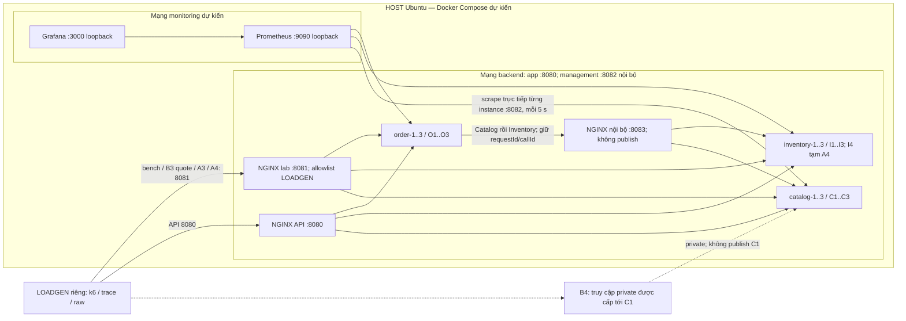

> **Vận hành từ D3:** ADMIN chọn ngày. App giao từng lượt theo PCCV sau khi kiểm tra GitHub có quyền ghi trên repo. Worker làm độc lập, kiểm tra HOST/LOADGEN qua broker nếu cần, bàn giao qua cả ba MD. Server chỉ giao lượt sau khi commit trước đã qua kiểm thử, CI và merge. Dữ liệu benchmark và protocol phải bám đặc tả.

# CƠ SỞ LÝ THUYẾT — NT533, BẢN TRIỂN KHAI 2 TUẦN

**Môn học:** Hệ tính toán phân bố (NT533), UIT.  
**Phạm vi:** Spring Boot, Docker, NGINX; Round Robin, Least Connections, IP Hash; đo lường và đánh giá thực nghiệm; mở rộng Consistent Hash theo client-ID (CH-ID).  
**Cập nhật:** 10/11/2026 — chốt NT533-v1 tại mục 0A, đồng bộ kế hoạch 14 ngày và PCCV 5 thành viên. **Đi kèm:** [Kế hoạch và phân công](01_KE_HOACH_DO_AN.md).

> Tài liệu dùng để học, thiết kế thí nghiệm và phát triển chương cơ sở lý thuyết. Ví dụ số là minh họa toán học, không phải kết quả của nhóm. Cấu hình mẫu chưa được chạy trong môi trường đồ án; cần kiểm tra với phiên bản đã khóa.

## 0A. Hồ sơ quyết định NT533-v1 — chốt ngày 10/11/2026

Phần này có cùng nội dung trong cả hai tài liệu và là đặc tả để triển khai. Các task “chốt/thiết kế/duyệt” trong PCCV được thực hiện bằng cách áp dụng, kiểm tra và lưu evidence cho các quyết định dưới đây, không mở lại việc lựa chọn từ đầu. **Đã chốt thiết kế không có nghĩa đã viết code, chạy thử, được giảng viên duyệt hoặc hoàn thành task trong Excel.** Nếu phần diễn giải cũ khác đặc tả này, sửa phần diễn giải theo đặc tả trước khi triển khai; không tự chọn một trong hai.

### Q01. RQ, giả thuyết và scope đã chốt

| RQ | Câu hỏi đã chốt | Phép đo/đối chứng |
|---|---|---|
| RQ1 | RR/LC/IPH khác nhau thế nào với backend đồng nhất và thời gian xử lý biến thiên? | B1 CPU-fixed, B2 Mixed-delay, cùng M/H; success RPS, p95/p99, lỗi, count và CPU |
| RQ2 | Một backend chậm hoặc dừng ảnh hưởng chất lượng và phục hồi thế nào? | A1/A2 so B2/M khỏe, cùng trace/block; timeline stop/start/ready |
| RQ3 | CH-ID có giảm tập trung do NAT và giữ affinity theo ID không, kể cả hot-client? | A3 uniform/hot-ID; RR/LC/IPH/CH-ID cùng một IP và trace |
| RQ4 | Bật consistent có giảm remapping khi membership 3→4→3 không? | A4 GH-ID so CH-ID cùng key, membership, endpoint identity |
| RQ5 | 1→3 replica và gọi xuyên dịch vụ thay đổi kết quả ở cùng tải thế nào? | B0 so B1; B3 quote; B4 chỉ diagnostic đường đi |

H1: RR đủ tốt với request đồng nhất. H2: LC có thể giảm tail khi connection bận phản ánh công việc tồn đọng. H3: ID tách client cùng NAT nhưng không chia được một hot key. H4: CH-ID có thể giảm remapping so GH-ID. Đây là giả thuyết cần kiểm chứng; không buộc dữ liệu phải ủng hộ.

**Trong scope:** Catalog, Inventory, Order; mỗi service ba replica; RR/LC/IPH core; CH-ID ở Inventory cho A3, GH-ID/CH-ID cho A4; A1 slow và A2 stop/start. **Ngoài scope:** AWS, Kubernetes/HPA, UI, database ghi, đặt hàng/thanh toán thật, auth production, cache/session store thật, retry ablation, circuit breaker và scheduler adaptive. Không thêm spike/soak vào ma trận chính.

**Ma trận cố định:** B0=6, B1=18, B2=18, B3=9, B4=3, A1=9, A2=9, A3=24 → **96 run chính + 8 xác nhận = 104 run hiệu năng**; A4 = 2 biến thể × 5 bộ khóa × 3 membership × 2 sweep = **60 sweep / 60.000 request**. Giữ nguyên 70 task, owner, effort và ngày trong Excel; không tự đánh dấu hoàn thành. Hai contrast xác nhận: LC–RR tại B2/H; CH-ID–IPH tại A3/uniform, thêm block 4–5 cho đúng hai phía để đạt n=5.

### Q02. API v1 và fixture đã chốt

HTTP/1.1, JSON UTF-8; không thêm `/v1` vào URL hiện có. Request quote bắt buộc `Content-Type: application/json`; kiểu khác → 415 `UNSUPPORTED_MEDIA_TYPE`. Mọi response nghiệp vụ/lab do ứng dụng tạo có `requestId` và `instanceId` ở top-level, kèm `X-Request-ID` và `X-Instance-ID` trùng body; không bọc thêm `data`. Health/Actuator giữ schema của nền tảng. Response nghiệp vụ không chứa timestamp để dễ so sánh fixture. Route không có → 404 `ROUTE_NOT_FOUND`; method không hỗ trợ → 405 `METHOD_NOT_ALLOWED` và header `Allow`.

| Endpoint | Input | Body 200 ngoài requestId/instanceId |
|---|---|---|
| `GET /api/catalog/products` | Không query, không phân trang | `{"products":[{"id":"P001","name":"Ban phim","price":100000,"currency":"VND"},{"id":"P002","name":"Chuot","price":250000,"currency":"VND"},{"id":"P003","name":"Cap USB","price":50000,"currency":"VND"}]}`; thứ tự ID tăng dần |
| `GET /api/catalog/products/{id}` | ID đúng regex `^P[0-9]{3}$` | `{"id":"P001","name":"Ban phim","price":100000,"currency":"VND"}` với ID P001 |
| `GET /api/inventory/{productId}` | Cùng quy tắc ID | `{"productId":"P001","availableStock":100}` với ID P001 |
| `POST /api/orders/quote` | Chính xác `{"productId":"P001","quantity":2}` | `{"productId":"P001","quantity":2,"unitPrice":100000,"totalPrice":200000,"currency":"VND","availableStock":100}` |

Fixture duy nhất: P001/100000 VND/tồn 100; P002/250000 VND/tồn 3; P003/50000 VND/tồn 0. Catalog giữ tên/giá, Inventory giữ tồn; commit fixture cùng source, mọi replica cùng checksum. Giá và tổng dùng số nguyên 64-bit theo đồng, không float; `totalPrice = unitPrice × quantity`. Không giảm tồn, không sinh orderId, không ghi đơn. Quote kiểm tra input → Catalog → Inventory tuần tự; dừng ngay khi một bước lỗi, không gọi tiếp và không retry ở bất kỳ tầng nào.

`quantity` là JSON integer 1–10, không nhận chuỗi, boolean hoặc 2.5; thiếu/null, trường thừa, query không được khai báo, JSON lỗi → 400 `INVALID_INPUT`. ID sai format → 400; ID đúng format nhưng không có fixture (P999) → 404 `PRODUCT_NOT_FOUND`. Tồn < quantity → 409 `INSUFFICIENT_STOCK`, kể cả P003. Catalog 404 được Order trả 404; Inventory 404 khi Catalog có sản phẩm là lỗi không nhất quán fixture → 502 `DOWNSTREAM_BAD_RESPONSE`.

Lỗi ứng dụng có đúng dạng `{"error":{"code":"INVALID_INPUT","message":"Invalid request"},"requestId":"<id>","instanceId":"O1"}`; instance thực tế tùy service. Message ngắn, không lộ stack trace/host. Connection refused hoặc downstream 5xx → 503 `DOWNSTREAM_UNAVAILABLE`; hết deadline → 504 `DOWNSTREAM_TIMEOUT`; body/schema sai hoặc status khác dự kiến → 502 `DOWNSTREAM_BAD_RESPONSE`; lỗi nội bộ chưa xử lý → 500 `INTERNAL_ERROR`. Nếu timeout tại NGINX trước khi app trả lời, giữ status/body proxy, đánh lỗi transport/proxy trong analyzer; không ép body đó thành JSON đúng nghiệp vụ.

RequestId public: NGINX tạo `$request_id`, ghi đè header ngoài. Ingress lab chỉ nhận `X-Request-ID` dạng 32 hex thường từ load generator đã cho phép, thiếu/sai → 400; chuyển nguyên ID này xuống app. B3 gọi `/api/orders/quote` trên listener lab 8081 (proxy giữ nguyên URI tới Order), vì vậy requestId trong trace được giữ; public listener vẫn tạo ID mới. Order dùng cùng requestId cho cả hai call; mỗi call thêm `X-Call-ID` bằng requestId + `-catalog` hoặc `-inventory`. NGINX nội bộ giữ requestId và callId từ Order, không tạo lại. Không dùng requestId làm Prometheus label. X-Instance-ID trả về quote là O1/O2/O3, không ghi đè bằng instance downstream.

Test contract bắt buộc: list đủ ba sản phẩm; P001×2 → 200/200000; P002×3 → 200/750000; P002×4 và P003×1 → 409; P999 → 404; ID sai/quantity 0,11,2.5,"2",null/trường thừa → 400; sai content-type → 415; giả lập từng lỗi downstream → đúng 502/503/504. Kiểm tra cả body, metadata và số lần gọi, không chỉ status.

### Q02-DMN. Thiết kế Catalog và fixture — D01-DMN

Phần này cụ thể hóa Q02, không đổi API v1. Đầu ra D01 là schema, fixture và ca nghiệm thu trong tài liệu; chưa có service hay response HTTP thực tế. Catalog sở hữu tên/giá; Inventory sở hữu tồn kho. P003 vẫn xuất hiện trong list và detail Catalog dù tồn bằng 0; chỉ quote kiểm tra đủ tồn theo Q02.

#### Schema Product

Product có đúng bốn trường bắt buộc dưới đây, không null, không trường thừa. `id` là khóa duy nhất, phân biệt hoa/thường, không trim hay tự đổi chữ hoa. `name` giữ nguyên tên fixture. `price` là số nguyên 64-bit không âm theo đồng (Java `long`), `currency` chỉ nhận `VND`. Khi nạp fixture phải từ chối chuỗi, boolean và token số thập phân/khoa học cho giá; JSON Schema `integer` tự nó chỉ kiểm tra giá trị nguyên về mặt toán học.

Schema này áp dụng cho Product trong fixture/list, chưa chứa metadata request. Response detail thêm `requestId`, `instanceId` cùng cấp với bốn trường Product; list thêm hai trường này cùng cấp với `products`, không thêm vào từng Product. Không thêm `availableStock`, `orderId` hoặc timestamp vào Product.

<!-- D01-DMN:product-schema -->
```json
{
  "$schema": "https://json-schema.org/draft/2020-12/schema",
  "title": "NT533-v1 Catalog Product",
  "type": "object",
  "required": [
    "id",
    "name",
    "price",
    "currency"
  ],
  "additionalProperties": false,
  "properties": {
    "id": {
      "type": "string",
      "pattern": "^P[0-9]{3}$"
    },
    "name": {
      "type": "string",
      "minLength": 1
    },
    "price": {
      "type": "integer",
      "minimum": 0,
      "maximum": 9223372036854775807
    },
    "currency": {
      "type": "string",
      "const": "VND"
    }
  }
}
```

#### Fixture Catalog duy nhất

Khối JSON sau là fixture thiết kế để đưa vào resource của Catalog khi triển khai service theo Q08. Chỉ có ba ID, không trùng, thứ tự tăng dần; list giữ thứ tự này, detail lấy cùng dữ liệu theo ID. Không tạo giá ngẫu nhiên, cache giá khác ở Order hoặc đưa tồn kho vào fixture Catalog.

<!-- D01-DMN:fixture -->
```json
{
  "products": [
    {"id": "P001", "name": "Ban phim", "price": 100000, "currency": "VND"},
    {"id": "P002", "name": "Chuot", "price": 250000, "currency": "VND"},
    {"id": "P003", "name": "Cap USB", "price": 50000, "currency": "VND"}
  ]
}
```

Đối chiếu Inventory theo Q02: P001/tồn 100, P002/tồn 3, P003/tồn 0. Quote tham chiếu cùng ID và giá: P001×2 = 200000 VND; P002×3 = 750000 VND; P002×4 và P003×1 trả 409. Giá lớn nhất của fixture nhân quantity tối đa 10 vẫn trong miền `long`. Những phép tính này là expected value, chưa phải kết quả gọi Order.

Fixture được đọc một lần khi khởi động, giữ bất biến; kiểm tra kiểu/miền, ID duy nhất, đủ đúng ba bản ghi và giá/tên/currency khớp Q02. Fixture sai làm readiness fail theo Q08, không bỏ qua bản ghi lỗi hay trả danh sách rỗng. Khi có source, commit fixture cùng source và đối chiếu SHA-256 byte file giữa C1–C3; khác checksum phải chặn chạy đo. SHA-256 khối JSON trong kiểm tra D01 dưới đây chỉ nhận diện fixture tài liệu (UTF-8/LF, có LF cuối), chưa chứng minh các replica đã dùng cùng file.

#### Ba ca nghiệm thu Catalog

Điều kiện chung cho kiểm thử HTTP sau này: fixture hợp lệ đã nạp, instance minh họa C1, requestId minh họa được ingress truyền xuống là `0123456789abcdef0123456789abcdef`; không query. Instance và requestId thực tế lấy từ môi trường/request đang kiểm, luôn đối chiếu body với header. Message 404 bên dưới là ví dụ thông báo ngắn; mã lỗi và cấu trúc theo Q02 là bắt buộc.

| Case | Ý nghĩa | Kỳ vọng |
|---|---|---|
| CAT-01 | ID P001 hợp lệ và có fixture | 200, đúng tên/giá/currency, không bọc `data` |
| CAT-02 | ID p001 sai định dạng (chữ thường) | 400 `INVALID_INPUT`, không tự sửa thành P001 |
| CAT-03 | ID P999 đúng định dạng nhưng không có fixture | 404 `PRODUCT_NOT_FOUND`, không nhầm với sai định dạng |

<!-- D01-DMN:cases -->
```json
[
  {
    "caseId": "CAT-01", "method": "GET", "path": "/api/catalog/products/P001",
    "expectedStatus": 200,
    "expectedBody": {"id":"P001","name":"Ban phim","price":100000,"currency":"VND","requestId":"0123456789abcdef0123456789abcdef","instanceId":"C1"},
    "expectedHeaders": {"X-Request-ID":"0123456789abcdef0123456789abcdef","X-Instance-ID":"C1"}
  },
  {
    "caseId": "CAT-02", "method": "GET", "path": "/api/catalog/products/p001",
    "expectedStatus": 400,
    "expectedBody": {"error":{"code":"INVALID_INPUT","message":"Invalid request"},"requestId":"0123456789abcdef0123456789abcdef","instanceId":"C1"},
    "expectedHeaders": {"X-Request-ID":"0123456789abcdef0123456789abcdef","X-Instance-ID":"C1"}
  },
  {
    "caseId": "CAT-03", "method": "GET", "path": "/api/catalog/products/P999",
    "expectedStatus": 404,
    "expectedBody": {"error":{"code":"PRODUCT_NOT_FOUND","message":"Product not found"},"requestId":"0123456789abcdef0123456789abcdef","instanceId":"C1"},
    "expectedHeaders": {"X-Request-ID":"0123456789abcdef0123456789abcdef","X-Instance-ID":"C1"}
  }
]
```

Khi triển khai còn phải kiểm tra list trả đủ ba Product/thứ tự, detail từng ID khớp list (kể cả P003), query thừa → 400, route lạ → 404, method sai → 405/`Allow`, header/body metadata, cùng fixture trên mọi replica theo Q02/Q10. Ba ca trên là bộ mô tả nghiệm thu D01, không thay toàn bộ contract test.

#### Kiểm tra thiết kế có thể chạy lại trên Ubuntu

Lệnh sau đọc và chạy khối Python `D01-DMN-CHECK` ngay trong tài liệu, chỉ đọc hai MD; không cần dependency ngoài Python 3 stdlib. Kiểm tra đồng bộ hai bản thiết kế, schema, fixture so với bảng API Q02, giá/tổng, ba ca kỳ vọng và 11 Product lỗi. Đây là kiểm tra dữ liệu thiết kế, không phải trình xác thực JSON Schema tổng quát hay kiểm thử HTTP.

```bash
python3 -c 'from pathlib import Path; t=Path("01_KE_HOACH_DO_AN.md").read_text(encoding="utf-8"); exec("# D01-DMN-CHECK" + t.split("```python\n# D01-DMN-CHECK",1)[1].split("```",1)[0])'
```

<!-- D01-DMN:check -->
```python
# D01-DMN-CHECK: kiểm tra thiết kế tài liệu, không gọi HTTP
import copy
import hashlib
import json
import re
from pathlib import Path

paths = ("01_KE_HOACH_DO_AN.md", "02_CO_SO_LY_THUYET.md")
docs = [Path(p).read_text(encoding="utf-8") for p in paths]
def section(text):
    return re.split(r"^### Q03\.", text.split("### Q02-DMN. ", 1)[1], maxsplit=1, flags=re.M)[0]
assert section(docs[0]) == section(docs[1]), "D01-DMN sections differ"
def block(text, label):
    pattern = r"<!-- D01-DMN:" + re.escape(label) + r" -->\n\x60{3}json\n(.*?)\n\x60{3}"
    match = re.search(pattern, text, re.S)
    assert match, label
    return match.group(1)
schema = json.loads(block(docs[0], "product-schema"))
fixture_text = block(docs[0], "fixture")
fixture = json.loads(fixture_text)
cases = json.loads(block(docs[0], "cases"))
fields = {"id", "name", "price", "currency"}
assert schema["$schema"] == "https://json-schema.org/draft/2020-12/schema"
assert schema["type"] == "object" and schema["additionalProperties"] is False
assert set(schema["required"]) == set(schema["properties"]) == fields
assert schema["properties"] == {
    "id": {"type": "string", "pattern": "^P[0-9]{3}$"},
    "name": {"type": "string", "minLength": 1},
    "price": {"type": "integer", "minimum": 0, "maximum": 9223372036854775807},
    "currency": {"type": "string", "const": "VND"},
}
# Bộ kiểm tra stdlib chỉ cho Product này, không phải engine JSON Schema tổng quát.
def product_ok(p):
    return (type(p) is dict and set(p) == fields
        and type(p["id"]) is str and re.fullmatch(r"P[0-9]{3}", p["id"]) is not None
        and type(p["name"]) is str and len(p["name"]) >= 1
        and type(p["price"]) is int and 0 <= p["price"] <= 9223372036854775807
        and p["currency"] == "VND")
expected = [
    {"id": "P001", "name": "Ban phim", "price": 100000, "currency": "VND"},
    {"id": "P002", "name": "Chuot", "price": 250000, "currency": "VND"},
    {"id": "P003", "name": "Cap USB", "price": 50000, "currency": "VND"},
]
assert set(fixture) == {"products"} and fixture["products"] == expected
assert all(product_ok(p) for p in fixture["products"])
ids = [p["id"] for p in fixture["products"]]
assert ids == sorted(set(ids)) and len(ids) == 3
for doc in docs:
    q02 = doc.split("### Q02.", 1)[1].split("### Q02-DMN.", 1)[0]
    row = next(line for line in q02.splitlines() if "| `GET /api/catalog/products` |" in line)
    assert json.loads(re.search(r"`(\{\"products\":.*?\})`", row).group(1)) == fixture
products = {p["id"]: p for p in fixture["products"]}
assert products["P001"]["price"] * 2 == 200000
assert products["P002"]["price"] * 3 == 750000
assert all(p["price"] * 10 <= 9223372036854775807 for p in products.values())
assert [c["caseId"] for c in cases] == ["CAT-01", "CAT-02", "CAT-03"]
assert [c["path"].rsplit("/", 1)[1] for c in cases] == ["P001", "p001", "P999"]
for c in cases:
    assert c["method"] == "GET" and c["path"].startswith("/api/catalog/products/")
    pid = c["path"].rsplit("/", 1)[1]
    status = 400 if re.fullmatch(r"P[0-9]{3}", pid) is None else (200 if pid in products else 404)
    assert c["expectedStatus"] == status
    body = c["expectedBody"]
    assert re.fullmatch(r"[0-9a-f]{32}", body["requestId"])
    assert body["instanceId"] == "C1"
    assert c["expectedHeaders"] == {"X-Request-ID": body["requestId"], "X-Instance-ID": body["instanceId"]}
    payload = {k: v for k, v in body.items() if k not in ("requestId", "instanceId")}
    if status == 200:
        assert payload == products[pid] and product_ok(payload)
    else:
        assert set(payload) == {"error"} and set(payload["error"]) == {"code", "message"}
        assert payload["error"]["code"] == {400: "INVALID_INPUT", 404: "PRODUCT_NOT_FOUND"}[status]
        assert type(payload["error"]["message"]) is str and payload["error"]["message"]
bad = []
for key, value in [("id", "p001"), ("id", "P001\n"), ("price", True),
                   ("price", "100000"), ("price", 100000.0), ("price", -1),
                   ("price", 9223372036854775808), ("name", ""), ("currency", "USD")]:
    item = copy.deepcopy(expected[0])
    item[key] = value
    bad.append(item)
bad.append({**expected[0], "availableStock": 100})
bad.append({k: v for k, v in expected[0].items() if k != "price"})
assert all(not product_ok(p) for p in bad)
print("OK: 2 documents; Product schema; 3 fixed products; Q02 parity; 3 Catalog cases; 11 invalid products rejected; quote arithmetic")
print("fixture-sha256 (UTF-8/LF + final LF): " + hashlib.sha256((fixture_text + "\n").encode("utf-8")).hexdigest())
```

#### Tiến độ D01-DMN và ghi chú cho cả ba MD

Đã hoàn thành sản phẩm thiết kế Catalog/fixture và ba ca mô tả nghiệm thu của D01-DMN trong workspace Ubuntu của task. Không có service để kiểm thử HTTP; không có benchmark, build Java hay triển khai ứng dụng trong phần việc này. Mã kiểm tra dùng Python 3.12.3 stdlib trên Linux qua vm_exec; không cài thêm công cụ.

Lần kiểm tra được ghi tự động từ kết quả lệnh chạy thật lúc 2026-11-17T07:45:34Z. Lệnh D01-DMN-CHECK được công bố ngay trên; stdout/stderr và exit code dưới đây là kiểm tra thiết kế, không phải response HTTP.

stdout:
~~~text
OK: 2 documents; Product schema; 3 fixed products; Q02 parity; 3 Catalog cases; 11 invalid products rejected; quote arithmetic
fixture-sha256 (UTF-8/LF + final LF): bd76926a87fd55258a567c248146ff215632ae323bd276fcc7a76eae227d850e
~~~

stderr:
~~~text
~~~

Exit code D01-DMN-CHECK: 0. Lệnh bổ sung: `git diff --check`; exit code: 0, stdout/stderr rỗng. Phần bổ sung dùng LF; nội dung gốc và khối tiến độ hệ thống được giữ nguyên.

Ghi chú để bộ điều phối cập nhật bằng chứng vào **cả ba MD** trước commit: `01_KE_HOACH_DO_AN.md` giữ schema/fixture/case và kết quả kiểm tra; `02_CO_SO_LY_THUYET.md` giữ bản thiết kế đồng bộ, giải thích fixture bất biến và ranh giới Catalog/Inventory; `AGENTS.md` ghi D01-DMN đã kiểm tra thiết kế đạt, chưa có bằng chứng HTTP/runtime/deploy. Worker chỉ sửa hai MD trong phạm vi task, không sửa thân AGENTS.md hay khối JSON hệ thống; bộ điều phối xác minh và hợp nhất phần tiến độ có cấu trúc. Đã trao đổi với TDN/TTN/HXN/DHN; TTN xác nhận tồn 100/3/0, TDN xử lý câu tóm tắt 400/404 trong task riêng.

Bàn giao tiếp theo trong pipeline của task hiện tại: bộ điều phối kiểm tra, cập nhật bằng chứng ba MD, commit/PR/review đúng HEAD/CI/merge tuần tự. Chưa có xác nhận các bước này hoàn tất. Không chuyển sang task/ngày mới.

#### Q02-TTN. Hợp đồng Inventory dùng cho triển khai D01-TTN

Phần này cụ thể hóa Q02, không thêm API ghi. Inventory chỉ sở hữu `productId` và `availableStock`; không gọi Catalog/Order, không reservation hoặc trừ tồn. `availableStock` là JSON integer không âm, đơn vị **sản phẩm**; không dùng chuỗi, float, phần trăm hoặc giá tiền. Fixture đọc một lần, bất biến và giống nhau trên mọi replica; fixture thiếu/sai kiểu/trùng ID làm readiness fail theo Q08.

| Request GET | HTTP / phần body nghiệp vụ ngoài metadata |
|---|---|
| `/api/inventory/P001` | 200 / `{"productId":"P001","availableStock":100}` |
| `/api/inventory/P002` | 200 / `{"productId":"P002","availableStock":3}` |
| `/api/inventory/P003` | 200 / `{"productId":"P003","availableStock":0}` |
| `/api/inventory/P999` | 404 / `PRODUCT_NOT_FOUND` |
| `/api/inventory/p001`, `/api/inventory/P01` | 400 / `INVALID_INPUT` |
| `/api/inventory/P001?quantity=1` | 400 / `INVALID_INPUT` (API không nhận query) |

GET tồn 0 vẫn là 200; **409 `INSUFFICIENT_STOCK` thuộc Order quote**, không thuộc GET Inventory. Thiếu segment `/api/inventory` là route không tồn tại: 404 `ROUTE_NOT_FOUND`. Method không hỗ trợ trả 405 `METHOD_NOT_ALLOWED` kèm `Allow` theo Q02; không tạo POST/PUT/DELETE cập nhật tồn. Metadata/error envelope, requestId public/lab và header giữ nguyên Q02.

Ví dụ đầy đủ (ID minh họa, không phải response đã chạy):

```json
{"productId":"P001","availableStock":100,"requestId":"0123456789abcdef0123456789abcdef","instanceId":"I1"}
```

Ví dụ có `X-Request-ID: 0123456789abcdef0123456789abcdef`, `X-Instance-ID: I1`; khi gọi replica khác, chỉ instanceId/header tương ứng thay đổi. D04-TTN phải kiểm cả schema/kiểu, ba fixture, lỗi 400/404/405, header khớp body và đọc lặp không đổi tồn. Lab Inventory giữ nguyên Q04: `mixed-delay` 20/200 ms, A1 I3 thêm 300 ms; `mapping` không delay; lab tắt thì route không tồn tại. Không đưa delay vào API tồn kho.

### Q03. Stack, topology, tài nguyên và config đã chốt

Chọn Spring MVC đồng bộ, Java 21, Maven Wrapper 3.9.9, Spring Boot 3.5.7; dùng BOM của Boot, không tự trộn phiên bản Spring. Image lab chọn NGINX OSS 1.28.3, k6 1.0.0, Prometheus 3.2.1, Grafana 11.6.0; analyzer Python 3.12 với stdlib, chart dùng matplotlib 3.10.1. Đây là baseline tái lập trong mạng cô lập, **không phải tuyên bố các bản này mới nhất/an toàn để đưa production**. Trước lần build phải rà advisory, nếu cần nâng patch thì cập nhật cả hai tài liệu và chạy smoke trước pilot; không đổi giữa các run chính thức. Java patch, OS/Docker/Compose thực tế và image digest chỉ được ghi từ lệnh trên HOST, không tự điền giá trị giả. `versions.lock` và manifest giữ version + digest; không dùng `latest`.

Nguồn phiên bản: [Boot 3.5.7](https://spring.io/blog/2025/10/23/spring-boot-3-5-7-available-now/), [Maven 3.9.9](https://maven.apache.org/docs/3.9.9/release-notes.html), [NGINX 1.28](https://nginx.org/en/CHANGES-1.28), [k6 1.0.0](https://github.com/grafana/k6/releases/tag/v1.0.0), [Prometheus 3.2.1](https://github.com/prometheus/prometheus/releases/tag/v3.2.1), [Grafana 11.6.0](https://github.com/grafana/grafana/releases/tag/v11.6.0), [matplotlib 3.10.1](https://pypi.org/project/matplotlib/3.10.1/). Phiên bản là lựa chọn thiết kế; chưa build/test tương thích trong lần sửa tài liệu này.

Topology cố định cho chiến dịch: một HOST chạy Docker Compose và một LOADGEN riêng cùng LAN; nếu không có máy riêng thì dùng LOADGEN chung host như phương án dự phòng đã chọn, ghi `topology=single-host` và giám sát client; không trộn hai topology trong một chiến dịch. HOST/LOADGEN là vai trò, Nhật điền địa chỉ từ kiểm kê, không giả định máy hiện tại đủ tài nguyên. Điều kiện mở lab v2: năm Codex ready, SSH xác thực thành công và công cụ cần thiết dùng được; không chặn theo CPU/RAM/disk. Giữ cấu hình replica/protocol; ghi lỗi thực thi thật nếu không chạy được.

Tên container `catalog-1..3`, `inventory-1..3`, `order-1..3`; instance `C1..3`, `I1..3`, `O1..3`; A4 thêm `inventory-4`/I4. Port app 8080, management 8082 chỉ nội bộ. Compose có mạng backend/monitoring; chỉ NGINX publish API 8080 và lab 8081 trên địa chỉ LAN được firewall giới hạn LOADGEN. Grafana 3000/Prometheus 9090 chỉ bind loopback; Actuator và backend không publish. B4 chạy qua quyền truy cập private tới C1, không mở C1 ra Internet. Order gọi listener NGINX nội bộ 8083; B3 không truyền IP giả xuống downstream.

Mỗi JVM: 0,5 CPU, 512 MiB, `-Xms256m -Xmx256m`, G1, 32 platform worker threads, accept-count 100, virtual threads off. NGINX: 1 CPU/256 MiB, 2 worker, worker_connections 4096; mọi upstream zone 64k, equal weight=1, keepalive 32, `max_fails=1 fail_timeout=5s`. Monitoring tổng 1 CPU/1 GiB; I4 cùng quota JVM. Đo không swap/OOM, không CPU contention bất thường; nếu footprint không đạt thì dừng preflight và sửa đồng đều trước pilot, không đổi quota riêng một thuật toán.

HTTP/1.1, cache off, `proxy_buffering off`, `proxy_next_upstream off`, connect 200 ms, send/read 3 s, client k6 timeout 5 s, keepalive bật đồng đều. Order: mỗi downstream connect ≤200 ms nằm trong call deadline tổng 1 s; toàn quote deadline 2,5 s, không chỉ dựa vào socket read timeout. Healthcheck readiness 5 s/lần, timeout 2 s, start-period 60 s, 3 retries; runner yêu cầu 3 lần ready liên tiếp trước warm-up, abort sau 120 s. Probe Compose không phải health-check chủ động của NGINX OSS; NGINX vẫn dùng passive failure handling.

#### D01-DHN — Bảng tài nguyên và sơ đồ mạng (17/11/2026)

**Trạng thái:** bảng quota và topology dưới đây là thiết kế theo Q03/Q04, chưa phải triển khai hay kiểm kê phần cứng đã đạt. Task chỉ sửa thân hai Markdown; giữ nguyên AGENTS.md, nội dung các thành viên và JSON tiến độ hệ thống. Không áp ngưỡng CPU/RAM/disk cũ để chặn bắt đầu v2.

**Máy được broker phân:** `get_lab` của task D01-DHN trả role `host`, workspace `/workspace`, HOST `10.70.197.121`, LOADGEN riêng `10.70.197.172`, `toolsReady.host/loadgen=true`. Đây là metadata phân máy, chưa chứng minh SSH/LAN, OS, cấu hình máy, Docker daemon hay năng lực phát tải. HXN đã xác nhận vai trò LOADGEN trong workspace riêng, chưa có receipt host-inspect thực.

| Hạng mục kiểm kê | HOST | LOADGEN | Bằng chứng / phần còn thiếu |
|---|---|---|---|
| Vai trò | Docker Compose, NGINX, backend, monitoring | k6, trace và thu raw ở máy riêng | Broker phân vai trò; topology dự kiến `two-host` |
| Địa chỉ broker cấp | `10.70.197.121` | `10.70.197.172` | Không biến thành cấu hình firewall/Real-IP trước khi xác minh peer thực |
| Ubuntu/OS/kernel/kiến trúc | Chưa kiểm kê host thực | Chưa kiểm kê host thực | Cần adapter read-only trên từng Ubuntu |
| CPU logic/quota, RAM tổng/available, swap | Chưa đo | Chưa đo | Không lấy CPU/RAM của container làm số đo host |
| Disk tổng/trống và filesystem vùng NT533 | Chưa đo | Chưa đo | Không dùng số đo từ đợt cũ |
| Docker Engine/server và Compose | Chưa xác minh | Chưa xác minh công cụ cần dùng | `toolsReady=true` không thay `docker version/info` và `docker compose version` |
| Java patch, image ID/digest, config hash | Chưa build/thu | k6 host chưa xác minh | Không tự điền digest hoặc gọi bản thiết kế là bản đã chạy |
| LAN route/source peer và cổng thực | Chưa xác minh | Chưa xác minh | Chưa xác nhận trust /32 hoặc rule firewall đã áp dụng |
| Năng lực phát tải | Chưa chạy backend | Chưa pilot CPU/RAM/VU/dropped | Chưa xác nhận N/R_ref/VU, G0/G2/G3 |

**Budget quota dự kiến (MiB, heap nằm trong RAM quota):**

| Thành phần | JVM | CPU | RAM MiB | Heap tối đa MiB |
|---|---:|---:|---:|---:|
| Catalog C1–C3 | 3 | 1,5 | 1.536 | 768 |
| Inventory I1–I3 | 3 | 1,5 | 1.536 | 768 |
| Order O1–O3 | 3 | 1,5 | 1.536 | 768 |
| Backend thường | 9 | 4,5 | 4.608 | 2.304 |
| NGINX | 0 | 1 | 256 | — |
| Prometheus + Grafana (budget chung) | 0 | 1 | 1.024 | — |
| Tổng HOST thường | 9 | 6,5 | 5.888 | 2.304 |
| I4 tạm, chỉ A4/profile `mapping` | 1 | 0,5 | 512 | 256 |
| Tổng HOST khi A4 có I4 | 10 | 7 | 6.400 | 2.560 |

Mỗi JVM giữ `-Xms256m -Xmx256m`, G1, 32 platform worker threads, accept-count 100, virtual threads off. Giới hạn 512 MiB phải chứa heap, metaspace, thread stack và native memory; không cộng heap lần nữa. Tổng quota chưa dự trù OS, page cache, Docker/overhead ngoài container, lưu raw và chi phí phát tải. Monitoring 1 CPU/1 GiB là budget chung; chưa có số đo footprint. Pilot phải quan sát OOM/swap/throttling/client contention thật; không giảm quota/replica riêng một thuật toán để làm test đạt. I4 chỉ vào membership A4 3→4→3, không thêm vào chín JVM thường.

**Sơ đồ mạng dự kiến, chưa phải bằng chứng network/container đã tạo:**



| Cổng / ranh giới | Quy tắc thiết kế cần kiểm chứng khi triển khai |
|---|---|
| HOST LAN 8080 / API | Chỉ NGINX publish; tạo requestId mới, ghi đè header ngoài; không route `/internal/bench` |
| HOST LAN 8081 / lab | Firewall giới hạn LOADGEN; Real-IP chỉ tin peer thực /32 sau kiểm kê, không tin 0.0.0.0/0; log cả peer/effective IP |
| Backend 8080, management 8082 | Không publish app/Actuator; scrape trực tiếp từng instance, không qua load balancer |
| NGINX 8083 | Chỉ Order gọi nội bộ; giữ requestId/callId; B3 không giả IP downstream |
| HOST 127.0.0.1:9090 / :3000 | Prometheus/Grafana chỉ bind loopback; không mở ra Internet |
| B4 → C1 | Chỉ đường private được cấp trong vùng NT533; không mở thêm cổng public hoặc đổi mạng/SSH |
| Header lab / ID | ID đúng regex không phải authentication; ngoài allowlist, thiếu/sai ID/requestId phải có negative smoke |

**Probe thực tế trong container task:** `python3 -c` kiểm PATH/socket và gọi `k6 version` trả exit 0, stderr rỗng; Python 3.12.3, cwd `/workspace`, không có `/var/run/docker.sock`. `docker version` và `docker compose version` không khởi chạy vì không tìm thấy executable (exit của tiến trình Docker không có, không phải daemon đã trả lỗi). `k6 version` trả `k6 v1.0.0 (commit/41b4984b75-dirty, go1.24.2, linux/amd64)`, exit 0, stderr rỗng. Đây chỉ là quan sát container, không xác nhận bản cài HOST/LOADGEN; không cài thêm hoặc tìm đường vượt sandbox.

**Đối chiếu sửa tiếp:** đầu phiên này `vm_read`, `git status --porcelain` và `git diff --stat` xác nhận checkout sạch ở base `c73d70eac79395d2bbf83821acbe31d592150381`, chưa có mục DHN của lượt trước. Khôi phục đúng mục D01-DHN trong hai MD, không reset/ours/theirs. `get_task` hiện trả 46 receipt cũ đến 08:00:26.250 UTC, gồm audit/CI/whitespace exit 0; nhận định cũ “chỉ đến 07:49 UTC” đã lỗi thời. Chưa thấy receipt mới của phiên sửa tiếp, nên không coi output mới trong phiên là bằng chứng broker đã lưu. Lượt trước từng lỗi mã hóa một dòng gốc (audit/CI exit 1), sau khôi phục riêng dòng từ HEAD đã đạt exit 0; lần này ghi chèn theo byte UTF-8/CRLF để bảo toàn phần gốc.

**Yêu cầu adapter và bàn giao cả ba MD:** máy chủ cần cung cấp job kiểm kê read-only trên HOST và LOADGEN thực, gồm OS/CPU/RAM/swap/disk, Docker client/server/Compose, Java/k6 và route/source peer; lưu argv/stdout/stderr/exit/job ID theo task. Nếu thiếu công cụ host, chuẩn bị qua adapter được quản lý, không sudo host từ container. Điều phối phải đối chiếu/lưu receipt mới, hợp nhất tiến độ D01-DHN vào AGENTS.md và hai MD trước commit, bảo toàn bằng chứng mọi worker. AGENTS.md nằm ngoài scope sửa thân của DHN; không tự ghi JSON hệ thống. Chưa chạy Compose/NGINX/chín JVM/I4/pilot, chưa xác nhận G0/G2/G3; chưa commit/push/PR/CI GitHub/merge/deploy. Chờ điều phối xác nhận pipeline, không chuyển task/ngày.

### Q04. Workload, trace và seed đã chốt

| Profile/endpoint lab | Hành vi chính xác | Input/output cần kiểm |
|---|---|---|
| `cpu-fixed`: `/bench/catalog` → Catalog `/internal/bench` | SHA-256 lặp N lần, digest vòng trước làm input vòng sau, input đầu UTF-8 `NT533-v1`; tính lại mỗi request, không cache/sleep | Query `profile=cpu-fixed`; body `profile,iterations,checksum,requestId,instanceId`; checksum khớp N |
| `mixed-delay`: `/bench/inventory` → Inventory `/internal/bench` | Query `delayClass=fast` ngủ 20 ms, `slow` ngủ 200 ms; trace chọn 80/20 | Query `profile=mixed-delay&delayClass=fast` hoặc `slow`; body `profile,delayClass,appliedDelayMs,requestId,instanceId` |
| `mapping`: cùng route Inventory | Không delay/CPU loop, không gọi downstream | Query `profile=mapping`; body `profile,requestId,instanceId` |
| `quote`: `/api/orders/quote` | P001, quantity=2; không thêm synthetic delay vào API nghiệp vụ | 200, totalPrice=200000, stock=100; profile quote ở trace, không phải query API |

Không nhận số delay/vòng lặp do client tự truyền. Profile ngoài allowlist hoặc query sai → 400; `/internal/bench` không được route qua API public, Spring profile lab tắt thì route không tồn tại. N áp dụng chung mọi Catalog, xác định bằng pilot theo Q05; Mixed-delay 20/200 ms là giá trị đã chọn, không chỉnh để tạo chiến thắng LC. A1: I3 thêm **300 ms** vào mọi request lab trước thời gian fast/slow, nên appliedDelayMs=320/500; I1/I2 giữ 20/200. B2/A2/A3 không có extra delay. Cleanup trả I3 về 0 ms extra.

Trace CSV UTF-8/LF: `request_index,request_id,client_id,effective_ip,profile,delay_class,product_id,quantity`. Index liên tục từ 0, dùng `scenario.iterationInTest`, không lấy VU ID; requestId = 32 hex đầu SHA-256 của `trace_id:request_index`. Seed block 1–5: **53301,53302,53303,53304,53305**; seed schedule=53300, bootstrap=53399, A4 keyset=**53401..53405**. Luồng độc lập: dùng Python `random.Random(seed)` cho client, `random.Random(seed+100000)` cho delay; schedule dùng seed riêng. Xuất toàn bộ trace trước khi chạy, đóng checksum; block lặp cùng trace trên mọi thuật toán.

A3 và B1/B2/A1/A2 dùng cùng bộ 1.000 client-ID/block: ID thứ j (0..999) là `c-` + 16 hex đầu SHA-256 của `seed:client:j`; trùng ID → abort generator. Uniform chọn `randrange(1000)`; hot-ID chọn ID 0 với xác suất 0,8, còn lại chọn đều 1..999, báo tỷ lệ thực tế từ trace. Delay chọn fast nếu RNG delay <0,8, không gắn fast/slow vào hot-ID. A4 dùng cùng cách sinh với seed 53401..53405, sắp ID tăng dần rồi sweep; keysets phải khác nhau.

IP giả lập cho client j: `10.(64 + j//256).(j%256).10`, tạo 1.000 prefix /24 khác nhau; A3 tất cả dùng `10.250.0.10`. NGINX lab dùng `real_ip_header X-Lab-Source-IP`, `real_ip_recursive off`, `set_real_ip_from` đúng peer LOADGEN thực tế /32 sau kiểm kê; firewall chặn nguồn khác, log cả `$realip_remote_addr` và `$remote_addr`. Không tin toàn mạng 0.0.0.0/0, không expose ingress này. A3/A4 bắt buộc ID regex `^c-[0-9a-f]{16}$` ở tất cả biến thể. B3 dùng IP thực từng hop; IPH downstream hash IP Order, không giả định hash IP người dùng. Trust Real-IP phải kiểm tra theo [module NGINX](https://nginx.org/en/docs/http/ngx_http_realip_module.html).

A4 rate **10 request/s**, concurrency tối đa 1, timeout 5 s; nếu không giữ được rate do lỗi/chậm thì snapshot invalid. Mỗi membership có 2 sweep đủ 1.000 ID, mapping giống nhau 100%; lỗi/schema sai/thiếu key → invalid và chạy lại cả snapshot với ID mới. Sau reload: backend ready, worker generation cũ thoát (tối đa 30 s), đóng connection client cũ/mở mới, smoke xác minh generation mới trước sweep; không đạt → abort. Traffic-weighted remap dùng weight từ trace hot-ID cùng seed keyset; lưu riêng weight CSV/checksum; không suy weight từ response thành công. So cả 3→4, 4→3 và 3 đầu→3 cuối; không ép tỷ lệ đổi bằng 25%.

### Q05. Pilot, SLO, lịch run và ngưỡng quyết định đã chốt

Các giá trị **được đo**, không phải quyết định tùy ý: N CPU, R_ref cho CPU/Mixed/Quote, số VU cần cấp, version/digest và host facts. Không điền số giả. Chốt quy tắc sau để người triển khai không phải tự chọn lại:

1. N CPU: bắt đầu 1.000 vòng, gấp đôi đến tối đa 1.024.000; warm-up 120 s và đo 100 request tuần tự trực tiếp C1, chọn N đầu tiên có median xử lý app ≥20 ms và ≤100 ms. Không tìm được → dừng hiệu chuẩn, ghi log, không đo chính thức. N giống nhau giữa replica/thuật toán.
2. RR/3 replica, từng profile riêng: rate 10,20,40,... tối đa 2.560 request/s; mỗi bước warm-up 120 s/đo 60 s, cooldown tối thiểu 60 s. `R_ref` là bước đầu vi phạm ít nhất một SLO trong 2 lượt cùng rate có client hợp lệ; bước trước phải đạt SLO. Nếu ngay 10 đã trượt, thêm bước 1,2,5; không có bước đạt, hoặc đến 2.560 chưa trượt → dừng pilot, ghi không tìm được điểm tham chiếu trong miền đã chốt, không tự tăng trần.
3. H=R_ref; M=max(1,floor(0,6×R_ref)). B0/B4 dùng rate CPU của B1; A1/A2/A3 dùng M Mixed của B2; B3 dùng M Quote riêng. Không chọn rate riêng theo thuật toán. Cấp trước `ceil(rate×5×1,2)` VU, maxVUs bằng preAllocatedVUs; smoke/pilot phải chứng minh LOADGEN đủ RAM/CPU. Không đủ → đổi máy phát tải trước chiến dịch, không hạ offered load chỉ cho một thuật toán.
4. **SLO cố định:** direct p95 wall-clock thành công <500 ms, quote <1.000 ms, error <1%. Validity: actual sent ≥99% target, dropped=0, đủ raw/trace/config/membership và cùng input, HTTP 200 không sai fixture/schema. Overload/timeouts/HTTP lỗi do backend là kết quả performance, không invalid; sai body 200 do bug implementation là lỗi contract phải sửa và chạy lại toàn bộ cell bị ảnh hưởng, giữ raw cũ. Không hạ SLO theo pilot.
5. Run thường warm-up 120 s, đo 180 s, drain tối đa 5 s, cooldown ≥60 s. A2 đo 300 s; stop I3 tại t=90 s bằng stop timeout 0, start cùng container t=150 s; log thời điểm lệnh/exit và ready thực, không reload config trong run. Nếu warm-up chưa ổn (hai cửa sổ 30 s cuối có success RPS lệch >5% hoặc p95 lệch >10%), tăng warm-up đồng đều lên 300 s và chạy lại pilot; vẫn không ổn → dừng G3. Cập nhật ngân sách nếu tăng, không cắt đoạn dữ liệu bằng mắt.
6. Giữ pairing theo block: B2/M → A1 → A2 cùng algorithm/seed, reset giữa run; các thuật toán trong block đảo thứ tự bằng seed schedule. Các case khác đảo thứ tự thuật toán trong từng cell/block; ghi toàn bộ `schedule.csv` trước khi xem kết quả. D9 chạy B0–B4 (54); D10 A1/A3 và 8 xác nhận (41); D11 A2 (9) và A4 (60 sweep); không chạy chồng host. Máy dự trù 18–20 giờ, 642 phút hiệu năng chưa cộng drain; riêng mapping 60.000/10=100 phút chưa tính setup. Nếu phải tăng warm-up, công bố ngân sách mới trước chạy.
7. Khác biệt thực tiễn: ≥10% giảm p95 hoặc tăng success RPS, **error candidate không lớn hơn baseline**, không đánh đổi đạt SLO thành trượt SLO. n=3: từng run, median/min–max, chỉ kết luận thăm dò. n=5: paired bootstrap 10.000 resample nguyên block, seed 53399, thống kê mean chênh lệch cặp và CI 95% percentile; CI chứa 0 → chưa đủ bằng chứng chiều cải thiện. Không dùng p-value/kiểm định hàng loạt và không gọi “tương đương” vì CI rộng.
8. Recovery A2: mức trước fault = success RPS trong [30,90) s; xét cửa sổ 10 s không chồng, neo tại t=90 s. Đầu của 3 cửa sổ liên tiếp có error <1%, p95 <500 ms, success RPS ≥95% mức trước fault là mốc phục hồi; mỗi cửa sổ ≥100 successful samples, không đủ → N/A. Báo khoảng từ stop thực và ready thực; nếu mốc phục hồi trước ready, ghi đã phục hồi khi I3 còn down và khoảng từ ready là N/A. Không đạt trước t=300 → chưa phục hồi trong thời gian quan sát.

### Q06. Metric, dữ liệu và kiểm thử đã chốt

Latency chính = wall-clock từ ngay trước `http.get/post` đến khi nhận xong hoặc timeout, đơn vị ms; giữ riêng k6 http_req_duration để diagnostic. p50/p95/p99 analyzer dùng nearest-rank `sorted[ceil(p×n)-1]`, n=0 → N/A. Báo latency successful riêng all-completed; timeout là lỗi, không âm thầm bỏ mẫu. p99 với <1.000 successful samples gắn cờ ít mẫu; không dùng để xếp hạng. Success=HTTP/body đúng contract. Throughput theo completion-window; latency/error theo request bắt đầu trong measurement-window và kết thúc đến drain; lưu rõ hai population, pending cuối drain làm run invalid do thiếu dữ liệu.

Scrape trực tiếp từng instance **5 s**, retention **15 ngày**. Custom counter `nt533_requests_total{service,instance,route,status,profile}`, timer `nt533_request_duration_seconds` (count/sum/buckets), timer downstream `nt533_downstream_duration_seconds{service,instance,target,status}`; bucket giây `[0.005,0.01,0.02,0.05,0.1,0.2,0.5,1,2,5]`. Route là template (`/api/inventory/{productId}`), không ID thật. Không gắn requestId/clientId/runId vào metric; phase/algorithm/run được ghép theo manifest và timestamp, không tạo series mới mỗi request. JSONL log: `timestamp_utc,request_id,call_id,service,instance_id,route,profile,status,duration_ms`; NGINX thêm `peer_ip,effective_ip,upstream_addr,upstream_status,request_time_s,upstream_response_time_s,config_generation`. Request không thuộc downstream dùng call_id=null. Health/scrape không tính vào count nghiệp vụ.

Mỗi `results/<run_id>/` có `manifest.json,trace.csv,k6-raw.json,requests.jsonl,nginx.jsonl,app.jsonl,metrics/,events.jsonl,stdout.txt,stderr.txt,exit-code.txt,summary.json,SHA256SUMS`. Run ID: `<scenario>-<condition>-<algorithm>-b<block>-<UTC>-a<attempt>`. Rerun ID mới, manifest `supersedes` trỏ bản lỗi; không ghi đè. Manifest có schema_version=1, scenario/algorithm/condition/repeat/block_id, các seed/trace_sha256, commit/image_digests/config_sha256, host_spec/limits/topology, N/delay, target/actual rate/VU, ip_mode/key_mode, window/retry/fault, status và invalid_reason. Mapping CSV giữ schema `seed,variant,membership,sweep,client_id,instance_id,status,config_hash`; summary chứa sent/completed/success/errors/dropped/RPS/percentiles/per_instance_counts/CV/Jain/validity và sample counts. Chưa có dữ liệu → null/N/A, không thay bằng 0 thành công.

Count vector luôn chứa đủ instance membership kể cả 0; all-zero CV/Jain=N/A. Analyzer phải assert `[100,100,100]` → Jain=1, `[300,0,0]` → Jain=1/3, missing-map invalid, remap 1/4=25%, weighted 80/100=80%; test timeout/error dedup, start/completion boundary, ID/profile validation, percentile n=0/1 và retry-list parser. CI: build/unit từng service; quote contract/integration; `docker compose config`, `nginx -t` cho 5 biến thể; analyzer asserts; không chạy 104 benchmark trong CI. Mọi lệnh có stdout/stderr/exit code, không chỉ ảnh dashboard.

#### Q06-TTN. Từ điển nhãn, đơn vị và ranh giới đo D01-TTN

Schema dưới đây áp dụng cho **custom metric** Q06 ở cả ba service. Tên/giá trị nhãn phân biệt hoa thường; không lấy nhãn trực tiếp từ path, query hoặc header chưa kiểm tra. Đây là đặc tả triển khai, chưa phải bằng chứng endpoint Prometheus đã hoạt động.

| Nhãn | Giá trị/quy tắc thống nhất |
|---|---|
| `service` | `catalog`, `inventory`, `order` (tên logic, chữ thường) |
| `instance` | Catalog `C1,C2,C3`; Inventory `I1,I2,I3`, chỉ A4 thêm `I4`; Order `O1,O2,O3`. Khớp `INSTANCE_ID`, body `instanceId`, header `X-Instance-ID` và log `instance_id`; không dùng container ID/IP/port làm định danh này |
| `route` | Catalog: `/api/catalog/products`, `/api/catalog/products/{id}`; Inventory: `/api/inventory/{productId}`; Order: `/api/orders/quote`; lab ở app: `/internal/bench`. Không match route → `unknown`; lỗi 405 dùng template nếu xác định được |
| `status` của request app | Chuỗi HTTP thực tế ba chữ số, ví dụ `200`, `400`, `404`, `409`, `500`; không gom thành `2xx`, không dùng mã nghiệp vụ. Nếu xử lý bị hủy và không có response HTTP xác định: `aborted`, không giả `200`/`499`; log status=null |
| `profile` | Lab hợp lệ: `cpu-fixed`, `mixed-delay`, `mapping`; route quote: `quote`; API nghiệp vụ khác: `none`; lab thiếu/sai profile: `unknown`. Không đưa `delayClass` hoặc chuỗi profile lạ thành series mới |
| `target` của downstream | Chỉ `catalog` hoặc `inventory`, emitter là `service=order`, `instance=O1/O2/O3`; không dùng URL/instance đích |
| `status` của downstream | HTTP ba chữ số nếu đã nhận response; trước khi nhận HTTP, deadline hết → `timeout`, lỗi kết nối/I/O → `io_error`. HTTP 200 sai body vẫn có nhãn `200`; Order trả 502 và log cho biết lỗi contract, không đổi status downstream thành 502 |

`nt533_requests_total` là Counter tăng một lần cho mỗi request nghiệp vụ/lab kết thúc ở app, kể cả lỗi; không đếm health/Actuator/scrape. `nt533_request_duration_seconds` là Timer có **cùng năm nhãn** `service,instance,route,status,profile`; mỗi request được count có đúng một timer observation. Đo bằng monotonic clock từ lúc vào application filter đến khi xử lý response hoàn tất/lỗi/hủy; gồm xử lý, delay và downstream ở Order, không gồm hàng chờ trước filter hoặc toàn bộ mạng tới client. Tránh double-count giữa filter, controller và exception handler.

`nt533_downstream_duration_seconds{service,instance,target,status}` đo từng call thực sự được Order phát: bắt đầu trước gửi HTTP, kết thúc khi đọc/kiểm body xong hoặc lỗi/deadline và cancel; không ghi observation cho call chưa phát do bước trước lỗi. Quote thành công tạo 1 request Order + 1 Catalog + 1 Inventory và 2 downstream observations; không cộng chúng thành 3 client request. Quote lỗi input có 0 downstream; Catalog lỗi thì không gọi Inventory. Không retry theo Q02.

Prometheus exposition của mỗi Timer gồm `_seconds_count` (số observation), `_seconds_sum` (tổng giây), `_seconds_bucket{le="..."}` (count tích lũy). Bucket hữu hạn giữ đúng Q06: `[0.005,0.01,0.02,0.05,0.1,0.2,0.5,1,2,5]` giây; thêm bucket `+Inf` bằng count, không cộng các bucket tích lũy để tính số request. Không thêm counter trùng timer-count để cộng lần nữa; `nt533_requests_total` và timer-count dùng đối soát. Histogram phục vụ diagnostic; p95/p99 chính vẫn từ raw client theo Q06.

Scrape trực tiếp từng app trên management 8082 nội bộ, mỗi 5 s, retention 15 ngày; không scrape qua NGINX. App xuất common tags `service/instance`; scrape app dùng `honor_labels: true` để giữ `instance=I1` thay vì nhãn mặc định `host:port`. Khi triển khai phải kiểm series sau ingestion không bị đổi thành `exported_instance` và mỗi series thuộc đúng replica; `job` là nhãn scrape, `le` là nhãn histogram, không thay nhãn nghiệp vụ. Chỉ dùng exporter nội bộ tin cậy theo Q03.

| Đại lượng | Đơn vị lưu / diễn giải |
|---|---|
| Counter, timer-count, bucket | Request/call/observation (số đếm không âm); counter reset khi restart, dùng delta có xử lý reset, không coi mất scrape là count 0 |
| App/downstream Timer, NGINX `request_time_s,upstream_response_time_s` | Giây; upstream thiếu thời gian là null, không thay bằng 0 |
| Client wall latency, app log `duration_ms`, `appliedDelayMs` | Mili giây; đổi s→ms nhân 1000 đúng một lần, không lấy app timer làm latency client |
| Throughput | Request thành công/giây theo completion-window Q06; `rate(counter)` chỉ là tốc độ phía app, chưa kiểm body hoặc client timeout |
| CPU / RAM / GC | CPU cumulative = core-second, tốc độ = core (hiển thị 100% = 1 core, ghi quota riêng); RAM/heap = byte (MiB = byte/1048576); GC pause = giây, GC count = lần |
| `timestamp_utc` / tỷ lệ | Timestamp UTC ISO-8601 có `Z`; elapsed dùng monotonic. Error/CV/Jain/affinity/remap lưu ratio không đơn vị, nhân 100 khi trình bày % |

Không thêm requestId/clientId/productId/runId/algorithm/phase vào labels; đối chiếu log/trace/manifest theo Q06. Phân biệt **HTTP status** với kết quả contract: 200 sai body hoặc client timeout sau khi app trả 200 vẫn là client error. Dashboard histogram/counter không thay raw và không chứng minh run hợp lệ.

**Checklist triển khai D04/D06 (chưa chạy ở D01):** scrape cả C/I/O và I4 chỉ A4; gọi hai productId vẫn cùng route template; lỗi profile lạ không tạo nhãn mới; health/scrape không tăng custom counter; delta counter = timer-count (kể cả lỗi/hủy), bucket đơn điệu và +Inf=count; quote fan-out đúng số call; kiểm reset/mất scrape và đổi đơn vị. Đây là điểm giao Inventory/Order, scrape của DHN và analyzer của HXN.

### Q07. Ownership, nghiệm thu và thay đổi sau chốt

| Nhóm quyết định / task PCCV liên quan | Owner / reviewer | Đầu ra đã xác định |
|---|---|---|
| Q01–Q02: D01-TDN, D02-TDN, D03-TDN, D04-TDN | Trương Danh Nhân / Đào Mạnh Nhân | API v1 ở đây; code/contract tests phải bám đặc tả, không còn API v0/nháp để lựa chọn |
| Fixture/CPU: D01-DMN, D04-DMN, D05-DMN, D08-DMN | Đào Mạnh Nhân / Trần Thanh Nguyên | Fixture và thuật toán CPU theo Q02/Q04; N được đo theo Q05 |
| Inventory/metric: D01-TTN, D04-TTN, D06-TTN, D08-TTN | Trần Thanh Nguyên / Đào Hồng Nhật | Delay/metric theo Q04/Q06; readiness và tài nguyên phải có evidence |
| Host/config/fault: D01-DHN, D05-DHN, D06-DHN, D08-DHN | Đào Hồng Nhật / Trương Danh Nhân | Topology/quota/trust theo Q03/Q04, ghi HOST/digest thực; A1=+300 ms, A2=90/150 s |
| Matrix/trace/runner: D01-HXN, D04-HXN, D05-HXN, D06-HXN, D08-HXN | Huỳnh Xuân Nin / Trần Thanh Nguyên | Matrix/seed/schema/schedule theo Q01/Q04–Q06; pilot chỉ điền giá trị đo |
| D07-TDN/D08-TDN, D11-HXN/D12-HXN, D14-TDN | Owner theo PCCV / reviewer theo PCCV | G2 kiểm tra tính năng, G3 kiểm tra protocol đã chốt; G4 khóa raw, G5 báo cáo, G7 bàn giao |

Họp **21:00–21:15 Asia/Ho_Chi_Minh** mỗi ngày, deadline task **22:00** ngày D tương ứng. D1–D14 vẫn là ngày tương đối; lịch 05–18/11/2026 trong workbook chỉ là mốc kế hoạch hiện có, không xác nhận ngày bắt đầu thật hoặc hạn nộp chính thức. Không tự dời lịch vì ngày sửa tài liệu. G0 cần chứng cứ host và phản hồi giảng viên nếu môn học yêu cầu; tài liệu này không thay chữ ký của người khác.

G0: scope/RQ/API đã có trong hồ sơ này, còn xác minh nguồn lực. G1: quote và lỗi đúng contract. G2: 9 replica + 5 biến thể/smoke/test đạt. G3: áp dụng SLO/seed/matrix đã chọn, thêm N/R_ref/VU và lock hashes từ pilot hợp lệ. G4: 104 run hợp lệ và 60 sweep, hoặc bảng thiếu/lý do công khai. G5: báo cáo bảy chương và H1–H6 có raw/run ID. G6: fresh-clone do người khác làm. G7: source tag `nt533-v1`, report PDF, slide PDF/PPTX, video MP4, raw archive/checksum, runbook và PCCV có evidence. Không đánh dấu code/benchmark hoàn tất chỉ vì đã viết đặc tả.

Nếu trễ, thứ tự cắt đã chọn: bỏ B0 trước (96→90 chính, 98 tổng hiệu năng); nếu vẫn không đủ, A4 giảm 5→3 bộ seed đầu (60→36 sweep, 36.000 request). Không cắt B3 xuống nữa vì chỉ còn một mức M. Không cắt thuật toán core, lặp/cell, validation hay raw. Chỉ kích hoạt trước run đầu của chiến dịch, nhóm trưởng ghi lý do và reviewer xác nhận; cập nhật đồng thời hai Markdown và workbook, tổng/claim tương ứng. **Bản hiện tại chưa kích hoạt cắt: vẫn 96+8 và 60 sweep.** Nếu đã chạy thì giữ nguyên dữ liệu, công bố thiếu thay vì đổi protocol hậu nghiệm.

Quyết định v1 không thay đổi bằng trao đổi miệng: PR nêu quyết định cũ/mới/lý do/case bị ảnh hưởng, owner và reviewer theo bảng; cập nhật cả hai Markdown. Đổi scope/matrix/effort/lịch phải cập nhật workbook trước khi chạy tiếp; đổi code/config/profile/SLO làm mất so sánh thì tạo protocol_version mới và chạy lại các cell bị ảnh hưởng, không gộp dữ liệu khác version. Raw lưu bất biến, backup sang thiết bị/thư mục lưu trữ thứ hai kèm SHA-256 trước khi cleanup; không commit secret, không xóa archive chưa bàn giao.

#### Bổ sung Q07 · Warm-up trên topology remote-zerotier

`nt533-q05-remote-v2` áp dụng cho pilot D8 mới và chiến dịch D9–D11 tương ứng. Tiêu chí p95 trong hai cửa sổ warm-up lấy từ NGINX với ngưỡng 10%. Giữ ngưỡng success RPS 5%, nhánh 300 s và điều kiện dừng G3. SLO vẫn chấm đầu-cuối tại LOADGEN. Giữ raw của cả hai phía, p95/p99, RTT, jitter, packet loss và tài nguyên LOADGEN. Xem [quyết định Q07 và cách tái lập](experiments/PROTOCOL_REMOTE_V2.md). Bản v1 và dữ liệu pilot trước đó được bảo toàn.

#### Bổ sung Q07 · Giới hạn công việc đồng thời tại Catalog

`nt533-q05-remote-v3` giữ các ngưỡng đo của v2 và ghi phiên bản runtime mới sau khi giới hạn hai phép tính `cpu-fixed` đồng thời trên mỗi replica Catalog. HTTP 503 khi quá tải được ghi và chấm như lỗi đầu cuối. Thực hiện lại pilot D8 và dùng cùng runtime cho cả chiến dịch. Xem [quyết định Q07 v3](experiments/PROTOCOL_REMOTE_V3.md).

**Còn phải thực hiện, không phải còn phải tự lựa chọn:** kiểm kê HOST/LOADGEN, rà advisory/build/smoke, đo N/R_ref/VU, thu digest/hash thực, thực nghiệm, phản hồi giảng viên, bàn giao. Mỗi giá trị cần đo đã có owner, quy tắc và cổng chặn ở trên. Không có số liệu hiệu năng thật trong lần chốt tài liệu này.

### Q08. Từ số 0: môi trường, repository và quy ước source

**Môi trường v2:** HOST và LOADGEN là hai VM Ubuntu 24.04 riêng. Docker Engine/Compose chạy trên Ubuntu, không dùng Docker Desktop/WSL trên Windows cho thực thi đồ án. ADMIN nhập IP/user/password trên web và xác minh fingerprint. Windows giữ vai trò điều phối/Git/Codex client, không tự cài hoặc đổi cấu hình hệ điều hành Windows. Mỗi task có workspace Ubuntu riêng; bootstrap kiểm kê và dùng lại dependency phù hợp trước khi cài phần thiếu.

**Môi trường v2:** HOST và LOADGEN là hai VM Ubuntu 24.04 riêng. Docker Engine/Compose chạy trên Ubuntu, không dùng Docker Desktop/WSL trên Windows cho thực thi đồ án. ADMIN nhập IP/user/password trên web và xác minh fingerprint. Windows giữ vai trò điều phối/Git/Codex client, không tự cài hoặc đổi cấu hình hệ điều hành Windows. Mỗi task có workspace Ubuntu riêng; bootstrap kiểm kê và dùng lại dependency phù hợp trước khi cài phần thiếu.

**Môi trường v2:** HOST và LOADGEN là hai VM Ubuntu 24.04 riêng. Docker Engine/Compose chạy trên Ubuntu, không dùng Docker Desktop/WSL trên Windows cho thực thi đồ án. ADMIN nhập IP/user/password trên web và xác minh fingerprint. Windows giữ vai trò điều phối/Git/Codex client, không tự cài hoặc đổi cấu hình hệ điều hành Windows. Mỗi task có workspace Ubuntu riêng; bootstrap kiểm kê và dùng lại dependency phù hợp trước khi cài phần thiếu.

```text
NT533-DoAn/
  README.md                          # lệnh theo Q09, yêu cầu máy, giới hạn thực nghiệm
  .gitignore                         # .env, .venv, target/, raw results, runtime, release, key
  .gitattributes                     # source/config/scripts UTF-8 LF, *.sh text eol=lf
  .env.example                       # chỉ tên biến và giá trị lab không nhạy cảm
  versions.lock                      # version/image ID/digest thật sau build
  services/catalog/                  # pom.xml, mvnw, .mvn/, Dockerfile, src/main, src/test
  services/inventory/                # cùng cấu trúc, build/image riêng
  services/order/                    # cùng cấu trúc, build/image riêng
  infra/compose/compose.yaml          # project name nt533, services/limits/health/networks
  infra/nginx/nginx.conf              # cấu hình khung; include runtime/http.conf trong http
  infra/nginx/templates/              # common + rr/lc/iph/ch-id/gh-id, không copy trôi default
  infra/runtime/                      # file sinh ra, không commit; mount directory read-only
  observability/prometheus.yml
  observability/grafana/              # provision datasource + dashboard JSON đã export
  load-tests/main.js                  # k6, đọc trace theo iterationInTest, validate body
  load-tests/trace.py                 # sinh trace CSV/checksum theo Q04, stdlib
  experiments/matrix.csv              # toàn bộ cell/count/condition Q01, không tính tay lại
  experiments/run.py                  # runner CLI stdlib, gọi docker/ssh/scp/k6 bằng argv
  experiments/protocol.json           # version, giá trị pilot, seed, thời gian, SLO, topology
  experiments/schedule.csv            # thứ tự cố định, block, run ID/trace trước chạy
  analysis/analyze.py                 # audit → summary → tables/charts, không sửa raw
  analysis/tests/                     # unittest + tiny raw/mapping fixtures
  analysis/requirements.txt           # matplotlib==3.10.1, khóa dependency resolve trong lock
  docs/                              # bản chụp hai Markdown, API, kiến trúc, runbook, report
  results/                           # raw/manifest bất biến, không commit raw lớn
  release/                           # bộ nộp sinh ở Q15, không commit bản nén
  .github/workflows/ci.yml
```

Mỗi service dùng package `vn.edu.uit.nt533.<catalog|inventory|order>`; Maven groupId `vn.edu.uit.nt533`, artifactId `catalog-service`, `inventory-service`, `order-service`, version `1.0.0`. Dependencies chỉ Spring Boot web/validation/actuator, Micrometer Prometheus, Boot test (JUnit/Mockito từ BOM); không JPA/H2/Lombok/Spring Cloud/OpenFeign. DTO dùng Java record; fixture JSON đọc một lần lúc khởi động, bất biến, lỗi fixture làm readiness fail. Catalog/Inventory: Application, Controller, FixtureStore, BenchController; Order thêm QuoteService và DownstreamClient; mỗi service có local exception handler và request metadata filter, không tạo framework chung.

Order dùng một Java HttpClient dùng lại, HTTP/1.1/connect 200 ms; gửi từng call bằng sendAsync + BodyHandlers.ofString, chờ Future tối đa min(1 s, ngân sách quote còn lại), timeout thì cancel future và trả mã Q02. Quote vẫn là xử lý tuần tự đồng bộ ở MVC, không thêm fan-out song song. Jackson reject unknown fields, float→integer coercion và string/boolean→quantity; kiểm tra JSON type trước binding nếu cấu hình mapper chưa đủ, test các case Q02. Lab chỉ nhận profile/extra delay trong allowlist; không nhận arbitrary URL/file/command từ request.

`.env` local chỉ chứa `HOST_IP,LOADGEN_IP,LOADGEN_USER,REMOTE_ADDR,BACKUP_DIR`; `REMOTE_ADDR` là Git remote thật. Chọn địa chỉ sau kiểm kê, không hard-code account/IP của người khác. `.env.example` dùng slot `HOST`, `LOADGEN`, `USER`, `BACKUP`; runner từ chối slot chưa thay. Các biến workload/rate/SLO/seed không nằm trong `.env`, lấy từ protocol đã khóa để tránh sửa ngoài kiểm soát. Image local gắn `<service>:<git-short-sha>`; ghi cả `.Id` và RepoDigest nếu có, vì image build local có thể chưa có RepoDigest. Maven Wrapper/dependency lock và digest là evidence build, không bịa chúng trong tài liệu.

### Q09. Chuỗi dựng và vận hành end-to-end đã chốt

**Các lệnh dưới đây là giao diện triển khai đã chốt, không phải lệnh đã được chạy trong lần sửa Markdown.** `experiments/run.py`, `analysis/analyze.py` và source chưa tồn tại trong workspace hiện tại; owner phải tạo chúng theo hợp đồng bên dưới trước khi dùng. Không báo build/smoke/benchmark thành công chỉ vì có các dòng lệnh này.

**Môi trường v2:** HOST và LOADGEN là hai VM Ubuntu 24.04 riêng. Docker Engine/Compose chạy trên Ubuntu, không dùng Docker Desktop/WSL trên Windows cho thực thi đồ án. ADMIN nhập IP/user/password trên web và xác minh fingerprint. Windows giữ vai trò điều phối/Git/Codex client, không tự cài hoặc đổi cấu hình hệ điều hành Windows. Mỗi task có workspace Ubuntu riêng; bootstrap kiểm kê và dùng lại dependency phù hợp trước khi cài phần thiếu.

**Môi trường v2:** HOST và LOADGEN là hai VM Ubuntu 24.04 riêng. Docker Engine/Compose chạy trên Ubuntu, không dùng Docker Desktop/WSL trên Windows cho thực thi đồ án. ADMIN nhập IP/user/password trên web và xác minh fingerprint. Windows giữ vai trò điều phối/Git/Codex client, không tự cài hoặc đổi cấu hình hệ điều hành Windows. Mỗi task có workspace Ubuntu riêng; bootstrap kiểm kê và dùng lại dependency phù hợp trước khi cài phần thiếu.

`run.py` có đúng các subcommand nêu trên: config, smoke, pilot, plan, preflight, run, rerun, backup, reproduce, close; không thêm GUI/daemon. Exit 0=thao tác kỹ thuật hoàn tất và raw/audit hợp lệ, **không có nghĩa SLO đạt**; exit 2=preflight/input/schema/đủ tải không hợp lệ; exit 3=process/SSH/Docker/thu thập lỗi; Ctrl-C giữ raw và chạy finally. Giữ nguyên exit code child trong manifest (kể cả k6 threshold fail) và phân biệt performance fail với runner failure. Mọi subcommand ghi command/UTC/stdout/stderr/exit/evidence path; đường dẫn RUN_ID không được chứa `..` hoặc separator.

### Q10. Bộ test, CI và điều kiện dừng đã chốt

| Lớp kiểm tra | Case bắt buộc | Owner / bằng chứng đạt |
|---|---|---|
| Catalog | fixture đúng ba ID/giá/thứ tự; unknown/invalid ID; query/method lỗi; checksum CPU cùng N | Mạnh Nhân / JUnit XML và command log |
| Inventory | tồn 100/3/0; 20/200 và extra 300; mapping không sleep; reject profile lạ | Nguyên / JUnit và timer test có tolerance, không assert sleep đúng tuyệt đối từng ms |
| Order | toàn bộ case Q02; số call chính xác; Catalog fail không gọi Inventory; timeout cancel; ID/Call-ID xuyên hop; không retry | Nhân trưởng / JUnit + local fake HTTP server, không thêm mocking proxy dependency |
| Proxy/replica | nginx -t cả 5 variant; đúng route/body; C/I/O đúng service; đủ 9 instance; LC có concurrency | Nhật / smoke JSONL + config hash + inventory container/IP |
| Trust boundary | ngoài allowlist bị chặn; thiếu/sai lab ID/requestId; giả header public bị ghi đè; Actuator/8083 không truy cập từ LOADGEN | Nhật + Nin / negative smoke; không coi regex ID là authentication |
| Trace/runner | checksum tái sinh, client/delay độc lập, không dùng VU ID; allowlist/rate cap; Ctrl-C/child fail vẫn reset; resume không trùng run | Nin / unittest với fake child process, dry-run và một run ngắn thật |
| Analyzer | các expected values Q06; malformed/missing JSON/CSV, duplicate ID/key, zero samples, p95 nearest-rank, orphan downstream | Nin, Mạnh Nhân review / unittest + audit report |
| Recovery/mapping | I3 stop/start đúng container; ready timeline; I4 add/remove; không đổi I1–I3 endpoint; same-snapshot stability | Nhật + Nguyên / events/CSV và cleanup readiness |
| Reproduction/release | reviewer clone sạch, verify/build, một case ngắn, chart từ raw giữ nguyên; giải nén archive và verify checksum | Nhân trưởng, Mạnh Nhân review / fresh-clone log + release audit |

Workflow một file: PR/main → Java 21 → `mvnw verify` ba service → Python unit → Compose config → image build → `nginx -t` năm config → smoke core/private boundary với 1 replica/service → upload JUnit/audit/log và cleanup luôn chạy. Full 9-replica/all-variant/fault smoke chạy trên HOST G2 và trước chiến dịch vì tài nguyên CI có thể không đủ; không tuyên bố CI đã kiểm chín replica nếu chỉ chạy ba. Actions/dependency versions pin commit/digest khi dựng workflow, ghi trong versions.lock; không dùng action `@main`. Tham khảo [Maven CI chính thức](https://docs.github.com/en/actions/tutorials/build-and-test-code/java-with-maven).

Không merge khi compile/test/schema fail. Không qua G2 khi route/contract/reset fail. Không qua G3 khi IP/ID/trace/client/protocol sai. Không loại run chỉ vì lỗi/latency cao do quá tải. Hết thời gian nhưng evidence thiếu thì công bố thiếu và thu hẹp kết luận, không đổi `status=valid` bằng tay. Negative test được gắn suite riêng, không gộp 400/404 cố ý vào error benchmark.

### Q11. Triển khai proxy, reset, fault và an toàn dữ liệu đã chốt

`compose.yaml` dùng project name `nt533`, tên service/container tường minh Q03. NGINX chờ backend healthy ở lần khởi tạo bằng `depends_on: condition: service_healthy`; app readiness chỉ phản ánh instance tự sẵn sàng, không fail đồng loạt vì dependency tạm down. Order không restart tự động khi Inventory chết trong A2. Container restart policy `unless-stopped`, không watchdog riêng làm I3 tự quay lại giữa fault. [Quy tắc startup Compose](https://docs.docker.com/compose/how-tos/startup-order/).

Renderer tạo `infra/runtime/nginx/http.conf` từ common + đúng một variant, ghi file tạm rồi rename trong **directory** được bind mount read-only; không bind riêng inode file sinh. Validate config trước apply, lưu bản cũ; validate/reload fail → khôi phục file/config trước đó, giữ stderr và không chạy tiếp. Mỗi variant public/lab/internal route cùng upstream service; core đổi directive cả Catalog/Inventory/Order, CH-ID/GH-ID chỉ Inventory lab. Thay membership chỉ trong A4; mọi server weight=1, tên/port/thứ tự ổn định. Retry/cache/buffering/worker/connection/quota lấy common Q03, không rải default ở năm file.

A1 extra delay chọn bằng property `lab.extra-delay-ms` (allowlist 0 hoặc 300) trong directory config riêng từng Inventory, mount read-only và đọc lúc startup. Runner ghi property cho I3 rồi restart **cùng container** trước warm-up; không thêm admin/fault HTTP endpoint, không nhận delay tùy ý từ client. Trước mọi run hiệu năng: reset extra=0 rồi restart cùng chín app container theo cùng chính sách; A1 đặt extra=300 cho I3 ngay trong reset đó; chờ ready rồi warm-up. `INSTANCE_ID` không đổi. Không recreate trong A2; nếu phải recreate nơi khác và IP đổi, reload/xác minh membership trước run, không đổi giữa cửa sổ đo.

I4 khai báo sẵn dưới Compose profile `mapping`, cùng image/fixture/quota I1–I3; ngoài A4 không chạy. A4: start I4/ready → config membership=4/reload/drain → snapshot → config membership=3/reload/drain → stop I4, I1–I3 không recreate. A2: `docker compose -f infra/compose/compose.yaml stop -t 0 inventory-3` tại t=90, `start inventory-3` tại t=150; không sửa upstream config. Log Docker container ID và địa chỉ thực ở mọi transition, không chỉ tên I3.

Finally/reset luôn đưa extra=0, I3 running/ready, membership=3, I4 stopped, NGINX về RR, đóng client đang phát tải; lưu exit code cleanup riêng. Cleanup fail → dừng batch, đánh tình trạng môi trường lỗi và Nhật xử lý; không chạy tiếp trên stack còn fault. `docker compose down` chỉ dùng sau close; không `down -v`, không prune Docker toàn máy. Mọi đường dẫn backup/cleanup phải resolve nằm trong repo hoặc BACKUP_DIR đã chỉ định; không xóa theo input tự do.

Disk preflight: ngoài mức tối thiểu Q03, ước lượng raw bytes/s từ pilot × thời gian còn lại × **1,5**; không đủ thì dừng và bổ sung ổ lưu, không bỏ request log. Mỗi run sau audit tạo SHA256SUMS và copy nguyên run sang BACKUP_DIR trên thiết bị/thư mục lưu trữ thứ hai; kiểm tra checksum tại đích. Giữ cả archive invalid và log fault; logs chỉ ID giả lập, không dữ liệu cá nhân/token/key; bản release quét secret trước public. Giờ hệ thống đồng bộ, lưu UTC và monotonic offset; nếu lệch clock giữa máy >100 ms thì sửa trước run, không căn timeline bằng mắt sau đo.

### Q12. Pipeline dữ liệu → bảng/hình → trả lời RQ đã chốt

Một nguồn số liệu duy nhất: raw + manifest bất biến → `analysis/analyze.py audit` → `summary.json` từng run → `docs/generated/run_table.csv` → bảng aggregate và chart. Không nhập tay số benchmark vào Excel/Word/slide. Mọi table row/chart caption có protocol_version, scenario/condition/rate/algorithm/block/run IDs, n và đơn vị; dữ liệu khác protocol/topology không gộp chung. Gộp successful/HTTP/network/business errors theo Q06, không bỏ instance zero-count; reject duplicate result hoặc thiếu cohort.

| File trong docs/generated | Nội dung đã chốt | Kết luận được phép |
|---|---|---|
| `T01-environment.csv` | host/VM/LOADGEN/quota/version/image ID/config/fixture hashes | Mô tả môi trường thật, không phải thông số thiết kế giả làm đo |
| `T02-run-ledger.csv` | toàn bộ valid/invalid/rerun/missing, n thực mỗi cell | Độ đầy đủ, lý do loại; không giấu run xấu |
| `T03-performance.csv` | từng run + median/min–max success RPS/error/p50/p95/p99/count/CPU | RQ1/RQ5 theo M/H, không suy capacity_3/capacity_1 nếu chưa tìm capacity riêng |
| `T04-confirmation.csv` | 5 cặp/block của hai contrast, mean paired difference/CI/effect % | Chiều khác biệt và giới hạn small-n, không chọn contrast mới |
| `T05-affinity-remap.csv` | eligible keys/coverage, affinity, remap thường/có trọng số, stability từng seed | RQ3/RQ4; lỗi không thành remap, key thiếu làm snapshot invalid |
| `T06-recovery.csv` | stop/start/ready, cửa sổ/điều kiện/mốc recovery hoặc N/A | RQ2, tách slow/down/membership |
| `H1-architecture.svg` | sơ đồ public/lab/private/monitoring, C/I/O và fan-out | Sơ đồ thiết kế, không phải ảnh chụp bằng chứng đã deploy |
| `H2-performance-*.png` | success RPS, actual rate, error; mean/p95 ở panel riêng B1/B2 | Không lấy latency lỗi nhanh để xếp hạng |
| `H3-distribution-*.png` | count share đủ 3 instance, CV/Jain và CPU | Count fairness khác CPU fairness |
| `H4-fault-*.png` | A1 so healthy, A2 time series + stop/start/ready | Recovery theo Q05, không suy HA nhiều host |
| `H5-nat-*.png` | uniform/hot-ID, IPH/CH-ID và RR/LC controls, affinity/coverage | Đổi IP→ID và giới hạn hot-key |
| `H6-remap-*.png` | GH-ID/CH-ID, 3→4,4→3,3 đầu→3 cuối, 5 seed + stability | Tác động consistent cùng key, không ép 25% |

Chart PNG 1600×900 hoặc lớn hơn khi cần đọc nhãn, giữ cùng màu RR/LC/IPH/CH-ID/GH-ID giữa hình; không dual-axis che đơn vị, không vẽ missing thành 0. H1 giữ SVG để in rõ. Matplotlib dùng trực tiếp, không thêm notebook/dashboard phân tích. `build` thất bại nếu thiếu file/column/schema; trường hợp dataset chưa đủ thì xuất bảng missing và chỉ sinh hình từ phần hợp lệ, không xuất chart rỗng như kết quả.

Nhân trưởng viết kết luận theo mẫu cố định cho **từng RQ1–RQ5**: điều kiện → run/table/figure → số đo + n/độ bất định → giả thuyết ủng hộ/không ủng hộ/chưa đủ evidence → giới hạn. Nếu CI chứa 0, nói chưa đủ bằng chứng chiều khác biệt; nếu SLO trượt, nêu trượt; nếu không đo được cell thì đánh chưa trả lời được RQ tương ứng. Không chọn sẵn thuật toán thắng và không coi số minh họa trong lý thuyết là dữ liệu.

### Q13. Báo cáo cuối cùng đã chốt nội dung và hình thức

Bản chính viết tiếng Việt, tên đề tài **“Nghiên cứu và đánh giá các kỹ thuật cân bằng tải trong kiến trúc Microservices”**, output `NT533_BaoCao.docx` và `NT533_BaoCao.pdf`. Mục tiêu **30 trang nội dung**, chưa tính bìa/mục lục/tài liệu tham khảo/phụ lục; không kéo dài bằng log/code nguyên trang. Mặc định A4, Times New Roman 13, giãn dòng 1,3, lề trái 3 cm/phải 2 cm/trên dưới 2 cm, heading đánh số, hình/bảng có caption và nguồn, tài liệu tham khảo IEEE số thứ tự. Đây là quy cách nhóm chọn khi chưa có mẫu môn học; yêu cầu chính thức của giảng viên nếu được cung cấp ưu tiên hơn và phải cập nhật cả hai Markdown, không tự tuyên bố đã đúng template UIT.

| Chương / số trang mục tiêu | Nội dung phải viết, không để “sẽ chốt” | Chủ trì |
|---|---|---|
| 1. Giới thiệu — 2 | vấn đề, 5 RQ, H1–H4, scope/out-of-scope, đóng góp và giới hạn 14 ngày | Nhân trưởng |
| 2. Cơ sở lý thuyết/liên quan — 4 | service/replica/state, RR/LC/IPH, consistent key/ring, queue, metric, nghiên cứu liên quan có nguồn | Mạnh Nhân tổng hợp |
| 3. Thiết kế/triển khai — 6 | API/fixture Q02, source Q08, H1, network/trust, version/quota thật, timeout/retry, observability, A1/A2/A4 | Nhân trưởng + Nhật + Nguyên |
| 4. Phương pháp — 6 | biến độc lập/phụ thuộc/kiểm soát, 96+8/60, seed/trace/rate/pilot/SLO, windows/cohort, validity/stats, threats | Nin + Nguyên |
| 5. Kết quả/thảo luận — 8 | H2–H6/T01–T06, từng RQ1–RQ5, contrast/CI, hot-key, failure/recovery, giải thích và giới hạn | Nin xuất số; Mạnh Nhân đối soát; Nhật viết advanced |
| 6. Tái lập/đánh giá hạn chế — 3 | fresh-clone evidence, runbook/backup, missing/invalid, host/client bottleneck, không suy rộng production | Nhật + Nguyên |
| 7. Kết luận — 1 | trả lời gọn đủ 5 RQ bằng evidence, không thắng tuyệt đối; hướng phát triển ngoài scope | Nhân trưởng |

Phụ lục: OpenAPI/contract v1 xuất từ Q02; matrix/schedule/protocol; config/nginx -t; trace/manifest mẫu; test/fault/reproduction logs; link archive/checksum; PCCV và đóng góp có evidence. Trích tài liệu gốc cạnh nhận định rồi gom bibliography; ghi ngày truy cập, phiên bản thực; không bịa bài báo hoặc phát biểu kết quả. Word, PDF và slide lấy cùng thư mục docs/generated. D12 có đủ bảy chương với trạng thái dữ liệu thật; chưa có kết quả thì ghi thiếu, không điền số trông hợp lý.

Review cuối: Mạnh Nhân đối từng số/caption với run_table; Nguyên đối đơn vị/cohort/metrics; Nhật đối config/topology/fault; Nin kiểm chart/CI/reproducibility; Nhân trưởng kiểm RQ/scope/citation/bố cục và xuất PDF. Mở PDF sau xuất, kiểm trang trống/cắt hình/font/caption/link; sửa lỗi hiển thị rồi xuất lại. Đây là nghiệm thu bắt buộc, không chỉ kiểm file tồn tại.

### Q14. Slide, demo, video và bảo vệ đã chốt

Đầu ra `NT533_Slide.pptx` + PDF, **15 slide / 13 phút**, chữ chính ≥24 pt, không dán dashboard/log nhỏ. Thứ tự: (1) tên/nhóm; (2) vấn đề/RQ; (3) H1/scope; (4) API/fixture; (5) service/replica/test; (6) RR/LC/IPH; (7) protocol/matrix/SLO; (8) B1/B2 H2; (9) count/CPU H3; (10) A1/A2 H4; (11) NAT/hot-ID H5; (12) GH-ID/CH-ID H6; (13) paired CI/validity/giới hạn; (14) trả lời đủ 5 RQ; (15) tái lập/bàn giao/hướng sau này. Mỗi hình giữ caption/n/đơn vị/run IDs đọc được; không thêm số chưa có trong báo cáo.

Phân thời gian cố định: Nhân trưởng 2 phút (1–3), Mạnh Nhân 2 phút (4–5), Nhật 3 phút (6–7 và minh họa routing), Nguyên 2 phút (9–10), Nin 3 phút (8,11–14), Nhân trưởng 1 phút chốt (15); chuyển lời theo thứ tự slide, một người có thể trình bày hai đoạn. Q&A ngoài 13 phút. Mọi người chuẩn bị câu trả lời mục 13 của tài liệu lý thuyết và biết đường dẫn raw phần mình, không chỉ thuộc slide.

Demo dùng **lab và fixture đã chọn**, không dùng dịch vụ ngoài: (a) curl quote P001×2 và một lỗi P002×4; (b) xem X-Instance-ID/RR và metric trực tiếp; (c) minh họa NAT/IPH→CH-ID bằng trace demo seed 53501 ở 5 request/s, 20 s/biến thể; (d) trình bày timeline fault và 3→4→3 từ raw/video đã đo để không chờ full benchmark trên sân khấu. Trace demo riêng, không gộp vào 104 run; chỉ dùng ID giả lập. Không đổi matrix hoặc ngưỡng để “demo đẹp”. Live fail/quá 10 s không sẵn sàng → chuyển ngay video/ảnh offline, nói rõ đây là bản quay trước.

D12 Nhật quay `NT533_Demo.mp4`, 1080p/30 fps/H.264, **5 phút**: 30 s kiến trúc; 45 s API/test; 60 s RR/LC/IPH; 60 s NAT/CH-ID; 60 s fault/mapping; 45 s raw/checksum/tái lập. Che key/account/IP quản trị nếu xuất hiện; không chỉnh sửa log/số đo. Nguyên kiểm phát offline video/PDF/dashboard export; D13 tổng duyệt đủ 5 người, ghi thời lượng/lỗi/người sửa; D14 không thêm màn demo mới.

### Q15. Gói nộp, bàn giao và định nghĩa “xong đồ án” đã chốt

```text
release/nt533-v1/
  README_NopBai.md                   # mục lục/link, cách giải nén/verify/build/run, thiếu gì
  NT533_BaoCao.docx
  NT533_BaoCao.pdf
  NT533_Slide.pptx
  NT533_Slide.pdf
  NT533_Demo.mp4
  source/                           # snapshot source tại tag nt533-v1, không .env/key/raw
  docs/                             # hai Markdown + API/runbook/protocol/matrix/version lock
  data/                             # raw archive(s), summaries, charts, run ledger cả invalid
  03_NT533_PCCV.xlsx                 # trạng thái/evidence thật do owner cập nhật lúc bàn giao
  SHA256SUMS
  RELEASE_CHECK.json                 # file tồn tại/hash/link/secret/reproduce/người review
```

Nhân trưởng tạo tag `nt533-v1` **sau** khi G6 đạt; release metadata ghi commit/tag/image IDs/protocol version và timestamp. `analysis/analyze.py release` chỉ đọc source/raw đã khóa, sinh manifest và SHA256SUMS cho mọi file trong gói trừ SHA256SUMS/RELEASE_CHECK (hai file tự mô tả không hash vòng); quét secret và fail nếu thiếu file bắt buộc. Data archive chia part tối đa 1 GiB khi cần; raw đầy đủ nằm trong data hoặc link archive thứ hai do nhóm kiểm quyền tải thật, không để link giả/placeholder. Nếu phải nộp link vì cổng giới hạn dung lượng, README ghi từng part/hash/size và reviewer thử tải bằng tài khoản có quyền trước nộp.

Mạnh Nhân giải nén bản nộp vào thư mục sạch, kiểm checksum, mở PDF/PPTX/video/XLSX, chạy build/test và reproduction; lưu command/stdout/stderr/exit cùng RELEASE_CHECK. Nguyên đối metrics/fixtures, Nhật đối backup/đóng lab, Nin đối đủ/thiếu dataset và chart; Nhân trưởng xác nhận chỉ sau các reviewer. Không coi file ZIP giải nén được là tái lập thành công. Báo cáo/source/data phải cùng version; sửa code sau tag thì tag/release mới, không âm thầm thay nội dung cũ dưới cùng checksum.

Nhân trưởng nộp trên kênh chính thức do giảng viên cung cấp (slot `SUBMISSION_CHANNEL`), ghi biên nhận/URL/time trong `docs/evidence/submission.md`; người khác kiểm mở được. Không tự bịa deadline, quyền truy cập, URL LMS hoặc trạng thái “đã nộp”. Giữ hai bản sao đã verify ít nhất đến khi nhận điểm/phản hồi cuối; sau backup mới `run.py close`, dừng đúng stack nt533 và đóng rule/ingress lab đã mở. Bàn giao ownership source/config/analyzer/evidence theo PCCV; đóng góp thực tế dùng commit/PR/run/review, không tự chia đều phần trăm.

**Definition of Done end-to-end:** (1) đủ ba service/9 replica và test contract; (2) RR/LC/IPH, CH-ID/GH-ID và safety/reset có evidence; (3) protocol/pilot/version/seed/trace khóa thật; (4) run ledger đầy đủ/thiếu công khai, raw/summary/chart/checksum tái tạo được; (5) trả lời từng RQ đúng dữ liệu, không suy diễn; (6) báo cáo/slide/video mở đúng; (7) fresh-clone do reviewer; (8) PCCV/evidence trung thực; (9) gói nộp và biên nhận xác nhận; (10) backup kiểm được và đóng lab an toàn. Thiếu một mục thì chưa gọi hoàn tất, ghi đúng mục còn thiếu.

**Chuỗi quyết định cuối cùng:** chuẩn bị máy/repo → code ba service → contract/test → Compose/NGINX → metric/trace → advanced/fault/reset → smoke G2 → pilot/preflight G3 → 104 run + 60 sweep → audit/backup → bảng/hình/RQ → báo cáo/slide/video → fresh-clone → release/nộp/biên nhận → đóng lab/bàn giao. Q01–Q15 chốt toàn bộ lựa chọn triển khai và đầu ra từ số 0; dữ kiện cần đo hoặc xác nhận bên ngoài vẫn phải thu evidence thật, không thể thay bằng một tuyên bố trong Markdown.

<!-- END NT533-v1 DECISIONS -->

## 0B. Liên kết đề cương D01 với đặc tả nghiên cứu và API

[Bản đề cương sẵn gửi giảng viên](01_KE_HOACH_DO_AN.md) ở mục 0B giới hạn 14 ngày liên tiếp, đúng ba service Catalog, Inventory, Order, mỗi service ba replica. Năm RQ bám Q01: RQ1 so RR/LC/IPH tại B1/B2; RQ2 đo backend chậm hoặc dừng tại A1/A2; RQ3 đo CH-ID trong NAT/hot-client tại A3; RQ4 so GH-ID/CH-ID cùng key khi membership 3→4→3 tại A4; RQ5 so số replica và quote xuyên dịch vụ tại B0/B1/B3 (B4 chỉ chẩn đoán đường đi). Đây là thiết kế thí nghiệm, chưa phải kết quả.

API v0 trong đề cương tóm tắt đúng bốn route của API v1 tại Q02: Catalog GET /api/catalog/products và GET /api/catalog/products/{id}; Inventory GET /api/inventory/{productId}; Order POST /api/orders/quote. ID sai regex ^P[0-9]{3}$ trả 400 INVALID_INPUT; P999 đúng định dạng nhưng vắng fixture trả 404 PRODUCT_NOT_FOUND. GET Inventory cho P003 trả 200 với availableStock=0, còn quote P003×1 trả 409 INSUFFICIENT_STOCK. Fixture, metadata, lỗi downstream và contract test theo Q02. Chưa có biên nhận gửi giảng viên hoặc kiểm thử HTTP runtime.

## 1. Hệ phân tán và vấn đề cần giải quyết

Hệ phân tán gồm các thành phần chạy trong những tiến trình/nút riêng, trao đổi qua mạng để thực hiện chức năng chung. Một lời gọi qua mạng khác lời gọi hàm cục bộ: có độ trễ, có thể timeout, mất kết nối hoặc một phía lỗi trong khi phía còn lại vẫn chạy. Vì vậy, thiết kế phải quan tâm đến lỗi từng phần, giới hạn tài nguyên và khả năng quan sát.

Trong đồ án, ba dịch vụ và các replica là những tiến trình độc lập. Chạy chúng trong nhiều container trên cùng máy giúp kiểm tra giao tiếp và điều phối, nhưng chưa chứng minh chịu được lỗi máy chủ: mất host có thể làm cả cụm dừng. Báo cáo phải phân biệt **phân tán ở mức tiến trình** với **phân tán qua nhiều máy/failure domain**.

Các khái niệm cần phân biệt:

| Khái niệm | Ý nghĩa trong đồ án |
|---|---|
| Concurrency | Nhiều request cùng đang được xử lý/chờ; không nhất thiết chạy CPU đồng thời |
| Parallelism | Nhiều phép tính thực sự chạy đồng thời trên tài nguyên thực thi |
| Scalability | Khả năng tăng tải phục vụ khi tăng tài nguyên, với chất lượng được xác định |
| Availability | Khả năng phục vụ thành công trong phạm vi và cửa sổ quan sát |
| Fault tolerance | Tiếp tục cung cấp chức năng khi một phần hệ thống lỗi |
| Elasticity | Tự điều chỉnh tài nguyên theo nhu cầu; khác với chỉ cấu hình nhiều replica |
| Bottleneck | Thành phần giới hạn throughput hoặc làm hàng chờ tăng mạnh |

Không suy từ “có nhiều container” thành “hệ thống high availability”. Một NGINX duy nhất vẫn là single point of failure. Đồ án core đo lỗi backend, chưa đo lỗi load balancer hay network partition toàn hệ thống.

## 2. Microservices, replica và quản lý trạng thái

### 2.1. Ranh giới dịch vụ

Microservices chia ứng dụng theo trách nhiệm nghiệp vụ, mỗi dịch vụ có thể build/deploy riêng và giao tiếp qua hợp đồng API. Ba controller trong cùng một JVM không tự tạo thành ba microservice. Trong thiết kế đã chốt (Q01–Q02): Catalog quản lý thông tin sản phẩm, Inventory cung cấp tồn kho, Order lập báo giá bằng cách gọi hai dịch vụ còn lại.

Một **service** là vai trò logic; một **instance/replica** là một bản chạy của service. Ba dịch vụ, mỗi dịch vụ ba replica, tạo ra chín backend. NGINX chọn upstream theo route trước, sau đó mới chọn replica trong upstream. Không gửi request Catalog sang Order chỉ vì Order rảnh.

Ưu điểm kỳ vọng: triển khai/scale theo từng dịch vụ, cô lập một số lỗi, phân chia ownership. Chi phí đi kèm: thêm lời gọi mạng, phiên bản API, quan sát xuyên dịch vụ, timeout và vận hành nhiều tiến trình. Với đồ án nhỏ, đây là đánh đổi cần trình bày, không phải khẳng định microservices luôn tốt hơn monolith.

### 2.2. Stateless và stateful

Stateless ở tầng xử lý request nghĩa là request tiếp theo không buộc phải quay về đúng instance trước đó để hiểu phiên làm việc. Nó không có nghĩa toàn hệ thống không có dữ liệu. Replica có thể dùng dữ liệu bền vững dùng chung theo ranh giới service, hoặc token/session store phù hợp.

Nếu giỏ hàng chỉ nằm trong RAM của C1, chuyển request sang C2 có thể mất trạng thái. IP affinity chỉ giảm khả năng đổi instance, không bảo vệ dữ liệu khi C1 chết. Trong core, fixture chỉ đọc và báo giá không có side effect giúp tránh lẫn vấn đề state vào thí nghiệm scheduler. Nếu thêm đặt hàng thật, cần persistence, idempotency và kiểm soát cập nhật tồn kho; không thể chỉ nhân container chứa database in-memory rồi coi dữ liệu nhất quán.

### 2.3. Lỗi dây chuyền

Order chờ Inventory; Inventory chậm làm thread/request ở Order tồn tại lâu hơn. Khi hàng chờ dâng cao, thêm request mới có thể khiến cả chuỗi xấu đi. Timeout có ngân sách, giới hạn concurrency và retry có giới hạn là những biện pháp khác nhau. Circuit breaker là hướng mở rộng, không được bật riêng cho một thuật toán trong benchmark chính.

Với lời gọi nối tiếp, latency end-to-end gần tổng các giai đoạn cộng mạng/xếp hàng. Với gọi song song, thời gian thường bị chi phối bởi nhánh chậm nhất cộng overhead. Đây là mô hình giải thích, phải kiểm chứng bằng log/timing vì các hàng chờ và tài nguyên có thể tương tác.

## 3. Container, tài nguyên và quan sát

Container đóng gói ứng dụng và môi trường chạy, không tạo thêm CPU/RAM vật lý. Chín replica cùng tranh bốn lõi CPU không có năng lực tương đương chín máy độc lập. CPU quota gây throttling; giới hạn RAM có thể dẫn đến OOM. Heap JVM chỉ là một phần bộ nhớ: còn thread stack, metaspace, native buffer và phần ngoài heap khác.

Readiness trả lời “có thể nhận traffic chưa”; liveness trả lời “có cần khởi động lại tiến trình không”; startup bảo vệ giai đoạn khởi động. Không dùng một probe lỗi dependency ngắn hạn để vô tình restart toàn bộ dịch vụ. Với Compose, cần healthcheck phù hợp để chờ ứng dụng thật sự sẵn sàng, không chỉ container đã chạy. [Docker startup order](https://docs.docker.com/compose/how-tos/startup-order/).

Actuator và Micrometer hỗ trợ xuất metric ứng dụng; cần registry tương ứng và cấu hình endpoint. [Spring Boot Metrics](https://docs.spring.io/spring-boot/reference/actuator/metrics.html). Với đồ án, nên quan sát request count/duration từng instance, JVM memory/GC, CPU và thread pool. Metric labels chỉ dùng tập giá trị hữu hạn như service/instance/route/status/profile; request ID và user ID thuộc log/trace, không đưa vào label vì cardinality tăng không kiểm soát.

Scrape qua load balancer có thể mỗi lần lấy số liệu từ một replica khác nhau. Vì vậy phải scrape trực tiếp từng instance và giữ nhãn instance ổn định trong từng run. Monitoring cũng tốn tài nguyên, nên giữ cùng chế độ thu thập cho mọi thuật toán.

## 4. Load balancer và mô hình NGINX

Load balancer nhận traffic và chọn backend. Reverse proxy đại diện backend trước client; ngoài chọn server, nó có thể xử lý routing, timeout và logging. Load balancing không đồng nghĩa autoscaling: một bên phân phối công việc, bên kia thay đổi số tài nguyên xử lý.

L4 chọn theo thông tin kết nối ở tầng vận chuyển; L7 hiểu giao thức ứng dụng như HTTP và có thể route theo URL. Đồ án dùng HTTP reverse proxy, nên cần phân biệt request, client connection và upstream connection. Keepalive tái sử dụng kết nối; một connection không nhất thiết tương ứng đúng một request trong toàn bộ vòng đời.

NGINX hỗ trợ RR, LC và IPH; RR là cơ chế mặc định khi không chọn phương pháp khác. [NGINX HTTP load balancing](https://nginx.org/en/docs/http/load_balancing.html).

### 4.1. Round Robin

Mô hình đơn giản: lần lượt chọn A, B, C, A, B, C. Khi trọng số bằng nhau, backend sẵn sàng và nhiều request tương tự nhau, kỳ vọng số request tương đối đều. Không yêu cầu đọc CPU của backend.

**Ví dụ tư duy:** sáu request đều cần một đơn vị công việc có thể chia 2–2–2. Nếu hai request đến A đều nặng gấp mười, số request vẫn đều nhưng công việc không đều. Đây là lý do không đánh giá bằng count đơn thuần.

Weighted RR cho phép tỷ lệ mong muốn khác nhau khi năng lực khác nhau; core giữ trọng số bằng nhau để tránh thêm biến. Nếu bổ sung trọng số, phải đo năng lực trước và trình bày đó là thí nghiệm riêng.

### 4.2. Least Connections

LC chọn backend có ít kết nối đang hoạt động hơn, có xét trọng số. Nó không trực tiếp chọn server có CPU thấp nhất hoặc response time thấp nhất. [NGINX HTTP load balancing](https://nginx.org/en/docs/http/load_balancing.html).

**Mô hình giải thích:** A có 8 request kéo dài, B có 2 và C có 1; nếu các request đó tương ứng các kết nối bận đang được theo dõi, C là ứng viên hợp lý. Backend chậm giữ công việc lâu hơn nên có thể nhận ít request mới. Tuy nhiên sự tương ứng giữa connection và workload thay đổi theo giao thức, pooling và multiplexing; LC không phải bộ đo “công việc còn lại”.

Nếu chỉ gửi request tuần tự, nhiều lúc cả ba backend đều rảnh trước request mới. Khi đó thí nghiệm khó thể hiện khác biệt của LC. Cần concurrency đủ lớn và profile có thời gian xử lý biến thiên; không tự tăng delay chỉ để làm LC thắng mà không công khai thiết kế.

### 4.3. IP Hash

IPH ánh xạ khóa địa chỉ nguồn về backend để duy trì affinity. Với NGINX, IPv4 dùng ba octet đầu, IPv6 dùng toàn địa chỉ; cùng khóa thường giữ backend khi membership/khả dụng không đổi. [NGINX upstream — ip_hash](https://nginx.org/en/docs/http/ngx_http_upstream_module.html#ip_hash).

Mô hình `backend = H(key) mod N` chỉ để hiểu ý tưởng, **không phải** mô tả chính xác triển khai NGINX. IPH cũng không đồng nhất với generic consistent hashing. Hash đều theo khóa chưa chắc đều theo request: một khóa có thể tạo phần lớn traffic.

**Ví dụ tư duy:** 100 client đều truy cập nhưng 80 client đi qua cùng NAT; từ phía NGINX chúng có thể tập trung thành một khóa. Tăng số VU trên một máy không giải quyết được điều này. Ngay cả IP khác nhau trong một `/24` cũng chưa tạo ra nhiều khóa IPv4 hữu ích.

Khi dùng real-IP header trong lab, chỉ proxy/nguồn test tin cậy được phép sửa địa chỉ hiệu lực. Header client tự gửi không phải bằng chứng về IP thật. Module real-IP cần cấu hình vùng tin cậy và header rõ ràng. [NGINX real-IP](https://nginx.org/en/docs/http/ngx_http_realip_module.html).

### 4.4. So sánh bằng lập luận, chưa phải kết quả

| Thuật toán | Tín hiệu lựa chọn | Điều kiện đáng khảo sát | Hạn chế cần kiểm chứng |
|---|---|---|---|
| RR | Lượt phân phối/trọng số | Backend đồng nhất, chi phí request gần nhau | Count đều nhưng công việc không đều |
| LC | Kết nối bận quan sát được | Request kéo dài, backend chậm, concurrency cao | Connection là proxy không hoàn hảo cho tải |
| IPH | Khóa địa chỉ nguồn | Cần affinity, nhiều khóa có traffic cân đối | NAT/prefix/skew làm tập trung traffic |

Đây là khung hình thành giả thuyết của nhóm. Không có quy tắc “LC luôn nhanh nhất” hay “IPH luôn tệ nhất”. Kết luận phụ thuộc workload, mức tải, key distribution, trạng thái backend và cấu hình proxy.

## 5. Cấu hình minh họa và các yếu tố dễ gây nhiễu

Ví dụ dưới đây giả định các backend đã tồn tại trong mạng lab. Giữ `zone` để chia sẻ trạng thái upstream giữa worker; khóa phiên bản trước khi dùng. [NGINX upstream — zone](https://nginx.org/en/docs/http/ngx_http_upstream_module.html#zone).

```nginx
upstream catalog_backend {
    zone catalog_backend 64k;

    # RR: không thêm directive thuật toán.
    # LC: thêm least_conn;
    # IPH: thêm ip_hash;
    # Chỉ chọn một biến thể trong mỗi run.

    server catalog-1:8080 max_fails=1 fail_timeout=5s;
    server catalog-2:8080 max_fails=1 fail_timeout=5s;
    server catalog-3:8080 max_fails=1 fail_timeout=5s;
    keepalive 32;
}

server {
    listen 80;
    location /api/catalog/ {
        proxy_pass http://catalog_backend;
        proxy_http_version 1.1;
        proxy_set_header Connection "";
        proxy_set_header X-Request-ID $request_id;
        proxy_connect_timeout 200ms;
        proxy_read_timeout 3s;
        proxy_next_upstream off;
        proxy_buffering off;
    }
}
```

Đây là đoạn trong ngữ cảnh `http`, không phải toàn bộ `nginx.conf`. Thêm upstream/location cho Inventory và Order theo cùng quy ước. Dạng `proxy_pass` ở trên không có URI thay thế nên giữ route; phải khớp route Spring. `proxy_read_timeout` là timeout giữa các lần đọc liên tiếp, không phải deadline tổng request. Core đặt retry off để quan sát lỗi trực tiếp; bật retry là phép đo riêng. [NGINX proxy module](https://nginx.org/en/docs/http/ngx_http_proxy_module.html).

Các điều kiện phải ghi vào báo cáo:

- **Worker/shared state:** giữ cùng số worker, cấu hình zone và tài nguyên NGINX.
- **Keepalive/protocol:** đặt rõ, không lệ thuộc default thay đổi theo version; không dùng HTTP/2 cho một thuật toán nhưng HTTP/1.1 cho thuật toán khác.
- **Health handling:** kiểm tra lỗi thụ động dựa vào traffic khác với chủ động gửi probe. Không mặc định mọi directive health-check có trong image/edition đang dùng; xác minh tài liệu phiên bản và `nginx -t`. [NGINX load balancing](https://nginx.org/en/docs/http/load_balancing.html).
- **Retry:** có thể làm client thành công sau một lỗi backend, đồng thời tăng attempts. Không tự retry thao tác ghi không idempotent; một timeout không đảm bảo backend chưa thực hiện thao tác.
- **DNS/membership:** container mới có thể đổi IP; ghi upstream thực sự được NGINX sử dụng, không chỉ tên trong file.
- **Cache/buffering/log:** giữ như nhau; tắt cache trong core nếu muốn mỗi request đến backend. Log đồng bộ quá nặng có thể trở thành bottleneck.
- **Nguồn IP:** log effective IP, peer khi dùng real-IP, upstream address, status, request time, upstream time và request ID. Khi có retry, trường upstream có thể chứa nhiều attempt; parser không được coi đó là một backend duy nhất.

## 6. Lý thuyết hàng đợi và quá tải

Ký hiệu: `λ` là tốc độ đến (request/s), `μ` là năng lực phục vụ lý tưởng của một server, `L` là số request trung bình trong hệ thống, `W` là thời gian lưu trung bình (giây).

### 6.1. Little's Law

Trong trạng thái ổn định, với ranh giới đo và quần thể request nhất quán:

```text
L = λ × W
```

Ví dụ minh họa: throughput 200 request/s và thời gian lưu trung bình 0,1 s tương ứng trung bình khoảng 20 request đang ở trong hệ thống. Không đồng nhất con số này với số TCP connection hay số VU nếu còn think time, pooling hoặc thời gian ở ngoài ranh giới đo.

Khi hàng chờ đang tăng không ngừng hoặc còn nhiều request chưa hoàn tất, không áp công thức trên một cửa sổ ngắn rồi kết luận hệ thống ổn định.

### 6.2. Mô hình đơn giản để hiểu tail latency

Với mô hình M/M/1 lý tưởng: đến Poisson, service time mũ, một server, hàng chờ vô hạn, ổn định khi `λ < μ`:

```text
ρ = λ / μ
W = 1 / (μ - λ)
```

Ví dụ giả định `μ = 100 request/s`: tại `λ = 50`, W = 20 ms; tại `λ = 90`, W = 100 ms. Đây là minh họa toán học cho việc latency tăng phi tuyến gần bão hòa, không phải dự báo cho JVM/NGINX thật. Hệ thống thực tế có nhiều thread, quota, GC, timeout và phân bố request khác giả định này.

Do đó, phải đo ở tải thấp, vừa và gần/vượt bão hòa. Chỉ đo ở tải rất thấp dễ thấy mọi thuật toán tương tự; chỉ đo quá tải có thể che mất hoạt động ổn định. Tham khảo nền tảng hàng đợi trong [MIT OCW — M/M/1 Queue](https://ocw.mit.edu/courses/2-854-introduction-to-manufacturing-systems-fall-2016/927056a1af54772a587fd84ad4951e71_MIT2_854F16_Mm1Queue.pdf).

## 7. Chỉ số đánh giá và cách tính

### 7.1. Throughput, offered load và lỗi

```text
Offered rate      = số request dự kiến phát / thời gian
Sent rate         = số request thực sự phát / thời gian
Success throughput = số request hoàn tất đạt điều kiện thành công / thời gian
Error rate        = số request đã kết thúc bị lỗi / số request đã kết thúc
```

Định nghĩa “thành công” gồm HTTP status mong đợi và kiểm tra body nghiệp vụ. HTTP 200 với dữ liệu sai không phải thành công. Phân loại network error, timeout, HTTP 4xx/5xx và business check failure; nếu một request thuộc nhiều cờ lỗi, tổng error rate vẫn chỉ đếm request đó một lần.

Phải báo request chưa hoàn tất ở cuối run và iteration không khởi chạy, không biến chúng thành response thành công. Throughput lỗi cao không phải năng lực phục vụ hữu ích.

### 7.2. Response time và percentile

```text
Mean = (Σ latency_i) / N
p95  = ngưỡng mà khoảng 95% mẫu có latency không vượt quá
p99  = ngưỡng mà khoảng 99% mẫu có latency không vượt quá
```

Thuật toán nội suy percentile phải được ghi theo công cụ sử dụng. Mean cho chi phí trung bình; p95/p99 phản ánh phần đuôi. Một hệ thống có mean thấp nhưng 1% request rất chậm vẫn có trải nghiệm xấu cho nhóm người dùng đó.

Trong k6, `http_req_duration` gồm sending + waiting + receiving, không gồm DNS/kết nối ban đầu. TTFB không phải tổng thời gian nhận response. Khi báo cáo cần phân biệt latency client, latency NGINX và service time tại ứng dụng. [k6 built-in metrics](https://grafana.com/docs/k6/latest/using-k6/metrics/reference/).

Không lấy trung bình p95 của các instance để tạo p95 hệ thống. Muốn percentile tổng hợp phải gộp mẫu hợp lệ hoặc histogram phù hợp. Histogram bucket làm percentile xấp xỉ; summaries không thể tùy tiện gộp quantile qua replica. [Prometheus histograms and summaries](https://prometheus.io/docs/practices/histograms/).

### 7.3. Độ đều phân phối

Gọi `x_i` là request count của instance i trong cùng upstream/cửa sổ, `n` là số instance được xét:

```text
mean_x = (Σ x_i) / n
σ      = sqrt(Σ(x_i - mean_x)^2 / n)
CV     = σ / mean_x
Jain J = (Σ x_i)^2 / (n × Σ x_i^2)
```

CV thấp nghĩa là count ít phân tán. Với tải không âm và tổng tải dương, Jain nằm trong `[1/n, 1]`; 1 là count đều. Ví dụ toán học: `[100,100,100]` cho J = 1; `[300,0,0]` cho J = 1/3. Nếu mọi count bằng 0, cả CV và J ghi `N/A`, không chia cho 0. Phải đưa instance có count 0 vào vector, không chỉ lấy instance xuất hiện trong log. Công thức Jain xuất phát từ [báo cáo DEC của Jain, Chiu và Hawe](https://www.cse.wustl.edu/~jain/papers/fairness.htm).

Với server khác năng lực, count đều chưa chắc tối ưu. Có thể xem thêm count/capacity đã hiệu chuẩn, nhưng phải ghi rõ đó là metric chuẩn hóa khác. Trong A2, báo cả vector trên membership ban đầu và vector chỉ backend khả dụng nếu cần; không loại backend chết âm thầm để chỉ số trông đẹp hơn.

### 7.4. Tài nguyên, phục hồi và hiệu quả mở rộng

- CPU phải ghi chuẩn hiển thị: phần trăm một core hay toàn host, quota và throttling; RAM phải phân biệt container memory và heap.
- GC, thread pool và queue giúp giải thích latency; chúng không tự chứng minh quan hệ nhân quả nếu có biến khác thay đổi.
- Thời gian phục hồi phải có mốc bắt đầu và điều kiện “đã phục hồi” định lượng, không chọn bằng mắt khi đồ thị vừa đẹp.
- Nếu dùng `speedup = capacity_3 / capacity_1`, capacity phải là tải tối đa vẫn đạt cùng SLO, cùng phương pháp tìm; tỷ số throughput ở một mức offered load thấp không chứng minh tốc độ tối đa tăng.
- Hiệu quả tài nguyên có thể đo success request/s trên CPU cấp phát hoặc chi phí, nhưng phải công bố mẫu số và phạm vi chi phí.

## 8. Load testing đúng phương pháp

### 8.1. Open model và closed model

Closed model cố định nhóm người dùng, mỗi người thường chờ thao tác trước kết thúc rồi mới tiếp tục. Khi server chậm, rate có thể tự giảm. Open model khởi tạo công việc theo lịch arrival độc lập hơn với việc công việc trước hoàn tất. Chọn open model cho so sánh cùng offered rate; closed model vẫn hữu ích cho mô phỏng một quần thể người dùng cụ thể. [k6 open/closed models](https://grafana.com/docs/k6/latest/using-k6/scenarios/concepts/open-vs-closed/).

Open model không bảo đảm client luôn tạo đủ tải: thiếu VU/CPU/network vẫn gây thiếu request. Vì thế ghi actual rate và dropped iterations. Trong benchmark trực tiếp, quy ước một iteration một HTTP request giúp diễn giải đơn giản. Trong workflow nhiều request, iteration/s không bằng request/s.

### 8.2. Các loại kiểm thử

| Loại | Câu hỏi | Cách dùng trong đề tài |
|---|---|---|
| Smoke | Route/body/metric hoạt động chưa? | Trước mọi nhóm run |
| Load | Ở mức tải dự kiến có đạt SLO? | Low/medium chung cho các thuật toán |
| Stress | Điểm quá tải và kiểu thất bại là gì? | Tải high và pilot saturation |
| Spike | Tăng tải đột ngột có gây bất ổn? | Ngoài ma trận v1; chỉ là khái niệm/hướng sau này |
| Soak | Chạy lâu có rò rỉ/tích tụ queue? | Ngoài ma trận v1; điều tra riêng nếu có evidence memory leak |
| Fault injection | Hỏng một thành phần ảnh hưởng gì? | Stop/start và slow-backend có timeline |

### 8.3. Warm-up, lặp và randomization

JVM cần thời gian nạp lớp/JIT; cache và connection pool cũng thay đổi trong khởi động. Warm-up phải được loại khỏi dữ liệu steady-state theo cùng quy tắc. Không tùy ý bỏ một đoạn đầu chỉ vì latency xấu sau khi nhìn kết quả.

Một run dài không thay thế nhiều run độc lập. Dùng seed cố định theo block, đổi thứ tự thuật toán để giảm ảnh hưởng thời điểm chạy, nhiệt độ máy hoặc tác vụ nền. Nếu mọi RR chạy ngày đầu, LC ngày sau và IPH ngày cuối, tác động ngày có thể bị nhầm thành tác động thuật toán.

## 9. Thống kê, ngưỡng quyết định và cách viết kết luận

### 9.1. Đơn vị phân tích

Request trong cùng run dùng chung queue, JVM và điều kiện mạng nên thường tương quan. Lấy run làm đơn vị chính: tính metric mỗi run, sau đó xem phân bố giữa các run. Khi có cùng seed/block cho hai thuật toán, so sánh chênh lệch trong block để giảm nhiễu môi trường.

```text
Cải thiện latency (%) = (p95_baseline - p95_candidate) / p95_baseline × 100
Tăng throughput (%)   = (X_candidate - X_baseline) / X_baseline × 100
```

Baseline phải dương; nếu không, ghi N/A và giải thích. Không so phần trăm từ các run có workload hoặc offered rate khác nhau rồi gọi là lợi ích thuật toán.

### 9.2. Confidence interval và effect size

CI 95% mô tả độ bất định của ước lượng theo phương pháp lấy mẫu, không có nghĩa 95% request nằm trong khoảng đó. Có thể bootstrap theo run hoặc paired block, lưu seed và cách tạo CI. Mỗi cell chính có n=3: trình bày từng run, median/min–max và kết luận thăm dò. Hai contrast định trước có n=5 để dùng paired bootstrap; CI vẫn chưa đảm bảo ổn định với small-n.

P-value, nếu dùng, không phải độ lớn lợi ích và không chứng minh giả thuyết chắc chắn đúng. Nhiều phép so sánh làm tăng rủi ro kết luận tình cờ; ưu tiên ít câu hỏi đã đăng ký trước, hoặc điều chỉnh multiple comparisons khi kiểm định hàng loạt. Không dùng “CI riêng không chồng lấp” như quy tắc duy nhất: quan tâm CI của **chênh lệch**.

### 9.3. Quy tắc kết luận đã chốt (Q05)

1. Xác nhận run hợp lệ và cùng điều kiện; kiểm tra client đã tạo đủ tải.
2. Xét SLO và lỗi trước, tránh chọn thuật toán trả lỗi nhanh.
3. Xét successful throughput, p95 và hiệu ứng thực tiễn đã chốt trước (≥10% theo Q05).
4. Xem biến thiên/CI, count fairness và tài nguyên để giải thích.
5. Kết luận theo scenario, không chọn một “quán quân tuyệt đối”.

Mẫu diễn đạt chưa điền số: “Trong workload … ở offered rate … với … replica và phân bố IP …, LC có p95 thấp hơn RR …%; CI chênh lệch …; error rate …; chưa đủ cơ sở suy rộng sang workload khác.” Nếu dữ liệu không tách biệt, nói rõ chưa quan sát khác biệt đủ mạnh.

## 10. Nội dung nâng cao và giới hạn tính hợp lệ

### 10.1. Slow backend và fault injection

Slow backend không đồng nghĩa backend down. Một instance vẫn nhận request nhưng xử lý lâu có thể tạo tail latency lớn; dừng hẳn instance có thể được cơ chế lỗi phát hiện theo cách khác. Đo cả hai để tránh đánh đồng resilience với latency balancing.

Trong fault test, giữ nguyên lịch tải, đánh dấu thời điểm stop/start/ready, quan sát lỗi và request chuyển backend. Retry có thể che lỗi khỏi client nên cần đếm cả attempts. Case retry off và retry on trả lời hai câu hỏi khác nhau; không gộp chúng vào một so sánh scheduler.

### 10.2. IP distribution là biến nghiên cứu

Đối chứng ba phân bố: nhiều khóa traffic đều, một khóa, nhiều khóa nhưng hot key chiếm 80%. Điều này tách ảnh hưởng thuật toán khỏi ảnh hưởng đầu vào. Nếu dùng IP giả lập qua trusted header, phải gọi đúng là mô phỏng phân bố khóa; không suy kết quả thành đánh giá chất lượng mạng thật hoặc tập người dùng Internet.

### 10.3. Kubernetes và autoscaling

Kubernetes Service cung cấp điểm truy cập tới tập Pod; cơ chế forwarding phía sau phụ thuộc triển khai. NGINX chỉ nhìn thấy một Service VIP có thể không trực tiếp quyết định Pod nhận request. [Kubernetes Service](https://kubernetes.io/docs/concepts/services-networking/service/). Đây là rủi ro “hai tầng phân phối”, cần quan sát endpoint thực và xử lý discovery trước khi chuyển benchmark.

HPA điều chỉnh số replica dựa trên metric; cần cấu hình metric, requests và giới hạn phù hợp. [Kubernetes HPA](https://kubernetes.io/docs/concepts/workloads/autoscaling/horizontal-pod-autoscale/). Nếu để HPA chạy trong phép đo RR/LC/IPH, thuật toán có thể được so trong các trạng thái replica khác nhau. Vì vậy tắt autoscaling ở benchmark thuật toán; đánh giá scaling bằng protocol riêng có timeline.

### 10.4. Threats to validity

| Loại | Nguy cơ trong đồ án | Cách giảm |
|---|---|---|
| Construct validity | Dùng count thay CPU load; mean thay trải nghiệm đuôi; sleep thay I/O thật | Định nghĩa metric, nhiều góc quan sát, ghi rõ synthetic workload |
| Internal validity | JVM warm-up, retry, quota, IP hoặc config thay đổi cùng thuật toán | Khóa cấu hình, seed/block, preflight, manifest |
| External validity | Một host, một LAN, fixture nhỏ không đại diện production | Giới hạn kết luận, có end-to-end case, tùy chọn lặp môi trường khác |
| Conclusion validity | Ít run, cherry-picking, nhiều kiểm định, percentile ít mẫu | Công bố toàn bộ run/lý do loại, CI/effect size, tăng lặp khi cần |

Không cần triển khai mọi kỹ thuật phân tán để có đồ án tốt; cần kiểm soát được thứ mình đo và giải thích đúng phạm vi kết quả.

## 11. Advanced: Client-ID Consistent Hash và phép thử có đối chứng

### 11.1. Tách quyết định chọn khóa và chọn cách ánh xạ

Một cơ chế affinity có hai thành phần: **key extraction** chọn cái gì đại diện cho client; **mapping** ánh xạ khóa ấy vào tập backend. CH-ID dùng định danh giả lập ổn định rồi consistent hashing. Đổi từ IP sang ID và đổi hàm ánh xạ không phải cùng một tác động.

| Biến thể | Khóa | Mục đích |
|---|---|---|
| RR / LC | Không cố định theo client-ID | Đối chứng chất lượng phục vụ, không yêu cầu affinity |
| IPH | Khóa IP NGINX nhìn thấy | Phương án bắt buộc và đối chứng NAT |
| GH-ID | `X-Lab-Client-ID` | Generic Hash cùng khóa, đối chứng riêng cho A4 |
| CH-ID | Cùng `X-Lab-Client-ID` | Consistent Hash, đo affinity và remapping |

NGINX có `hash key` và tùy chọn `consistent`; tài liệu mô tả consistent variant sử dụng ketama nhằm giảm số khóa ánh xạ lại khi membership đổi. [NGINX hash](https://nginx.org/en/docs/http/ngx_http_upstream_module.html#hash). Đồ án sử dụng kỹ thuật này, không phát triển thuật toán mới.

**A3 trả lời câu hỏi ứng dụng:** cùng IP nhưng nhiều định danh, thay khóa có giúp chia tải? **A4 trả lời câu hỏi cơ chế:** giữ cùng ID, chỉ bật/tắt `consistent`, mapping đổi thế nào? Không lấy A3 để chứng minh riêng lợi ích của consistent ring.

### 11.2. Trực giác consistent hashing

Trong mô hình minh họa, hash key và các điểm đại diện backend lên một vòng; mỗi key được gán theo quy tắc chọn điểm tiếp theo. Thêm backend tác động một phần vùng khóa thay vì thay toàn bộ phép chia theo số server. Nhiều điểm đại diện cho một backend giảm phụ thuộc vào vài vị trí. Đây là trực giác giảng giải, không mô tả từng dòng triển khai NGINX hay cam kết công bằng tuyệt đối.

Trong mô hình lý tưởng cân đối, thêm server thứ tư có thể làm khoảng 1/4 khóa chuyển sang server mới. **Không dùng 25% làm assertion cho NGINX**: tập khóa hữu hạn, trọng số, server identity và failure state ảnh hưởng quan sát. Đo mapping thật và so GH-ID cùng khóa, không ép kết quả theo hình vẽ ring.

Giảm remapping có thể hữu ích cho locality/cache/session affinity; nhưng đồ án không triển khai cache/session store thật. Kết quả chỉ chứng minh độ ổn định routing, không chứng minh cache-hit tăng hoặc session không mất.

### 11.3. Cấu hình lab và ranh giới của khóa

Đặt đoạn sau trong ngữ cảnh `http`, cạnh config proxy chung. Bổ sung Real-IP/firewall đúng peer LOADGEN và network đã chốt tại Q03–Q04; đây không phải nginx.conf hoàn chỉnh. A3 dùng cùng validation cho RR/LC/IPH/GH-ID/CH-ID để không tạo overhead khác nhau. Header chỉ có ở mạng benchmark tin cậy, không phải xác thực người dùng.

```nginx
map $http_x_request_id $lab_request_valid {
    default 0;
    "~^[0-9a-f]{32}$" 1;
}

map $http_x_lab_client_id $lab_client_valid {
    default 0;
    "~^c-[0-9a-f]{16}$" 1;
}

upstream inventory_lab {
    zone inventory_lab 64k;
    hash $http_x_lab_client_id consistent;
    # A4 GH-ID: bỏ riêng consistent, giữ nguyên key/server/weight.
    server inventory-1:8080 max_fails=1 fail_timeout=5s;
    server inventory-2:8080 max_fails=1 fail_timeout=5s;
    server inventory-3:8080 max_fails=1 fail_timeout=5s;
    keepalive 32;
}

server {
    listen 8081;  # Chỉ publish vào mạng lab, firewall giới hạn LOADGEN.
    location = /bench/inventory {
        if ($lab_client_valid = 0) { return 400; }
        if ($lab_request_valid = 0) { return 400; }
        proxy_pass http://inventory_lab/internal/bench;
        proxy_set_header X-Request-ID $http_x_request_id;
        proxy_http_version 1.1;
        proxy_set_header Connection "";
        proxy_connect_timeout 200ms;
        proxy_read_timeout 3s;
        proxy_next_upstream off;
        proxy_buffering off;
    }
}
```

`map` tạo cờ hợp lệ từ header; regex được quote vì có ngoặc nhọn. [NGINX map](https://nginx.org/en/docs/http/ngx_http_map_module.html). `if` chỉ dùng `return`, không xử lý rewrite phức tạp. Ứng dụng phải kiểm tra profile trong allowlist. `proxy_pass` thay route thành `/internal/bench`, giữ query thông thường. Cấu hình mẫu cần `nginx -t` và smoke-test route/body trên phiên bản nhóm đã khóa; chưa được chạy tại đây.

**Thiếu ID:** lab reject thay vì fallback để đầu vào nhất quán. Nếu sản phẩm thật fallback về IP, phải đo tỷ lệ fallback và chấp nhận đổi thuộc tính routing. Hash chuỗi rỗng cho mọi request làm nhiều request thành một khóa; đó là lỗi input, không phải benchmark đáng tin.

**Trust boundary:** người gửi có thể chọn/đổi header để thay đường đi. Hash không xác thực, không phân quyền, không ngăn abuse. Production cần gateway xác thực và ghi đè key; lab chỉ dùng ID tổng hợp, không dùng dữ liệu cá nhân/MSSV làm key. Endpoint lab phải giới hạn mạng nguồn và tắt ngoài môi trường nghiên cứu.

### 11.4. NAT, hot-IP và hot-client

- **NAT:** nhiều client-ID cùng IP; CH-ID có cơ hội tách thành nhiều khóa.
- **Hot-IP:** một IP/prefix chiếm nhiều traffic, có thể chứa nhiều client; IPH tập trung traffic theo khóa đó.
- **Hot-client:** một ID tạo 80% request; CH-ID giữ affinity nên backend của ID ấy vẫn có thể quá tải. Nó không tự chia một hot key.

Ví dụ tư duy: 1.000 ID cùng một IP, mỗi ID 10 request, tạo 10.000 request. IPH chỉ nhìn một khóa thì số ID lớn không giúp nó. CH-ID có nhiều khóa nhưng không bảo đảm đúng 1/3 traffic mỗi server. Nếu một ID tạo 8.000 request, affinity lại là nguyên nhân tập trung. Đây không phải số đo của nhóm.

Không dùng ID mới mỗi request để làm biểu đồ đều: đó là request hashing, không còn session affinity. Lịch chọn workload nhanh/chậm và lịch chọn client phải dùng luồng seed độc lập, tránh vô tình gắn hot-client với slow-request.

### 11.5. Affinity, stability và remapping

Gọi `n(k,b)` là response thành công của key k ở backend b trong membership cố định; `N_k` là tổng response thành công của key đó. Chỉ xét key có ít nhất hai request:

```text
affinity(k) = max_b n(k,b) / N_k
weighted_affinity = Σ_k max_b n(k,b) / Σ_k N_k
```

Report số key đủ điều kiện, key chỉ một request, lỗi và coverage. Một request/key tự nhiên cho affinity=1, không chứng minh ổn định. RR/LC không tối ưu affinity theo ID, nên affinity thấp không tự nghĩa là cân bằng tải kém.

Với tập K có mapping đầy đủ trước và sau:

```text
remap_ratio = số key có backend_before != backend_after / |K|
traffic_weighted_remap = Σ_k w_k × 1[backend_before != backend_after] / Σ_k w_k
stability_same_membership = 1 - remap_ratio(sweep_1, sweep_2)
```

`w_k` lấy từ trace đã đăng ký, không từ count sau khi loại timeout. Tập rỗng/tổng weight bằng 0 → N/A. Key thiếu mapping phải được report và đánh invalid snapshot theo protocol, không âm thầm bỏ khỏi mẫu số.

**Unit-test minh họa:** mapping 4 key `[A,A,B,C]` → `[A,D,B,C]` cho remap 25%. Nếu key thứ hai weight 80, ba key khác tổng weight 20, weighted remap là 80%. Đây là expected value cho analyzer, không phải dự đoán NGINX.

### 11.6. Membership khác failover

**A4:** thêm/xóa I4 trong cấu hình, reload/chờ ổn định rồi đo. **A2:** không đổi membership; I3 vẫn nằm trong config nhưng dừng rồi start lại. Hai loại thay đổi không được gộp thành một chỉ số remapping chung.

Reload có thể để worker cũ phục vụ connection cũ. Trước snapshot mới: drain worker cũ, chốt config generation, đóng client cũ/mở mới, giữ endpoint I1–I3 ổn định. `nginx -t` thành công không tự chứng minh mọi request đã dùng config mới. Recreate đổi IP có thể làm biến gây nhiễu.

Retry off làm client có thể thấy lỗi của attempt đó, nhưng không đồng nghĩa mọi theo dõi failure thụ động đều bị tắt. Connection error/timeout và các HTTP status có quy tắc khác nhau khi tính failure; phải kiểm tra cấu hình và quan sát. [NGINX proxy_next_upstream](https://nginx.org/en/docs/http/ngx_http_proxy_module.html#proxy_next_upstream).

### 11.7. Không suy diễn quá kết quả

CH-ID tốt ở NAT không chứng minh p95 luôn thấp nhất; mapping ổn định không bảo vệ dữ liệu RAM; thêm I4 không chứng minh autoscaling/HA; ID hợp lệ không chứng minh đã xác thực; một bộ khóa đẹp không đại diện mọi người dùng. Công bố hot-key case và toàn bộ seed định trước, không chọn tập khóa sau khi xem phân bố.

## 12. Từ lý thuyết đến thí nghiệm 14 ngày

### 12.1. Trạng thái tài liệu khác trạng thái hệ thống

Config/example mô tả việc sẽ làm, chưa phải testbed đã chạy. Benchmark chỉ có kết quả khi raw/manifest và command/exit status tồn tại. Dashboard không thay raw. Ví dụ Jain=1/remap=25% là bài toán kiểm thử analyzer, không dùng làm số đo báo cáo.

### 12.2. Ma trận và độ tin cậy

Kế hoạch gồm 96 run chính, 8 xác nhận (104 run hiệu năng) và 60 lượt mapping. Mỗi cell chính n=3: từng run/median/min–max; hai contrast đăng ký trước n=5 để ước lượng paired CI. A4 dùng 5 tập khóa độc lập, không đổi thứ tự cùng một tập rồi coi là lặp độc lập. Đây là ngân sách, không phải bảo đảm statistical power.

Đơn vị phân tích latency là run/block; đơn vị khảo sát A4 là bộ khóa ở membership đã xác minh. Paired bootstrap resample nguyên cặp RR–LC hoặc IPH–CH-ID cùng block, không resample hai phía độc lập rồi gọi paired. Không lấy hàng triệu request tương quan làm hàng triệu lần lặp độc lập.

### 12.2A. Áp dụng Matrix v0 và schema trace D01-HXN

Bản thiết kế thực thi ở [Matrix v0](01_KE_HOACH_DO_AN.md#63a-matrix-v0--sản-phẩm-thiết-kế-d01-hxn) và [schema trace v0](01_KE_HOACH_DO_AN.md#71a-schema-trace-v0--input-seed-và-validity-d01-hxn) cụ thể hóa Q01/Q04–Q06, không thay protocol NT533-v1. Core B0–B4 có **54** run chính, advanced A1–A3 có **42** run chính; thêm **4+4** run xác nhận = **104**. A4 riêng **60** sweep/**60.000** request. B4 là diagnostic trực tiếp C1; B3 vẫn là core xuyên dịch vụ. CH-ID chỉ ở A3/A4, GH-ID chỉ làm control cùng key ở A4.

| Nhánh | Biến độc lập chính | Đối chứng/đơn vị phân tích | Kết luận có giới hạn |
|---|---|---|---|
| B0/B1 | 1→3 Catalog, RR chung tải; B1 RR/LC/IPH ở M/H CPU | Cùng block/input/rate CPU; run | RQ1/RQ5 tại offered load đó; không suy capacity tuyến tính |
| B2 | RR/LC/IPH ở M/H Mixed-delay 20/200 ms | Cùng trace uniform/prefix, run/block | RQ1 với concurrency đã kiểm tra, không gọi sleep là I/O thật |
| B3/B4 | Quote xuyên dịch vụ / đường direct C1 | B3 M Quote; B4 M CPU so đường qua proxy | RQ5/diagnostic; không lấy hiệu latency làm overhead NGINX thuần |
| A1/A2 | I3 +300 ms / stop90-start150, membership cấu hình không đổi | B2/M khỏe cùng algorithm/seed, reset giữa run | RQ2 slow và down khác nhau; recovery theo mốc thật |
| A3 | Uniform/hot-ID cùng một IP, RR/LC/IPH/CH-ID | Cùng trace/IP/rate M Mixed, block | RQ3 đổi khóa IP→ID, có giới hạn hot-key; không cô lập ring |
| A4 | GH-ID/CH-ID và membership 3-before→4→3-after | 5 keyset độc lập × 2 sweep kiểm stability | RQ4 tác động consistent cùng key; không chứng minh autoscaling |

Input là biến được kiểm soát trước thí nghiệm: tám cột bắt buộc `request_index,request_id,client_id,effective_ip,profile,delay_class,product_id,quantity`. Mixed-delay dùng delay_class fast/slow, quote chỉ P001×2 và không thêm query profile; ô không áp dụng để rỗng. Trace không chứa backend/status/latency dự đoán. `effective_ip` trong CSV là địa chỉ dự kiến cho mode mô phỏng, phải kiểm lại peer/effective IP trong log; B3/B4/A4 dùng mode nguồn thực, ô CSV này để rỗng, IP quan sát nằm trong log/manifest.

Block 1–5 dùng client seed **53301..53305**, delay RNG độc lập seed+100000; schedule **53300**, bootstrap **53399**, A4 keysets **53401..53405**. Uniform chọn j bằng randrange(1000); hot-ID chọn j0 với xác suất 0,8, phần còn lại đều trên 1..999. Tách RNG ngăn thay đổi lịch client vô tình làm đổi chuỗi delay; không bảo đảm mọi trace hữu hạn có đúng 80/20 hay count các ID bằng nhau. Công bố tỷ lệ quan sát từ input, không lọc seed vì phân bố/backend chưa đẹp.

`trace_id` ổn định theo input, request_id lấy SHA-256(trace_id:index) như Q04; so sánh/rerun giữ bytes và checksum. Vì ID được lặp giữa các algorithm, join dữ liệu phải gồm run_id; downstream thêm call_id. Index toàn cục liên tục từ 0 và phase offsets khóa trước chạy giúp warm-up/measurement không tái dùng row khi k6 scenario reset iterationInTest. Cặp B2/M–A1–A2 dùng cùng trace dài nhất, phần ngắn dùng prefix; không sinh trace theo VU hoặc modulo khi thiếu dòng.

Validity kiểm tra phép đo có đúng input, đủ tải và đủ evidence; SLO kiểm tra chất lượng phục vụ. Hụt tải client, hash/seed sai, pending cuối drain, thiếu raw hoặc 200 sai contract phải xử lý theo 7.1A. Timeout/5xx do backend overload vẫn là kết quả của run hợp lệ nếu đầu vào và thu thập đúng. Một run valid có thể fail SLO; thiếu mẫu p99/recovery là cờ/N/A theo protocol, không phải lý do tự loại run thua. Rerun giữ raw cũ và liên kết supersedes, không ghi đè. Thay code/config làm mất tính so sánh phải theo Q07: protocol_version mới và chạy lại các cell bị ảnh hưởng, không chỉ chọn bỏ run xấu.

A4 phân biệt hai membership ba backend bằng nhãn 3-before và 3-after. Hai sweep trong cùng snapshot phải đủ toàn bộ 1.000 key, cùng mapping 100%, có config generation/drain và endpoint I1–I3 ổn định; thiếu key hoặc lỗi không được tính là remap. Rerun snapshot dùng ID snapshot mới nhưng giữ keyset/client-ID, không đổi seed sau khi xem kết quả. Weight lấy từ trace hot-ID đã khóa riêng, không từ response còn sống sót.

Hai contrast đăng ký trước vẫn là B2/H LC–RR và A3/uniform CH-ID–IPH: block 4–5 chỉ thêm cho đúng hai phía. n=5 là năm cặp run, không phải năm request; A4 n=5 là năm keyset, hai sweep không tạo thêm lặp độc lập. Không có số liệu đo trong Matrix v0 hay ví dụ CSV.

### 12.3. Ranh giới thời gian và cohort

```text
Client wall time ≈ chờ phía client + DNS/connect/TLS nếu có
                 + gửi request + proxy/backend/queue + nhận response
NGINX request time: ranh giới tại NGINX
Application timer: ranh giới tại ứng dụng
```

Không lấy client latency trừ app timer rồi gọi toàn bộ phần dư là chi phí NGINX; còn mạng, queue, buffering và ranh giới đo. B4 direct C1 so với B0 một replica qua NGINX là diagnostic hai đường đi, không cô lập hoàn toàn overhead proxy.

Throughput completion-window và latency start-cohort có ranh giới khác nhau. Lưu start/end/phase; warm-up không tính vào steady-state. Request bắt đầu trong cửa sổ nhưng kết thúc sau đó được theo dõi đến drain/deadline; ghi pending/timeout, không để biến mất. Đối soát counters phải dùng cùng cohort và tính fan-out, không đòi tổng counter ba service bằng số quote.

### 12.4. Recovery là định nghĩa vận hành

Kế hoạch dùng ba cửa sổ 10 giây liên tiếp đạt error, p95 và throughput target để xác nhận phục hồi. Phân biệt mốc fault-onset và ready-again. Nếu hai backend còn lại không đủ tải, hệ thống có thể chưa hồi phục SLO trước khi I3 quay lại; đây là kết quả, không kéo dài thời gian tùy ý để được số đẹp.

Timeline cần: gửi lệnh stop; lệnh kết thúc; lỗi được quan sát; start; ứng dụng ready; chất lượng phục vụ phục hồi. Số “failover = X giây” không có định nghĩa các mốc này rất khó bảo vệ.

### 12.5. Lý thuyết → bằng chứng

| Khái niệm | Dữ liệu cần | Phát biểu có thể bảo vệ |
|---|---|---|
| Load distribution | Count/CPU từng instance, gồm zero-count | Count và CPU có độ lệch riêng, không đồng nhất |
| Tail latency | Raw/histogram tương thích, sample count, lỗi | Percentile đúng quần thể, không lấy trung bình percentile |
| NAT/key | Effective IP/peer, ID trace, config | NGINX thực sự thấy một/nhiều khóa, không suy từ VU |
| Consistent ring | GH-ID/CH-ID cùng key/membership | Chênh lệch remapping trong điều kiện đo |
| Resilience | Fault/ready events, time series | Phục hồi hoặc chưa phục hồi theo protocol |
| Tái lập | Commit/digest/hash/seed/runner, người chạy thứ hai | Quy trình và evidence kiểm tra lại được |

### 12.6. Sau hai tuần mới mở rộng

Weighted balancing theo năng lực đã đo, cache thật, authenticated session key, retry/idempotency, Kubernetes endpoint discovery/HPA và nhiều failure domain là hướng sau này. Mỗi hướng cần RQ/protocol mới, không gắn vào tuần cuối làm thay đổi dữ liệu đang chốt.

## 13. Câu hỏi bảo vệ thường gặp

1. **Tại sao chọn 3 service?** Để có ranh giới chức năng và một luồng xuyên dịch vụ, đồng thời giữ hệ thống đủ nhỏ để kiểm soát; số 3 không tự bảo đảm kiến trúc tốt.
2. **Ba service khác gì ba replica?** Service khác trách nhiệm/API; replica là nhiều bản chạy cùng dịch vụ.
3. **Tại sao LC có thể tốt hơn RR?** Connection bận có thể phản ánh công việc đang tồn tại khi thời gian xử lý khác nhau; phải chứng minh trong workload có concurrency.
4. **LC có luôn chọn server nhanh nhất?** Không; nó không trực tiếp đo CPU hay latency tương lai.
5. **Tại sao 1.000 VU mà IPH vẫn dồn một server?** VU không phải IP; NAT hoặc prefix hashing có thể cho cùng khóa.
6. **Tại sao không chỉ báo mean?** Mean che tail latency và nhóm người dùng gặp request rất chậm.
7. **Tại sao throughput tăng nhưng chất lượng giảm?** Có thể hệ thống hoàn tất nhiều lỗi nhanh hơn, hoặc rate tăng cùng timeout; cần success throughput và SLO.
8. **Tại sao thêm replica không tăng tuyến tính?** Host/downstream/LB/client có thể là bottleneck; overhead và tài nguyên dùng chung giới hạn lợi ích.
9. **Một backend chết có mất dữ liệu không?** Benchmark fixture/stateless không trả lời được độ bền dữ liệu; nghiệp vụ ghi thật cần thiết kế persistence riêng.
10. **Tại sao không để Kubernetes tự cân bằng?** Mục tiêu là cô lập và so sánh ba thuật toán NGINX; thêm tầng chọn Pod có thể thay đổi đối tượng đang đo.
11. **Phần advanced nằm ở đâu?** CH-ID xử lý bài toán khóa IP bị gộp bởi NAT; GH-ID/CH-ID cùng khóa cô lập tác động consistent ring; slow/fault và tái lập bổ trợ đánh giá.
12. **Nếu các thuật toán gần như bằng nhau?** Đó vẫn là kết quả hợp lệ trong điều kiện đã đo; không sửa workload hậu nghiệm để cố tạo chiến thắng.
13. **Tại sao không dùng CAP để giải thích mọi lỗi?** CAP liên quan đánh đổi consistency/availability khi có partition trong mô hình dữ liệu phân tán; benchmark read-only hiện tại không kiểm chứng lựa chọn đó.
14. **Làm sao tin dữ liệu?** Manifest/config hash, raw bất biến, analyzer có test, đối soát client/log/backend và một người khác chạy tái lập.
15. **CH-ID cải thiện do đổi khóa hay ring?** A3 đo ứng dụng khi đổi IP sang ID; A4 so GH-ID/CH-ID cùng khóa để tách tác động ring.
16. **Vì sao CH-ID vẫn lệch tải?** Traffic từng key khác nhau, đặc biệt hot-client; affinity không đồng nghĩa chia đều công việc.
17. **Vì sao mapping thay ngay sau reload?** Có thể trộn worker/connection cũ hoặc endpoint identity đổi; cần drain/xác minh trước snapshot.
18. **Ba lần lặp đủ khẳng định chắc chắn không?** Không; công bố từng run và giới hạn. Hai contrast n=5 định trước vẫn cần thận trọng với small-n.

## 14. Lộ trình đọc và dùng tài liệu

- **Cả nhóm:** mục 1–4, 7–9 và câu hỏi bảo vệ; phải thống nhất từ vựng trước khi viết báo cáo.
- **Nhân trưởng:** ranh giới dịch vụ, fan-out, lỗi dây chuyền, phương pháp kết luận và giới hạn phạm vi.
- **Đào Mạnh Nhân:** workload CPU, stateless/fixture, JVM và kiểm thử API.
- **Trần Thanh Nguyên:** metrics, histogram, percentile, tài nguyên và đối soát quan sát.
- **Đào Hồng Nhật:** NGINX, IP topology, Docker, fault handling, CH-ID/GH-ID và kiểm chứng mapping.
- **Huỳnh Xuân Nin:** open model, ma trận, thống kê theo run, metric definition và analyzer.

Các liên kết đặt cạnh nội dung là nguồn gốc để tra cứu; khi viết báo cáo chính thức, ghi ngày truy cập và phiên bản phần mềm thật của nhóm. Tài liệu upstream có thể thay đổi: lưu cấu hình/version đã kiểm chứng, không sao chép mặc định mới vào một chiến dịch benchmark đang chạy.

**Chưa thực hiện:** xây dựng ứng dụng, kiểm tra cấu hình mẫu bằng NGINX và chạy thực nghiệm. Không có số liệu hiệu năng thật trong tài liệu này.

<!-- D01-HXN_DESIGN_CHECK_BEGIN -->
### Bằng chứng D01-HXN — kiểm tra thiết kế trên Ubuntu

Task `6ec53ea01d438a5a374b42c99112e65cd5c4b3ef64ff0c51`, đợt `cb39b2e0e86262365cd1378893add46f33bd413287cd1a68`. HXN bổ sung Matrix v0 (6.3A), schema trace (7.1A) và phương pháp (12.2A); không đổi RQ/API/PCCV/protocol. Đây là sản phẩm thiết kế D01, không xác nhận benchmark hay task ngày sau đã hoàn thành.

Môi trường kiểm tra: container Ubuntu riêng của task trên vai trò LOADGEN, Python 3.12.3, cwd `/workspace`. Broker get_lab báo HOST/LOADGEN và toolsReady=true, chưa chứng minh tài nguyên/daemon hay năng lực phát tải của host. Container có git/k6 trong PATH, không có rg/docker; dùng Python stdlib cho kiểm tra tài liệu, không cài thêm công cụ. Đã trao đổi TDN/DMN/TTN/DHN; TTN đối chiếu đặc tả/giao diện tóm tắt, chưa đọc patch hoặc chạy lại kiểm tra HXN, không coi là xác minh độc lập.

Lệnh đã chạy qua vm_exec: `python3 -c <harness stdlib D01-HXN>` (đọc hai Markdown thực, mở rộng matrix, tái sinh/validate CSV và thử input sai) và `git -c core.whitespace=cr-at-eol diff --check`, cwd `.`. Toàn bộ đối số Python, stdout/stderr/exit nằm trong log công cụ của task. Git dùng cr-at-eol vì tài liệu gốc CRLF; vẫn kiểm tra khoảng trắng cuối dòng.

Python stdout của lần kiểm tra đạt:

```text
OK scope; Q01-Q15 and system progress blocks unchanged; AGENTS unchanged
OK matrix: core=54 advanced=42 main=96 confirmation=8 total=104; paired n=5
OK A4: 60 sweeps / 60000 requests; 5 distinct collision-free sorted keysets
OK schema: 8 ordered columns; exact documented CSV regenerated; four profiles accepted
OK schema: 16 invalid-input mutations rejected
OK seeds: 5 blocks reproducible; delay stream independent of uniform/hot-ID client selection; 1000 prefixes
OK offsets: 120s warm-up disjoint; shared 180s prefix of 300s schedule; drain creates no rows
OK validity/protocol references; documentation design check only, no service benchmark
```

Python exit=0, stderr rỗng. Git diff-check exit=0, stdout/stderr rỗng. Lỗi trung gian đã sửa trước khi đạt: chèn chuỗi làm lặp nội dung (đã kiểm bảo toàn lại tài liệu); harness lấy sai offset header bảng (đã sửa parser). Một lệnh wrapper dài bị adapter từ chối `Invalid command argv`, không chạy; đã dùng lại harness trực tiếp thành công. Các kiểm tra trên dùng dữ liệu tổng hợp, không có số đo hiệu năng.

Kiểm tra thêm khối `Documents, links and secret boundaries` trích nguyên từ `.github/workflows/nt533-ci.yml` bằng `python3 -c` qua vm_exec: exit=0, stderr rỗng; stdout: `Document, relative-link and public-repository boundary checks passed`. Đây là chạy khối kiểm tra tài liệu tại Ubuntu, không tuyên bố GitHub CI/pipeline đã chạy.

Bàn giao ghi chú cho **cả AGENTS.md, 01_KE_HOACH_DO_AN.md và 02_CO_SO_LY_THUYET.md**: bộ điều phối xác minh rồi cập nhật tiến độ có cấu trúc trước commit, bảo toàn worker khác. HXN chỉ sửa thân hai tệp trong phạm vi, không sửa AGENTS.md/JSON hệ thống. Giữ trạng thái Matrix/schema là thiết kế; test tài liệu đã chạy; chưa có N/R_ref/VU/digest/pilot/raw benchmark. Chưa kiểm dịch vụ, Real-IP, fault/mapping thật, CI/merge/deploy; inventory host/năng lực phát tải còn cần adapter/owner thu bằng chứng. Chờ bộ điều phối xác nhận pipeline, không tự commit/push hoặc chuyển ngày.

<!-- D01-HXN_DESIGN_CHECK_END -->
#### D01-TTN. Bằng chứng kiểm tra và ghi chú bàn giao

- Task `b9513e18f4738431f4ff86b37a604f2fa1aa6f59a276cef9`, đợt `cb39b2e0e86262365cd1378893add46f33bd413287cd1a68`: bổ sung Q02-TTN/Q06-TTN đồng nhất trong hai Markdown; chỉ thiết kế Inventory/metric, giữ nguyên API v1, fixture, bucket và protocol gốc.
- Môi trường kiểm tra thật qua `vm_exec` tại workspace Ubuntu được cấp: Linux 6.8.0-149-generic, Python 3.12.3; workspace ban đầu sạch, chỉ có tài liệu và CI, chưa có source service. `rg` chưa cài; dùng Python đọc/đối chiếu, đã báo DHN, không cần cài thêm cho D01.
- Lệnh `python3 -c <khối kiểm tra Documents, links and secret boundaries trích từ .github/workflows/nt533-ci.yml>`: stdout `Document, relative-link and public-repository boundary checks passed`, stderr rỗng, exit 0.
- Lệnh `python3 -c <InventoryMetricSpec: unittest 7 ca trong biên nhận vm_exec>`: kiểm hai bản giống nhau, parse fixture/example JSON và metadata, lỗi API, nhãn hữu hạn, bucket/đơn vị/fan-out, bảo toàn toàn bộ nội dung gốc và AGENTS/khối hệ thống, diff chỉ hai tệp được giao. stdout rỗng; stderr kết thúc `Ran 7 tests ... OK`; exit 0. Đây là kiểm tra **đặc tả**, không phải test ứng dụng.
- `git diff --check` ban đầu exit 2 do CRLF bị nhận là trailing whitespace (6/7 ca đạt). Giữ nguyên CRLF của tài liệu; kiểm lại bằng `git -c core.whitespace=trailing-space,space-before-tab,cr-at-eol diff --check`: stdout/stderr rỗng, exit 0; bộ 7 ca chạy lại đạt. Không đổi Git config hoặc nội dung gốc để che lỗi.
- Trao đổi cùng đợt: DMN xác nhận Catalog không sở hữu stock; TDN phụ trách sửa tóm tắt ID sai format 400/ID không có 404 trong phần của TDN; HXN giữ trace/raw và đơn vị; DHN giữ scrape trực tiếp management 8082 nội bộ, instance hữu hạn, I4 chỉ A4. Nội dung workspace người khác chưa được đọc hoặc sửa.
- Ghi chú cần bộ điều phối cập nhật vào **cả AGENTS.md, 01_KE_HOACH_DO_AN.md và 02_CO_SO_LY_THUYET.md**: D01-TTN đã soạn/kiểm đặc tả, bằng chứng stdout/stderr/exit trong biên nhận `vm_exec`; giữ các kết quả lỗi ban đầu và kết quả kiểm lại. AGENTS.md ngoài phạm vi sửa thân của TTN; khối tiến độ JSON ở cả ba tệp do bộ điều phối hợp nhất sau xác minh, trước commit.
- Chưa chạy API/JUnit, Prometheus ingestion, Docker/NGINX, benchmark hoặc deploy vì chưa có source/config triển khai trong task thiết kế này. Checklist D04/D06 ở Q06-TTN là nghiệm thu tương lai. Không tự commit/push/PR/merge; chờ bộ điều phối xác nhận pipeline, không chuyển ngày.


<!-- D01-HXN_MAIN_REPAIR_BEGIN -->
### D01-HXN — bằng chứng sửa xung đột và bàn giao cùng task

Lượt tiếp tục task `6ec53ea01d438a5a374b42c99112e65cd5c4b3ef64ff0c51`, đợt `cb39b2e0e86262365cd1378893add46f33bd413287cd1a68`: đã đọc ba MD bằng vm_read. Workspace LOADGEN hiện tại vẫn có một conflict thân/tệp tại hai đoạn bằng chứng; HXN nối đủ cả hai bên, giữ nguyên byte Q02-TTN/Q06-TTN và bằng chứng HXN/TTN (kể cả lỗi ban đầu). Khôi phục riêng từ lỗi mã hóa trong câu Routing benchmark của 01 theo HEAD, không reset hoặc chọn ours/theirs. Matrix v0/schema trace không đổi.

Môi trường thực chạy qua vm_exec: cwd `/workspace`, Linux 6.8.0-149-generic, Python 3.12.3, có git/k6; thiếu rg/docker trong container. Dùng Python stdlib, không cài công cụ hoặc truy cập host/workspace khác. toolsReady là metadata của broker, không phải inventory tài nguyên hay chứng cứ daemon host. Đã trao đổi lại TTN/DHN; kết quả workspace của họ chỉ là dữ liệu phối hợp, không nhận làm test HXN.

Kết quả thực sau sửa thân:

| Lệnh qua vm_exec | Kết quả |
|---|---|
| `python3 -c <harness repair>` | exit 0, stderr rỗng; core 54 + advanced 42 + 8 xác nhận = 104 run thiết kế; A4 60 sweep/60.000 request; CSV tái sinh đúng, bốn profile, năm seed, phase offsets; từ chối 16 input sai |
| `python3 -c <documents trích nguyên từ .github/workflows/nt533-ci.yml>` | exit 0, stderr rỗng; stdout `Document, relative-link and public-repository boundary checks passed` |
| `git -c core.whitespace=trailing-space,space-before-tab,cr-at-eol diff --check` | exit 2, stderr rỗng; stdout chỉ báo leftover conflict marker trong JSON hệ thống của 01/02 |
| `python3 -c <audit marker ba MD>` | exit 1; stdout body_markers=0 cho cả ba MD, system_markers=0 ở AGENTS và 12 ở mỗi 01/02; stderr `BLOCKED: coordinator-owned NT533_PROGRESS JSON unresolved` |
| `python3 -c <audit bảo toàn từng phần>` | exit 0, stderr rỗng; byte AGENTS.md, JSON hệ thống, Q02/Q06-TTN và bằng chứng HXN/TTN giữ nguyên so với đầu lượt; không còn ký tự thay thế U+FFFD |

Một lệnh audit truyền thêm đối số dữ liệu bị adapter trả `Invalid command argv`, không thực thi; đã tách sang từng lệnh `python3 -c` và kiểm tra đạt, không bỏ qua kiểm tra. stdout/stderr/exit của các lệnh thực có trong phản hồi vm_exec. **Chưa xác minh broker lưu receipt mới:** get_task sau test vẫn trả 50 receipt cũ, mới nhất `2026-11-17T07:55:42.055Z`, không có lượt test vừa chạy; bộ điều phối cần thu nhận/xác minh trước commit, không dùng receipt cũ thay bằng chứng mới.

Ghi chú cần cập nhật vào **cả AGENTS.md, 01_KE_HOACH_DO_AN.md và 02_CO_SO_LY_THUYET.md**: bộ điều phối hợp nhất JSON bảo toàn receipt HXN/TTN, ghi kết quả đạt và điểm chặn nêu trên sau xác minh, rồi chạy lại audit/test/CI/review đúng HEAD. HXN không sửa AGENTS.md hoặc JSON hệ thống theo phạm vi task. Không thể báo hết conflict hay pipeline đạt khi JSON còn marker/receipt mới chưa xác minh.

Đây là kiểm tra thiết kế với dữ liệu tổng hợp, chưa benchmark dịch vụ, đo N/R_ref/VU, kiểm host, Real-IP/fault/mapping thật. Chưa commit/push/PR/merge/deploy; chờ bộ điều phối xử lý phần bị chặn và xác nhận pipeline, không chuyển task/ngày.
<!-- D01-HXN_MAIN_REPAIR_END -->

<!-- D01-DMN:conflict-recheck-begin -->
#### D01-DMN. Kiểm tra lại sau ghép xung đột thân tài liệu

Thời điểm chạy thật (UTC): 2026-11-17T08:01:36.290257+00:00. Task f75a1c3602e24369f1609e52ff61e0637a3806aa89a601af, đợt cb39b2e0e86262365cd1378893add46f33bd413287cd1a68. Linux 6.8.0-149-generic, Python 3.12.3, workspace Ubuntu /workspace qua vm_exec.

Đã xử lý bốn xung đột thân (hai trong mỗi MD): chỉ bỏ tổng cộng 12 dòng marker, giữ toàn bộ hai phía Catalog/Inventory và bằng chứng TTN, Q06-TTN. Kiểm SHA-256 xác nhận thân ngoài ghi chú này khớp từng byte với bản trước sửa sau khi chỉ loại 12 dòng marker. ID/giá/tồn và ba ca không đổi. AGENTS.md và byte của hai khối JSON hệ thống giữ nguyên; không chọn ours/theirs, không sửa Git config.

Kiểm kê đầu lượt: rg chưa cài; lệnh Python gọi rg --files dừng với FileNotFoundError, exit 1. Dùng pathlib/Python stdlib thay thế, không cài công cụ hay đổi môi trường host. Workspace được cấp lại còn marker thân mặc dù báo cáo trước mô tả thân đã sạch; lần sửa này dựa trên byte thực tế đang có.

Lần ghi bằng chứng đầu lượt bị dừng tại assertion (exit 1): marker trong chuỗi argv được hiểu nhầm là ranh giới hệ thống sau khi đã thêm ghi chú vào MD đầu tiên. Đã gỡ riêng ghi chú chưa hoàn chỉnh và xác minh SHA-256 thân/khối hệ thống khớp baseline; lần ghi lại mã hóa ký tự < trong argv để tránh nhập nhằng. Không sửa dữ liệu Catalog/TTN hay JSON hệ thống.

Kết quả dưới đây thuộc lần chạy này; kết quả cũ phía trên là lịch sử. TTN phản hồi đã đọc đặc tả trong workspace riêng và xác nhận ranh giới nghiệp vụ; TTN chưa đọc bản ghép hoặc chạy lại kiểm tra này, nên không coi là chứng thực độc lập byte/test của DMN. TDN chỉ đọc workspace riêng với JSON tiến độ [] và không xác minh được kết quả DMN; không xem phản hồi TDN là bằng chứng test.

- CI documents: `python3 -c <CI documents>`; exit 0.

argv thực thi (JSON biểu diễn tham số, không phải khối tiến độ hệ thống):
~~~text
["python3", "-c", "from pathlib import Path\nimport textwrap\nworkflow=Path(\".github/workflows/nt533-ci.yml\").read_text(encoding=\"utf-8\")\ncode=workflow.split(\"python3 - \u003c\u003c'PY'\\n\",1)[1].split(\"\\n          PY\",1)[0]\nexec(textwrap.dedent(code))"]
~~~

stdout:
~~~text
Document, relative-link and public-repository boundary checks passed
~~~

stderr:
~~~text
~~~

- D01-DMN-CHECK: `python3 -c <D01-DMN-CHECK>`; exit 0.

argv thực thi (JSON biểu diễn tham số, không phải khối tiến độ hệ thống):
~~~text
["python3", "-c", "from pathlib import Path\nt=Path(\"01_KE_HOACH_DO_AN.md\").read_text(encoding=\"utf-8\")\nexec(\"# D01-DMN-CHECK\"+t.split(\"```python\\n# D01-DMN-CHECK\",1)[1].split(\"```\",1)[0])"]
~~~

stdout:
~~~text
OK: 2 documents; Product schema; 3 fixed products; Q02 parity; 3 Catalog cases; 11 invalid products rejected; quote arithmetic
fixture-sha256 (UTF-8/LF + final LF): bd76926a87fd55258a567c248146ff215632ae323bd276fcc7a76eae227d850e
~~~

stderr:
~~~text
~~~

- Markers/system JSON: `python3 -c <Markers/system JSON>`; exit 1.

argv thực thi (JSON biểu diễn tham số, không phải khối tiến độ hệ thống):
~~~text
["python3", "-c", "from pathlib import Path\nimport json,re,sys\nfailures=0\nfor name in (\"AGENTS.md\",\"01_KE_HOACH_DO_AN.md\",\"02_CO_SO_LY_THUYET.md\"):\n text=Path(name).read_text(encoding=\"utf-8\")\n body,system=text.split(\"\u003c!-- NT533_PROGRESS_BEGIN v1 -->\",1)\n hits=list(re.finditer(r\"(?m)^(?:\u003c\u003c\u003c\u003c\u003c\u003c\u003c[^\\n]*|=======|>>>>>>>[^\\n]*)$\",text))\n body_hits=list(re.finditer(r\"(?m)^(?:\u003c\u003c\u003c\u003c\u003c\u003c\u003c|=======|>>>>>>>)\",body))\n print(name+\": body markers=\"+str(len(body_hits))+\"; total markers=\"+str(len(hits)))\n if hits: failures+=1\n try:\n  payload=re.search(r\"`{3}json\\n(.*?)\\n`{3}\",system,re.S).group(1)\n  records=json.loads(payload)\n  assert isinstance(records,list)\n  print(name+\": system JSON valid; records=\"+str(len(records)))\n except (ValueError,AttributeError,AssertionError) as error:\n  print(name+\": system JSON INVALID: \"+str(error)); failures+=1\nsys.exit(1 if failures else 0)"]
~~~

stdout:
~~~text
AGENTS.md: body markers=0; total markers=0
AGENTS.md: system JSON valid; records=2
01_KE_HOACH_DO_AN.md: body markers=0; total markers=15
01_KE_HOACH_DO_AN.md: system JSON INVALID: Expecting property name enclosed in double quotes: line 3 column 1 (char 6)
02_CO_SO_LY_THUYET.md: body markers=0; total markers=15
02_CO_SO_LY_THUYET.md: system JSON INVALID: Expecting property name enclosed in double quotes: line 3 column 1 (char 6)
~~~

stderr:
~~~text
~~~

- Preservation: `python3 -c <Preservation>`; exit 0.

argv thực thi (JSON biểu diễn tham số, không phải khối tiến độ hệ thống):
~~~text
["python3", "-c", "from pathlib import Path\nimport hashlib,re\nmarker=b'\u003c!-- NT533_PROGRESS_BEGIN v1 -->'\nexpected={\"01_KE_HOACH_DO_AN.md\":\"EC40B757B2C6D8831A4DD99E8C7B5068260045F2C9AF40EB73FB5615F99E9165\",\"02_CO_SO_LY_THUYET.md\":\"DD13CBA04B6EBAA17217998D2348DBC7349B202D91150F1FEF5DFB3ECD74262B\"}\nassert hashlib.sha256(Path(\"AGENTS.md\").read_bytes()).hexdigest().upper()==\"E97D4AF03D78DD17EFBC1A2C6E679B1E451450323CB6CB73B6A5148F081876B8\"\nfor name,digest in expected.items():\n raw=Path(name).read_bytes(); body,system=raw.split(marker,1)\n assert hashlib.sha256(system).hexdigest().upper()==\"16032CAB9BF1BF47D665EDA81FE3856429D6579724948F9E9D869F289E61944E\"\n body=re.sub(rb'\u003c!-- D01-DMN:conflict-recheck-begin -->\\n.*?\u003c!-- D01-DMN:conflict-recheck-end -->\\n',b'',body,flags=re.S)\n assert hashlib.sha256(body).hexdigest().upper()==digest,name\n assert not re.search(rb'(?m)^(?:\u003c\u003c\u003c\u003c\u003c\u003c\u003c|=======|>>>>>>>)',body),name\n for heading in (b\"#### Q02-TTN.\",b\"#### Q06-TTN.\",b\"#### D01-TTN.\"):\n  assert body.count(heading)==1,(name,heading)\n print(name+\": retained body matches byte baseline after deleting only 6 marker lines\")\nprint(\"OK: Catalog/Inventory/metrics/TTN evidence bytes retained; AGENTS.md and both system blocks unchanged\")"]
~~~

stdout:
~~~text
01_KE_HOACH_DO_AN.md: retained body matches byte baseline after deleting only 6 marker lines
02_CO_SO_LY_THUYET.md: retained body matches byte baseline after deleting only 6 marker lines
OK: Catalog/Inventory/metrics/TTN evidence bytes retained; AGENTS.md and both system blocks unchanged
~~~

stderr:
~~~text
~~~

- Whitespace/conflict: `git -c core.whitespace=trailing-space,space-before-tab,cr-at-eol diff --check`; exit 2.

argv thực thi (JSON biểu diễn tham số, không phải khối tiến độ hệ thống):
~~~text
["git", "-c", "core.whitespace=trailing-space,space-before-tab,cr-at-eol", "diff", "--check"]
~~~

stdout:
~~~text
01_KE_HOACH_DO_AN.md:935: leftover conflict marker
01_KE_HOACH_DO_AN.md:942: leftover conflict marker
01_KE_HOACH_DO_AN.md:949: leftover conflict marker
01_KE_HOACH_DO_AN.md:954: leftover conflict marker
01_KE_HOACH_DO_AN.md:959: leftover conflict marker
01_KE_HOACH_DO_AN.md:960: leftover conflict marker
01_KE_HOACH_DO_AN.md:977: leftover conflict marker
01_KE_HOACH_DO_AN.md:999: leftover conflict marker
01_KE_HOACH_DO_AN.md:1005: leftover conflict marker
01_KE_HOACH_DO_AN.md:1017: leftover conflict marker
01_KE_HOACH_DO_AN.md:1022: leftover conflict marker
01_KE_HOACH_DO_AN.md:1023: leftover conflict marker
01_KE_HOACH_DO_AN.md:1036: leftover conflict marker
01_KE_HOACH_DO_AN.md:1041: leftover conflict marker
01_KE_HOACH_DO_AN.md:1042: leftover conflict marker
02_CO_SO_LY_THUYET.md:1094: leftover conflict marker
02_CO_SO_LY_THUYET.md:1101: leftover conflict marker
02_CO_SO_LY_THUYET.md:1108: leftover conflict marker
02_CO_SO_LY_THUYET.md:1113: leftover conflict marker
02_CO_SO_LY_THUYET.md:1118: leftover conflict marker
02_CO_SO_LY_THUYET.md:1119: leftover conflict marker
02_CO_SO_LY_THUYET.md:1136: leftover conflict marker
02_CO_SO_LY_THUYET.md:1158: leftover conflict marker
02_CO_SO_LY_THUYET.md:1164: leftover conflict marker
02_CO_SO_LY_THUYET.md:1176: leftover conflict marker
02_CO_SO_LY_THUYET.md:1181: leftover conflict marker
02_CO_SO_LY_THUYET.md:1182: leftover conflict marker
02_CO_SO_LY_THUYET.md:1195: leftover conflict marker
02_CO_SO_LY_THUYET.md:1200: leftover conflict marker
02_CO_SO_LY_THUYET.md:1201: leftover conflict marker
~~~

stderr:
~~~text
~~~

Điểm chặn: JSON tiến độ hệ thống ở hai MD còn marker xung đột, nên diff --check và kiểm marker/JSON chưa đạt. Không thay source để né kiểm tra và không tự hợp nhất JSON. AGENTS.md nằm ngoài phạm vi sửa thân; bộ điều phối cần hợp nhất tiến độ DMN/TTN có cấu trúc và cập nhật biên nhận vào CẢ BA MD trước commit, giữ cả các exit lỗi và kết quả kiểm lại; sau đó kiểm lại marker/JSON, diff --check, CI/review đúng HEAD.

Ghi chú cho cả ba MD: AGENTS.md ghi kết quả kiểm tra thiết kế và chặn JSON từ biên nhận vm_exec; 01_KE_HOACH_DO_AN.md giữ schema/fixture/ba case và bằng chứng lần ghép này; 02_CO_SO_LY_THUYET.md giữ bản đồng bộ và ranh giới Catalog/Inventory/metric. Chưa kiểm thử HTTP/runtime/Java/replica, benchmark hoặc deploy vì task D01 chỉ thiết kế và chưa có source service. Chưa commit/push/PR/merge; chờ bộ điều phối xác nhận pipeline, không chuyển task/ngày.

<!-- D01-DMN:conflict-recheck-end -->


## Hoàn tất phần việc D1 — phục hồi điều phối 17/11/2026

ADMIN đã tạm dừng cả năm worker và trực tiếp ghép tài liệu của TDN, DMN, TTN, DHN, HXN. Giữ nguyên thiết kế, bằng chứng kiểm tra cũ và lịch sử lỗi; loại các marker Git trong thân và hợp nhất JSON tiến độ theo task ID. Nội dung này ghi nhận phần thiết kế/kiểm kê D1, không xác nhận dịch vụ, benchmark hoặc triển khai ứng dụng đã chạy. Không tự chuyển D2.

Theo yêu cầu ADMIN, không chạy lại bộ test hay các harness Ubuntu trong lượt phục hồi. Các biên nhận cũ được giữ nguyên, gồm kết quả thất bại ban đầu; kết quả kiểm kê dưới đây là thao tác chỉ đọc mới, không phải kiểm thử tải. CI của nhánh tích hợp vẫn do GitHub chạy theo bảo vệ main.

**Đề cương:** ADMIN xác nhận trong phiên làm việc ngày 17/11/2026 rằng đề cương đã được gửi giảng viên. Chưa đính kèm kênh, thời điểm gửi hoặc biên nhận; bổ sung khi ADMIN cung cấp. Xác nhận này không có nghĩa giảng viên đã duyệt phạm vi hoặc phần nâng cao.

| Kiểm kê host thực qua SSH đã ghim fingerprint | HOST | LOADGEN |
|---|---|---|
| IP | 10.70.197.121 | 10.70.197.172 |
| Ubuntu | 24.04.5 LTS | 24.04.3 LTS |
| Kernel | 6.8.0-149-generic | 6.8.0-149-generic |
| CPU logic | 8 | 8 |
| RAM tổng / available tại thời điểm thu (MiB) | 5878 / 5139 | 3868 / 3185 |
| Swap | 0 | 0 |
| Disk available vùng Docker (GiB) | 8.99 | 12.93 |
| Docker Engine | 29.1.3 | 29.1.3 |
| Compose | 2.40.3 | 2.40.3 |
| Managed image ID rút gọn | eb1984d39325 | 64174dda1b88 |
| Route tới máy kia | ens33; source 10.70.197.121 | ens33; source 10.70.197.172 |
| Thời điểm UTC | 2026-11-17T08:48:21.107Z | 2026-11-17T08:48:22.330Z |

**Giới hạn tài nguyên:** HOST có RAM tổng thấp hơn cả budget thường 5888 MiB và budget I4 6400 MiB, chưa tính OS/Docker. D1 chỉ hoàn tất thiết kế và ghi nhận máy thực; cần tăng RAM hoặc có quyết định điều chỉnh đồng bộ đã được duyệt trước khi chạy đủ stack/pilot. Không giảm replica/quota riêng một thuật toán, không nhận G2/G3 đạt và không thay đổi cấu hình VM trong lượt này. Route read-only không chứng minh firewall, Real-IP, cổng dịch vụ hay khả năng chịu tải.


## Mốc triển khai D2 kiểm chứng trên hai Ubuntu

Baseline D2 dùng Java 21, Spring Boot 3.5.7, Maven 3.9.9 và k6 1.0.0. C1/I1/O1 nghe 8080 bên trong Docker; management 8082 chỉ ở mạng backend. NGINX là điểm vào duy nhất cho API. Khi chạy cục bộ dùng loopback mặc định; khi nghiệm thu dùng địa chỉ HOST được cấu hình và xác minh, truyền qua NT533_BIND_IP và NT533_BASE_URL. NGINX tạo request ID public và phải đặt Host hợp lệ cho Tomcat khi tên upstream có dấu gạch dưới.

Order chuyển request ID qua Catalog rồi Inventory, kiểm trường body và dùng số nguyên VND. Smoke LOADGEN kiểm list Catalog, chi tiết, Inventory tồn 0, quote, thiếu tồn và ID không hợp lệ/không tồn tại; mỗi request có ba kiểm tra status, payload và metadata. Bài đối chứng giữ HTTP 200 nhưng giảm totalPrice một đồng; chỉ kiểm payload thất bại và threshold buộc exit 99. Đây là smoke 1 VU/1 iteration; các profile lab, scrape, thử lỗi từng replica và benchmark thuộc phần sau. [Kết quả smoke D2](experiments/d2/smoke-summary.txt).

## Bàn giao D03-DMN

- Phần mã nguồn trong `services/catalog` gồm `Dockerfile`, `.dockerignore` và `docker_smoke_test.py`, trên base `96068aee2d23bef76ff973765930234ae2bbe273`. Dockerfile dùng context riêng, hai base image ghim digest theo `infra/Dockerfile`, chạy Maven `verify` trong tầng build và chạy JAR bằng Java 21 với UID/GID 10001. API dùng cổng 8080 và readiness dùng cổng 8082.
- Smoke khởi động C1–C3 trên cùng image ID, dùng cổng tạm trên loopback và dọn các container tạo trong lượt chạy. Smoke kiểm tra readiness, list theo thứ tự, detail P001–P003, sáu ca lỗi HTTP, header `Allow` và metadata trong header/body. Nó so từng byte của `BOOT-INF/classes/catalog-products.json` trong JAR lấy từ từng container với fixture nguồn.
- Kiểm tra lại trên workspace Ubuntu HOST qua `vm_exec` ngày 18/11/2026. Từ `services/catalog`, `mvn -B -ntp -o verify -DfailIfNoTests=true` in `BUILD SUCCESS` và `Tests run: 47, Failures: 0, Errors: 0, Skipped: 0` (26 HTTP, 21 fixture), exit 0. Biên nhận `be3c1a30ca791d1a956d0ca6c0b357ea8c94ea36e163c6ba`.
- `python3 -B -c '<harness trong biên nhận vm_exec>'` gọi `check_replica` cho ba tiến trình `java -jar target/catalog-service-1.0.0.jar` với `INSTANCE_ID=C1/C2/C3` và cổng loopback riêng. Cả ba in `readiness UP, list, 3 details, six error cases`. Fixture trùng từng byte và có SHA-256 `bd76926a87fd55258a567c248146ff215632ae323bd276fcc7a76eae227d850e`. Hai ca đối chứng in `Rejected as expected` khi đưa sai `instanceId` và khi thêm một byte vào fixture đối chiếu. Lệnh thoát 0, biên nhận `5453b8a67908f2b69be51eacee414b34ca3f95cb7134cb75`. `python3 -B docker_smoke_test.py --help` in cú pháp nhận tag hoặc ID, exit 0, biên nhận `223f3539db2a34d5f1056ce7e20201106481828b2c2662a6`.
- `get_lab` xác nhận workspace `/workspace` thuộc HOST. `probe_lab` trên HOST và LOADGEN đều exit 0. HOST báo Ubuntu 24.04.5 LTS, LOADGEN báo Ubuntu 24.04.3 LTS, cùng kernel 6.8.0-149-generic và Docker Compose 2.40.3. Kiểm tra trong container broker xác nhận thiếu Docker CLI, các socket Docker mặc định và rootless, cùng biến `DOCKER_HOST`, exit 0, biên nhận `818ae74b065c5ba0a466976b16378bc20cd842471231b00f`. `docker build -t nt533-catalog:d03-dmn .` tiếp tục trả `executable file not found in $PATH`, exit 127, biên nhận `911d6895b91ea0f51d9f57377a098bb34ccf72fae2e0e0e2`.
- Còn thiếu image ID và kết quả chạy Docker C1–C3. Bằng chứng trên xác minh contract và fixture ở mức JAR. Bộ điều phối cần chạy các lệnh sau trên HOST có Docker từ gốc checkout chứa thay đổi của task, lưu SHA checkout, image ID, RepoDigests nếu có và đầu ra/exit code của smoke, rồi xác minh CI trên HEAD được nộp.

```bash
cd services/catalog &&
  git rev-parse HEAD &&
  docker build -t nt533-catalog:d03-dmn . &&
  image_id=$(docker image inspect --format '{{.Id}}' nt533-catalog:d03-dmn) &&
  docker image inspect --format 'ID={{.Id}} RepoDigests={{json .RepoDigests}}' "$image_id" &&
  python3 -B docker_smoke_test.py "$image_id"
```


- Nghiệm thu bổ sung trên Ubuntu HOST (2026-11-18T09:42:40.826Z UTC, biên nhận máy chủ 26243eec9c53-smoke-retry). Docker build từ snapshot Catalog trên base `96068aee2d23bef76ff973765930234ae2bbe273` thành công, image `sha256:356d1d2cc3e67a9e54e85001cb941ae5bbff85cd4c2b9f1bb3def4da291311d1` (tag `nt533-catalog:d03-verify-26243eec9c53`).
- Lượt smoke đầu gặp `ConnectionResetError` lúc cổng đã được publish nhưng tiến trình Java còn khởi động. Đã sửa `check_ready` để thử lại khi gặp `ConnectionError` trong cửa sổ 45 giây có sẵn. Kiểm tra hồi quy xác nhận ca reset rồi HTTP UP thực hiện đúng hai lần gọi. Đầu vào image giữ nguyên sau khi sửa script smoke.
- Chạy `python3 -I -B docker_smoke_test.py nt533-catalog:d03-verify-26243eec9c53` trên HOST. C1, C2 và C3 đều đạt readiness, list, ba detail và sáu ca HTTP lỗi. Fixture trong JAR của cả ba replica trùng từng byte với fixture nguồn, SHA-256 `bd76926a87fd55258a567c248146ff215632ae323bd276fcc7a76eae227d850e`. Smoke và kiểm tra hồi quy đều exit 0.

## Bàn giao D03-TTN

- ADMIN thực hiện D3. Prometheus scrape trực tiếp chín management endpoint C1–C3, I1–I3, O1–O3 tại cổng 8082 mỗi 5 giây. `honor_labels` giữ nhãn service/instance của ứng dụng. Kiểm thử Inventory xác nhận readiness, nhãn `service=inventory`, `instance=I2` và tách cổng management khỏi API.
- `mvn -B -ntp verify -DfailIfNoTests=true` tại `services/inventory` trên HOST, exit 0, 5/5 ca đạt.
- `promtool check config` trên HOST, exit 0.

## Bàn giao D03-DHN

- ADMIN thực hiện D3. Compose khai báo ba replica mỗi dịch vụ, healthcheck riêng, NGINX có ba upstream RR độc lập và listener nội bộ 8083 cho các call của Order. Cổng backend chỉ dùng nội bộ. Prometheus bind loopback, retention 15 ngày. Kiểm tra cả chín replica và phân phối thật ở lần triển khai tích hợp.
- `docker compose config`, kiểm tra ranh giới Compose bản gốc/bản resolve và `nginx -t` trên HOST, exit 0.

## Bàn giao D03-TDN

- ADMIN thực hiện D3. Củng cố contract Quote bằng hai HTTP call theo thứ tự Catalog rồi Inventory. Kiểm tra giá, tồn, tổng tiền, request ID và call ID của từng downstream. HTTP 502 khi Inventory trả request ID khác. Kiểm thử xuyên cụm dùng bản triển khai D3.
- `mvn -B -ntp verify -DfailIfNoTests=true` tại `services/order` trên HOST, exit 0, 4/4 ca đạt.

## Bàn giao D03-HXN

- ADMIN thực hiện D3. Parser Python stdlib đọc `requests.jsonl`, k6 JSONL và log NGINX JSONL tùy chọn. Tách lỗi HTTP, transport và contract, giữ instance zero-count, percentile nearest-rank đơn vị ms và tách riêng k6 duration. Fixture kiểm tra lỗi trùng ID và unknown instance. Cohort theo manifest và aggregate theo block thuộc lượt sau.
- `python3 -m unittest discover -s analysis -p test*.py -v` trên LOADGEN, exit 0.

## Bàn giao D04-DMN

- ADMIN trực tiếp thực hiện. Profile CPU chỉ có trong Spring lab. SHA-256 chạy đúng số vòng cấu hình, bắt đầu bằng NT533-v1. Kiểm thử checksum chuẩn, cấm điều khiển vòng lặp từ request và xác nhận route tắt ngoài lab. N mặc định 1000 dùng để smoke, N chính thức chốt ở pilot.

## Bàn giao D04-TTN

- ADMIN trực tiếp thực hiện. Inventory lab xử lý fast 20 ms, slow 200 ms và mapping không delay; fault I3 thêm đúng 300 ms. Dashboard có CPU, JVM RAM, GC và bộ đếm theo service/instance. Tỷ lệ lớp delay do trace quyết định.
- Ubuntu HOST . · `python3 -m json.tool observability/dashboard.json` · exit 0.

## Bàn giao D04-TDN

- ADMIN trực tiếp thực hiện. Order giới hạn connect 200 ms, cả body từng call 1 s và deadline Quote 2,5 s. Timeout hủy future, trả 504 và dừng fan-out. Integration test giữ headers rồi chặn body, kiểm 5xx downstream trả 503 và không gọi Inventory khi Catalog thất bại.

## Bàn giao D04-DHN

- ADMIN trực tiếp thực hiện. RR, LC và IPH sinh từ chung một cấu hình. Ba upstream giữ nguyên membership và chính sách proxy, chỉ thay directive thuật toán. Đối chiếu byte phần chung và kiểm nginx -t từng bản.
- Ubuntu HOST . · `python3 -m unittest discover -s infra/tests -v` · exit 0.
- Kiểm tra cấu hình/runtime bằng adapter HOST · exit 0.

## Bàn giao D04-HXN

- ADMIN trực tiếp thực hiện. Sinh trace UTF-8/LF từ request index, seed client và luồng delay độc lập. Test tái sinh byte/checksum, 1000 ID, 80/20 và đúng các cột quote/IP/profile.
- Ubuntu LOADGEN . · `python3 -m unittest discover -s analysis -p test*.py -v` · exit 0.

## Bàn giao D05-DMN

- ADMIN trực tiếp thực hiện. Khóa SHA-256 fixture chuẩn, ghi rõ workload và profile allowlist. Catalog ghi request/timer một lần theo route template và nhãn hữu hạn để phục vụ đối soát sau này.

## Bàn giao D05-TTN

- ADMIN trực tiếp thực hiện. Dashboard export theo service, instance và cửa sổ đã chọn. Inventory đối chiếu custom counter, timer và route template, loại health/scrape và không đưa requestId vào label.
- Ubuntu HOST . · `python3 -m json.tool observability/dashboard.json` · exit 0.

## Bàn giao D05-DHN

- ADMIN trực tiếp thực hiện. CH-ID và GH-ID dùng cùng client ID, chỉ khác consistent. Ingress lab cần đúng peer và header hợp lệ; public bỏ header lab và không route /internal/bench.
- Ubuntu HOST . · `python3 -m unittest discover -s infra/tests -v` · exit 0.
- Kiểm tra cấu hình/runtime bằng adapter HOST · exit 0.

## Bàn giao D05-HXN

- ADMIN trực tiếp thực hiện. Runner trên LOADGEN kiểm trace/checksum, target lab, tool và dung lượng, dùng index theo phase. Lưu manifest với commit, digest, seed và config/protocol hash; giữ nguyên stdout/stderr, exit code, raw và lý do invalid.
- Ubuntu LOADGEN . · `python3 -m unittest discover -s analysis -p test*.py -v` · exit 0.

## Bàn giao D05-TDN

- ADMIN trực tiếp thực hiện. Review ranh giới public/lab/private, port management riêng và không route benchmark từ public. Order bổ sung metrics/log có nhãn hữu hạn, giữ status downstream thực và không đưa ID vào metric.

## Bàn giao D06-TTN

- ADMIN trực tiếp thực hiện. Tách phép đếm completion-window và cohort bắt đầu đo, so drain và observation thiếu. Audit UTC và monotonic timestamp của sự kiện fault, giữ reset/mất scrape là dữ liệu thiếu thay vì 0.
- Ubuntu HOST . · `python3 -m unittest discover -s observability/tests -v` · exit 0.

## Bàn giao D06-DHN

- ADMIN trực tiếp thực hiện. Real-IP chỉ tin peer /32, kiểm dải IP mô phỏng theo Q04 và log peer/effective IP. I4 tách profile mapping, giữ image/quota Inventory. Fault chỉ định đúng I3 theo nhãn Compose, start lại trong finally, xác minh readiness và lưu UTC/monotonic.
- Ubuntu HOST . · `python3 -m unittest discover -s infra/tests -v` · exit 0.
- Ubuntu HOST . · `python3 infra/fault.py --help` · exit 0.
- Kiểm tra cấu hình/runtime bằng adapter HOST · exit 0.

## Bàn giao D06-HXN

- ADMIN trực tiếp thực hiện. A3 giữ một IP NAT với uniform và hot-ID. A4 có năm keyset 1000 ID khác nhau, snapshot tuần tự 10 request/s, xác nhận generation, coverage và ổn định giữa hai sweep. Số đo đầy đủ thuộc chiến dịch sau.
- Ubuntu LOADGEN . · `python3 -m unittest discover -s analysis -p test*.py -v` · exit 0.

## Bàn giao D06-DMN

- ADMIN trực tiếp thực hiện. Fixture độc lập kiểm phân phối đều/lệch/toàn zero, percentile n=0/1, remap 1/4=25% và trọng số 80/100=80%; không đồng nhất dữ liệu thiếu với 0.
- Ubuntu HOST . · `python3 -m unittest discover -s services/catalog/analysis-tests -v` · exit 0.

## Bàn giao D06-TDN

- ADMIN trực tiếp thực hiện. Chương kiến trúc mô tả quyền sở hữu Catalog/Inventory/Order, chuỗi Quote tuần tự, ranh giới 502/503/504 và phạm vi A1/A2/A4. Review fault ghi rõ I3, readiness, restore và điểm lỗi chung HOST/NGINX.

## Bàn giao D07-DMN

- ADMIN trực tiếp thực hiện. Baseline so từng byte fixture của ba JAR trong cụm và của C1 độc lập. Ghi image ID thực tế của từng replica; xác nhận cả ba image trả cùng SHA-256 của 1000 vòng (smoke) trong container lab độc lập.
- Ubuntu HOST . · `python3 -m py_compile services/catalog/baseline.py` · exit 0.

## Bàn giao D07-TTN

- ADMIN trực tiếp thực hiện. Audit một cohort Quote gồm 200, Catalog 404, input 400 theo request/call ID. Sau deploy so đúng 3 request client với 6 app/gateway records, delta counter/timer từng service và 3 downstream observations.
- Ubuntu HOST . · `python3 -m py_compile observability/verify_live.py` · exit 0.

## Bàn giao D07-DHN

- ADMIN trực tiếp thực hiện. G2 smoke năm biến thể trên cùng image, kiểm ID/trust, membership và khôi phục mapping 3→4→3. Kiểm kê dọn đúng container/network thuộc lượt thử; bảo toàn cụm đang chạy.
- Ubuntu HOST . · `python3 -m unittest discover -s infra/tests -v` · exit 0.
- Kiểm tra cấu hình/runtime bằng adapter HOST · exit 0.

## Bàn giao D07-HXN

- ADMIN trực tiếp thực hiện. Dry-run Quote trên LOADGEN, raw→summary→PNG có checksum và nguồn truy ngược. Attempt invalid giữ riêng raw và exit code; không tính mẫu smoke vào chiến dịch.
- Ubuntu LOADGEN . · `python3 -m unittest discover -s analysis -p test*.py -v` · exit 0.

## Bàn giao D07-TDN

- ADMIN trực tiếp thực hiện. Tích hợp API/error/Quote, CI và G2 trên main. Tag feature-freeze gắn đúng commit được nghiệm thu sau khi đủ bằng chứng; không thêm tính năng ngoài D7.

## Bàn giao D08-DHN

- ADMIN trực tiếp thực hiện. Kiểm kê thật hai Ubuntu, khóa digest cấu hình NGINX đang chạy, đối chiếu quota/connection và trace 1.000 prefix /24 cùng NAT một IP. Hồ sơ infra/D08_PREFLIGHT.md ghi nguyên điều kiện còn thiếu trước pilot, không chứng nhận G3.

## Bàn giao D08-DMN

- ADMIN trực tiếp thực hiện. ?o CPU pilot 80 req/s tr?n b?n c? ghi nh?n 2.850 l?i 504 v? 991 l?i 502 ? c?a s? ?o. D?ng l?i m?t buffer SHA-256 trong t?ng request, gi? nguy?n s? v?ng, checksum v? contract. ??i chi?u JDK 21 tr?n HOST kh?p s?u m?c t? 1 ??n 1.024.000 v?ng. ? 256.000 v?ng, heap allocation ?o ???c l? 12288448 B/request tr??c s?a v? 496 B/request sau s?a. N v? R_ref c?a b?n sau s?a s? ???c ?o l?i tr??c G3.
- Ubuntu HOST services/catalog · `mvn -B -ntp test` · exit 0.

## Bàn giao D08-TTN

- ADMIN trực tiếp thực hiện. Đo ba đường CPU/Mixed/Quote trên runtime a96cfe9dec1d250456b21e1813672b584ac3e71b. R_ref lần lượt 80, 320, 320 req/s. Mỗi bậc dùng warm-up 300 s và lưu dữ liệu phía LOADGEN.

## Bàn giao D08-HXN

- ADMIN trực tiếp thực hiện. Chốt lịch từ ba biên nhận R_ref và ghi SHA-256 trace trước chiến dịch. B0–B4 54 lượt, A1/A3 và hai contrast 41 lượt, A2 9 lượt cùng 60 sweep A4.
- Ubuntu LOADGEN . · `python3 -m unittest discover -s analysis/tests` · exit 0.


<!-- NT533_PROGRESS_BEGIN v1 -->
```json
[
  {
    "id": "06e5c475aaaefe7536e04d46e46ae43ea47fbcc755776405:code",
    "taskId": "06e5c475aaaefe7536e04d46e46ae43ea47fbcc755776405",
    "member": "DHN",
    "pccvId": "D08-DHN",
    "state": "VERIFIED_PENDING_MERGE",
    "recordedAt": "2026-11-18T14:20:21.057Z",
    "base": "f3c1ae21a14a62d491ed16a7ce7dff0da8bebb71",
    "files": [
      "infra/D08_PREFLIGHT.md"
    ],
    "tests": [
      {
        "program": "python3",
        "exitCode": 0
      }
    ],
    "remoteJobs": []
  },
  {
    "id": "08b03fe4b201e38ad777cd56b1220617b5304068f5e46154:code",
    "taskId": "08b03fe4b201e38ad777cd56b1220617b5304068f5e46154",
    "member": "DMN",
    "pccvId": "D07-DMN",
    "state": "VERIFIED_PENDING_MERGE",
    "recordedAt": "2026-11-18T13:13:25.949Z",
    "base": "8f3f781c1f6bc2d8aadf4746bd591839735216bd",
    "files": [
      "services/catalog/baseline.py"
    ],
    "tests": [
      {
        "program": "python3",
        "exitCode": 0
      },
      {
        "program": "python3",
        "exitCode": 0
      },
      {
        "program": "mvn",
        "exitCode": 0
      }
    ],
    "remoteJobs": []
  },
  {
    "id": "0a9f823dc492ea3b9b440730c914c0ac0dc3663af0f6dc88:code",
    "taskId": "0a9f823dc492ea3b9b440730c914c0ac0dc3663af0f6dc88",
    "member": "DHN",
    "pccvId": "D04-DHN",
    "state": "VERIFIED_PENDING_MERGE",
    "recordedAt": "2026-11-18T12:32:36.210Z",
    "base": "2777d569ef429ce38c005d7721b7c2a7c9b3e042",
    "files": [
      "infra/routing.py",
      "infra/tests/test_routing.py"
    ],
    "tests": [
      {
        "program": "python3",
        "exitCode": 0
      },
      {
        "program": "python3",
        "exitCode": 0
      }
    ],
    "remoteJobs": []
  },
  {
    "id": "186f6979f031df50f7fe4c6307f5edec99c31963f4f91cd4:code",
    "taskId": "186f6979f031df50f7fe4c6307f5edec99c31963f4f91cd4",
    "member": "TTN",
    "pccvId": "D04-TTN",
    "state": "VERIFIED_PENDING_MERGE",
    "recordedAt": "2026-11-18T12:27:40.175Z",
    "base": "2df0d6143a1774a2f992155aa93363a869ed53c5",
    "files": [
      "observability/dashboard.json",
      "services/inventory/src/main/java/vn/edu/uit/nt533/inventory/InventoryBenchController.java",
      "services/inventory/src/test/java/vn/edu/uit/nt533/inventory/InventoryBenchTest.java"
    ],
    "tests": [
      {
        "program": "python3",
        "exitCode": 0
      },
      {
        "program": "python3",
        "exitCode": 0
      },
      {
        "program": "mvn",
        "exitCode": 0
      }
    ],
    "remoteJobs": []
  },
  {
    "id": "18f2f7b93645676d63e915eca69ae1b296e34e9b990157e5:code",
    "taskId": "18f2f7b93645676d63e915eca69ae1b296e34e9b990157e5",
    "member": "DHN",
    "pccvId": "D07-DHN",
    "state": "VERIFIED_PENDING_MERGE",
    "recordedAt": "2026-11-18T13:17:17.592Z",
    "base": "619191dd6907956f25bcdd38e2ff7712300c1b20",
    "files": [
      "infra/tests/lab_smoke.py",
      "infra/RELEASE_SMOKE.md"
    ],
    "tests": [
      {
        "program": "python3",
        "exitCode": 0
      },
      {
        "program": "python3",
        "exitCode": 0
      }
    ],
    "remoteJobs": []
  },
  {
    "id": "259b04f8751eb99e6766357b0e79bb04f8fc0de9caac318e:code",
    "taskId": "259b04f8751eb99e6766357b0e79bb04f8fc0de9caac318e",
    "member": "TTN",
    "pccvId": "D08-TTN",
    "state": "VERIFIED_PENDING_MERGE",
    "recordedAt": "2026-11-21T02:42:05.348Z",
    "base": "a96cfe9dec1d250456b21e1813672b584ac3e71b",
    "files": [
      "observability/D08_RESOURCE_PILOT.md"
    ],
    "tests": [
      {
        "program": "python3",
        "exitCode": 0
      }
    ],
    "remoteJobs": []
  },
  {
    "id": "260ff6fb8b480986728d3b8b82043de269238b695ee9daf8:code",
    "taskId": "260ff6fb8b480986728d3b8b82043de269238b695ee9daf8",
    "member": "TDN",
    "pccvId": "D02-TDN",
    "state": "VERIFIED_PENDING_MERGE",
    "recordedAt": "2026-11-18T04:59:54.935Z",
    "base": "fe64bceeb078c8e4962bdb8789fe2462f29b335d",
    "files": [
      "services/order/.gitignore",
      "services/order/.mvn/wrapper/maven-wrapper.properties",
      "services/order/mvnw",
      "services/order/mvnw.cmd",
      "services/order/pom.xml",
      "services/order/src/main/java/vn/edu/uit/nt533/order/OrderApplication.java",
      "services/order/src/main/java/vn/edu/uit/nt533/order/OrderController.java",
      "services/order/src/main/java/vn/edu/uit/nt533/order/OrderException.java",
      "services/order/src/main/java/vn/edu/uit/nt533/order/OrderExceptionHandler.java",
      "services/order/src/main/java/vn/edu/uit/nt533/order/QuoteService.java",
      "services/order/src/main/java/vn/edu/uit/nt533/order/RequestMetadata.java",
      "services/order/src/main/java/vn/edu/uit/nt533/order/RequestMetadataFilter.java",
      "services/order/src/main/resources/application.properties",
      "services/order/src/test/java/vn/edu/uit/nt533/order/OrderHttpTest.java",
      ".github/workflows/nt533-ci.yml"
    ],
    "tests": [
      {
        "program": "mvn",
        "exitCode": 0
      }
    ],
    "remoteJobs": []
  },
  {
    "id": "390fee983640cc534432c926ff0e6a899eb07dbf1276e4d3:code",
    "taskId": "390fee983640cc534432c926ff0e6a899eb07dbf1276e4d3",
    "member": "TTN",
    "pccvId": "D07-TTN",
    "state": "VERIFIED_PENDING_MERGE",
    "recordedAt": "2026-11-18T13:15:16.852Z",
    "base": "8c5d4d1d579f5ca652c1f54038ad0c253dae457b",
    "files": [
      "observability/verify_live.py"
    ],
    "tests": [
      {
        "program": "python3",
        "exitCode": 0
      },
      {
        "program": "python3",
        "exitCode": 0
      }
    ],
    "remoteJobs": []
  },
  {
    "id": "3efe8f41d93a815dddbe5e2e9bf5a47a73f1cd0d9ebee0d9:code",
    "taskId": "3efe8f41d93a815dddbe5e2e9bf5a47a73f1cd0d9ebee0d9",
    "member": "HXN",
    "pccvId": "D08-HXN",
    "state": "VERIFIED_PENDING_MERGE",
    "recordedAt": "2026-11-21T02:45:37.451Z",
    "base": "d65065081ae6e1cd884642c14fb688ce8a2c4b36",
    "files": [
      "analysis/analyze.py",
      "analysis/chart.py",
      "analysis/mapping.py",
      "analysis/run.py",
      "analysis/tests/test_analyze.py",
      "analysis/tests/test_mapping.py",
      "analysis/tests/test_run.py",
      "analysis/trace.py",
      "load-tests/workload.js",
      "analysis/pilot.py",
      "analysis/pilot_gate.py",
      "analysis/schedule.py",
      "analysis/summary_report.py",
      "analysis/tests/test_pilot_gate.py",
      "analysis/tests/test_pilot_resume.py",
      "analysis/tests/test_schedule.py",
      "analysis/tests/test_summary_report.py",
      "analysis/tests/test_wan.py",
      "analysis/wan.py",
      "experiments/D08_SCHEDULE_LOCK.md",
      "experiments/PROTOCOL_REMOTE_V4.md"
    ],
    "tests": [
      {
        "program": "python3",
        "exitCode": 0
      },
      {
        "program": "python3",
        "exitCode": 0
      },
      {
        "program": "python3",
        "exitCode": 0
      },
      {
        "program": "k6",
        "exitCode": 0
      }
    ],
    "remoteJobs": []
  },
  {
    "id": "4a1e67af68c5c564a6ad23a3c53b41f53143849e8bcc7ff4:code",
    "taskId": "4a1e67af68c5c564a6ad23a3c53b41f53143849e8bcc7ff4",
    "member": "HXN",
    "pccvId": "D07-HXN",
    "state": "VERIFIED_PENDING_MERGE",
    "recordedAt": "2026-11-18T13:19:20.406Z",
    "base": "5dfcfd2aed187c0e4b5f3c547e6a7d678fc4ee0e",
    "files": [
      "analysis/run.py",
      "load-tests/workload.js",
      "analysis/chart.py",
      "analysis/requirements.txt",
      "experiments/DRY_RUN.md"
    ],
    "tests": [
      {
        "program": "python3",
        "exitCode": 0
      },
      {
        "program": "python3",
        "exitCode": 0
      },
      {
        "program": "python3",
        "exitCode": 0
      },
      {
        "program": "k6",
        "exitCode": 0
      }
    ],
    "remoteJobs": []
  },
  {
    "id": "5ae6e7b9f2bb2fc3944f744a0a16f648417c67b96326cd4c:code",
    "taskId": "5ae6e7b9f2bb2fc3944f744a0a16f648417c67b96326cd4c",
    "member": "DMN",
    "pccvId": "D08-DMN",
    "state": "VERIFIED_PENDING_MERGE",
    "recordedAt": "2026-11-18T16:34:23.335Z",
    "base": "c42546329ef8b92c51847b5fd75eea4f246ff220",
    "files": [
      "services/catalog/src/main/java/vn/edu/uit/nt533/catalog/CatalogBenchController.java"
    ],
    "tests": [
      {
        "program": "mvn",
        "exitCode": 0
      },
      {
        "program": "python3",
        "exitCode": 0
      },
      {
        "program": "mvn",
        "exitCode": 0
      }
    ],
    "remoteJobs": []
  },
  {
    "id": "5c9cf480b52f4fee120f8afa9bd1e4529d6e5ccc8a69ed69:code",
    "taskId": "5c9cf480b52f4fee120f8afa9bd1e4529d6e5ccc8a69ed69",
    "member": "TTN",
    "pccvId": "D03-TTN",
    "state": "VERIFIED_PENDING_MERGE",
    "recordedAt": "2026-11-18T12:01:40.943Z",
    "base": "79b1637e6cf19825078fc4d02d61c07ad4105dd3",
    "files": [
      "observability/prometheus.yml",
      "services/inventory/src/test/java/vn/edu/uit/nt533/inventory/InventoryActuatorTest.java"
    ],
    "tests": [
      {
        "program": "mvn",
        "exitCode": 1
      },
      {
        "program": "mvn",
        "exitCode": 0
      },
      {
        "program": "promtool",
        "exitCode": 0
      },
      {
        "program": "git",
        "exitCode": 0
      },
      {
        "program": "python3",
        "exitCode": 0
      },
      {
        "program": "mvn",
        "exitCode": 0
      }
    ],
    "remoteJobs": []
  },
  {
    "id": "6ec53ea01d438a5a374b42c99112e65cd5c4b3ef64ff0c51:code",
    "taskId": "6ec53ea01d438a5a374b42c99112e65cd5c4b3ef64ff0c51",
    "member": "HXN",
    "pccvId": "D01-HXN",
    "state": "VERIFIED_PENDING_MERGE",
    "recordedAt": "2026-11-17T08:57:44.366Z",
    "base": "8459d8257b94fc81d8acaa433a9098c7ef92a54e",
    "files": [],
    "tests": [
      {
        "program": "git",
        "exitCode": 0
      },
      {
        "program": "python3",
        "exitCode": 0
      },
      {
        "program": "python3",
        "exitCode": 0
      },
      {
        "program": "python3",
        "exitCode": 1
      },
      {
        "program": "git",
        "exitCode": 2
      },
      {
        "program": "python3",
        "exitCode": 1
      },
      {
        "program": "python3",
        "exitCode": 0
      },
      {
        "program": "python3",
        "exitCode": 0
      },
      {
        "program": "python3",
        "exitCode": 0
      },
      {
        "program": "python3",
        "exitCode": 0
      },
      {
        "program": "python3",
        "exitCode": 0
      },
      {
        "program": "python3",
        "exitCode": 0
      },
      {
        "program": "python3",
        "exitCode": 0
      },
      {
        "program": "python3",
        "exitCode": 0
      },
      {
        "program": "git",
        "exitCode": 0
      },
      {
        "program": "python3",
        "exitCode": 0
      },
      {
        "program": "python3",
        "exitCode": 0
      },
      {
        "program": "python3",
        "exitCode": 0
      },
      {
        "program": "python3",
        "exitCode": 0
      },
      {
        "program": "git",
        "exitCode": 2
      },
      {
        "program": "python3",
        "exitCode": 1
      },
      {
        "program": "python3",
        "exitCode": 0
      },
      {
        "program": "python3",
        "exitCode": 0
      },
      {
        "program": "python3",
        "exitCode": 0
      },
      {
        "program": "git",
        "exitCode": 2
      },
      {
        "program": "python3",
        "exitCode": 1
      },
      {
        "program": "python3",
        "exitCode": 0
      },
      {
        "program": "git",
        "exitCode": 0
      },
      {
        "program": "python3",
        "exitCode": 0
      },
      {
        "program": "python3",
        "exitCode": 0
      },
      {
        "program": "python3",
        "exitCode": 0
      },
      {
        "program": "python3",
        "exitCode": 0
      },
      {
        "program": "git",
        "exitCode": 2
      },
      {
        "program": "python3",
        "exitCode": 1
      },
      {
        "program": "python3",
        "exitCode": 0
      },
      {
        "program": "python3",
        "exitCode": 0
      },
      {
        "program": "python3",
        "exitCode": 0
      },
      {
        "program": "python3",
        "exitCode": 0
      },
      {
        "program": "python3",
        "exitCode": 0
      },
      {
        "program": "python3",
        "exitCode": 0
      },
      {
        "program": "python3",
        "exitCode": 0
      },
      {
        "program": "python3",
        "exitCode": 0
      },
      {
        "program": "python3",
        "exitCode": 0
      },
      {
        "program": "python3",
        "exitCode": 0
      },
      {
        "program": "python3",
        "exitCode": 0
      },
      {
        "program": "python3",
        "exitCode": 0
      },
      {
        "program": "python3",
        "exitCode": 0
      },
      {
        "program": "git",
        "exitCode": 2
      },
      {
        "program": "python3",
        "exitCode": 1
      },
      {
        "program": "python3",
        "exitCode": 0
      }
    ],
    "remoteJobs": []
  },
  {
    "id": "7037a610a2f182341a70c308f2f751dece4ca4793d53bbcf:code",
    "taskId": "7037a610a2f182341a70c308f2f751dece4ca4793d53bbcf",
    "member": "TTN",
    "pccvId": "D06-TTN",
    "state": "VERIFIED_PENDING_MERGE",
    "recordedAt": "2026-11-18T12:58:16.157Z",
    "base": "5f1432abb299caa079a7da89a61bbf521ef73932",
    "files": [
      "observability/grafana/dashboards.yml",
      "observability/grafana/datasource.yml",
      "observability/tests/test_window.py",
      "observability/window.py"
    ],
    "tests": [
      {
        "program": "python3",
        "exitCode": 0
      },
      {
        "program": "python3",
        "exitCode": 0
      }
    ],
    "remoteJobs": []
  },
  {
    "id": "758383a836a60fc3f6133f4b4543a22aef2745fbcea5b2ff:code",
    "taskId": "758383a836a60fc3f6133f4b4543a22aef2745fbcea5b2ff",
    "member": "DHN",
    "pccvId": "D03-DHN",
    "state": "VERIFIED_PENDING_MERGE",
    "recordedAt": "2026-11-18T12:03:36.346Z",
    "base": "dfb2c4f649ac6c265f25fe2d497ddfae9aac71dd",
    "files": [
      "infra/compose/compose.yaml",
      "infra/compose/nginx.conf"
    ],
    "tests": [
      {
        "program": "docker",
        "exitCode": 0
      },
      {
        "program": "git",
        "exitCode": 0
      },
      {
        "program": "python3",
        "exitCode": 0
      }
    ],
    "remoteJobs": []
  },
  {
    "id": "78e4160bb00160bd63cac39708a36367a8f4073ac7903d98:code",
    "taskId": "78e4160bb00160bd63cac39708a36367a8f4073ac7903d98",
    "member": "HXN",
    "pccvId": "D04-HXN",
    "state": "VERIFIED_PENDING_MERGE",
    "recordedAt": "2026-11-18T12:35:47.854Z",
    "base": "89505188bbd010678ca51f86a387202ad3fc5dfb",
    "files": [
      "analysis/tests/test_trace.py",
      "analysis/trace.py"
    ],
    "tests": [
      {
        "program": "python3",
        "exitCode": 0
      },
      {
        "program": "python3",
        "exitCode": 0
      },
      {
        "program": "python3",
        "exitCode": 0
      }
    ],
    "remoteJobs": []
  },
  {
    "id": "7d29538dc8656b6c8c651518540a128481e8daf2341539d0:code",
    "taskId": "7d29538dc8656b6c8c651518540a128481e8daf2341539d0",
    "member": "DHN",
    "pccvId": "D02-DHN",
    "state": "VERIFIED_PENDING_MERGE",
    "recordedAt": "2026-11-18T04:59:54.946Z",
    "base": "fe64bceeb078c8e4962bdb8789fe2462f29b335d",
    "files": [
      "infra/Dockerfile",
      "infra/compose/compose.yaml",
      "infra/compose/nginx.conf"
    ],
    "tests": [
      {
        "program": "docker",
        "exitCode": 0
      },
      {
        "program": "curl",
        "exitCode": 0
      }
    ],
    "remoteJobs": []
  },
  {
    "id": "8fd6c6bb3b7a97206a4d4870500e999cec58d708f85d54de:code",
    "taskId": "8fd6c6bb3b7a97206a4d4870500e999cec58d708f85d54de",
    "member": "DMN",
    "pccvId": "D03-DMN",
    "state": "VERIFIED_PENDING_MERGE",
    "recordedAt": "2026-11-18T09:57:08.171Z",
    "base": "96068aee2d23bef76ff973765930234ae2bbe273",
    "files": [
      "services/catalog/.dockerignore",
      "services/catalog/Dockerfile",
      "services/catalog/docker_smoke_test.py"
    ],
    "tests": [
      {
        "program": "bash",
        "exitCode": 0
      },
      {
        "program": "bash",
        "exitCode": 0
      },
      {
        "program": "mvn",
        "exitCode": 0
      },
      {
        "program": "docker",
        "exitCode": 127
      },
      {
        "program": "cat",
        "exitCode": 0
      },
      {
        "program": "git",
        "exitCode": 0
      },
      {
        "program": "docker",
        "exitCode": 127
      },
      {
        "program": "mvn",
        "exitCode": 0
      },
      {
        "program": "python3",
        "exitCode": 0
      },
      {
        "program": "python3",
        "exitCode": 0
      },
      {
        "program": "python3",
        "exitCode": 0
      },
      {
        "program": "python3",
        "exitCode": 0
      },
      {
        "program": "git",
        "exitCode": 0
      },
      {
        "program": "rg",
        "exitCode": 127
      },
      {
        "program": "python3",
        "exitCode": 0
      },
      {
        "program": "git",
        "exitCode": 0
      },
      {
        "program": "docker",
        "exitCode": 127
      },
      {
        "program": "mvn",
        "exitCode": 0
      },
      {
        "program": "python3",
        "exitCode": 0
      },
      {
        "program": "python3",
        "exitCode": 0
      },
      {
        "program": "python3",
        "exitCode": 0
      },
      {
        "program": "python3",
        "exitCode": 0
      },
      {
        "program": "git",
        "exitCode": 0
      },
      {
        "program": "rg",
        "exitCode": 127
      },
      {
        "program": "docker",
        "exitCode": 127
      },
      {
        "program": "git",
        "exitCode": 0
      },
      {
        "program": "mvn",
        "exitCode": 0
      },
      {
        "program": "git",
        "exitCode": 0
      },
      {
        "program": "python3",
        "exitCode": 0
      },
      {
        "program": "python3",
        "exitCode": 0
      },
      {
        "program": "python3",
        "exitCode": 0
      },
      {
        "program": "python3",
        "exitCode": 0
      },
      {
        "program": "python3",
        "exitCode": 0
      },
      {
        "program": "git",
        "exitCode": 0
      },
      {
        "program": "python3",
        "exitCode": 0
      },
      {
        "program": "docker",
        "exitCode": 127
      },
      {
        "program": "mvn",
        "exitCode": 1
      },
      {
        "program": "bash",
        "exitCode": 0
      },
      {
        "program": "mvn",
        "exitCode": 0
      },
      {
        "program": "python3",
        "exitCode": 0
      },
      {
        "program": "python3",
        "exitCode": 0
      },
      {
        "program": "python3",
        "exitCode": 0
      },
      {
        "program": "docker",
        "exitCode": 0
      },
      {
        "program": "python3",
        "exitCode": 0
      },
      {
        "program": "mvn",
        "exitCode": 0
      }
    ],
    "remoteJobs": []
  },
  {
    "id": "9619cf5adffc7569e80a0f30752a85aca81d84986cc40cca:code",
    "taskId": "9619cf5adffc7569e80a0f30752a85aca81d84986cc40cca",
    "member": "TTN",
    "pccvId": "D05-TTN",
    "state": "VERIFIED_PENDING_MERGE",
    "recordedAt": "2026-11-18T12:47:03.123Z",
    "base": "3b0b76a3fa94bbc216fdfc798480d69b2fe7d316",
    "files": [
      "observability/dashboard.json",
      "services/inventory/src/main/java/vn/edu/uit/nt533/inventory/RequestMetadataFilter.java",
      "services/inventory/src/test/java/vn/edu/uit/nt533/inventory/InventoryActuatorTest.java",
      "observability/COUNTERS.md"
    ],
    "tests": [
      {
        "program": "python3",
        "exitCode": 0
      },
      {
        "program": "python3",
        "exitCode": 0
      },
      {
        "program": "mvn",
        "exitCode": 0
      }
    ],
    "remoteJobs": []
  },
  {
    "id": "9b5ccb469808a7cac917e00996134bf7a0d417b4ed70d361:code",
    "taskId": "9b5ccb469808a7cac917e00996134bf7a0d417b4ed70d361",
    "member": "DMN",
    "pccvId": "D02-DMN",
    "state": "VERIFIED_PENDING_MERGE",
    "recordedAt": "2026-11-18T04:31:48.309Z",
    "base": "856ebb0e017acc008d3fe016f6bca30ae846fd63",
    "files": [
      "services/catalog/.gitignore",
      "services/catalog/.mvn/wrapper/maven-wrapper.properties",
      "services/catalog/mvnw",
      "services/catalog/mvnw.cmd",
      "services/catalog/pom.xml",
      "services/catalog/src/main/java/vn/edu/uit/nt533/catalog/CatalogApplication.java",
      "services/catalog/src/main/java/vn/edu/uit/nt533/catalog/CatalogController.java",
      "services/catalog/src/main/java/vn/edu/uit/nt533/catalog/CatalogException.java",
      "services/catalog/src/main/java/vn/edu/uit/nt533/catalog/CatalogExceptionHandler.java",
      "services/catalog/src/main/java/vn/edu/uit/nt533/catalog/CatalogFixtureStore.java",
      "services/catalog/src/main/java/vn/edu/uit/nt533/catalog/Product.java",
      "services/catalog/src/main/java/vn/edu/uit/nt533/catalog/RequestMetadata.java",
      "services/catalog/src/main/java/vn/edu/uit/nt533/catalog/RequestMetadataFilter.java",
      "services/catalog/src/main/resources/application.properties",
      "services/catalog/src/main/resources/catalog-products.json",
      "services/catalog/src/test/java/vn/edu/uit/nt533/catalog/CatalogFixtureStoreTest.java",
      "services/catalog/src/test/java/vn/edu/uit/nt533/catalog/CatalogHttpTest.java"
    ],
    "tests": [
      {
        "program": "bash",
        "exitCode": 0
      },
      {
        "program": "git",
        "exitCode": 0
      },
      {
        "program": "rg",
        "exitCode": 127
      },
      {
        "program": "git",
        "exitCode": 0
      },
      {
        "program": "bash",
        "exitCode": 0
      },
      {
        "program": "mvn",
        "exitCode": 0
      },
      {
        "program": "bash",
        "exitCode": 1
      },
      {
        "program": "bash",
        "exitCode": 0
      },
      {
        "program": "bash",
        "exitCode": 0
      },
      {
        "program": "bash",
        "exitCode": 0
      },
      {
        "program": "python3",
        "exitCode": 0
      },
      {
        "program": "bash",
        "exitCode": 0
      },
      {
        "program": "python3",
        "exitCode": 0
      },
      {
        "program": "python3",
        "exitCode": 0
      },
      {
        "program": "python3",
        "exitCode": 0
      },
      {
        "program": "bash",
        "exitCode": 0
      },
      {
        "program": "bash",
        "exitCode": 0
      },
      {
        "program": "python3",
        "exitCode": 0
      },
      {
        "program": "python3",
        "exitCode": 0
      },
      {
        "program": "mvn",
        "exitCode": 0
      },
      {
        "program": "python3",
        "exitCode": 0
      },
      {
        "program": "git",
        "exitCode": 0
      },
      {
        "program": "git",
        "exitCode": 0
      },
      {
        "program": "mvn",
        "exitCode": 0
      },
      {
        "program": "mvn",
        "exitCode": 1
      },
      {
        "program": "mvn",
        "exitCode": 0
      },
      {
        "program": "python3",
        "exitCode": 0
      },
      {
        "program": "bash",
        "exitCode": 0
      },
      {
        "program": "python3",
        "exitCode": 0
      },
      {
        "program": "python3",
        "exitCode": 0
      },
      {
        "program": "mvn",
        "exitCode": 0
      },
      {
        "program": "python3",
        "exitCode": 0
      },
      {
        "program": "git",
        "exitCode": 0
      },
      {
        "program": "git",
        "exitCode": 0
      },
      {
        "program": "bash",
        "exitCode": 0
      },
      {
        "program": "mvn",
        "exitCode": 1
      },
      {
        "program": "bash",
        "exitCode": 126
      },
      {
        "program": "bash",
        "exitCode": 0
      },
      {
        "program": "bash",
        "exitCode": 0
      },
      {
        "program": "git",
        "exitCode": 128
      },
      {
        "program": "git",
        "exitCode": 0
      },
      {
        "program": "bash",
        "exitCode": 0
      },
      {
        "program": "bash",
        "exitCode": 0
      },
      {
        "program": "python3",
        "exitCode": 0
      },
      {
        "program": "mvn",
        "exitCode": 0
      }
    ],
    "remoteJobs": []
  },
  {
    "id": "9c601301c3569281daeb0fa004e53de710802e4917abfbd2:code",
    "taskId": "9c601301c3569281daeb0fa004e53de710802e4917abfbd2",
    "member": "DMN",
    "pccvId": "D05-DMN",
    "state": "VERIFIED_PENDING_MERGE",
    "recordedAt": "2026-11-18T12:43:57.699Z",
    "base": "81fe46c2fffb6fb6ea697aca77ce866757bdb6e3",
    "files": [
      "services/catalog/src/main/java/vn/edu/uit/nt533/catalog/RequestMetadataFilter.java",
      "services/catalog/src/test/java/vn/edu/uit/nt533/catalog/CatalogFixtureStoreTest.java",
      "services/catalog/WORKLOAD.md"
    ],
    "tests": [
      {
        "program": "python3",
        "exitCode": 0
      },
      {
        "program": "mvn",
        "exitCode": 0
      }
    ],
    "remoteJobs": []
  },
  {
    "id": "b634393e9071ef8858b3fffab773e21536cd3418be5b803a:code",
    "taskId": "b634393e9071ef8858b3fffab773e21536cd3418be5b803a",
    "member": "TDN",
    "pccvId": "D04-TDN",
    "state": "VERIFIED_PENDING_MERGE",
    "recordedAt": "2026-11-18T12:30:33.957Z",
    "base": "baf4ca180dd3955bea66bcda1bdc94fffef1708e",
    "files": [
      "services/order/src/main/java/vn/edu/uit/nt533/order/QuoteService.java",
      "services/order/src/test/java/vn/edu/uit/nt533/order/OrderHttpTest.java"
    ],
    "tests": [
      {
        "program": "python3",
        "exitCode": 0
      },
      {
        "program": "mvn",
        "exitCode": 0
      }
    ],
    "remoteJobs": []
  },
  {
    "id": "b9513e18f4738431f4ff86b37a604f2fa1aa6f59a276cef9:code",
    "taskId": "b9513e18f4738431f4ff86b37a604f2fa1aa6f59a276cef9",
    "member": "TTN",
    "pccvId": "D01-TTN",
    "state": "VERIFIED_PENDING_MERGE",
    "recordedAt": "2026-11-17T07:39:35.789Z",
    "base": "c73d70eac79395d2bbf83821acbe31d592150381",
    "files": [],
    "tests": [
      {
        "program": "bash",
        "exitCode": 0
      },
      {
        "program": "python3",
        "exitCode": 0
      },
      {
        "program": "python3",
        "exitCode": 0
      },
      {
        "program": "python3",
        "exitCode": 0
      },
      {
        "program": "python3",
        "exitCode": 1
      },
      {
        "program": "git",
        "exitCode": 0
      },
      {
        "program": "git",
        "exitCode": 2
      },
      {
        "program": "python3",
        "exitCode": 0
      },
      {
        "program": "git",
        "exitCode": 0
      },
      {
        "program": "python3",
        "exitCode": 0
      },
      {
        "program": "python3",
        "exitCode": 0
      },
      {
        "program": "git",
        "exitCode": 0
      },
      {
        "program": "python3",
        "exitCode": 0
      }
    ],
    "remoteJobs": []
  },
  {
    "id": "c5ebfaa9ec5eddb107f4d213df3def27ff1c3e57123af3d2:code",
    "taskId": "c5ebfaa9ec5eddb107f4d213df3def27ff1c3e57123af3d2",
    "member": "HXN",
    "pccvId": "D05-HXN",
    "state": "VERIFIED_PENDING_MERGE",
    "recordedAt": "2026-11-18T12:51:07.076Z",
    "base": "c8a94fad90bdc4b1503465f8f06b9324262a41bb",
    "files": [
      "analysis/run.py",
      "analysis/tests/test_run.py",
      "experiments/manifest.schema.json",
      "load-tests/workload.js"
    ],
    "tests": [
      {
        "program": "python3",
        "exitCode": 0
      },
      {
        "program": "python3",
        "exitCode": 0
      },
      {
        "program": "python3",
        "exitCode": 0
      },
      {
        "program": "k6",
        "exitCode": 0
      }
    ],
    "remoteJobs": []
  },
  {
    "id": "c82a077a068d32b6f848d380e963a4af97cd76c2b7ce1293:code",
    "taskId": "c82a077a068d32b6f848d380e963a4af97cd76c2b7ce1293",
    "member": "DHN",
    "pccvId": "D05-DHN",
    "state": "VERIFIED_PENDING_MERGE",
    "recordedAt": "2026-11-18T12:49:10.705Z",
    "base": "bb7dcb08010d5cbae95d5b6841f8fe0ff933b410",
    "files": [
      "infra/compose/nginx.conf",
      "infra/routing.py",
      "infra/tests/test_routing.py",
      "infra/compose/lab.conf.tpl",
      "infra/tests/lab_smoke.py"
    ],
    "tests": [
      {
        "program": "python3",
        "exitCode": 0
      },
      {
        "program": "python3",
        "exitCode": 0
      }
    ],
    "remoteJobs": []
  },
  {
    "id": "ce3786dbe1ef5b7c948cd6ad27cc26cd62e27fa5ffc676ad:code",
    "taskId": "ce3786dbe1ef5b7c948cd6ad27cc26cd62e27fa5ffc676ad",
    "member": "DMN",
    "pccvId": "D06-DMN",
    "state": "VERIFIED_PENDING_MERGE",
    "recordedAt": "2026-11-18T13:05:03.821Z",
    "base": "9289aa4fecbb1d9d6a156e880acce26ec88bc01d",
    "files": [
      "services/catalog/analysis-tests/test_metrics.py"
    ],
    "tests": [
      {
        "program": "python3",
        "exitCode": 0
      },
      {
        "program": "python3",
        "exitCode": 0
      },
      {
        "program": "mvn",
        "exitCode": 0
      }
    ],
    "remoteJobs": []
  },
  {
    "id": "cfc4a3c4b70587b3302c92c22cb1cba30bb5779345273844:code",
    "taskId": "cfc4a3c4b70587b3302c92c22cb1cba30bb5779345273844",
    "member": "TDN",
    "pccvId": "D01-TDN",
    "state": "VERIFIED_PENDING_MERGE",
    "recordedAt": "2026-11-17T08:57:44.377Z",
    "base": "8459d8257b94fc81d8acaa433a9098c7ef92a54e",
    "files": [],
    "tests": [
      {
        "program": "python3",
        "exitCode": 0
      },
      {
        "program": "python3",
        "exitCode": 0
      },
      {
        "program": "git",
        "exitCode": 0
      },
      {
        "program": "git",
        "exitCode": 0
      },
      {
        "program": "python3",
        "exitCode": 0
      },
      {
        "program": "git",
        "exitCode": 0
      },
      {
        "program": "python3",
        "exitCode": 0
      },
      {
        "program": "git",
        "exitCode": 0
      },
      {
        "program": "git",
        "exitCode": 0
      },
      {
        "program": "git",
        "exitCode": 0
      },
      {
        "program": "python3",
        "exitCode": 0
      },
      {
        "program": "python3",
        "exitCode": 0
      },
      {
        "program": "git",
        "exitCode": 0
      },
      {
        "program": "python3",
        "exitCode": 0
      },
      {
        "program": "python3",
        "exitCode": 0
      },
      {
        "program": "git",
        "exitCode": 0
      },
      {
        "program": "git",
        "exitCode": 0
      },
      {
        "program": "git",
        "exitCode": 0
      },
      {
        "program": "pwd",
        "exitCode": 0
      },
      {
        "program": "git",
        "exitCode": 0
      },
      {
        "program": "git",
        "exitCode": 0
      },
      {
        "program": "git",
        "exitCode": 0
      },
      {
        "program": "git",
        "exitCode": 0
      },
      {
        "program": "git",
        "exitCode": 0
      },
      {
        "program": "rg",
        "exitCode": 127
      },
      {
        "program": "git",
        "exitCode": 0
      },
      {
        "program": "python3",
        "exitCode": 0
      },
      {
        "program": "python3",
        "exitCode": 0
      },
      {
        "program": "python3",
        "exitCode": 0
      },
      {
        "program": "python3",
        "exitCode": 0
      },
      {
        "program": "git",
        "exitCode": 2
      },
      {
        "program": "git",
        "exitCode": 0
      },
      {
        "program": "git",
        "exitCode": 0
      },
      {
        "program": "git",
        "exitCode": 0
      },
      {
        "program": "python3",
        "exitCode": 0
      },
      {
        "program": "python3",
        "exitCode": 0
      },
      {
        "program": "git",
        "exitCode": 0
      },
      {
        "program": "git",
        "exitCode": 0
      },
      {
        "program": "git",
        "exitCode": 0
      },
      {
        "program": "git",
        "exitCode": 0
      },
      {
        "program": "git",
        "exitCode": 0
      },
      {
        "program": "git",
        "exitCode": 0
      },
      {
        "program": "python3",
        "exitCode": 0
      },
      {
        "program": "python3",
        "exitCode": 0
      },
      {
        "program": "python3",
        "exitCode": 0
      },
      {
        "program": "python3",
        "exitCode": 0
      },
      {
        "program": "python3",
        "exitCode": 0
      },
      {
        "program": "git",
        "exitCode": 0
      },
      {
        "program": "git",
        "exitCode": 0
      },
      {
        "program": "python3",
        "exitCode": 0
      }
    ],
    "remoteJobs": []
  },
  {
    "id": "de613e7941c17fe4c90d71eea9ce6909d785d3b14e6c4cd5:code",
    "taskId": "de613e7941c17fe4c90d71eea9ce6909d785d3b14e6c4cd5",
    "member": "DMN",
    "pccvId": "D04-DMN",
    "state": "VERIFIED_PENDING_MERGE",
    "recordedAt": "2026-11-18T12:24:06.606Z",
    "base": "cc1cb9f1e6fd7b3b4b1353f8aba091376f4b63c5",
    "files": [
      "services/catalog/src/test/java/vn/edu/uit/nt533/catalog/CatalogHttpTest.java",
      "services/catalog/src/main/java/vn/edu/uit/nt533/catalog/CatalogBenchController.java",
      "services/catalog/src/test/java/vn/edu/uit/nt533/catalog/CatalogBenchTest.java"
    ],
    "tests": [
      {
        "program": "python3",
        "exitCode": 0
      },
      {
        "program": "mvn",
        "exitCode": 0
      }
    ],
    "remoteJobs": []
  },
  {
    "id": "deb01fe457f32de21a1ea663d7d5568b275bd2941eea18a1:code",
    "taskId": "deb01fe457f32de21a1ea663d7d5568b275bd2941eea18a1",
    "member": "DHN",
    "pccvId": "D06-DHN",
    "state": "VERIFIED_PENDING_MERGE",
    "recordedAt": "2026-11-18T13:00:14.863Z",
    "base": "8cf4c47d7911bde0b12331ae600f56e462bf1fc7",
    "files": [
      "infra/compose/compose.yaml",
      "infra/compose/lab.conf.tpl",
      "infra/compose/nginx.conf",
      "infra/routing.py",
      "infra/tests/test_routing.py",
      "infra/compose/mapping.yaml",
      "infra/fault.py"
    ],
    "tests": [
      {
        "program": "python3",
        "exitCode": 0
      },
      {
        "program": "python3",
        "exitCode": 0
      },
      {
        "program": "python3",
        "exitCode": 0
      }
    ],
    "remoteJobs": []
  },
  {
    "id": "e05277ac8a024131eff87bf1f9b4b19fb3a2cd8dd64bc41c:code",
    "taskId": "e05277ac8a024131eff87bf1f9b4b19fb3a2cd8dd64bc41c",
    "member": "TDN",
    "pccvId": "D06-TDN",
    "state": "VERIFIED_PENDING_MERGE",
    "recordedAt": "2026-11-18T13:08:03.348Z",
    "base": "b0f7b14bd1f8ed2d2f0120684971094bdcd2b851",
    "files": [
      "services/order/ARCHITECTURE.md"
    ],
    "tests": [
      {
        "program": "python3",
        "exitCode": 0
      },
      {
        "program": "mvn",
        "exitCode": 0
      }
    ],
    "remoteJobs": []
  },
  {
    "id": "e8a28ee8ee8416a5288b1d05496380a739cd5e538175dd24:code",
    "taskId": "e8a28ee8ee8416a5288b1d05496380a739cd5e538175dd24",
    "member": "TDN",
    "pccvId": "D07-TDN",
    "state": "VERIFIED_PENDING_MERGE",
    "recordedAt": "2026-11-18T13:23:10.047Z",
    "base": "179c844b3724b0a444f132079cfba4d67b9e12eb",
    "files": [
      "services/order/FEATURE_FREEZE.md"
    ],
    "tests": [
      {
        "program": "python3",
        "exitCode": 0
      },
      {
        "program": "mvn",
        "exitCode": 0
      }
    ],
    "remoteJobs": []
  },
  {
    "id": "e9016887071f65d1dc81ea81679494ceb7c601cebbc12ee7:code",
    "taskId": "e9016887071f65d1dc81ea81679494ceb7c601cebbc12ee7",
    "member": "HXN",
    "pccvId": "D03-HXN",
    "state": "VERIFIED_PENDING_MERGE",
    "recordedAt": "2026-11-18T12:09:15.488Z",
    "base": "025991c0564c70f69bc2965a074453e00a2e6e35",
    "files": [
      "analysis/analyze.py",
      "analysis/tests/__init__.py",
      "analysis/tests/test_analyze.py"
    ],
    "tests": [
      {
        "program": "python3",
        "exitCode": 0
      },
      {
        "program": "git",
        "exitCode": 0
      },
      {
        "program": "python3",
        "exitCode": 0
      },
      {
        "program": "python3",
        "exitCode": 0
      }
    ],
    "remoteJobs": []
  },
  {
    "id": "ec63dd3891f3096ff6e9963d5332635c7fc5c5aa7e9a827a:code",
    "taskId": "ec63dd3891f3096ff6e9963d5332635c7fc5c5aa7e9a827a",
    "member": "TTN",
    "pccvId": "D02-TTN",
    "state": "VERIFIED_PENDING_MERGE",
    "recordedAt": "2026-11-18T04:59:54.955Z",
    "base": "fe64bceeb078c8e4962bdb8789fe2462f29b335d",
    "files": [
      "services/inventory/.gitignore",
      "services/inventory/.mvn/wrapper/maven-wrapper.properties",
      "services/inventory/mvnw",
      "services/inventory/mvnw.cmd",
      "services/inventory/pom.xml",
      "services/inventory/src/main/java/vn/edu/uit/nt533/inventory/InventoryApplication.java",
      "services/inventory/src/main/java/vn/edu/uit/nt533/inventory/InventoryController.java",
      "services/inventory/src/main/java/vn/edu/uit/nt533/inventory/InventoryException.java",
      "services/inventory/src/main/java/vn/edu/uit/nt533/inventory/InventoryExceptionHandler.java",
      "services/inventory/src/main/java/vn/edu/uit/nt533/inventory/RequestMetadata.java",
      "services/inventory/src/main/java/vn/edu/uit/nt533/inventory/RequestMetadataFilter.java",
      "services/inventory/src/main/resources/application.properties",
      "services/inventory/src/main/resources/inventory-stock.json",
      "services/inventory/src/test/java/vn/edu/uit/nt533/inventory/InventoryHttpTest.java"
    ],
    "tests": [
      {
        "program": "mvn",
        "exitCode": 0
      },
      {
        "program": "curl",
        "exitCode": 0
      }
    ],
    "remoteJobs": []
  },
  {
    "id": "ef72864aeabac39d94febc0692d94c3eb38f89c8884cde8b:code",
    "taskId": "ef72864aeabac39d94febc0692d94c3eb38f89c8884cde8b",
    "member": "DHN",
    "pccvId": "D01-DHN",
    "state": "VERIFIED_PENDING_MERGE",
    "recordedAt": "2026-11-17T08:57:44.384Z",
    "base": "8459d8257b94fc81d8acaa433a9098c7ef92a54e",
    "files": [],
    "tests": [
      {
        "program": "bash",
        "exitCode": 0
      },
      {
        "program": "python3",
        "exitCode": 0
      },
      {
        "program": "python3",
        "exitCode": 0
      },
      {
        "program": "python3",
        "exitCode": 1
      },
      {
        "program": "git",
        "exitCode": 0
      },
      {
        "program": "python3",
        "exitCode": 0
      },
      {
        "program": "python3",
        "exitCode": 0
      },
      {
        "program": "python3",
        "exitCode": 0
      },
      {
        "program": "python3",
        "exitCode": 0
      },
      {
        "program": "git",
        "exitCode": 0
      },
      {
        "program": "python3",
        "exitCode": 0
      },
      {
        "program": "python3",
        "exitCode": 0
      },
      {
        "program": "python3",
        "exitCode": 0
      },
      {
        "program": "git",
        "exitCode": 0
      },
      {
        "program": "git",
        "exitCode": 0
      },
      {
        "program": "python3",
        "exitCode": 0
      },
      {
        "program": "python3",
        "exitCode": 0
      },
      {
        "program": "python3",
        "exitCode": 0
      },
      {
        "program": "python3",
        "exitCode": 0
      },
      {
        "program": "python3",
        "exitCode": 0
      },
      {
        "program": "python3",
        "exitCode": 0
      },
      {
        "program": "python3",
        "exitCode": 0
      },
      {
        "program": "python3",
        "exitCode": 0
      },
      {
        "program": "python3",
        "exitCode": 0
      },
      {
        "program": "git",
        "exitCode": 0
      },
      {
        "program": "python3",
        "exitCode": 0
      },
      {
        "program": "python3",
        "exitCode": 0
      },
      {
        "program": "python3",
        "exitCode": 0
      },
      {
        "program": "git",
        "exitCode": 0
      },
      {
        "program": "python3",
        "exitCode": 0
      },
      {
        "program": "python3",
        "exitCode": 1
      },
      {
        "program": "python3",
        "exitCode": 1
      },
      {
        "program": "git",
        "exitCode": 0
      },
      {
        "program": "git",
        "exitCode": 0
      },
      {
        "program": "python3",
        "exitCode": 0
      },
      {
        "program": "python3",
        "exitCode": 0
      },
      {
        "program": "python3",
        "exitCode": 0
      },
      {
        "program": "python3",
        "exitCode": 0
      },
      {
        "program": "git",
        "exitCode": 0
      },
      {
        "program": "python3",
        "exitCode": 0
      },
      {
        "program": "python3",
        "exitCode": 0
      },
      {
        "program": "python3",
        "exitCode": 0
      },
      {
        "program": "python3",
        "exitCode": 0
      },
      {
        "program": "git",
        "exitCode": 0
      },
      {
        "program": "git",
        "exitCode": 0
      },
      {
        "program": "python3",
        "exitCode": 0
      },
      {
        "program": "python3",
        "exitCode": 0
      },
      {
        "program": "python3",
        "exitCode": 0
      },
      {
        "program": "python3",
        "exitCode": 0
      },
      {
        "program": "python3",
        "exitCode": 0
      },
      {
        "program": "host-inventory",
        "exitCode": 0
      },
      {
        "program": "host-inventory",
        "exitCode": 0
      }
    ],
    "remoteJobs": []
  },
  {
    "id": "f4148c2a72d3045fb6b131cfda0f46fa0bfda30261984a7e:code",
    "taskId": "f4148c2a72d3045fb6b131cfda0f46fa0bfda30261984a7e",
    "member": "TDN",
    "pccvId": "D05-TDN",
    "state": "VERIFIED_PENDING_MERGE",
    "recordedAt": "2026-11-18T12:53:54.765Z",
    "base": "2c07af9acc6ee51b08e06270a9db34bf97df85ae",
    "files": [
      "services/order/src/main/java/vn/edu/uit/nt533/order/QuoteService.java",
      "services/order/src/main/java/vn/edu/uit/nt533/order/RequestMetadataFilter.java",
      "services/order/TRUST_BOUNDARY.md"
    ],
    "tests": [
      {
        "program": "python3",
        "exitCode": 0
      },
      {
        "program": "mvn",
        "exitCode": 0
      }
    ],
    "remoteJobs": []
  },
  {
    "id": "f63eff6bfa681667dc94b2533848dad5509e6c78df925c0b:code",
    "taskId": "f63eff6bfa681667dc94b2533848dad5509e6c78df925c0b",
    "member": "HXN",
    "pccvId": "D02-HXN",
    "state": "VERIFIED_PENDING_MERGE",
    "recordedAt": "2026-11-18T04:59:54.959Z",
    "base": "fe64bceeb078c8e4962bdb8789fe2462f29b335d",
    "files": [
      "load-tests/d2-smoke.js",
      "experiments/d2/smoke-summary.txt"
    ],
    "tests": [
      {
        "program": "k6",
        "exitCode": 0
      }
    ],
    "remoteJobs": []
  },
  {
    "id": "f75a1c3602e24369f1609e52ff61e0637a3806aa89a601af:code",
    "taskId": "f75a1c3602e24369f1609e52ff61e0637a3806aa89a601af",
    "member": "DMN",
    "pccvId": "D01-DMN",
    "state": "VERIFIED_PENDING_MERGE",
    "recordedAt": "2026-11-17T08:57:44.391Z",
    "base": "8459d8257b94fc81d8acaa433a9098c7ef92a54e",
    "files": [],
    "tests": [
      {
        "program": "python3",
        "exitCode": 0
      },
      {
        "program": "git",
        "exitCode": 0
      },
      {
        "program": "git",
        "exitCode": 0
      },
      {
        "program": "python3",
        "exitCode": 0
      },
      {
        "program": "python3",
        "exitCode": 0
      },
      {
        "program": "pkill",
        "exitCode": 1
      },
      {
        "program": "python3",
        "exitCode": 0
      },
      {
        "program": "git",
        "exitCode": 2
      },
      {
        "program": "python3",
        "exitCode": 0
      },
      {
        "program": "python3",
        "exitCode": 0
      },
      {
        "program": "git",
        "exitCode": 0
      },
      {
        "program": "python3",
        "exitCode": 0
      },
      {
        "program": "python3",
        "exitCode": 0
      },
      {
        "program": "python3",
        "exitCode": 0
      },
      {
        "program": "git",
        "exitCode": 0
      },
      {
        "program": "python3",
        "exitCode": 0
      },
      {
        "program": "python3",
        "exitCode": 0
      },
      {
        "program": "git",
        "exitCode": 0
      },
      {
        "program": "python3",
        "exitCode": 0
      },
      {
        "program": "python3",
        "exitCode": 0
      },
      {
        "program": "python3",
        "exitCode": 0
      },
      {
        "program": "python3",
        "exitCode": 0
      },
      {
        "program": "python3",
        "exitCode": 1
      },
      {
        "program": "git",
        "exitCode": 2
      },
      {
        "program": "python3",
        "exitCode": 0
      },
      {
        "program": "python3",
        "exitCode": 0
      },
      {
        "program": "python3",
        "exitCode": 0
      },
      {
        "program": "git",
        "exitCode": 0
      },
      {
        "program": "python3",
        "exitCode": 0
      },
      {
        "program": "python3",
        "exitCode": 0
      },
      {
        "program": "python3",
        "exitCode": 0
      },
      {
        "program": "python3",
        "exitCode": 0
      },
      {
        "program": "python3",
        "exitCode": 0
      },
      {
        "program": "python3",
        "exitCode": 0
      },
      {
        "program": "python3",
        "exitCode": 1
      },
      {
        "program": "python3",
        "exitCode": 0
      },
      {
        "program": "git",
        "exitCode": 2
      },
      {
        "program": "python3",
        "exitCode": 1
      },
      {
        "program": "python3",
        "exitCode": 0
      },
      {
        "program": "python3",
        "exitCode": 0
      },
      {
        "program": "python3",
        "exitCode": 1
      },
      {
        "program": "python3",
        "exitCode": 0
      },
      {
        "program": "python3",
        "exitCode": 0
      },
      {
        "program": "python3",
        "exitCode": 0
      },
      {
        "program": "python3",
        "exitCode": 0
      },
      {
        "program": "git",
        "exitCode": 2
      },
      {
        "program": "python3",
        "exitCode": 0
      },
      {
        "program": "python3",
        "exitCode": 0
      },
      {
        "program": "python3",
        "exitCode": 1
      },
      {
        "program": "python3",
        "exitCode": 0
      }
    ],
    "remoteJobs": []
  },
  {
    "id": "f897a6dcb47efc0d8f83ef8edfa3498e94094c4d8fb372d4:code",
    "taskId": "f897a6dcb47efc0d8f83ef8edfa3498e94094c4d8fb372d4",
    "member": "HXN",
    "pccvId": "D06-HXN",
    "state": "VERIFIED_PENDING_MERGE",
    "recordedAt": "2026-11-18T13:02:08.978Z",
    "base": "ae5470113f055c38b32e701db41e62ae26988be2",
    "files": [
      "analysis/trace.py",
      "analysis/mapping.py",
      "analysis/tests/test_mapping.py"
    ],
    "tests": [
      {
        "program": "python3",
        "exitCode": 0
      },
      {
        "program": "python3",
        "exitCode": 0
      },
      {
        "program": "python3",
        "exitCode": 0
      }
    ],
    "remoteJobs": []
  },
  {
    "id": "fea7088e3f7d17aa1e6d24473a9892193f9e597bc98662a6:code",
    "taskId": "fea7088e3f7d17aa1e6d24473a9892193f9e597bc98662a6",
    "member": "TDN",
    "pccvId": "D03-TDN",
    "state": "VERIFIED_PENDING_MERGE",
    "recordedAt": "2026-11-18T12:06:07.989Z",
    "base": "adc88a2fa2d424aae9f90b3ebcd2d5bae3e655b9",
    "files": [
      "services/order/src/test/java/vn/edu/uit/nt533/order/OrderHttpTest.java"
    ],
    "tests": [
      {
        "program": "mvn",
        "exitCode": 0
      },
      {
        "program": "git",
        "exitCode": 0
      },
      {
        "program": "python3",
        "exitCode": 0
      },
      {
        "program": "mvn",
        "exitCode": 0
      }
    ],
    "remoteJobs": []
  }
]
```
<!-- NT533_PROGRESS_END -->