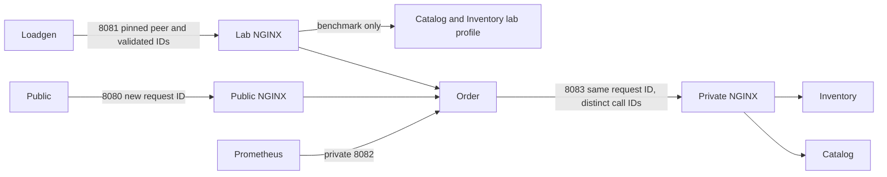

# Quote trust boundary

- Public NGINX replaces the request ID, strips lab input headers, and has no benchmark routes. The default Compose release publishes only the public listener. Prometheus binds loopback and scrapes management endpoints directly.
- Lab NGINX enables a separate listener for an exact verified LOADGEN peer. Request/client IDs are syntactic filters for synthetic data, not authentication. Do not publish the lab listener without a source allowlist. Keep the Spring `lab` profile off in the default release.
- The private listener is reachable on the application Docker network. Order forwards its existing request ID and adds the `-catalog` and `-inventory` call suffixes. It never forwards a simulated client IP. Backend and management ports have no host publication.
- Connection and body timeout, upstream errors, duplicate identity, stale metadata and stock errors must retain their HTTP contract. Quote only reads fixture data. It neither writes an Order nor changes stock.
